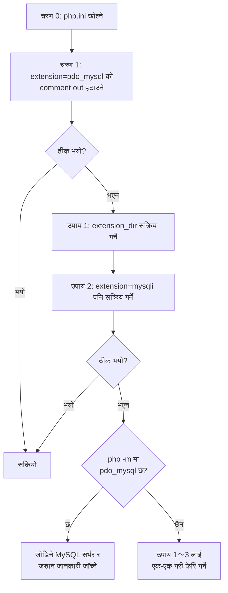

# PDO MySQL extension सक्रिय नभएमा गर्ने उपाय

> 🇯🇵 मूल प्रति (जापानी भाषामा): [PDO_MySQL接続エラー対処法.md](<../../../1年生_データ設計とアプリ開発/前期/20260723/PDO_MySQL接続エラー対処法.md>) <!-- original-ja-link -->

## सम्बन्धित त्रुटि

तल देखाइएको जस्तो त्रुटि (error) आएमा त्यसलाई समाधान गर्ने तरिका यहाँ दिइएको छ।

```
Fatal error: Uncaught PDOException: could not find driver in C:\Users\nishida\Desktop\apple\5.php:2
Stack trace:
#0 C:\Users\nishida\Desktop\apple\5.php(2): PDO->__construct('mysql:host=127....', 'root', Object(SensitiveParameterValue))
#1 {main}
  thrown in C:\Users\nishida\Desktop\apple\5.php on line 2
```

### यो त्रुटिको अर्थ

PHP बाट MySQL (डाटाबेस) मा जोडिँदा `PDO` भन्ने प्रणाली प्रयोग गरिन्छ, तर वास्तवमा MySQL सँग कुरा गर्नका लागि "ड्राइभर (driver)" भन्ने छुट्टै भाग चाहिन्छ।

`could not find driver` भनेको "त्यो ड्राइभर भेटिएन" भन्ने अर्थको त्रुटि हो। अर्थात्, **PHP ले `pdo_mysql` भन्ने extension (ड्राइभर) लोड गर्न नसकेकाले** यो त्रुटि आएको हो।

धेरैजसो अवस्थामा कारण php.ini (PHP को सेटिङ फाइल) को सेटिङमा हुन्छ। तलका चरणहरू माथिबाट क्रमैसँग प्रयास गर्नुहोस्। एउटा प्रयास गरेपछि, सधैं "सर्भर रिस्टार्ट" ([उपाय 3](#उपाय-3-सर्भरलाई-पक्का-रिस्टार्ट-गर्ने)) गरेर मात्र ब्राउजरमा जाँच्नुहोस्। सेटिङ परिवर्तन गरेकै भरमा त्यो PHP मा लागू हुँदैन।

पूरा प्रक्रिया यस्तो छ।



※ जुनसुकै चरणमा पनि, परिवर्तन गरेर सेभ गरेपछि सधैं उपाय 3 (सर्भर रिस्टार्ट) गरेर मात्र जाँच्नुहोस्।

---

## चरण 0: php.ini खोल्ने

अबदेखि php.ini भन्ने फाइल धेरै पटक सम्पादन गर्नुपर्छ। पहिले यसलाई कसरी खोल्ने हेरौं।

1. Explorer (फोल्डर) वा VS Code बाट `C:\php\php.ini` खोल्नुहोस्।
   - भेटिएन भने, टर्मिनलमा `php --ini` टाइप गर्नुहोस्। यसले प्रयोगमा रहेको php.ini को स्थान देखाउँछ।
2. अबदेखि यही php.ini भित्रको सामग्री सम्पादन गर्दै जानुहोस्।

---

## चरण 1: extension=pdo_mysql को comment out हटाउने

php.ini भित्र धेरै सुविधा (extension) हरू अन/अफ गर्ने सेटिङहरू लहरै राखिएका छन्। लाइनको सुरुमा `;` (semicolon) छ भने "त्यो लाइन निष्क्रिय (comment out) छ" भन्ने अर्थ हुन्छ।

1. php.ini खोलेको अवस्थामा `Ctrl + F` (खोज) थिच्नुहोस्, र `extension=pdo_mysql` टाइप गरेर खोज्नुहोस्।
2. तल जस्तै सुरुमा `;` भएको लाइन भेटिनुपर्छ।

   ```ini
   ;extension=pdo_mysql
   ```

3. लाइनको सुरुको `;` मात्र मेटाउनुहोस्।

   ```ini
   extension=pdo_mysql
   ```

4. `Ctrl + S` थिचेर सेभ गर्नुहोस्।
5. [उपाय 3](#उपाय-3-सर्भरलाई-पक्का-रिस्टार्ट-गर्ने) को तरिकाले सर्भर रिस्टार्ट गर्नुहोस्, र ब्राउजरमा काम गर्छ कि गर्दैन जाँच्नुहोस्।

धेरैजसो यत्तिमै ठीक हुन्छ, तर ठीक भएन भने अर्को चरणमा जानुहोस्।

---

## यहाँसम्म गर्दा पनि समाधान नभएमा

`;extension=pdo_mysql` को comment out हटाउँदा पनि समाधान भएन भने, "extension को वास्तविक फाइल (DLL फाइल) राखिएको फोल्डर कहाँ छ" भन्ने कुरा PHP ले पहिचान गर्न नसकेको हुन सक्ने सम्भावना बढी छ।

तलका उपायहरू क्रमैसँग जाँच्नुहोस्।

## उपाय 1: extension_dir को सेटिङ सक्रिय गर्ने (★सबैभन्दा धेरै देखिने कारण)

`extension=pdo_mysql` त केवल "pdo_mysql भन्ने सुविधा प्रयोग गर" भन्ने निर्देशन मात्र हो। त्यो सुविधा वास्तवमा चलाउने सामग्री (DLL फाइल) कहाँ छ भनेर PHP लाई बताउने सेटिङ `extension_dir` हो। यो ठीकसँग सेट गरिएको छैन भने, निर्देशन मात्र छ तर सामग्री भेटिँदैन भन्ने अवस्था हुन्छ।

1. `C:\php\php.ini` खोल्नुहोस्।
2. किबोर्डमा `Ctrl + F` थिचेर `extension_dir` खोज्नुहोस्।
3. तल जस्तो लाइन खोज्नुहोस् (सुरुमा `;` हुनुपर्छ)।

   ```ini
   ;extension_dir = "ext"
   ```

4. सुरुको `;` (semicolon) मेटाएर सक्रिय गर्नुहोस्।

   ```ini
   extension_dir = "ext"
   ```

5. `Ctrl + S` थिचेर सेभ गर्नुहोस्, र [उपाय 3](#उपाय-3-सर्भरलाई-पक्का-रिस्टार्ट-गर्ने) अनुसार सर्भर रिस्टार्ट गरेर जाँच्नुहोस्।

   ※यसले पनि समाधान भएन भने, `"ext"` जस्तो relative path को सट्टा पूरा path (absolute path) तोकेर हेर्नुहोस्।

   ```ini
   extension_dir = "C:\php\ext"
   ```

   यसले PHP लाई "`C:\php` फोल्डरभित्रको `ext` फोल्डर हेर है" भनेर कुनै अलमल नहुने गरी बताउँछ। बदलेपछि, फेरि सेभ गरेर सर्भर रिस्टार्ट गर्नुहोस्।

## उपाय 2: extension=mysqli पनि सँगै सक्रिय गरेर हेर्ने

`mysqli` पनि MySQL मा जोडिनका लागि प्रयोग हुने अर्को extension हो। वातावरण अनुसार, `pdo_mysql` ठीकसँग चल्नका लागि `mysqli` पनि सँगै सक्रिय हुनुपर्ने अवस्था हुन सक्छ। सावधानीका लागि यसलाई पनि सँगै सक्रिय गरौं।

1. php.ini मा `extension=mysqli` खोज्नुहोस्।
2. सुरुमा `;` छ भने मेटाउनुहोस्।

   ```ini
   extension=mysqli
   ```

3. `Ctrl + S` थिचेर सेभ गर्नुहोस्, र सर्भर रिस्टार्ट गरेर जाँच्नुहोस्।

## उपाय 3: सर्भरलाई "पक्का" रिस्टार्ट गर्ने

php.ini बदले पनि, अहिले चलिरहेको PHP सर्भरमा त्यो आफैं लागू हुँदैन। किनभने सेटिङ फाइल "सर्भर सुरु हुँदा" एक पटक मात्र पढिन्छ। त्यसैले, सेटिङ बदलेपछि सधैं सर्भरलाई एक पटक पूरै रोकेर फेरि सुरु गर्नुपर्छ।

1. VS Code को तलपट्टिको टर्मिनल (कालो स्क्रिन) खोल्नुहोस्।
2. टर्मिनलमा क्लिक गरेर `Ctrl + C` केही पटक थिच्नुहोस्, र सर्भरलाई पूरै रोक्नुहोस्। टर्मिनलमा `^C` देखिएर कमान्ड टाइप गर्न मिल्ने अवस्था (prompt) मा फर्कियो भने रोकिएको हो।
3. फेरि सर्भर सुरु गर्ने कमान्ड टाइप गर्नुहोस्।

   ```bash
   php -S localhost:8000
   ```

4. ब्राउजरमा सम्बन्धित पेज (उदाहरण: `http://localhost:8000/5.php`) रिलोड (रिफ्रेस) गर्नुहोस्।

---

## त्यसपछि पनि समाधान नभएमा जाँच्ने तरिका

"अहिले pdo_mysql लोड भएको छ कि छैन" भनेर सिधै जाँच्ने तरिका छ।

1. टर्मिनलमा तलको कमान्ड चलाउनुहोस्।

   ```bash
   php -m
   ```

   यो "अहिले PHP मा लोड भएका extension हरूको सूची" देखाउने कमान्ड हो।

2. देखिएको सूचीमा `pdo_mysql` भन्ने शब्द छ कि छैन खोज्नुहोस्।
   - **छ भने** → extension आफैं त लोड भएको छ। त्रुटि अझै आइरहेको छ भने, जोडिने MySQL सर्भर चलिरहेको छ कि छैन, र जडान जानकारी (host नाम, user नाम, पासवर्ड आदि) सही छ कि छैन जाँच्नुहोस्।
   - **छैन भने** → extension अझै लोड भएको छैन। माथिका उपाय 1〜3 एक-एक गरी पक्का फेरि प्रयास गर्नुहोस्। प्रत्येक उपायपछि सेभ गरेर सर्भर रिस्टार्ट गर्न नबिर्सनुहोस्।

<!-- nav:start -->

---

| ⬅️ पछाडि | 🗺️ समग्र नक्सा | अर्को ➡️ |
|:--|:--:|--:|
| [Todo व्यवस्थापन एप सुरु गर्ने तरिका](Todo管理アプリ起動する流れ.md) | [सामग्रीको समग्र नक्सा](../../README.md) | [07/28 टेबलहरूको सम्बन्ध・JOIN](../20260728/20260728_資料.md) |

<!-- nav:end -->
