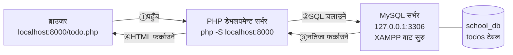
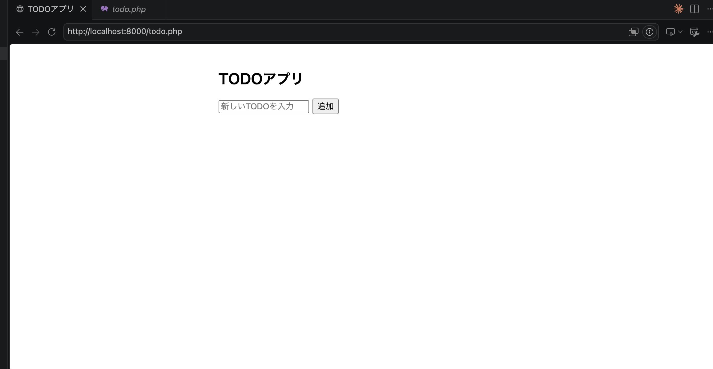
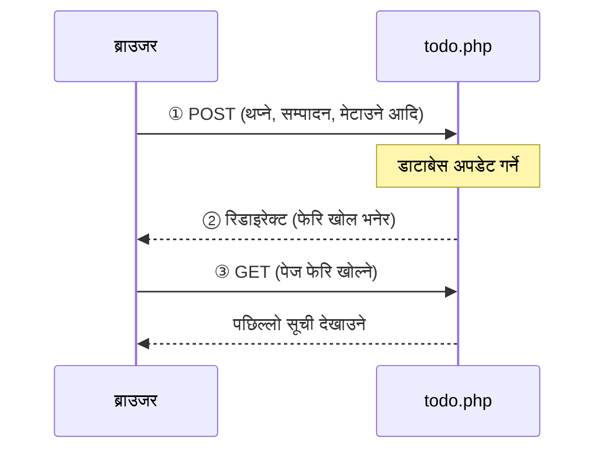

# Todo व्यवस्थापन एप सुरु गर्ने तरिका

> 🇯🇵 मूल प्रति (जापानी भाषामा): [Todo管理アプリ起動する流れ.md](<../../../1年生_データ設計とアプリ開発/前期/20260723/Todo管理アプリ起動する流れ.md>) <!-- original-ja-link -->

`todo.php` PHP + PDO प्रयोग गरेर MySQL मा जोडिने, र TODO थप्ने, सम्पादन गर्ने, पूरा भएको/नभएको बदल्ने र मेटाउने काम गर्न सकिने एप हो। यसलाई चलाउन "डाटाबेस सर्भर" र "PHP डेभलपमेन्ट सर्भर" गरी **2 वटा** सर्भर सुरु गरेर राख्नुपर्छ।

## समग्र चित्र (सर्भरहरू चलिरहेको अवस्थाको चित्र)



- **PHP डेभलपमेन्ट सर्भर**: `todo.php` (मुख्य प्रोग्राम) चलाउने जिम्मेवारी यस सर्भरको हो। यसले ब्राउजरबाट आएको पहुँच (request) स्वीकार गरेर PHP चलाउँछ।
- **MySQL सर्भर (XAMPP)**: डाटा (`school_db` को `todos` टेबल) भण्डारण गर्ने जिम्मेवारी यस सर्भरको हो। यसले PHP बाट आएको SQL चलाएर डाटा फर्काउँछ।
- यी दुई **छुट्टाछुट्टै process** हुन्, र दुवैलाई सुरु गरेर चलिरहन दिनुपर्छ (कुनै एउटा मात्र रोकियो भने पनि त्रुटि आउँछ)।

## पूर्वशर्त

- XAMPP इन्स्टल भइसकेको हुनुपर्छ
- PHP इन्स्टल भइसकेको हुनुपर्छ (`php -v` ले जाँच्नुहोस्)
- तलका कमान्डमा भएको `<प्रयोगकर्ताको नाम>` लाई आफ्नो कम्प्युटरको user नामले बदल्नुहोस्

---

## 0. todo.php लाई आफ्नो study डाइरेक्टरीमा तयार राख्ने

बाँडिएको `todo.php` लाई आफ्नो कम्प्युटरको `study` डाइरेक्टरीभित्र (उदाहरण: `study/20260723/`) कपी गर्नुहोस्।

- फाइललाई सिधै drag & drop गरेर कपी गर्ने, वा
- भित्रको सामग्री कपी गरेर, आफ्नो वातावरणमा नयाँ बनाएको `todo.php` मा पेस्ट गर्ने

जुनसुकै तरिका प्रयोग गरे पनि, `php -S` चलाउने `study` डाइरेक्टरीभित्र `todo.php` रहेको सुनिश्चित गर्नुहोस्।

---

## 1. XAMPP बाट MySQL सुरु गर्ने

XAMPP Control Panel खोल्नुहोस्, र `MySQL` को `Actions` मा `Stop` देखिएको छ (= चलिरहेको छ) कि छैन जाँच्नुहोस्। `Start` देखिएको छ भने क्लिक गरेर सुरु गर्नुहोस्।

(विस्तृत तरिकाका लागि [डाटाबेस सर्भर कसरी स्थापना गर्ने](../データベースサーバーの立て方/データベースサーバーの立て方.md) हेर्नुहोस्)

`todo.php` ले तलको जडान जानकारी प्रयोग गरेर MySQL मा जडान गर्ने भएकाले, MySQL को सेटिङ यस जानकारीसँग मिल्नुपर्छ।

```php
$pdo = new PDO(
    'mysql:host=127.0.0.1;port=3306;dbname=school_db;charset=utf8mb4',
    'root',
    '' // XAMPP/DBngin मा डिफल्ट पासवर्ड खाली हुन्छ
);
```

- होस्ट: `127.0.0.1` (आफ्नै कम्प्युटर)
- पोर्ट: `3306` (MySQL को मानक पोर्ट)
- डाटाबेसको नाम: `school_db`
- प्रयोगकर्ताको नाम: `root`　पासवर्ड: खाली

`school_db` डाटाबेस भने phpMyAdmin आदि प्रयोग गरेर पहिल्यै बनाउनुपर्छ (`todos` टेबल `todo.php` सुरु हुँदा आफैं बन्छ, त्यसैले टेबल छुट्टै हातले बनाउनुपर्दैन)।

---

## 2. PHP डेभलपमेन्ट सर्भर सुरु गर्ने

टर्मिनल खोल्नुहोस्, `todo.php` राखिएको `study` डाइरेक्टरीमा सिधै गएर, PHP को डेभलपमेन्ट सर्भर सुरु गर्नुहोस्।

```bash
cd /Users/<प्रयोगकर्ताको नाम>/Desktop/study
php -S localhost:8000
```

(विस्तृत तरिकाका लागि [PHP डेभलपमेन्ट सर्भर कसरी सुरु गर्ने](../PHP開発サーバーの立て方.md) हेर्नुहोस्)

---

## 3. ब्राउजरबाट पहुँच गर्ने

सर्भर चलिरहेकै अवस्थामा, ब्राउजरमा `todo.php` राखेको ठाउँसँग मिल्ने URL मा जानुहोस्।

```
http://localhost:8000/20260723/todo.php
```

माथिको URL कपी गरेर, ब्राउजरको address bar मा पेस्ट गरी खोल्नुहोस्।

※ `study/20260723/` भित्र राखेको अवस्थाको उदाहरण हो। वास्तविक URL लाई "`php -S` सुरु गरेको डाइरेक्टरी (`study/`) बाटको relative path" अनुसार मिलाउनुहोस्।

TODO एपको स्क्रिन देखियो भने सफलतापूर्वक सुरु भएको हो।

---

## 4. काम गर्छ कि गर्दैन जाँच्ने

### यो स्क्रिन खुल्यो भने ठीक छ!




- इनपुट बक्समा टेक्स्ट लेखेर 「追加」(थप्ने) थिच्दा → सूचीमा थपिन्छ कि
- चेकबक्समा चेक लगाउँदा → पाठमाथि काटिएको रेखा (strikethrough) देखिएर काम पूरा भएको मानिन्छ कि
- 「編集」(सम्पादन) → सामग्री बदलेर 「保存」(सेभ) गर्न सकिन्छ कि
- 「削除」(मेटाउने) → पुष्टि गर्ने संवाद (dialog) पछि मेटिन्छ कि

सबै कुरा लागू भएको अवस्थामा `index.php` (= `todo.php`) मा फर्कियो भने ठीकसँग काम गरिरहेको छ (PRG ढाँचाका कारण, काम गरेपछि पेज आफैं रिलोड हुने व्यवस्था छ)।

PRG (Post → Redirect → Get) ढाँचाको प्रक्रिया यस्तो छ।



---

## सर्भर रोक्ने

`php -S` चलाएको टर्मिनलमा `Ctrl + C` थिच्दा PHP डेभलपमेन्ट सर्भर रोकिन्छ। MySQL लाई XAMPP Control Panel को `Stop` बटनले रोक्न सकिन्छ।

---

## राम्रोसँग नचलेमा

`could not find driver` जस्ता PDO सम्बन्धी त्रुटि आएमा, [PDO_MySQL जडान त्रुटिको समाधान](./PDO_MySQL接続エラー対処法.md) हेर्नुहोस्।

<!-- nav:start -->

---

📎 यो पनि पढ्नुहोस् → [PDO_MySQL जडान त्रुटिको समाधान](PDO_MySQL接続エラー対処法.md)

| ⬅️ अघिल्लो | 🗺️ समग्र नक्सा | अर्को ➡️ |
|:--|:--:|--:|
| [07/23 अभ्यास](20260723_演習.md) | [सामग्रीको समग्र नक्सा](../../README.md) | [07/28 टेबलहरूको सम्बन्ध・JOIN](../20260728/20260728_資料.md) |

<!-- nav:end -->
