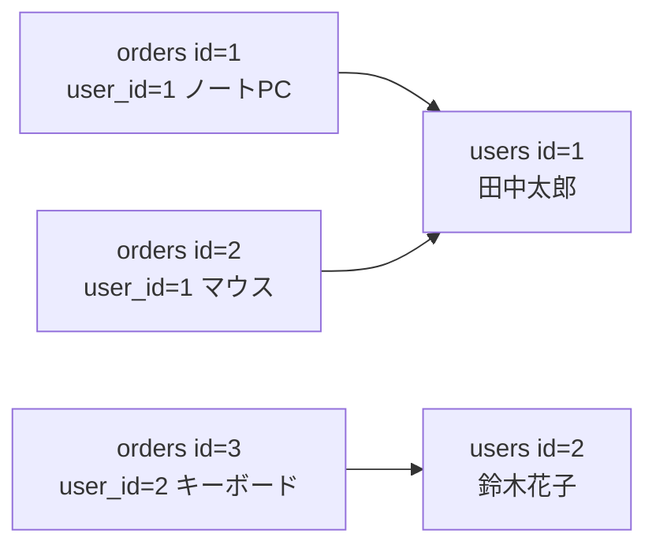
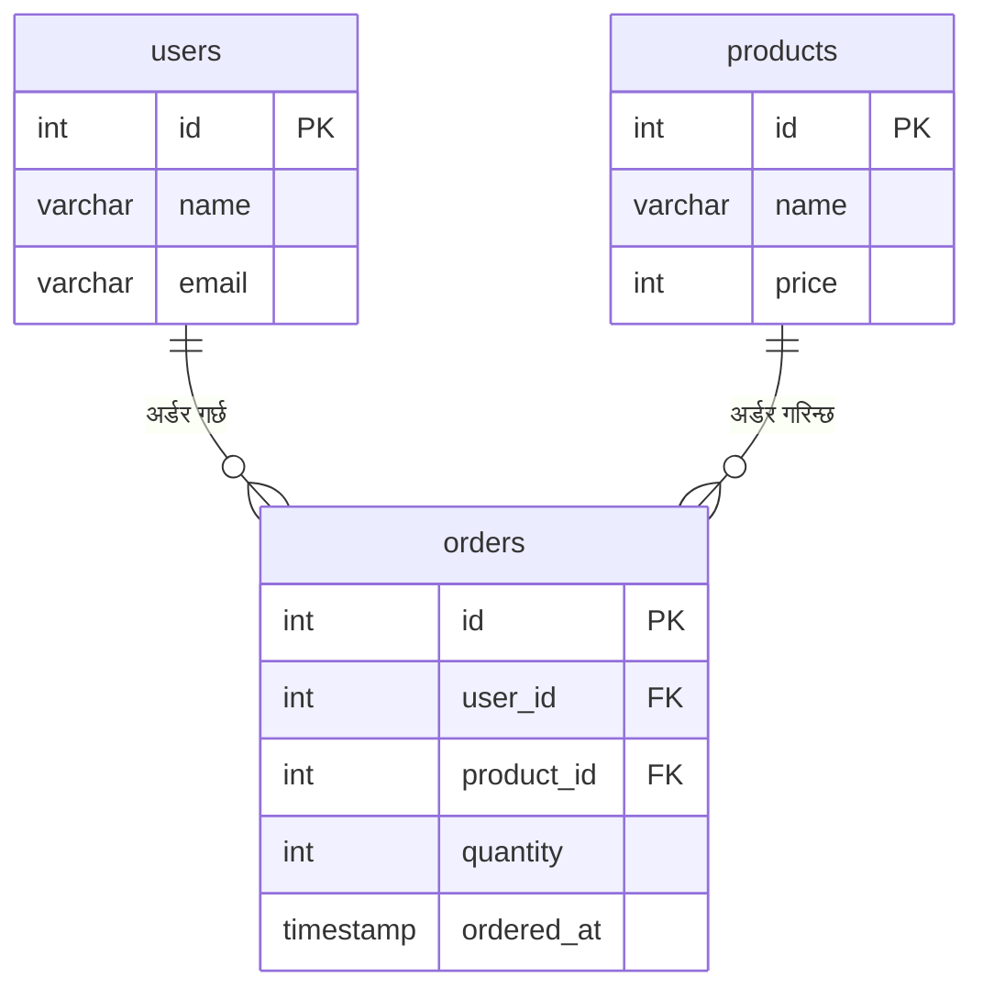
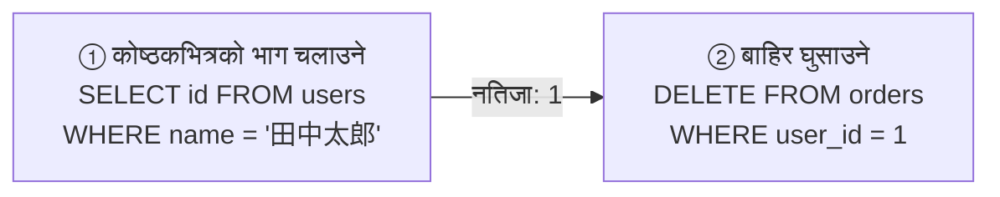

# कक्षा 09｜टेबलहरूको सम्बन्ध・JOIN — धेरै टेबलका डाटा मिलाउने

> 🇯🇵 मूल प्रति (जापानी भाषामा): [20260728_資料.md](<../../../1年生_データ設計とアプリ開発/前期/20260728/20260728_資料.md>) <!-- original-ja-link -->

## आजको लक्ष्य
- टेबल किन छुट्याइन्छ (नर्मलाइजेसन) भनेर व्याख्या गर्न सक्ने
- फरेन कीको अवधारणा बुझेको हुने
- INNER JOIN / LEFT JOIN ले टेबलहरू जोड्न सक्ने

---

[रिलेसनल डाटाबेसबारे](../20260721/リレーショナルデータベース入門.md)

## 1. टेबलहरू किन छुट्याइन्छ

नराम्रो उदाहरण: सबै कुरा एउटै टेबलमा कोचेर राख्ने

```
orders टेबल (नराम्रो उदाहरण)
id │ user_name │ user_email         │ product_name │ price
───┼───────────┼────────────────────┼──────────────┼───────
 1 │ 田中太郎  │ tanaka@example.com │ ノートPC     │ 98000
 2 │ 田中太郎  │ tanaka@example.com │ マウス       │  3200
 3 │ 鈴木花子  │ suzuki@example.com │ キーボード   │  8500
```

**समस्याहरू:**
- 田中太郎 को जानकारी 2 वटा row मा दोहोरिएको छ (इमेल बदलियो भने सबै row अपडेट गर्नुपर्छ)
- डाटा एकअर्कासँग नमिल्ने (असंगत) हुन सजिलो हुन्छ

**समाधान: टेबल छुट्याएर फरेन कीले जोड्ने (नर्मलाइजेसन)**

---

## 2. फरेन की (Foreign Key)

**users टेबल**

| id | name | email |
|----|------|-------|
| 1 | 田中太郎 | tanaka@... |
| 2 | 鈴木花子 | suzuki@... |

**orders टेबल**

| id | user_id | product | price |
|----|---------|---------|-------|
| 1 | 1 | ノートPC | 98000 |
| 2 | 1 | マウス | 3200 |
| 3 | 2 | キーボード | 8500 |

`orders.user_id` ले `users.id` लाई रेफर गरिरहेको छ। यही नै "फरेन की (Foreign Key)" हो।



---

## 3. टेबल बनाउने र फरेन की सेट गर्ने

```sql
USE school_db;

-- users टेबल
CREATE TABLE users (
    id    INT AUTO_INCREMENT PRIMARY KEY,
    name  VARCHAR(100) NOT NULL,
    email VARCHAR(255) NOT NULL UNIQUE
);

-- products टेबल
CREATE TABLE products (
    id    INT AUTO_INCREMENT PRIMARY KEY,
    name  VARCHAR(100) NOT NULL,
    price INT NOT NULL
);

-- orders टेबल (फरेन कीले जोड्ने)
CREATE TABLE orders (
    id         INT AUTO_INCREMENT PRIMARY KEY,
    user_id    INT NOT NULL,
    product_id INT NOT NULL,
    quantity   INT NOT NULL DEFAULT 1,
    ordered_at TIMESTAMP DEFAULT CURRENT_TIMESTAMP,
    
    -- फरेन की constraint (referential integrity कायम राख्ने)
    FOREIGN KEY (user_id)    REFERENCES users(id),
    FOREIGN KEY (product_id) REFERENCES products(id)
);

-- टेस्ट डाटा
INSERT INTO users (name, email) VALUES
    ('田中太郎', 'tanaka@example.com'),
    ('鈴木花子', 'suzuki@example.com'),
    ('山田次郎', 'yamada@example.com');

INSERT INTO products (name, price) VALUES
    ('ノートPC', 98000),
    ('マウス', 3200),
    ('キーボード', 8500);

INSERT INTO orders (user_id, product_id, quantity) VALUES
    (1, 1, 1),  -- 田中 ले ノートPC (ल्यापटप) 1 वटा
    (1, 2, 2),  -- 田中 ले マウス (माउस) 2 वटा
    (2, 3, 1),  -- 鈴木 ले キーボード (किबोर्ड) 1 वटा
    (3, 1, 1),  -- 山田 ले ノートPC (ल्यापटप) 1 वटा
    (2, 1, 1);  -- 鈴木 ले ノートPC (ल्यापटप) 1 वटा
```

3 वटा टेबलको सम्बन्धलाई चित्रमा देखाउँदा यस्तो हुन्छ। orders ले users र products दुवैलाई फरेन कीले रेफर गरिरहेको छ।



---

[INNER JOIN र LEFT JOIN को फरकबारे](./JOIN入門.md)

## 4. INNER JOIN — दुवैमा भएको डाटा मात्र जोड्ने

```sql
-- orders मा users को जानकारी जोड्ने
SELECT
    orders.id,
    users.name    AS ユーザー名,
    users.email,
    orders.quantity
FROM orders
INNER JOIN users ON orders.user_id = users.id;

-- 3 वटा टेबल जोड्ने (orders + users + products)
SELECT
    orders.id,
    users.name      AS ユーザー名,
    products.name   AS 商品名,
    products.price  AS 単価,
    orders.quantity AS 数量,
    products.price * orders.quantity AS 合計金額
FROM orders
INNER JOIN users    ON orders.user_id    = users.id
INNER JOIN products ON orders.product_id = products.id
ORDER BY orders.id;
```

---

## 5. LEFT JOIN — बायाँ टेबलका सबै row समावेश गर्ने

```sql
-- अहिलेसम्म अर्डर नगरेका user हरू पनि समावेश गरेर देखाउन चाहेमा
SELECT
    users.name,
    COUNT(orders.id) AS 注文数
FROM users
LEFT JOIN orders ON users.id = orders.user_id
GROUP BY users.id, users.name;

-- अर्डर 0 भएका user हरू पनि देखिन्छन्
-- INNER JOIN गर्दा अर्डर भएका user हरू मात्र आउँछन्
```

### 5-1. प्रयोग: अहिलेसम्म अर्डर नगरेका user "मात्र" खोज्ने

LEFT JOIN ले जोड्दा, दायाँपट्टिको (orders) मा मिल्ने row छैन भने, ती column `NULL` हुन्छन्। यो गुण प्रयोग गरेर "नमिलेका row मात्र" छान्न सकिन्छ।

```sql
SELECT users.name, users.email
FROM users
LEFT JOIN orders ON users.id = orders.user_id
WHERE orders.id IS NULL;
```

**सोच्ने तरिका:**
1. `LEFT JOIN` ले users सबैलाई राख्ने (orders नभएका मानिसका column `NULL` हुन्छन्)
2. `WHERE orders.id IS NULL` ले "orders सँग नमिलेका row" मात्र छान्ने
   → अर्थात् "एक पटक पनि अर्डर नगरेका मानिस" मात्र बाँकी रहन्छन्

`INNER JOIN` मा यो ढाँचा प्रयोग गर्न सकिँदैन (नमिल्ने row त नतिजामै आउँदैनन्)। "LEFT JOIN + `IS NULL`" लाई सँगै प्रयोग गरिने चर्चित ढाँचाको रूपमा सम्झिराख्दा काम लाग्छ।

---

## 6. aggregation (समूहगत गणना) सँग मिलाएर प्रयोग गर्ने

```sql
-- user अनुसार किनेको कुल रकम
SELECT
    users.name AS ユーザー名,
    COUNT(orders.id) AS 注文件数,
    SUM(products.price * orders.quantity) AS 合計金額
FROM users
INNER JOIN orders    ON users.id          = orders.user_id
INNER JOIN products  ON orders.product_id = products.id
GROUP BY users.id, users.name
ORDER BY 合計金額 DESC;
```

---

## 7. HAVING — गणना गरेको "पछि" छान्ने

`WHERE` ले गणना गर्नु **अघि** का row छान्छ, तर `HAVING` ले `GROUP BY` ले गणना गरेको **पछि** को नतिजा छान्छ।

```sql
-- कुल रकम 100000 येन वा सोभन्दा बढी भएका user मात्र देखाउने
SELECT
    users.name AS ユーザー名,
    SUM(products.price * orders.quantity) AS 合計金額
FROM users
INNER JOIN orders   ON users.id          = orders.user_id
INNER JOIN products ON orders.product_id = products.id
GROUP BY users.id, users.name
HAVING SUM(products.price * orders.quantity) >= 100000;
```

**WHERE र HAVING को फरक:**

| | कहिले छान्छ | के प्रयोग गर्न सकिन्छ |
|---|---|---|
| `WHERE` | `GROUP BY` ले गणना गर्नु **अघि** | हरेक row को मूल column (`orders.quantity` आदि) |
| `HAVING` | `GROUP BY` ले गणना गरेको **पछि** | `SUM()` `COUNT()` जस्ता गणनाका नतिजा |

`SELECT ... FROM ... WHERE ... GROUP BY ... HAVING ... ORDER BY` को क्रममा लेखिन्छ, तर वास्तवमा प्रोसेस हुने क्रम `WHERE`→`GROUP BY`→`HAVING`→`ORDER BY` हो। "`HAVING SUM(...) >= 100000` ठीक छ, `WHERE SUM(...) >= 100000` मिल्दैन (गणना अघि भएकाले SUM अझै बनेकै हुँदैन)" भनेर सम्झिराख्नुहोस्।

---

## 8. सबक्वेरी — SELECT भित्र SELECT लेख्ने

`INSERT` वा `DELETE` गर्दा, लक्षित `id` थाहा नहुन सक्छ। त्यस्तो बेला `SELECT` को नतिजालाई सिधै शर्तको रूपमा प्रयोग गर्ने **सबक्वेरी (subquery)** काम लाग्छ।

```sql
-- उदाहरण: "田中太郎" को id लाई शर्तमा प्रयोग गर्न चाहन्छौं, तर id कति नम्बर हो थाहा छैन

-- ① नराम्रो उदाहरण त होइन, तर 2 चरणमा छुट्टिन्छ
SELECT id FROM users WHERE name = '田中太郎';  -- नतिजा: 1
DELETE FROM orders WHERE user_id = 1;          -- जाँचेको 1 हातैले टाइप गर्ने

-- ② सबक्वेरी प्रयोग गर्दा एउटै statement मा लेख्न सकिन्छ
DELETE FROM orders
WHERE user_id = (SELECT id FROM users WHERE name = '田中太郎');
```

`( )` भित्रको `SELECT` पहिले चलेर एउटा मान (यहाँ `id`) बन्छ, र त्यो बाहिरको `WHERE user_id = यहाँ` मा घुसाइन्छ भन्ने कल्पना गर्नुहोस्। "कोष्ठकभित्रको भाग पहिले पढ्ने" भनेर सोच्दा बुझ्न सजिलो हुन्छ।



```sql
-- INSERT मा पनि यसरी नै प्रयोग गर्न सकिने उदाहरण
INSERT INTO orders (user_id, product_id, quantity)
VALUES (
    (SELECT id FROM users WHERE name = '田中太郎'),
    (SELECT id FROM products WHERE name = 'USBハブ'),
    3
);
```

---

## सारांश

| अवधारणा | व्याख्या |
|------|------|
| फरेन की | अर्को टेबलको प्राइमरी कीलाई रेफर गर्ने column |
| INNER JOIN | दुवै टेबलमा भएको डाटा मात्र जोड्ने |
| LEFT JOIN | बायाँ टेबलका सबै row + दायाँ टेबलका मिल्ने row जोड्ने |
| `ON टेबलA.col = टेबलB.col` | जोड्ने शर्त |
| LEFT JOIN + `WHERE ... IS NULL` | दायाँ टेबलसँग नमिल्ने row मात्र खोज्ने चर्चित ढाँचा |
| `WHERE` | गणना अघिका row छान्ने |
| `HAVING` | `GROUP BY` ले गणना गरेपछिको नतिजा छान्ने |
| सबक्वेरी `(SELECT ...)` | `SELECT` को नतिजालाई अर्को SQL को शर्त वा मानको रूपमा घुसाउने |

---

## अर्को कक्षा (कक्षा 10) को झलक

SQL अभ्यासको रूपमा, अर्डर व्यवस्थापन डाटाबेसलाई आफैं चलाउनेछौं।  
SELECT / INSERT / UPDATE / DELETE / JOIN मिलाएर व्यावहारिक प्रश्नहरू हल गर्नेछौं।

<!-- nav:start -->

---

📎 यो पनि पढ्नुहोस् → [JOIN परिचय](JOIN入門.md)

| ⬅️ अघिल्लो | 🗺️ समग्र नक्सा | अर्को ➡️ |
|:--|:--:|--:|
| [Todo व्यवस्थापन एप सुरु गर्ने तरिका](../20260723/Todo管理アプリ起動する流れ.md) | [सामग्रीको समग्र नक्सा](../../README.md) | [07/28 SQL अभ्यास](20260728_演習.md) |

<!-- nav:end -->
