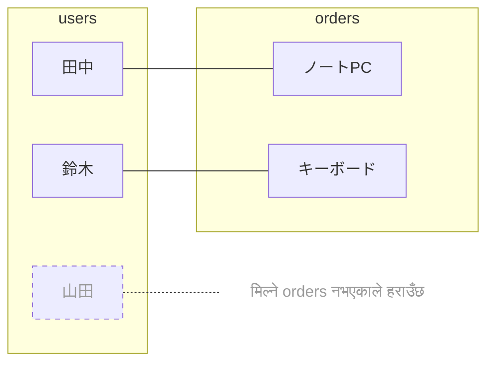
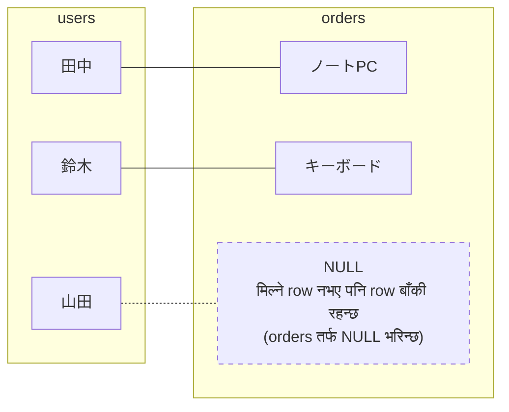

> 🇯🇵 मूल प्रति (जापानी भाषामा): [JOIN入門.md](<../../../1年生_データ設計とアプリ開発/前期/20260728/JOIN入門.md>) <!-- original-ja-link -->

## यो लेखबाट के थाहा हुन्छ

- INNER JOIN ले "दुवै टेबलमा भएको डाटा मात्र" जोड्छ
- LEFT JOIN ले "बायाँ टेबलका सबै row + दायाँ टेबलका मिल्ने row" जोड्छ
- एउटै 2 वटा टेबल र एउटै जोड्ने शर्त भए पनि, JOIN को प्रकार अनुसार नतिजाको row संख्या फरक पर्छ

## प्रयोग गरिने 2 वटा टेबल

`users` (user) र `orders` (अर्डर) बाट व्याख्या गरौं। मुख्य कुरा के हो भने, **山田次郎 ले अहिलेसम्म एक पटक पनि अर्डर गरेका छैनन्**।

### 🧑 users टेबल

| id | name |
|----|------|
| 1  | 田中太郎 |
| 2  | 鈴木花子 |
| 3  | 山田次郎 |

### 🛒 orders टेबल

| id | user_id | product |
|----|---------|---------|
| 1  | 1       | ノートPC |
| 2  | 2       | キーボード |

`orders.user_id` ले `users.id` लाई रेफर गरिरहेको छ (फरेन की)। 山田次郎 (id=3) लाई रेफर गर्ने row `orders` मा एउटा पनि छैन।

## INNER JOIN: दुवैमा भएको डाटा मात्र जोड्ने

```sql
SELECT users.name, orders.product
FROM users
INNER JOIN orders ON users.id = orders.user_id;
```

**नतिजा:**

| name | product |
|------|---------|
| 田中太郎 | ノートPC |
| 鈴木花子 | キーボード |

INNER JOIN को चित्र (जोडिएका जोडीहरू मात्र नतिजामा देखिन्छन्)



山田次郎 सँग `orders` मा मिल्ने row एउटा पनि नभएकाले, **नतिजाबाट हराउँछन्**। "दुवै टेबलमा भएको डाटा मात्र जोड्ने" भनेको यही हो।

## LEFT JOIN: बायाँ टेबलका सबै row + दायाँ टेबलका मिल्ने row जोड्ने

```sql
SELECT users.name, orders.product
FROM users
LEFT JOIN orders ON users.id = orders.user_id;
```

**नतिजा:**

| name | product |
|------|---------|
| 田中太郎 | ノートPC |
| 鈴木花子 | キーボード |
| 山田次郎 | NULL    |

LEFT JOIN को चित्र (बायाँ टेबलका सबैलाई राख्ने)



`FROM users LEFT JOIN orders` मा **FROM तर्फ (बायाँ) लेखिएको users आधार** बन्छ। 山田次郎 को अर्डर नभए पनि row को रूपमा बाँकी रहन्छन्, र `orders` तर्फका column `NULL` (केही छैन) ले भरिन्छन्।

## छुट्याउने तरिका

- **`FROM A LEFT JOIN B`** → **A बायाँ हो**, A का सबै row सधैं बाँकी रहन्छन्
- नमिल्ने row आयो भने, दायाँ (B) का column आफैं `NULL` हुन्छन्
- `INNER JOIN` मा यस्तो "सबै राख्ने" व्यवहार हुँदैन, मिलेका row मात्र बाँकी रहन्छन्

## कुन प्रयोग गर्ने

| गर्न चाहेको काम | प्रयोग गर्ने JOIN |
|---|---|
| अर्डर भएका मानिसको डाटा मात्र हेर्न चाहेमा | `INNER JOIN` |
| अर्डर 0 भएका मानिससहित सबैको सूची बनाउन चाहेमा (उदाहरण: अर्डर नगरेकामध्ये जानकारीमूलक इमेल पठाउने व्यक्तिहरू खोज्दा) | `LEFT JOIN` |
| user अनुसार अर्डर संख्या गन्न चाहेमा (0 भएकालाई पनि 0 भनेर देखाउन चाहेमा) | `LEFT JOIN` + `COUNT` |

तेस्रो उदाहरण नै `20260728_資料.md` को "5. LEFT JOIN" मा देखाइएको, अर्डर 0 भएका user पनि देखाउने SQL हो। `INNER JOIN` ले उही काम गर्दा, 山田次郎 जस्ता अर्डर नगरेका user नतिजामै देखिँदैनन्।

## सारांश

- `INNER JOIN` ले "दुवै टेबलमा भएको डाटा मात्र" जोड्छ → नमिल्ने row हराउँछन्
- `LEFT JOIN` ले "`FROM` को बायाँ टेबलका सबै row + दायाँ टेबलका मिल्ने row" जोड्छ → नमिले पनि बायाँ टेबलका row बाँकी रहन्छन्, र दायाँतर्फ `NULL` हुन्छ
- "सबैलाई/सबै डाटा नछुटाई हेर्न चाहेमा" LEFT JOIN र "दुवैमा भएको डाटा मात्र भए पुग्छ" भने INNER JOIN प्रयोग गर्ने भनेर सम्झनुहोस्

<!-- nav:start -->

---

| ⬅️ पछाडि | 🗺️ समग्र नक्सा | अर्को ➡️ |
|:--|:--:|--:|
| [07/28 टेबलहरूको सम्बन्ध・JOIN](20260728_資料.md) | [सामग्रीको समग्र नक्सा](../../README.md) | [07/28 SQL अभ्यास](20260728_演習.md) |

<!-- nav:end -->
