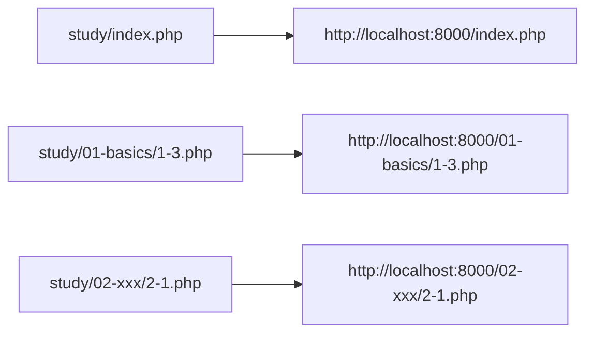

# PHP डेभलपमेन्ट सर्भर कसरी सुरु गर्ने

> 🇯🇵 मूल प्रति (जापानी भाषामा): [PHP開発サーバーの立て方.md](<../../1年生_データ設計とアプリ開発/前期/PHP開発サーバーの立て方.md>) <!-- original-ja-link -->

PHP फाइललाई ब्राउजरमा सिधै खोल्दा चल्दैन (source जस्ताको तस्तै देखिन्छ वा डाउनलोड हुन्छ)।
PHP सर्भरमा व्याख्या हुने (चल्ने) भाषा भएकाले, सधैं `php -S` जस्ता कमान्डबाट सुरु गरिएको सर्भरमार्फत पहुँच गर्नुपर्छ।

## पूर्वशर्त

- PHP इन्स्टल भइसकेको हुनुपर्छ (`php -v` ले जाँच्नुहोस्)
- यहाँ `php` मा भित्रै भएको डेभलपमेन्ट सर्भर प्रयोग गरिन्छ (production मा चलाउन उपयुक्त छैन)
- तलका कमान्डमा भएको `<प्रयोगकर्ताको नाम>` लाई आफ्नो कम्प्युटरको user नामले बदल्नुहोस् (उदाहरण: `taro`, `hanako` आदि। Mac मा `whoami` कमान्डले जाँच्न सकिन्छ)

## तरिका 1: study डाइरेक्टरीमै सुरु गर्ने

```bash
cd /Users/<प्रयोगकर्ताको नाम>/Desktop/study
php -S localhost:8000
```

`cd` (change directory) टर्मिनलमा हाल रहेको स्थान (current directory) परिवर्तन गर्ने कमान्ड हो।
`cd /Users/<प्रयोगकर्ताको नाम>/Desktop/study` प्रयोग गरेर `study` डाइरेक्टरीमा गएपछि `php -S` चलाउँदा,
`study` सर्भर सुरु गरिएको स्थान अर्थात् वेबको root बन्छ।

`php -S` चलाएको डाइरेक्टरी नै "वेबको root (`/`)" बन्छ।
`study/` मै `contact.php` भएकाले, URL सिधै यस्तो हुन्छ:

```
http://localhost:8000/contact.php
http://localhost:8000/1-3.php
http://localhost:8000/index.php
```

## अध्याय अनुसारको डाइरेक्टरी संरचनामा पहुँच गर्ने

अभ्यास बढ्दै गएपछि, अध्याय अनुसार sub-directory बनाएर व्यवस्थित गर्नुहोस् (उदाहरण: `01-basics/`)।

```
study/
  index.php
  contact.php
  01-basics/
    1-1.php
    1-2.php
    1-3.php
  02-xxx/
    2-1.php
```

सर्भर भने पहिलेकै जस्तो **study डाइरेक्टरीमै** सुरु गर्नुहोस् (सुरु गर्ने ठाउँ नबदल्नुहोस्)।

```bash
cd /Users/<प्रयोगकर्ताको नाम>/Desktop/study
php -S localhost:8000
```

सुरु गरेको डाइरेक्टरी वेबको root बन्ने भएकाले, sub-directory मा राखेका फाइलका लागि
**URL मा त्यो डाइरेक्टरीको नाम पनि समावेश गर्नुपर्छ**:

```
http://localhost:8000/index.php
http://localhost:8000/01-basics/1-3.php
http://localhost:8000/02-xxx/2-1.php
```

अर्थात् "फाइल राखेको path" = "URL को path" (`study/` बाटको relative path) सिधै मेल खान्छ।



## सर्भर रोक्ने

सर्भर सुरु गरेको टर्मिनलमा `Ctrl + C` थिच्नुहोस्।

## पोर्ट नम्बरबारे

`8000` को ठाउँमा, खाली (प्रयोगमा नरहेको) छ भने जुनसुकै नम्बर तोक्न सकिन्छ (उदाहरण: `php -S localhost:8080`)।

<!-- nav:start -->

---

| ⬅️ पछाडि | 🗺️ समग्र नक्सा | अर्को ➡️ |
|:--|:--:|--:|
| [06/30 PHP परिचय](20260630/20260630_資料.md) | [सामग्रीको समग्र नक्सा](../README.md) | [06/30 अभ्यास](20260630/20260630_演習.md) |

<!-- nav:end -->
