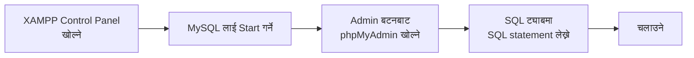
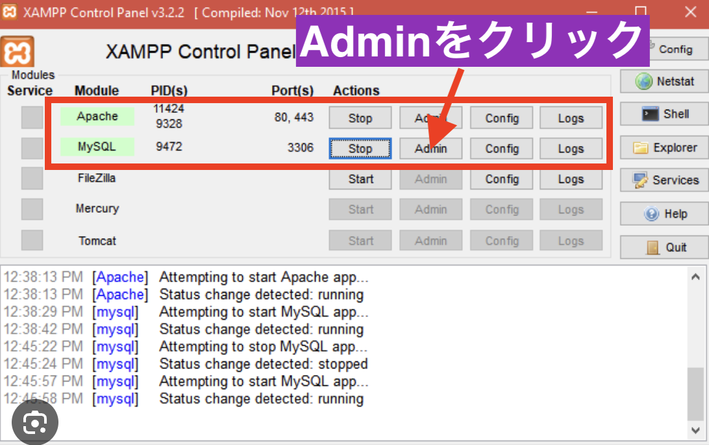
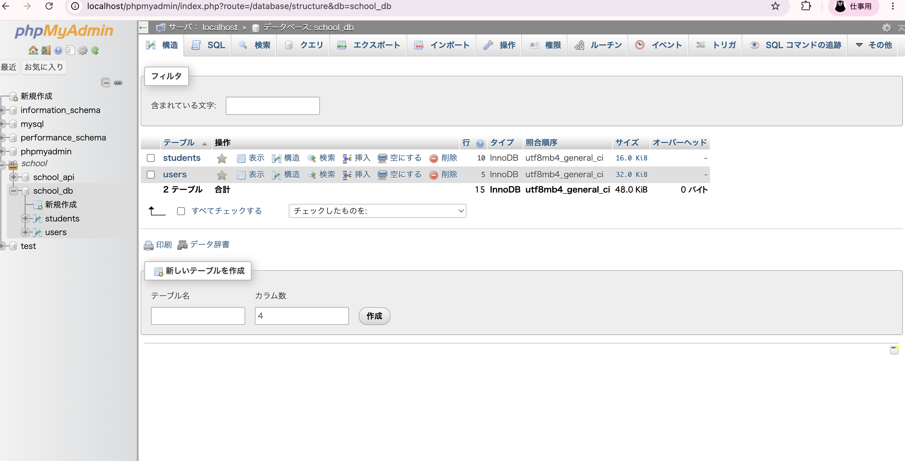
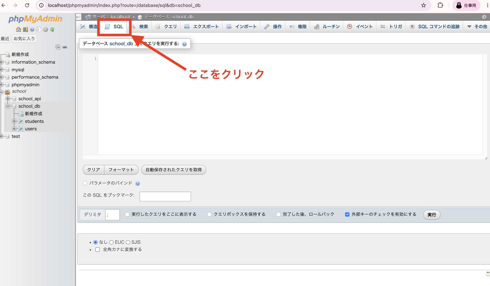

# डाटाबेस सर्भर कसरी स्थापना गर्ने (XAMPP प्रयोग गरेर)

> 🇯🇵 मूल प्रति (जापानी भाषामा): [データベースサーバーの立て方.md](<../../../1年生_データ設計とアプリ開発/前期/データベースサーバーの立て方/データベースサーバーの立て方.md>) <!-- original-ja-link -->

## यो लेखबाट के थाहा हुन्छ

- XAMPP ले के-के सुरु गर्छ
- phpMyAdmin (डाटाबेसको व्यवस्थापन स्क्रिन) कसरी खोल्ने
- phpMyAdmin मा SQL statement कसरी चलाउने

पूरा प्रक्रिया यस्तो छ।

## 1. XAMPP भनेको के हो

XAMPP (ज्याम्प) वेब एप चलाउन चाहिने तलका 2 वटा कुरा कम्प्युटरमा सजिलै इन्स्टल गर्न सकिने सफ्टवेयर हो।

- **Apache**: वेब पेज देखाउनका लागि प्रयोग हुने वेब सर्भर
- **MySQL**: डाटा भण्डारण गर्न प्रयोग हुने डाटाबेस सर्भर

एप बनाउँदा "डाटा राख्ने ठाउँ (डाटाबेस)" चाहिने भएकाले, पहिले यो MySQL सुरु गरेर राख्नुपर्छ।

## 2. XAMPP सुरु गरेर, काम गर्छ कि गर्दैन जाँच्ने

XAMPP को एप (XAMPP Control Panel) खोल्नुहोस्।

`Apache` र `MySQL` को row को `Actions` मा `Stop` देखिएको छ भने, पहिल्यै सुरु भइसकेको अवस्था हो। यदि `Start` देखिएको छ भने सुरु भएको छैन, त्यसैले त्यो बटन क्लिक गरेर सुरु गर्नुहोस्।

## 3. phpMyAdmin (व्यवस्थापन स्क्रिन) खोल्ने

MySQL को row मा भएको `Admin` बटन क्लिक गर्नुहोस्।

त्यसपछि, ब्राउजरमा **phpMyAdmin** भन्ने स्क्रिन खुल्छ। phpMyAdmin भनेको MySQL मा राखिएको डाटा स्क्रिनमै हेर्न र सम्पादन गर्न सकिने व्यवस्थापन टुल हो। यहाँ, बनाइसकिएको डाटाबेस (उदाहरण: `school_db`) भित्रका टेबलहरू (`students`, `users` आदि) को सूची हेर्न सकिन्छ।

## 4. SQL statement चलाउने

टेबल बनाउने वा डाटा दर्ता/परिवर्तन गर्ने काम SQL statement बाट सिधै गर्न चाहेमा, स्क्रिनको माथिपट्टि भएको `SQL` ट्याब क्लिक गर्नुहोस्।

ट्याब खोलेपछि SQL statement लेख्न मिल्ने इनपुट बक्स देखिन्छ। त्यहाँ SQL statement लेखेर 「実行」(Go) बटन थिच्नुभयो भने, त्यो SQL statement डाटाबेसमा लागू हुन्छ।

## सारांश

- XAMPP भनेको Apache (वेब सर्भर) र MySQL (डाटाबेस) लाई सँगै चलाउने टुल हो
- MySQL को `Admin` बाट phpMyAdmin भन्ने डाटाबेस व्यवस्थापन स्क्रिन खोल्न सकिन्छ
- phpMyAdmin को `SQL` ट्याबबाट SQL statement सिधै चलाउन सकिन्छ

<!-- nav:start -->

---

| ⬅️ पछाडि | 🗺️ समग्र नक्सा | अर्को ➡️ |
|:--|:--:|--:|
| [07/21 DB किन चाहिन्छ](../20260721/20260721_資料.md) | [सामग्रीको समग्र नक्सा](../../README.md) | [07/21 SQL का आधारभूत कुराहरू ① (SELECT)](../20260721/20260721_資料_2.md) |

<!-- nav:end -->
