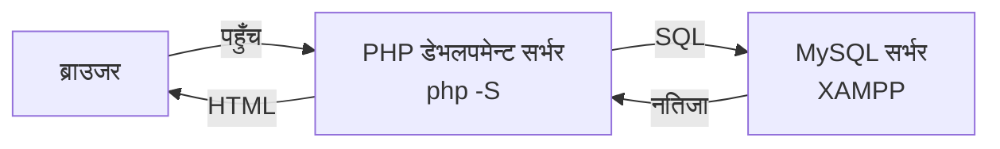
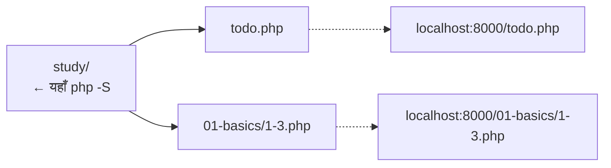
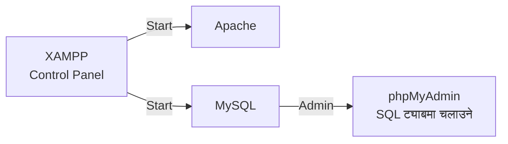
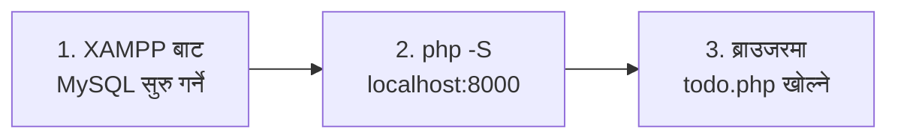

# पहिलो सेमेस्टरको पुनरावलोकन (दोहोर्‍याइ)

> 🇯🇵 मूल प्रति (जापानी भाषामा): [20261001_復習.md](<../../../1年生_データ設計とアプリ開発/後期/20261001/20261001_復習.md>) <!-- original-ja-link -->

दोस्रो सेमेस्टर सुरु हुनुअघि, पहिलो सेमेस्टरमा गरेको "एप चलाउनका लागि गर्ने तयारी" सम्झिऔं।
वेब एप चलाउन **2 वटा सर्भर** चाहिन्थ्यो।



- **PHP डेभलपमेन्ट सर्भर**: PHP को प्रोग्राम चलाउने जिम्मा
- **MySQL सर्भर**: डाटा भण्डारण गर्ने जिम्मा

**कुनै एउटा मात्र रोकिए पनि, एप चल्दैन।**

---

## 1. PHP डेभलपमेन्ट सर्भर

PHP सर्भर तर्फ चल्ने भाषा भएकाले, `.php` फाइललाई ब्राउजरमा सिधै खोल्दा चल्दैन।
त्यसैले, PHP भित्रै भएको डेभलपमेन्ट सर्भर सुरु गरेका थियौं।

Windows मा **PowerShell** (Start मेनुमा "PowerShell" खोज्नुहोस्) मा चलाउनुहोस्।

```powershell
cd C:\Users\<प्रयोगकर्ताको नाम>\Desktop\study
php -S localhost:8000
```

> **`php` भेटिएन भनेर आयो भने**
> XAMPP मा भएको PHP को पथ निर्दिष्ट गरेर सुरु गर्नुहोस्।
>
> ```powershell
> C:\xampp\php\php.exe -S localhost:8000
> ```

`php -S` चलाएको फोल्डर नै URL को `/` (root) बन्छ।
फोल्डरभित्र भएका फाइलमा पहुँच गर्दा, URL मा पनि त्यो फोल्डरको नाम जोड्नुपर्छ।



रोक्दा, सुरु गरेको PowerShell मा `Ctrl + C` थिच्नुहोस्।

विस्तृत जानकारी → [PHP डेभलपमेन्ट सर्भर कसरी सुरु गर्ने](../../前期/PHP開発サーバーの立て方.md)

---

## 2. XAMPP (MySQL)

डाटा राख्ने ठाउँको रूपमा, XAMPP बाट MySQL सुरु गरेका थियौं।
XAMPP Control Panel को `Start` बटन थिचेर, देखिने अक्षर `Stop` मा बदलियो भने चलिरहेको छ।



MySQL को row को `Admin` बटन थिच्दा, डाटाबेसको व्यवस्थापन स्क्रिन (phpMyAdmin) खुल्छ।
`SQL` ट्याबबाट SQL statement सिधै चलाउन सकिन्थ्यो।

विस्तृत जानकारी → [डाटाबेस सर्भर कसरी स्थापना गर्ने (XAMPP संस्करण)](../../前期/データベースサーバーの立て方/データベースサーバーの立て方.md)

---

## 3. एप चलाउने क्रम

PHP बाट PDO प्रयोग गरेर MySQL मा जोडिई, Todo व्यवस्थापन एप (`todo.php`) चलाएका थियौं।
तलको क्रममा सुरु गर्नुहोस्।



विस्तृत जानकारी → [Todo व्यवस्थापन एप सुरु गर्ने तरिका](../../前期/20260723/Todo管理アプリ起動する流れ.md)

<!-- nav:start -->

---

| ⬅️ अघिल्लो | 🗺️ समग्र नक्सा | अर्को ➡️ |
|:--|:--:|--:|
| [07/28 SQL अभ्यास](../../前期/20260728/20260728_演習.md) | [सामग्रीको समग्र नक्सा](../../README.md) | [10/01 सोर्स कन्ट्रोलको सुरुवात](20261001_資料_1.md) |

<!-- nav:end -->
