# सोर्स कन्ट्रोलको सुरुवात — SourceTree र GitHub प्रयोग गरेर कोड व्यवस्थापन

> 🇯🇵 मूल प्रति (जापानी भाषामा): [20261001_資料_1.md](<../../../1年生_データ設計とアプリ開発/後期/20261001/20261001_資料_1.md>) <!-- original-ja-link -->

## आजको लक्ष्य
- सोर्स कन्ट्रोल किन चाहिन्छ भन्ने बुझ्ने
- SourceTree मा commit, push र pull गर्न सक्ने

[पहिलो सेमेस्टरको पुनरावलोकन](./20261001_復習.md)

---

## 1. सोर्स कन्ट्रोल किन चाहिन्छ?

तपाईंलाई कहिल्यै यस्तो भएको छ?

```
study/
  todo.php
  todo_コピー.php
  todo_動いてたやつ.php
  todo_最新2.php   ← कुन चाहिँ साँच्चै नयाँ हो?
```

फाइल कपी गरेर राख्ने तरिकामा कुन नयाँ हो, कहाँ सच्याइएको हो भन्ने थाहा पाउन गाह्रो हुन्छ।
कम्प्युटर बिग्रियो भने त सबै हराउँछ।

Git प्रयोग गर्दा गेममा जस्तै **सेभ पोइन्ट** राख्न सकिन्छ।
कोड बिग्रिए पनि, चलिरहेको बेलाको अवस्थामा जुनसुकै बेला फर्कन सकिन्छ।

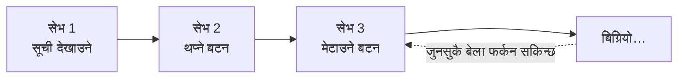

---

## 2. Git, GitHub र SourceTree

नाम मिल्दाजुल्दा भए पनि, यिनीहरूको काम फरक-फरक छ।

| नाम | के हो? | उदाहरण दिँदा |
|------|-----------|-----------|
| **Git** | इतिहास रेकर्ड गर्ने प्रणाली | सेभ गर्ने सुविधा |
| **GitHub** | इतिहासलाई इन्टरनेटमा राख्ने सेवा | क्लाउडको सेभ राख्ने ठाउँ |
| **SourceTree** | Git लाई स्क्रिनबाट चलाउने एप | सेभ स्क्रिन |

Git सामान्यतया PowerShell जस्ता ठाउँमा कमान्ड टाइप गरेर चलाइन्छ, तर आज SourceTree प्रयोग गरेर **माउसबाट** काम गर्छौं।

---

## 3. शब्दहरू चित्रबाट सम्झौं

Git मा फाइलहरू "काम गर्ने फोल्डर → आफ्नो PC → GitHub" बीच आउजाउ गर्छन्।
तीरको नाम नै अपरेसनको नाम हो।

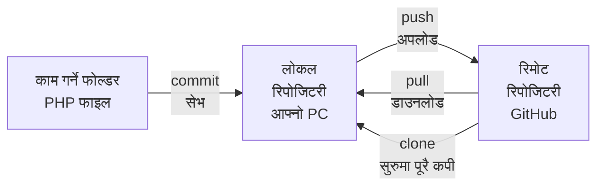

- **रिपोजिटरी (repository)**: इतिहास व्यवस्थापन गर्ने "बाकस"। आफ्नो PC मा भएकोलाई **लोकल**, GitHub मा भएकोलाई **रिमोट** भनिन्छ
- **commit**: परिवर्तनलाई सेभ पोइन्टको रूपमा रेकर्ड गर्नु
- **push**: आफ्नो PC को सेभलाई GitHub मा अपलोड गर्नु
- **pull**: GitHub को पछिल्लो अवस्था आफ्नो PC मा डाउनलोड गर्नु
- **clone**: GitHub को रिपोजिटरीलाई सुरुमा पूरै कपी गरेर ल्याउनु

---

## 4. SourceTree इन्स्टल गर्ने

आधिकारिक वेबसाइटबाट इन्स्टलर डाउनलोड गरेर चलाउनुहोस्।

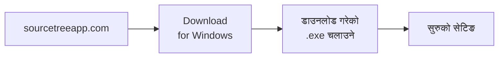

इन्स्टल गर्ने क्रममा केही प्रश्नहरू सोधिन्छन्।

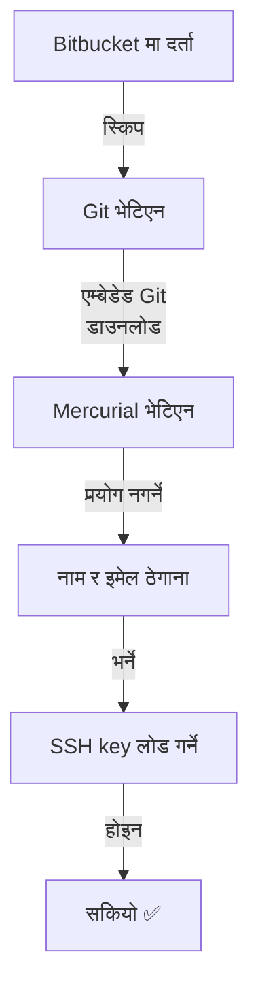

| सोधिने कुरा | छान्ने कुरा |
|------------|---------|
| Bitbucket (Atlassian) मा दर्ता | `スキップ` (स्किप। आज प्रयोग गर्दैनौं) |
| Git भेटिएन | **埋め込み版のGitをダウンロード** (एम्बेडेड Git डाउनलोड गर्ने। SourceTree को आफ्नै Git इन्स्टल हुन्छ) |
| Mercurial भेटिएन | `Mercurialを使いたくない` (Mercurial प्रयोग गर्न चाहन्न। आज प्रयोग गर्दैनौं) |
| नाम र इमेल ठेगाना | भर्नुहोस्। यही नाम **commit गर्ने व्यक्ति (author)** को रूपमा रेकर्ड हुन्छ |
| SSH key लोड गर्ने कि नगर्ने | `いいえ` (होइन। आज token प्रयोग गर्ने भएकाले चाहिँदैन) |

> स्क्रिनमा देखिने शब्दहरू संस्करणअनुसार अलिकति फरक हुन सक्छन्। अलमल भयो भने शिक्षकलाई सोध्नुहोस्।

> **नाम तपाईंलाई अरूले चिन्न सक्ने खालको राख्नुहोस्**
> आज सबैजनाले एउटै रिपोजिटरी प्रयोग गर्ने भएकाले, `yamada-taro` जस्तै **कसको commit हो भनेर थाहा हुने नाम** राख्नुहोस्।

---

## 5. आजको व्यवस्था

आज शिक्षकले GitHub मा तयार गरेको **अभ्यासको लागि रिपोजिटरी** कक्षाका सबैजनाले प्रयोग गर्छौं।
आफ्नो GitHub अकाउन्ट अझै प्रयोग गर्दैनौं, शिक्षकले दिने ३ वटा जानकारी प्रयोग गरेर जोडिन्छौं।

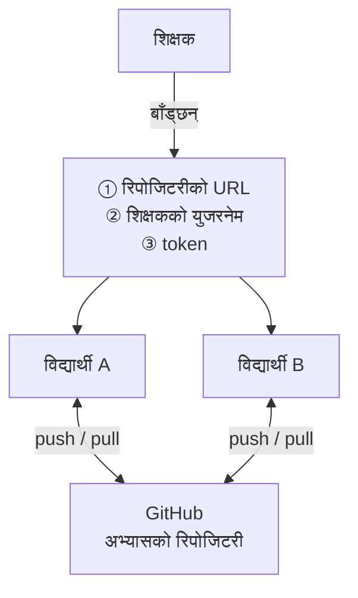

**token** भनेको GitHub लाई "यो व्यक्तिलाई काम गर्न अनुमति छ" भनेर जानकारी दिने, पासवर्डको सट्टा प्रयोग गरिने गोप्य शब्द हो (`github_pat_` बाट सुरु हुने लामो अक्षरहरूको शृङ्खला)।
आजको token अभ्यासको रिपोजिटरीमा मात्र काम गर्न मिल्ने गरी सीमित गरिएको छ।

> ⚠️ **token अरूलाई नदेखाउनुहोस्, सोसल मिडिया वा च्याटमा नटाँस्नुहोस्**

---

## 6. clone गर्ने

शिक्षकको रिपोजिटरीलाई आफ्नो PC मा कपी गर्छौं।

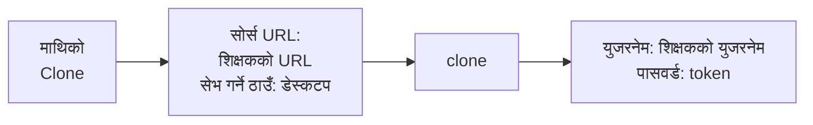

SourceTree को माथिपट्टि रहेको `Clone` मा क्लिक गरेर, तल जस्तै भर्नुहोस्।

| वस्तु | भर्ने कुरा |
|------|------------|
| 元のパス / URL (स्रोतको path / URL) | शिक्षकबाट पाएको रिपोजिटरीको URL |
| 保存先のパス (सेभ गर्ने ठाउँको path) | `C:\Users\<युजरनेम>\Desktop\<रिपोजिटरीको नाम>` |

बीचमा युजरनेम र पासवर्ड सोधियो भने, **पासवर्डको ठाउँमा token टाँस्नुहोस्**।

✅ डेस्कटपमा `<रिपोजिटरीको नाम>` फोल्डर बनेर, भित्र `README.md` छ भने सफल भयो।

हालेको token Windows को "Credential Manager (資格情報マネージャー)" मा सेभ हुन्छ, त्यसैले अर्को पटकदेखि सोधिँदैन।

> **डेस्कटपमा फोल्डर नदेखिएमा**
> OneDrive प्रयोग गरिरहेको PC मा डेस्कटपको ठाउँ `C:\Users\<युजरनेम>\OneDrive\デスクトップ` भएको हुन सक्छ।
> सेभ गर्ने ठाउँको `...` बटनबाट Explorer मा डेस्कटप छान्नु भनेको पक्का तरिका हो।

---

## 7. commit गर्ने

पहिलो सेमेस्टरमा बनाएको PHP फाइललाई clone गरेको फोल्डरमा राखेर commit गर्छौं।
सबैजनाले एउटै रिपोजिटरी प्रयोग गर्ने भएकाले, **आफ्नो नामको फोल्डर** बनाएर त्यसभित्र राख्नुहोस्।
यसो गर्दा अरूका फाइलहरूसँग टक्कर (conflict) हुँदैन।

```
<रिपोजिटरीको नाम>/
  README.md
  yamada-taro/     ← आफ्नो फोल्डर
    todo.php
  suzuki-hanako/   ← अरू व्यक्ति
    todo.php
```

Explorer मा फाइल कपी गरेपछि, SourceTree को बायाँपट्टिको `ファイルステータス` (फाइलको स्थिति) खोल्नुहोस्।
"ステージしていないファイル" (stage नगरिएका फाइल) मा देखिएका फाइललाई "ステージ" (stage) मा सारेर, मेसेज लेखी commit गर्नुहोस्।

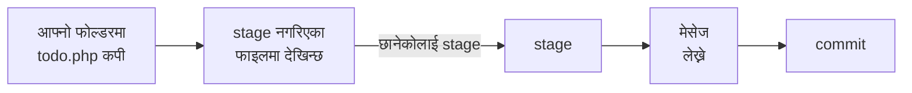

**stage** भनेको "यस पटकको सेभमा समावेश गर्ने फाइल" छान्ने ठाउँ हो।

commit मेसेजमा, पछि हेर्दा बुझिने गरी **के गरियो** भनेर लेख्नुहोस्।

| ❌ नराम्रो मेसेज | ⭕ राम्रो मेसेज |
|----------|----------|
| सच्याइयो | Todo को मेटाउने बटनले काम नगर्ने समस्या सच्याइयो |
| अपडेट | Todo सूचीमा म्यादको कोलम थपियो |

---

## 8. push गर्ने

commit मात्र गर्दा, यो अझै आफ्नो PC भित्र मात्र रेकर्ड भएको हुन्छ।
push गरेर GitHub मा अपलोड गर्छौं।

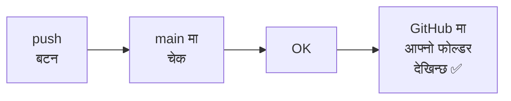

शिक्षकले स्क्रिनमा देखाउने GitHub पेजमा आफ्नो फोल्डर देखियो भने सफल भयो।

### त्रुटि (rejected) आएमा

अरू कसैले पहिले नै push गरेको छ भने, GitHub तिरको अवस्था नयाँ भइसकेको हुन्छ।
यसै अवस्थामा push गर्दा GitHub ले अस्वीकार गर्छ (rejected)।
**पहिले pull गरेर नयाँ परिवर्तन ल्याएपछि** फेरि push गर्नुहोस्।

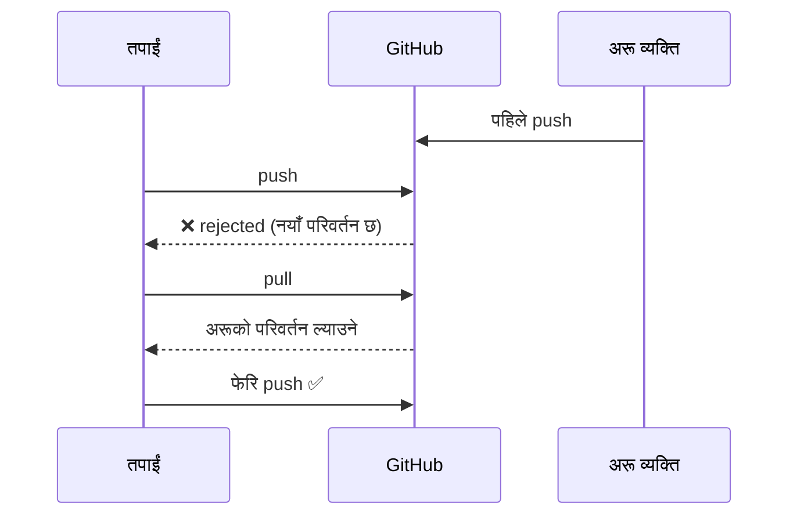

---

## 9. pull गर्ने

अरूले push गरेका परिवर्तनहरू आफ्नो PC मा ल्याउँछौं।

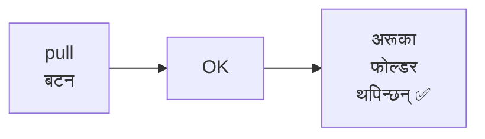

Explorer मा डेस्कटपको `<रिपोजिटरीको नाम>` फोल्डर खोलेर, अरूका फोल्डरहरू थपिएका छन् भने सफल भयो।
यसरी GitHub मार्फत **सबैको परिवर्तन साझा गर्न सकिनु** नै GitHub को सुविधाजनक पक्ष हो।

---

## 10. कामको क्रम

Git प्रयोग गरेर विकास गर्दा, तलको क्रम दोहोर्‍याइन्छ।

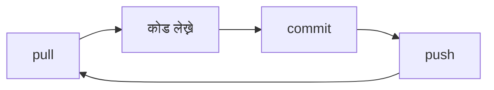

- **काम सुरु गर्नुअघि pull**: अरूको परिवर्तन पहिले ल्याउने
- **बारम्बार commit**: "यहाँसम्म चल्यो" लाग्यो भने सेभ गर्ने
- **काम सकिँदा push**: GitHub मा सेभ गरेर साझा गर्ने

> आजको रिपोजिटरी र token **अभ्यासको लागि मात्र** हुन् (कक्षापछि प्रयोग गर्न मिल्दैन)।
> आफ्नै रिपोजिटरी बनाउने → [GitHub अकाउन्ट र रिपोजिटरी बनाउने तरिका](../20261008/20261008_資料_1.md)

<!-- nav:start -->

---

| ⬅️ अघिल्लो | 🗺️ समग्र नक्सा | अर्को ➡️ |
|:--|:--:|--:|
| [10/01 पहिलो सेमेस्टरको पुनरावलोकन](20261001_復習.md) | [सामग्रीको समग्र नक्सा](../../README.md) | [10/08 GitHub अकाउन्ट र रिपोजिटरी](../20261008/20261008_資料_1.md) |

<!-- nav:end -->
