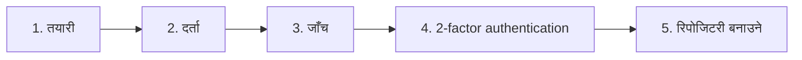
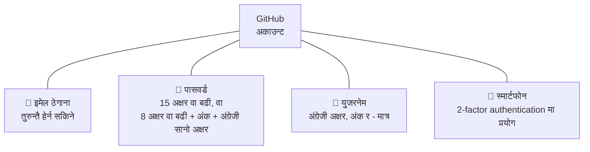
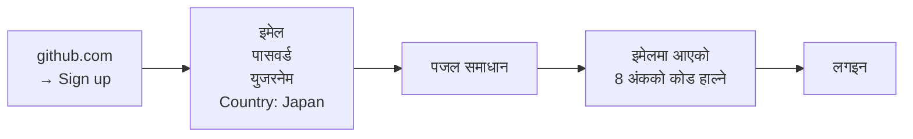
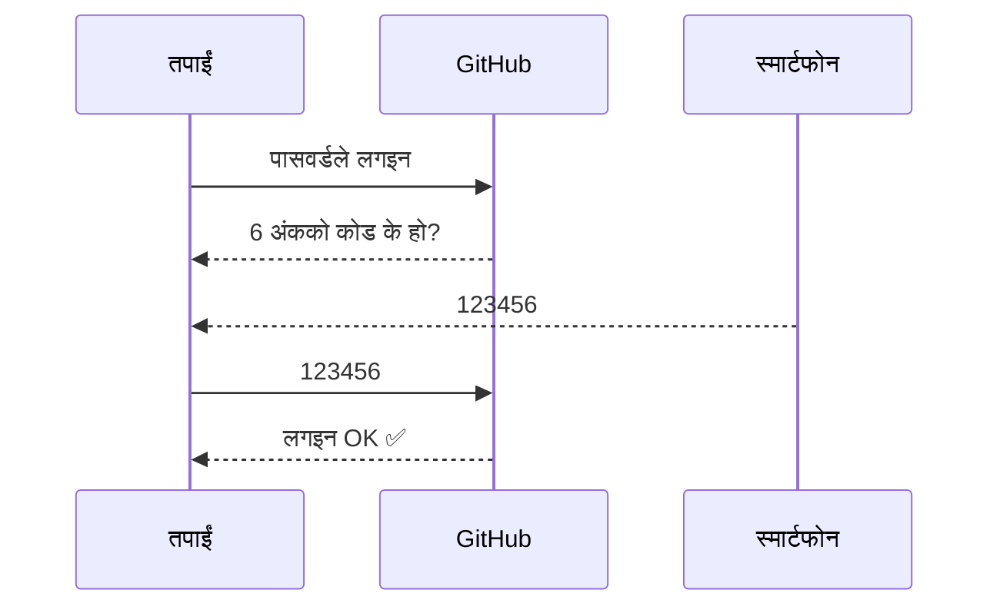
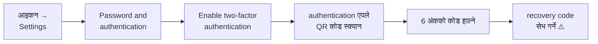
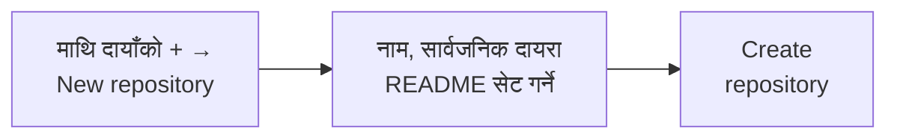
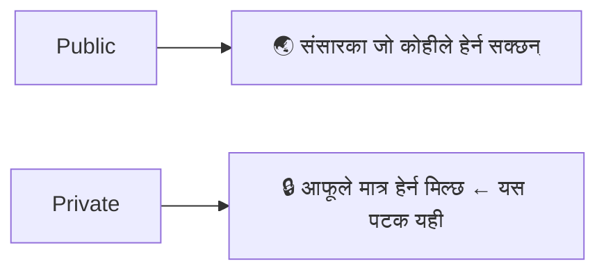

> 🇯🇵 मूल प्रति (जापानी भाषामा): [20261008_資料_1.md](<../../../1年生_データ設計とアプリ開発/後期/20261008/20261008_資料_1.md>) <!-- original-ja-link -->


# GitHub अकाउन्ट र रिपोजिटरी बनाउने तरिका

## आजको लक्ष्य
- GitHub अकाउन्ट बनाउन सक्ने
- आफ्नै रिपोजिटरी बनाउन सक्ने

[सोर्स कन्ट्रोलको सुरुवातमा फर्कने](../20261001/20261001_資料_1.md)

---

## अघिल्लो कक्षाको पुनरावलोकन

अघिल्लो कक्षामा, **शिक्षकको GitHub अकाउन्टमा भएको रिपोजिटरी** मा सबैजनाले push गर्‍यौं।

यस पटक, **आफ्नै GitHub अकाउन्ट बनाएर आफ्नै रिपोजिटरी** तयार गर्छौं।
यसपछि आफ्नो कोड आफ्नै ठाउँमा व्यवस्थापन गर्न सकिन्छ।

```mermaid
graph LR
    subgraph अघिल्लो["अघिल्लो पटक"]
        A[सबैको PC] --> T[शिक्षकको रिपोजिटरी]
    end
    subgraph यसपटक["यस पटक"]
        B[आफ्नो PC] --> M[आफ्नो रिपोजिटरी]
    end
```

---

## समग्र क्रम

आज तलका ५ चरणमा, GitHub मा आफ्नै कोड राख्ने ठाउँ तयार गर्छौं।



---

## 1. तयार गर्नुपर्ने कुराहरू

दर्ता सुरु गर्नुअघि, तलका ४ कुरा तयार राख्नुहोस्।



- **इमेल ठेगाना**: पुष्टि कोड आउने भएकाले, कक्षाकै बेला तुरुन्तै हेर्न सकिने इमेल प्रयोग गर्नुहोस्
- **स्मार्टफोन**: पछि सेट गर्ने 2-factor authentication मा प्रयोग हुन्छ

### युजरनेम कसरी छान्ने

युजरनेम `https://github.com/<युजरनेम>` जस्तै **URL बन्ने, अरूलाई देखाइने नाम** हो।
भविष्यमा पोर्टफोलियोको रूपमा देखाउन पनि सकिने भएकाले, ठट्टा गरेको जस्तो नाम नराख्नुहोस्।
आफ्नो वास्तविक नाम देखाउन नचाहनेले वास्तविक नाम नराखे पनि हुन्छ।

| ❌ नराख्नु राम्रो | ⭕ राम्रो |
|-------------|----------|
| `unko-man`, `aaaa1234` | `taro-yamada`, `tyamada-dev` |

---

## 2. दर्ता गर्ने

https://github.com खोलेर, माथि दायाँको `Sign up` बाट दर्ता गर्नुहोस्।



- युजरनेम पहिले नै प्रयोगमा छ भने रातो अक्षरमा देखिन्छ, त्यसैले अर्को नाम राख्नुहोस्
- **पजल** भनेको "तपाईं मान्छे हुनुहुन्छ भन्ने पुष्टि" हो। स्क्रिनको निर्देशनअनुसार उत्तर दिनुहोस्
- दर्ता गरेको इमेलमा आउने **8 अंकको कोड** हालेपछि दर्ता पूरा हुन्छ

बीचमा प्रश्न वा प्लान छान्ने स्क्रिन आयो भने, तल जस्तै अगाडि बढ्नुहोस्।

| स्क्रिन | छान्ने कुरा |
|------|---------|
| प्रयोगको उद्देश्यबारे प्रश्न | `Skip personalization` (स्किप) |
| प्लान | **Free (निःशुल्क)** |

> **इमेल नआएमा**
> स्प्याम फोल्डर हेर्नुहोस् → केही मिनेट पर्खेर `Resend the code` बाट फेरि पठाउनुहोस् → त्यसले पनि भएन भने इमेल ठेगाना गलत टाइप भएको छ कि जाँच्नुहोस्

---

## 3. जाँच गर्ने

अकाउन्ट बन्यो कि बनेन, आफ्नो प्रोफाइल स्क्रिन खोलेर जाँच्नुहोस्।


**आफ्नो युजरनेम टिपेर राख्नुहोस्।** पछि प्रयोग हुन्छ।

---

## 4. 2-factor authentication

**2-factor authentication (2FA)** भनेको पासवर्डका साथै **स्मार्टफोनमा देखिने 6 अंकको कोड** बाट पनि लगइन पुष्टि गर्ने प्रणाली हो।
पासवर्ड अरूले थाहा पाए पनि, स्मार्टफोन नभई लगइन गर्न सकिँदैन।



GitHub मा 2-factor authentication सेट गर्न अनिवार्य गरिएको छ, लगइन गरेको केही समयपछि सेटिङ गर्ने सूचना आउँछ।

### सेटिङका चरणहरू

स्मार्टफोनमा authentication एप (Google Authenticator आदि) इन्स्टल गरेपछि सुरु गर्नुहोस्।



> ⚠️ **recovery code अनिवार्य रूपमा सेभ गर्नुहोस्!**
> स्मार्टफोन हरायो भने लगइन गर्ने अन्तिम उपाय यही हो।
> यो हरायो भने, अकाउन्टमा पस्न नसकिने पनि हुन सक्छ।

---

## 5. रिपोजिटरी बनाउने

अकाउन्ट बनेपछि, आफ्नो कोड सेभ गर्ने **रिपोजिटरी** (इतिहास व्यवस्थापन गर्ने बाकस) बनाउँछौं।



तल जस्तै सेट गर्नुहोस्।

| वस्तु | सेटिङ |
|------|------------|
| Repository name | `php-study` |
| सार्वजनिक दायरा | **`Private`** |
| Add README | **On** |

**सार्वजनिक दायरा** भनेको यो रिपोजिटरी कसले हेर्न सक्छ भन्ने सेटिङ हो।
अभ्यासको कोडलाई `Private` मा राख्नुहोस्।



**README** भनेको रिपोजिटरीको विवरण लेख्ने फाइल हो।
सुरुदेखि नै एउटा फाइल भयो भने, पछि clone गर्दा भित्र सामग्री छ कि छैन भनेर जाँच्न सकिन्छ।

### जाँच ✅

तलका ३ कुरा पूरा भए तयार भयो।

- URL `github.com/<युजरनेम>/php-study` भएको छ
- `README.md` देखिएको छ
- रिपोजिटरीको नामको छेउमा `Private` देखिएको छ

---

अब, बनाएको `php-study` मा अभ्यासको वातावरण push गर्छौं → [अभ्यासको वातावरण आफ्नो रिपोजिटरीमा push गर्ने](./20261008_資料_2.md)

<!-- nav:start -->

---

| ⬅️ अघिल्लो | 🗺️ समग्र नक्सा | अर्को ➡️ |
|:--|:--:|--:|
| [10/01 सोर्स कन्ट्रोलको सुरुवात](../20261001/20261001_資料_1.md) | [सामग्रीको समग्र नक्सा](../../README.md) | [10/08 अभ्यासको वातावरण push गर्ने](20261008_資料_2.md) |

<!-- nav:end -->
