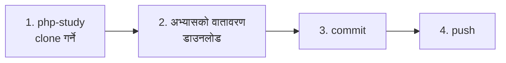
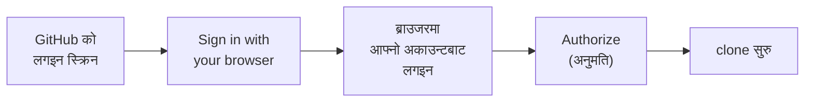
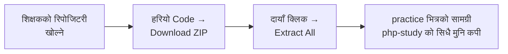
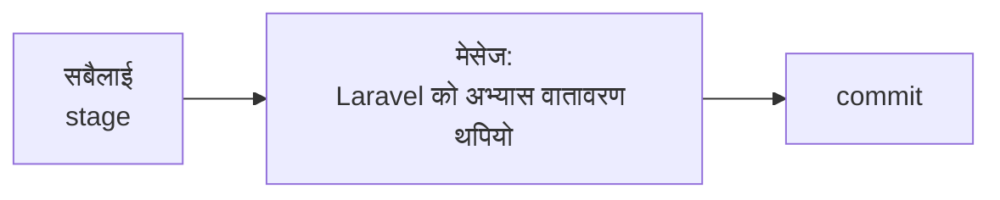

# अभ्यासको वातावरण आफ्नो रिपोजिटरीमा push गर्ने

> 🇯🇵 मूल प्रति (जापानी भाषामा): [20261008_資料_2.md](<../../../1年生_データ設計とアプリ開発/後期/20261008/20261008_資料_2.md>) <!-- original-ja-link -->

## आजको लक्ष्य
- आफ्नो GitHub अकाउन्टबाट लगइन गरेर clone र push गर्न सक्ने
- अभ्यासको वातावरण आफ्नो रिपोजिटरीमा push गर्न सक्ने

[GitHub अकाउन्ट र रिपोजिटरी बनाउने तरिकामा फर्कने](./20261008_資料_1.md)

---

## समग्र क्रम

[सामग्री 1](./20261008_資料_1.md) मा बनाएको `php-study` मा, शिक्षकले तयार गरेको **अभ्यासको वातावरण** राखेर push गर्छौं।



---

## 1. php-study clone गर्ने

अघिल्लो पटक जस्तै, SourceTree को `Clone` बाट आफ्नो PC मा कपी गर्छौं।
अघिल्लो पटक token सहितको URL बाट clone गरेका थियौं, तर यस पटक **आफ्नो GitHub अकाउन्टबाट लगइन** गरेर जोडिन्छौं।

| वस्तु | भर्ने कुरा |
|------|------------|
| 元のパス / URL (स्रोतको path / URL) | `https://github.com/<आफ्नो युजरनेम>/php-study.git` |
| 保存先のパス (सेभ गर्ने ठाउँको path) | `C:\Users\<युजरनेम>\Desktop\php-study` |

`クローン` (clone) थिच्दा GitHub को लगइन स्क्रिन आउँछ।
`Sign in with your browser` (ब्राउजरबाट साइन इन) छानेर **आफ्नो अकाउन्ट** बाट लगइन गर्नुहोस्।



- ब्राउजरमा लगइन गर्न भनियो भने, सामग्री 1 मा बनाएको अकाउन्टबाट लगइन गर्नुहोस् (2-factor authentication को 6 अंकको कोड पनि हाल्नुहोस्)
- `Authorize` (अनुमति) थिचेपछि SourceTree मा फर्केर clone सुरु हुन्छ
- लगइन जानकारी Windows मा सेभ हुने भएकाले, अर्को पटकदेखि सोधिँदैन

✅ डेस्कटपमा `php-study` फोल्डर बनेर, भित्र `README.md` छ भने सफल भयो।

---

## 2. अभ्यासको वातावरण डाउनलोड गर्ने

शिक्षकको रिपोजिटरीलाई ZIP मा डाउनलोड गरेर, त्यसभित्रको `practice` फोल्डरको **भित्री सामग्री** निकाल्छौं।



**शिक्षकको रिपोजिटरी:** https://github.com/hakobunet/iica-koyama

extract गरेको फोल्डरभित्र, तलको ठाउँमा `practice` छ।

```
iica-koyama-main/
  docs/
    1年生_データ設計とアプリ開発/
      practice/   ← यसभित्रको सामग्री कपी गर्ने
```

`practice` फोल्डर खोलेर, **भित्रका सबै सामग्री** `php-study` को **सिधै मुनि** कपी गर्नुहोस् (`practice` फोल्डर आफैं बनाउँदैनौं)।

```
php-study/
  README.md          ← practice को README.md ले बदले पनि OK
  .gitattributes
  mysql/
    compose.yaml
  laravel/
    .gitignore
    compose.yaml
    Dockerfile
    entrypoint.sh
```

> **`README.md` एउटै नामले दोहोरिएमा**
> "फाइल बदल्ने (Replace)" छाने हुन्छ। अभ्यासको वातावरण कसरी चलाउने भनेर लेखिएको README बन्छ।

> **भित्रका फाइल एक-एक गरेर नछान्नुहोस्**
> `.gitattributes` वा `.gitignore` जस्तै, नाम `.` बाट सुरु हुने फाइलहरू महत्त्वपूर्ण सेटिङ फाइल हुन्।
> यी कहिलेकाहीँ नदेखिन पनि सक्छन्, त्यसैले `practice` फोल्डर खोलेपछि `Ctrl + A` (सबै छान्ने) ले एकैपटक कपी गर्नुहोस्।

---

## 3. commit गर्ने

SourceTree को `ファイルステータス` (फाइलको स्थिति) खोल्दा, `mysql` र `laravel` भित्रका फाइलहरू "ステージしていないファイル" (stage नगरिएका फाइल) मा देखिन्छन्।



---

## 4. push गर्ने

`プッシュ` (push) बटन → `main` मा चेक → `OK` थिचेर GitHub मा अपलोड गर्नुहोस्।

### जाँच ✅

ब्राउजरमा `github.com/<युजरनेम>/php-study` खोलेर, तल जस्तै भएको छ भने तयार भयो।

- `mysql` र `laravel` फोल्डर सबैभन्दा माथि (सिधै मुनि) देखिएका छन्

> **clone वा push गर्दा `403` वा `Repository not found` आएमा**
> URL को `<आफ्नो युजरनेम>` सही छ कि छैन, र ब्राउजरमा **आफ्नै अकाउन्ट** बाट लगइन गर्नुभयो कि भनेर जाँच्नुहोस्।

अभ्यासको वातावरण कसरी चलाउने भन्ने कुरा `php-study` फोल्डरको `README.md` मा लेखिएको छ।
फोल्डरको ठाउँ `C:\Users\<युजरनेम>\Desktop\php-study` हुने भएकाले, README मा भएको `Desktop\practice` लाई `Desktop\php-study` भनेर बुझ्नुहोस्।

<!-- nav:start -->

---

| ⬅️ अघिल्लो | 🗺️ समग्र नक्सा | अर्को ➡️ |
|:--|:--:|--:|
| [10/08 GitHub अकाउन्ट र रिपोजिटरी](20261008_資料_1.md) | [सामग्रीको समग्र नक्सा](../../README.md) | [10/08 Docker को सुरुवात](20261008_資料_3.md) |

<!-- nav:end -->
