# Docker को सुरुवात — Docker Desktop इन्स्टल गर्ने

> 🇯🇵 मूल प्रति (जापानी भाषामा): [20261008_資料_3.md](<../../../1年生_データ設計とアプリ開発/後期/20261008/20261008_資料_3.md>) <!-- original-ja-link -->

## आजको लक्ष्य
- Docker ले के काम गर्छ भन्ने बुझ्ने
- Docker Desktop इन्स्टल गरेर `hello-world` चलाउन सक्ने
- अभ्यासको वातावरण सुरु गरेर ब्राउजरमा Laravel को टप पेज देखाउन सक्ने

---

## सुरुमा: कन्टेनर भनेको के हो?

**कन्टेनर (container)** भनेको PC भित्र बनाइएको **सानो छुट्टै कोठा** जस्तै हो।
कोठाभित्र एप चलाउन चाहिने कुराहरू (PHP, MySQL आदि) मात्र राखिएका हुन्छन्।

पहिलो सेमेस्टरको XAMPP लाई PC मा सिधै इन्स्टल गरेका थियौं।
कन्टेनर प्रयोग गर्दा PC मा सिधै इन्स्टल नगरी, कोठाभित्र मात्र चलाउन सकिन्छ।

```mermaid
graph TB
    subgraph पहिले["पहिलो सेमेस्टर XAMPP"]
        P1[आफ्नो PC<br>PHP, MySQL सिधै इन्स्टल]
    end
    subgraph अबदेखि["अबदेखि Docker"]
        P2[आफ्नो PC] --> R1[कन्टेनर<br>PHP]
        P2 --> R2[कन्टेनर<br>MySQL]
    end
```

कन्टेनरका यस्ता विशेषताहरू छन्।

| विशेषता | यसको अर्थ के हो? |
|------|--------------|
| **कोठा-कोठा छुट्टिएका छन्** | कन्टेनरहरूले एकअर्कालाई असर गर्दैनन्। PHP को पुरानो र नयाँ संस्करण एकैसाथ चलाउन सकिन्छ |
| **PC फोहोर हुँदैन** | PC मा केही पनि इन्स्टल हुँदैन |
| **छिट्टै बनाउन र छिट्टै मेटाउन सकिन्छ** | केही सेकेन्डमै सुरु हुन्छ। नचाहिएमा मेटाएर फेरि बनाउन सकिन्छ |
| **जसको PC मा पनि एउटै सामग्री** | एउटै डिजाइनबाट बनाएमा सबैको PC मा एउटै वातावरण हुन्छ |

यो कन्टेनर बनाउने र चलाउने सफ्टवेयर नै **Docker** हो।

---

## 1. Docker किन प्रयोग गर्ने?

पहिलो सेमेस्टरमा एप चलाउन XAMPP इन्स्टल गरेर PHP र MySQL तयार गरेका थियौं।
तर, यस्तो कुरा प्रायः हुन्छ।

```
A：「मेरो PC मा त चल्छ नि…」
B：「PHP को संस्करण फरक छ जस्तो छ」
C：「XAMPP को सेटिङ चलाएपछि चल्न छोड्यो」
```

**Docker** प्रयोग गर्दा, एप चलाउने वातावरण (PHP, MySQL आदि) लाई **कन्टेनर** (छुट्टै कोठा) मा राखेर, जुनसुकै PC मा पनि एकै किसिमले चलाउन सकिन्छ।

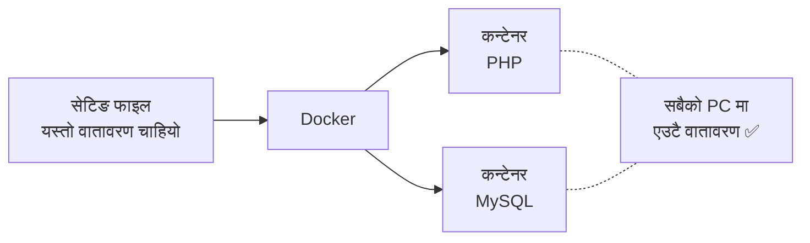

- वातावरण बिग्रिए पनि, कन्टेनर फेरि बनाए तुरुन्तै पहिलेको अवस्थामा फर्किन्छ
- सेटिङ फाइल साझा गरे, टिमका सबैले एउटै वातावरण तयार गर्न सक्छन्

---

## 2. Docker, इमेज र कन्टेनर

सुरुमा आउने शब्दहरूलाई खाना पकाउने उदाहरणबाट सम्झौं।

| नाम | के हो? | उदाहरण दिँदा |
|------|-----------|-----------|
| **इमेज (image)** | वातावरणको डिजाइन (नक्सा) | रेसिपी |
| **कन्टेनर** | इमेजबाट बनाइएको, साँच्चै चल्ने वातावरण | रेसिपीबाट बनाएको खाना |
| **Docker Desktop** | Windows मा Docker प्रयोग गर्ने एप | भान्सा |
| **Docker Hub** | इमेजहरू सार्वजनिक गरिएको साइट | रेसिपीको किताब |

एउटा इमेज (रेसिपी) बाट जति पनि कन्टेनर (खाना) बनाउन सकिन्छ।

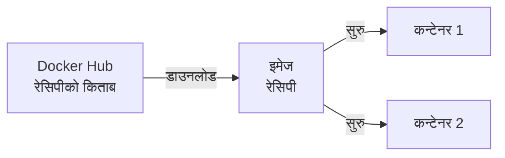

> **कन्टेनर मेटाए पनि ठीक छ?**
> कन्टेनर इमेज (रेसिपी) बाट जुनसुकै बेला फेरि बनाउन सकिने भएकाले, बिग्रियो भने मेटाएर फेरि बनाए हुन्छ।
> तर, **कन्टेनरभित्र बनाएको डाटा कन्टेनर मेटाउँदा सँगै मेटिन्छ।** डाटा जोगाउने तरिका अर्को कक्षादेखि सिक्नेछौं।

---

## 3. इन्स्टल गर्ने क्रम

आज तलको क्रममा अगाडि बढ्छौं।

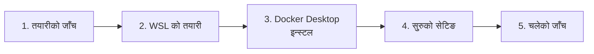

---

## 4. तयारीको जाँच

Docker Desktop इन्स्टल गर्नुअघि, PC ले तलका सर्तहरू पूरा गर्छ कि गर्दैन जाँच्नुहोस्।

| जाँच्ने कुरा | सर्त |
|------------|------|
| Windows को संस्करण | Windows 10 (22H2) वा Windows 11 |
| भर्चुअलाइजेसन | **सक्रिय (Enabled)** भएको |
| अकाउन्ट | **Administrator अधिकार** भएको युजर |

### भर्चुअलाइजेसन सक्रिय छ कि जाँच्ने

Docker ले PC भित्र अर्को एउटा सानो PC चलाउने **भर्चुअलाइजेसन (virtualization)** भन्ने सुविधा प्रयोग गर्छ।

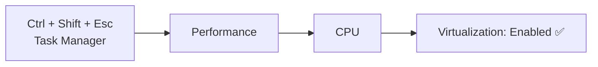

तल दायाँको सूचीमा **"仮想化：有効"** (Virtualization: Enabled) देखिएको छ भने OK।

> **"無効" (Disabled) भएमा**
> BIOS (PC सुरु हुँदाको सेटिङ स्क्रिन) मा सक्रिय गर्नुपर्छ। PC को कम्पनीअनुसार तरिका फरक हुने भएकाले, शिक्षकलाई बोलाउनुहोस्।

---

## 5. WSL को तयारी

**WSL** (Windows Subsystem for Linux) भनेको Windows भित्र Linux चलाउने प्रणाली हो।
Docker Desktop यही WSL माथि चल्छ।

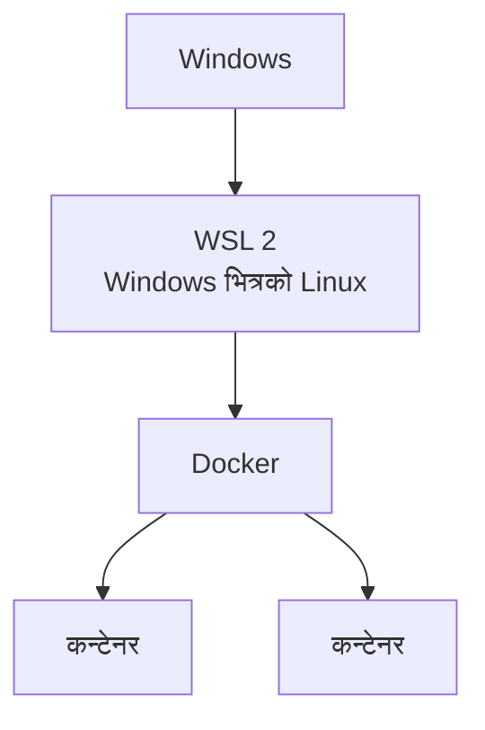

Start मेनुमा "PowerShell" खोजेर, **दायाँ क्लिक → "Run as administrator"** बाट खोल्नुहोस्।

```powershell
wsl --install
```

पहिले नै इन्स्टल भएको छ भने, नयाँ संस्करणमा अपडेट गर्नुहोस्।

```powershell
wsl --update
```

सकिएपछि **PC रिस्टार्ट** गर्नुहोस्।

✅ रिस्टार्टपछि PowerShell मा तलको कमान्ड चलाउँदा `既定のバージョン: 2` (Default Version: 2) देखियो भने OK।

```powershell
wsl --status
```

> **`wsl --install` गर्दा Ubuntu को युजरनेम सोधियो भने**
> यो Ubuntu (Linux को एक प्रकार) को सुरुको सेटिङ हो। अंग्रेजी सानो अक्षरको युजरनेम र पासवर्ड तय गरेर हाल्नुहोस्।
> पासवर्ड टाइप गर्दा स्क्रिनमा केही देखिँदैन, तर ठीकसँग टाइप भइरहेको हुन्छ।

---

## 6. Docker Desktop इन्स्टल गर्ने

आधिकारिक वेबसाइटबाट इन्स्टलर डाउनलोड गरेर चलाउनुहोस्।

**डाउनलोड पेज:** https://www.docker.com/products/docker-desktop/

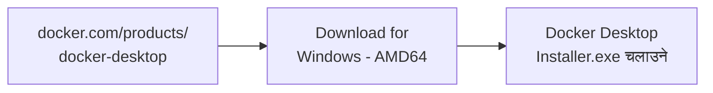

> **ARM64 र AMD64 को फरक**
> यो PC को CPU को प्रकार हो। धेरैजसो Windows PC **AMD64** (x86_64) हुन्छन्।
> Snapdragon जस्ता स्मार्टफोन-प्रकारको CPU भएको PC मा मात्र ARM64 छान्नुहोस्।

इन्स्टल गर्ने क्रममा सेटिङहरू सोधिन्छन्।

| सोधिने कुरा | छान्ने कुरा |
|------------|---------|
| Use WSL 2 instead of Hyper-V | **On** (WSL माथि चलाउने) |
| Add shortcut to desktop | On (डेस्कटपमा आइकन बन्छ) |

`OK` थिचेपछि इन्स्टल सुरु हुन्छ।
`Close and restart` (वा `Close`) देखिएपछि **PC रिस्टार्ट** गर्नुहोस्।

---

## 7. सुरुको सेटिङ

रिस्टार्टपछि, डेस्कटपको **Docker Desktop** आइकनमा डबल क्लिक गरेर खोल्नुहोस्।

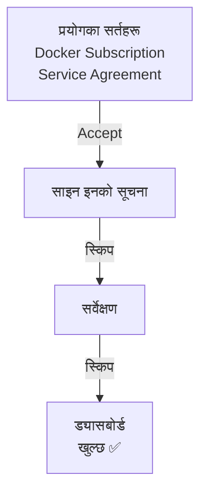

| स्क्रिन | छान्ने कुरा |
|------|---------|
| प्रयोगका सर्तहरू (Subscription Service Agreement) | `Accept` |
| साइन इन (Sign in / Sign up) | `Skip` (आज अकाउन्ट बिना प्रयोग गर्छौं) |
| सर्वेक्षण (Welcome Survey) | `Skip` |

> सिकाइको उद्देश्य र व्यक्तिगत प्रयोगका लागि निःशुल्क छ।

> स्क्रिनमा देखिने शब्दहरू संस्करणअनुसार अलिकति फरक हुन सक्छन्। अलमल भयो भने शिक्षकलाई सोध्नुहोस्।

### चलिरहेको छ कि जाँच्ने

स्क्रिनको तल बायाँमा **Engine running** (हरियो) देखिएको छ भने Docker चलिरहेको छ।
स्क्रिनको तल दायाँको टास्कबार (`^` भित्र) मा रहेको **ह्वेल माछाको आइकन** 🐳 बाट पनि जाँच्न सकिन्छ।

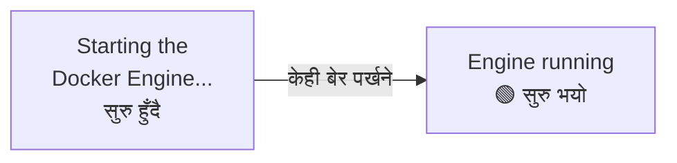

**Docker Desktop सुरु नभई Docker प्रयोग गर्न सकिँदैन।**
PC रिस्टार्ट गरेपछि, सबैभन्दा पहिले Docker Desktop सुरु गर्नुहोस्।

---

## 8. चलेको जाँच

PowerShell (Administrator नभए पनि OK) खोलेर Docker को संस्करण जाँच्नुहोस्।

```powershell
docker --version
```

```
Docker version 28.x.x, build xxxxxxx
```

यस्तो देखियो भने OK (अंकहरू व्यक्तिअनुसार फरक हुन्छन्)।

अब, अभ्यासको लागि **hello-world** इमेज चलाएर हेरौं।

```powershell
docker run hello-world
```

यो एउटै कमान्ड चलाउँदा Docker ले तलका काम गर्छ।

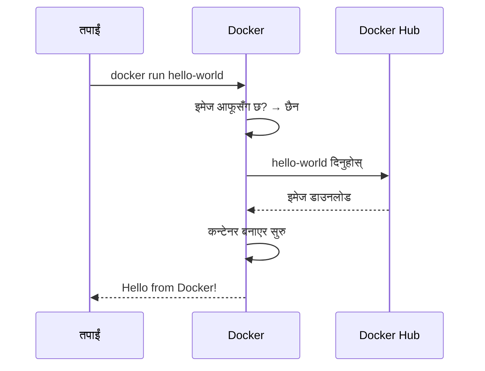

✅ तलको मेसेज देखियो भने इन्स्टल सफल भयो।

```
Hello from Docker!
This message shows that your installation appears to be working correctly.
```

फेरि `docker run hello-world` चलाउँदा, यस पटक डाउनलोड नगरी तुरुन्तै चल्छ।
किनभने इमेज (रेसिपी) पहिले नै आफूसँग छ।

Docker Desktop को बायाँपट्टिको `Containers` खोल्दा, भर्खरै चलाएको कन्टेनर देखिन्छ।

---

## 9. अभ्यासको वातावरण सुरु गर्ने

[सामग्री 2](./20261008_資料_2.md) मा push गरेको अभ्यासको वातावरणलाई Docker मा चलाएर हेरौं।
**अनिवार्य रूपमा mysql → laravel को क्रममा** सुरु गर्नुहोस्।

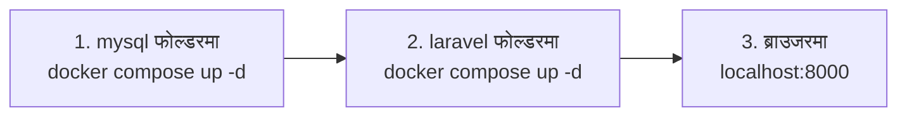

सुरु भएपछि, २ वटा कन्टेनर तल जस्तै जोडिएर चल्छन्।
laravel कन्टेनरले mysql कन्टेनर प्रयोग गर्ने भएकाले, mysql पहिले सुरु गर्नुहोस्।

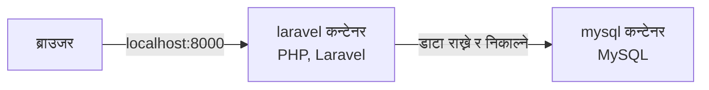

```powershell
cd C:\Users\<युजरनेम>\Desktop\php-study\mysql
docker compose up -d
```

```powershell
cd C:\Users\<युजरनेम>\Desktop\php-study\laravel
docker compose up -d
```

**पहिलो पटक मात्र**, Laravel इन्स्टल हुन केही मिनेट लाग्छ।
`docker compose logs -f` बाट प्रगति हेर्न सकिन्छ (`Ctrl + C` ले हेर्न बन्द गर्छ)।
`Server running on [http://0.0.0.0:8000]` देखिएपछि तयार भयो।

✅ ब्राउजरमा http://localhost:8000 खोलेर, तलको स्क्रिन देखियो भने OK।


---

## 10. काम नगरेमा

| समस्या | समाधान |
|------|------|
| `docker` भेटिएन भनिन्छ | Docker Desktop सुरु भएको छ कि जाँच्ने → PowerShell फेरि खोल्ने |
| `Engine stopped` मै रोकिएर चल्दैन | Docker Desktop बन्द गरेर फेरि सुरु गर्ने → भएन भने PC रिस्टार्ट |
| WSL पुरानो भयो भनिन्छ (WSL update failed आदि) | Administrator को PowerShell मा `wsl --update` → PC रिस्टार्ट |
| भर्चुअलाइजेसन निष्क्रिय भनिन्छ (Virtualization support not detected) | [4. तयारीको जाँच](#4-तयारीको-जाँच) हेर्ने → शिक्षकलाई बोलाउने |
| `error during connect` आउँछ | Docker Engine अझै सुरु हुँदैछ। तल बायाँमा `Engine running` नआउन्जेल पर्खने |

---

## 11. सारांश

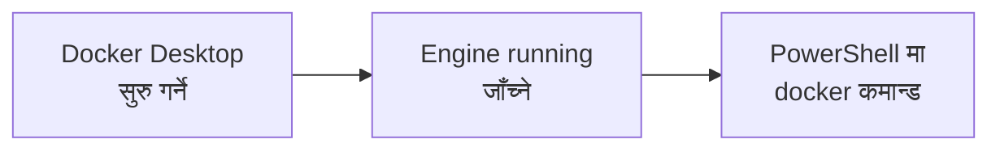

- **इमेज** डिजाइन (नक्सा) हो, **कन्टेनर** त्यसबाट बनाइएको साँच्चै चल्ने वातावरण हो
- Docker प्रयोग गर्नुअघि **Docker Desktop सुरु** गरिराख्ने
- `docker run <इमेजको नाम>` ले इमेज डाउनलोडदेखि कन्टेनर सुरु गर्नेसम्मको काम एकैपटक गर्छ

अर्को कक्षामा, Docker प्रयोग गरेर PHP र MySQL को वातावरण बनाउँदै जानेछौं।

<!-- nav:start -->

---

| ⬅️ अघिल्लो | 🗺️ समग्र नक्सा | अर्को ➡️ |
|:--|:--:|--:|
| [10/08 अभ्यासको वातावरण push गर्ने](20261008_資料_2.md) | [सामग्रीको समग्र नक्सा](../../README.md) | [10/15 MVC को संरचना](../20261015/20261015_資料_1.md) |

<!-- nav:end -->
