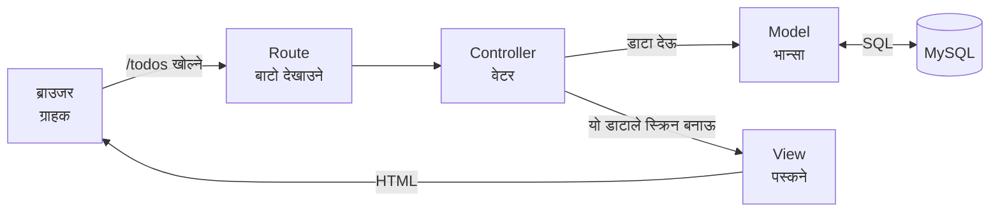
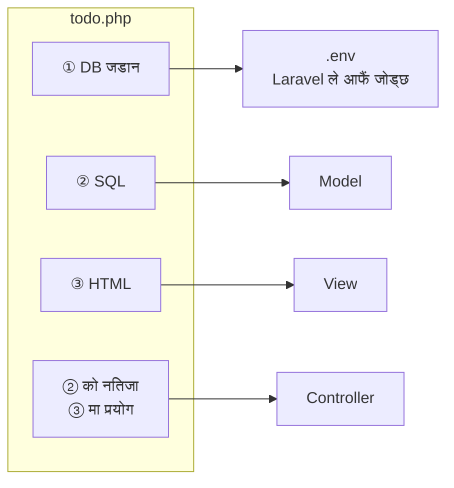
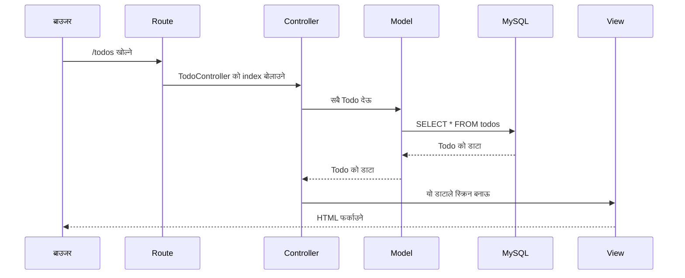
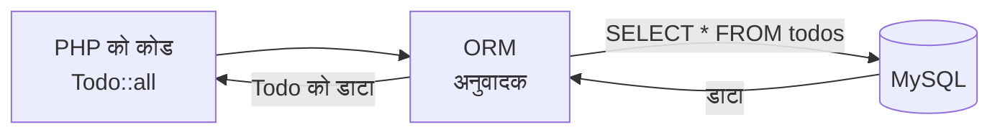
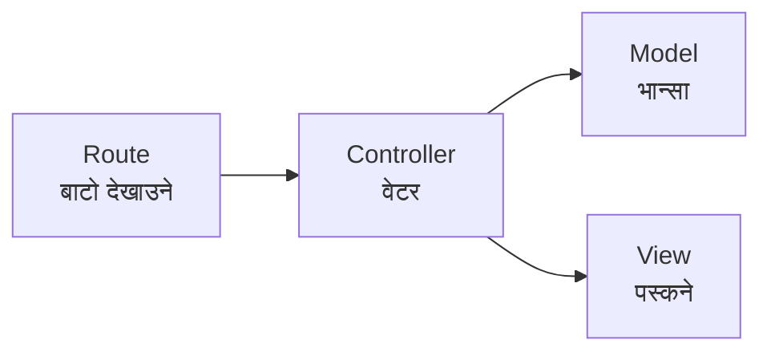

# Laravel को सुरुवात — MVC को संरचना

> 🇯🇵 मूल प्रति (जापानी भाषामा): [20261015_資料_1.md](<../../../1年生_データ設計とアプリ開発/後期/20261015/20261015_資料_1.md>) <!-- original-ja-link -->

## आजको लक्ष्य
- MVC (Model, View, Controller) को भूमिका बुझ्ने
- Laravel मा request "Route → Controller → Model → View" को क्रममा प्रवाह हुन्छ भन्ने बुझ्ने
- ORM प्रयोग गर्दा SQL नलेखी पनि डाटा राख्न र निकाल्न सकिन्छ भन्ने बुझ्ने

---

## 1. पहिलो सेमेस्टरको todo.php को पुनरावलोकन

पहिलो सेमेस्टरमा बनाएको `todo.php` मा **एउटै फाइलमा सबै कुरा** लेखिएको थियो।
सूची देखाउने भाग मात्र निकालेर हेर्दा, यस्तो छ।

```php
<?php
// ① डाटाबेससँग जोड्ने
$pdo = new PDO('mysql:host=127.0.0.1;dbname=school_db;charset=utf8mb4', 'root', '');

// ② SQL बाट Todo ल्याउने
$stmt = $pdo->query("SELECT * FROM todos ORDER BY created_at DESC");
$todos = $stmt->fetchAll(PDO::FETCH_ASSOC);
?>
<!-- ③ HTML बाट स्क्रिन बनाउने -->
<ul>
<?php foreach ($todos as $todo): ?>
    <li><?= htmlspecialchars($todo['title']) ?></li>
<?php endforeach; ?>
</ul>
```

सानो एप हो भने यसले काम गर्छ।
तर, एप ठूलो हुँदै जाँदा यस्तो हुन्छ।

```
A：「स्क्रिनको रूप मात्र सच्याउन चाहेको, तर SQL मिसिएकाले पढ्न गाह्रो छ…」
B：「एउटै SELECT धेरै फाइलहरूमा कपी गरिसकें」
C：「कहाँ सच्याउनुपर्ने हो थाहै भएन」
```

त्यसैले, **भूमिकाअनुसार फाइल छुट्याउने** सोच नै **MVC** हो।

```mermaid
graph LR
    subgraph पहिले["पहिलो सेमेस्टर: एउटै फाइल"]
        T[todo.php<br>DB जडान, SQL, HTML<br>सबै एकै ठाउँमा]
    end
    subgraph MVC["MVC: भूमिकाअनुसार छुट्याउने"]
        M[Model<br>डाटा]
        C[Controller<br>निर्देशन दिने]
        V[View<br>स्क्रिन]
    end
    T --> M
    T --> C
    T --> V
```

---

## 2. MVC भनेको के हो

MVC भनेको एपलाई ३ वटा भूमिकामा छुट्याउने सोच हो। रेस्टुरेन्टको उदाहरणबाट सम्झौं।

| नाम | भूमिका | रेस्टुरेन्टसँग तुलना गर्दा |
|------|------|------------------|
| **M**odel (मोडेल) | डाटाबेसको डाटा राख्ने र निकाल्ने | भान्सा (सामग्री निकालेर ल्याउने) |
| **V**iew (भ्यू) | स्क्रिन (HTML) बनाउने | सजाएर पस्कने (थालमा राखेर देखाउने) |
| **C**ontroller (कन्ट्रोलर) | अर्डर लिएर Model र View लाई निर्देशन दिने | वेटर (भान्सा र खाना पस्कने कामलाई जोड्ने) |

Laravel मा यसमा **Route** (कुन URL को जिम्मा कुन Controller ले लिने) थपिन्छ।
Route भनेको पसलको **ढोकामा बाटो देखाउने व्यक्ति** हो।



मुख्य कुरा के हो भने, **Controller बीचमा बसेर सबैलाई निर्देशन दिन्छ**।
View आफैंले Model बाट डाटा ल्याउँदैन। डाटा Controller बाट पाउँछ।

### पहिलो सेमेस्टरको todo.php कहाँ जान्छ?

भर्खरको `todo.php` का ①〜③ भागहरू MVC मा तल जस्तै छुट्टिन्छन्।



| todo.php को भाग | जाने ठाउँ | राख्ने ठाउँ |
|---------------|-------|---------|
| ① डाटाबेससँग जोड्ने | Laravel ले आफैं गरिदिन्छ | `.env` (सेटिङ फाइल) |
| ② SQL बाट Todo ल्याउने | **Model** | `app/Models/Todo.php` |
| ③ HTML बाट स्क्रिन बनाउने | **View** | `resources/views/todos/index.blade.php` |
| ② को नतिजा ③ लाई दिने | **Controller** | `app/Http/Controllers/TodoController.php` |
| कुन URL मा यो काम चलाउने | **Route** | `routes/web.php` |

---

## 3. request को प्रवाह

ब्राउजरमा `http://localhost:8000/todos` खोल्दा, Laravel भित्र तलको क्रममा काम अगाडि बढ्छ।



रेस्टुरेन्टसँग तुलना गर्दा, यो प्रक्रिया यस्तो हुन्छ।

1. ग्राहक पसलमा आउँछन् (ब्राउजरमा `/todos` खोल्ने)
2. बाटो देखाउने व्यक्तिले जिम्मेवार वेटरकहाँ पुर्‍याउँछन् (Route → Controller)
3. वेटरले भान्सालाई सामग्री माग्छन् (Controller → Model)
4. भान्साले भण्डारबाट सामग्री निकालेर ल्याउँछ (Model → MySQL)
5. वेटरले सामग्री पस्कने व्यक्तिलाई दिन्छन् (Controller → View)
6. खाना ग्राहकलाई पस्किन्छ (HTML ब्राउजरमा फर्किन्छ)

---

## 4. ORM को संरचना

### ORM भनेको के हो

पहिलो सेमेस्टरमा `SELECT * FROM todos` जस्तै **SQL आफैं लेखेर** प्रयोग गरेका थियौं।
Laravel मा Model प्रयोग गरेर `Todo::all()` लेखेर मात्र पनि डाटा ल्याउन सकिन्छ।

यो **ORM** (Object-Relational Mapping) भन्ने प्रणालीको कारणले सम्भव भएको हो।
ORM ले **PHP को कोडलाई आफैं SQL मा अनुवाद** गरेर MySQL मा पठाइदिन्छ।
Laravel को ORM को नाम **Eloquent** (एलोक्वेन्ट) हो।



रेस्टुरेन्टमा भन्दा, भान्सा (Model) मा **अनुवादक (ORM)** हुन्छन्, र वेटरको "सबै Todo देऊ" भन्ने अर्डरलाई भण्डार (MySQL) ले बुझ्ने भाषा (SQL) मा बदलिदिन्छन् भन्ने कल्पना गर्नुहोस्।

### पहिलो सेमेस्टरको SQL सँग तुलना

| गर्न चाहेको कुरा | पहिलो सेमेस्टर (SQL लेख्ने) | Laravel (Eloquent) |
|------------|-----------------|-------------------|
| सबै ल्याउने | `SELECT * FROM todos` | `Todo::all()` |
| id 1 भएको ल्याउने | `SELECT * FROM todos WHERE id = 1` | `Todo::find(1)` |
| पूरा नभएका मात्र ल्याउने | `SELECT * FROM todos WHERE is_done = 0` | `Todo::where('is_done', 0)->get()` |

आज "SQL नलेखी पनि यसरी लेख्न सकिँदो रहेछ" भन्ने बुझे पुग्छ।

### त्यसो भए SQL पढेको खेर जान्छ?

**जाँदैन।** ORM ले पर्दा पछाडि SQL बनाएर MySQL मा पठाइरहेको हुन्छ।
राम्रोसँग नचलेको बेला, वा जटिल डाटा निकाल्नुपर्दा, पहिलो सेमेस्टरमा सिकेको SQL को ज्ञान काम लाग्छ।

---

## 5. सारांश



| भूमिका | छोटकरीमा |
|------|-----------|
| **Route** | कुन URL को जिम्मा कुन Controller ले लिने भनेर तय गर्छ |
| **Controller** | Model बाट डाटा लिएर View लाई दिन्छ |
| **Model** | डाटाबेसको डाटा राख्छ र निकाल्छ (ORM ले SQL मा अनुवाद गरिदिन्छ) |
| **View** | स्क्रिन (HTML) बनाउँछ |

भूमिकाअनुसार फाइल छुट्टिएका हुनाले, "स्क्रिन सच्याउनु छ भने View", "डाटा निकाल्ने तरिका सच्याउनु छ भने Model" भनेर **कहाँ सच्याउने भन्ने तुरुन्तै थाहा हुन्छ**।

अब, MVC का भूमिकाअनुसार छुट्याएर Todo को सूची पेज बनाएर हेर्छौं → [Todo सूची बनाएर हेरौं](./20261015_資料_2.md)

<!-- nav:start -->

---

| ⬅️ अघिल्लो | 🗺️ समग्र नक्सा | अर्को ➡️ |
|:--|:--:|--:|
| [10/08 Docker को सुरुवात](../20261008/20261008_資料_3.md) | [सामग्रीको समग्र नक्सा](../../README.md) | [10/15 Todo सूची](20261015_資料_2.md) |

<!-- nav:end -->
