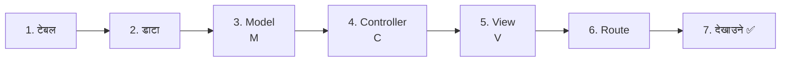
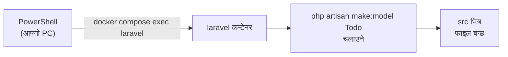
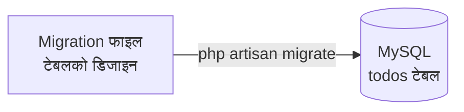
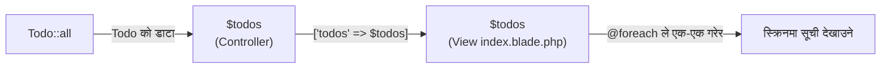
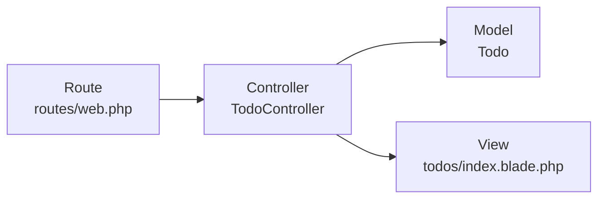

# Laravel को सुरुवात — Todo सूची बनाएर हेरौं

> 🇯🇵 मूल प्रति (जापानी भाषामा): [20261015_資料_2.md](<../../../1年生_データ設計とアプリ開発/後期/20261015/20261015_資料_2.md>) <!-- original-ja-link -->

[MVC को संरचना](./20261015_資料_1.md) मा सिकेका कुरा प्रयोग गरेर, Todo को सूची पेज बनाउँछौं।

## आजको लक्ष्य
- Todo को सूची पेजलाई MVC मा छुट्याएर बनाउन सक्ने
- Migration, Model, Controller, View र Route कहाँ-कहाँ लेख्ने भन्ने बुझ्ने

> अभ्यासको वातावरण (`php-study`) मा mysql र laravel सुरु गरेपछि मात्र अभ्यास सुरु गर्छौं।
> कसरी सुरु गर्ने भन्ने कुरा `php-study` फोल्डरको `README.md` मा हेर्नुहोस्।

पहिलो सेमेस्टरकै `todos` टेबल प्रयोग गरेर Todo को सूची पेज बनाउँछौं।
फाइलहरू `php-study\laravel\src` भित्र बन्छन्।

---

## 1. बनाउने क्रम

**चल्ने क्रम** (Route → Controller → Model → View) को उल्टो, **डाटा तर्फबाट** बनाउँदै जान्छौं।
किनभने सामग्री (टेबल र डाटा) बिना खाना (स्क्रिन) बनाउन सकिँदैन।



---

## 2. कमान्ड कसरी पढ्ने

आज तल जस्ता कमान्डहरू केही पटक प्रयोग गर्छौं।
कमान्डहरू PowerShell मा **laravel फोल्डर** मा गएपछि चलाउनुहोस्।

```powershell
cd C:\Users\<युजरनेम>\Desktop\php-study\laravel
```

```powershell
docker compose exec laravel php artisan make:model Todo
```

लामो देखिए पनि, यो २ भागमा छुट्टिएको छ।

| भाग | अर्थ |
|------|------|
| `docker compose exec laravel` | "laravel कन्टेनरभित्र अर्को कमान्ड चलाऊ" |
| `php artisan make:model Todo` | "Todo नामको Model बनाऊ" |

आफ्नो PC को PowerShell बाट कन्टेनरभित्र कमान्ड पठाएर चलाउने कल्पना गर्नुहोस्।
कन्टेनरभित्र बनेका फाइलहरू आफ्नो PC को `src` फोल्डरमा देखिन्छन्।



**artisan** (आर्टिजन) भनेको Laravel सँगै आउने **सहयोगी कमान्ड** हो।
`make:〇〇` ले फाइलको ढाँचा (template) आफैं बनाइदिन्छ।

---

## 3. बनाएर हेरौं

आज बनाउने वा परिवर्तन गर्ने फाइलहरू तलका ५ वटा हुन् (`src` भित्र)।

```
src/
├─ routes/
│   └─ web.php ······························ 6. Route (थप्ने)
├─ app/
│   ├─ Http/Controllers/
│   │   └─ TodoController.php ··············· 4. Controller
│   └─ Models/
│       └─ Todo.php ························· 3. Model
├─ resources/views/
│   └─ todos/
│       └─ index.blade.php ·················· 5. View
└─ database/migrations/
    └─ 2026_10_15_xxxxxx_create_todos_table.php ··· 1. टेबल
```

### 1. टेबल बनाउने (Migration)

> अहिले यहाँ: **🟢 1. टेबल** → 2. डाटा → 3. Model → 4. Controller → 5. View → 6. Route → 7. देखाउने

**Migration** भनेको टेबलको डिजाइन PHP मा लेखिएको फाइल हो।
पहिलो सेमेस्टरमा SQL को `CREATE TABLE` बाट टेबल बनाएका थियौं, तर Laravel मा यो फाइलबाट बनाइन्छ।

तलको कमान्डले Migration फाइल बनाउँछ।

```powershell
docker compose exec laravel php artisan make:migration create_todos_table
```

नाम `create_〇〇_table` राख्दा, Laravel ले टेबलको नाम `todos` बुझेर ढाँचा बनाइदिन्छ।

`database/migrations/` मा `2026_10_15_123456_create_todos_table.php` जस्तो **मिति भएको फाइल** बन्छ।
त्यसलाई खोलेर `up()` भित्र तल जस्तै लेख्नुहोस्।

```php
public function up(): void
{
    Schema::create('todos', function (Blueprint $table) {
        $table->id();
        $table->string('title');
        $table->boolean('is_done')->default(false);
        $table->timestamps();
    });
}
```

पहिलो सेमेस्टरको `CREATE TABLE` सँग तुलना गरौं। एउटै कुरा PHP मा लेखिएको छ।

| पहिलो सेमेस्टरको SQL | Migration |
|----------|----------------|
| `id INT AUTO_INCREMENT PRIMARY KEY` | `$table->id();` (ठ्याक्कै भन्दा, INT भन्दा ठूलो संख्यासम्म राख्न सकिने `BIGINT UNSIGNED` हुन्छ) |
| `title VARCHAR(255) NOT NULL` | `$table->string('title');` |
| `is_done TINYINT(1) NOT NULL DEFAULT 0` | `$table->boolean('is_done')->default(false);` |
| `created_at TIMESTAMP ...` | `$table->timestamps();` (`created_at` र `updated_at` दुवै बन्छन्। मान Laravel ले आफैं हाल्छ) |

सेभ गरेपछि, Migration चलाएर टेबल बनाउँछौं।

त्यसअघि, **`todos` टेबल अझै छैन** भनेर पक्का गरौं।
फाइल लेखेर मात्र टेबल बनिसकेको हुँदैन।

👀 **चलाउनुअघि हेर्ने**: phpMyAdmin (http://localhost:8080) मा बायाँको सूचीबाट `laravel` डाटाबेस खोल्नुहोस्।
टेबलको सूचीमा `todos` **अझै छैन** भनेर जाँच्नुहोस्।



```powershell
docker compose exec laravel php artisan migrate
```

✅ **जाँच**: phpMyAdmin (http://localhost:8080) को `laravel` डाटाबेसमा `todos` टेबल बनेको छ भने OK।

---

### 2. डाटा हाल्ने

> अहिले यहाँ: 1. टेबल → **🟢 2. डाटा** → 3. Model → 4. Controller → 5. View → 6. Route → 7. देखाउने

phpMyAdmin मा `todos` टेबल खोलेर, `挿入` (Insert) बाट २〜३ वटा Todo हालिराख्नुहोस्।
`id`, `created_at`, `updated_at` खाली नै छोडे पनि OK।

| title | is_done |
|-------|---------|
| 牛乳を買う | 0 |
| レポートを出す | 1 |

✅ **जाँच**: `表示` (Browse) ट्याबमा हालेको डाटा देखियो भने OK।

---

### 3. Model बनाउने (M)

> अहिले यहाँ: 1. टेबल → 2. डाटा → **🟢 3. Model** → 4. Controller → 5. View → 6. Route → 7. देखाउने

टेबल बनिसकेकाले, त्यो टेबलको डाटा राख्ने र निकाल्ने **Model** (भान्सा) बनाउँछौं।

```powershell
docker compose exec laravel php artisan make:model Todo
```

`app/Models/Todo.php` बन्छ। खोलेर हेर्दा, लगभग केही पनि लेखिएको हुँदैन।

```php
class Todo extends Model
{
    //
}
```

**यत्तिमै तयार भयो। केही थप्नु पर्दैन।**
Laravel ले Model को नाम `Todo` बाट **टेबलको नाम `todos`** आफैं तय गरिदिने भएकाले, यत्तिले नै डाटा राख्न र निकाल्न सकिन्छ।

| Model को नाम (एकवचन, ठूलो अक्षरबाट सुरु) | टेबलको नाम (बहुवचन, सानो अक्षर) |
|------------------|------------------|
| `Todo` | `todos` |
| `User` | `users` |

Model प्रयोग गर्दा, **SQL आफैं नलेखी पनि** डाटा राख्न र निकाल्न सकिन्छ।
यो **ORM** भन्ने प्रणालीको कारणले हो → [ORM को संरचना](./20261015_資料_1.md#4-orm-को-संरचना)

> **`-m` थप्दा एकैपटक बनाउन सकिन्छ**
> `php artisan make:model Todo -m` गर्दा Model र Migration एकै पटकमा बनाउन सकिन्छ।
> आज भूमिका छुट्याएर बुझ्नका लागि, छुट्टाछुट्टै बनायौं।

---

### 4. Controller बनाउने (C)

> अहिले यहाँ: 1. टेबल → 2. डाटा → 3. Model → **🟢 4. Controller** → 5. View → 6. Route → 7. देखाउने

Model (भान्सा) र View (पस्कने) लाई जोड्ने **Controller** (वेटर) बनाउँछौं।

```powershell
docker compose exec laravel php artisan make:controller TodoController
```

`app/Http/Controllers/TodoController.php` बन्छ, त्यसको सामग्री तल जस्तै बदल्नुहोस्।

```php
<?php

namespace App\Http\Controllers;

use App\Models\Todo;  // ← Todo Model प्रयोग गर्नका लागि १ लाइन

class TodoController extends Controller
{
    public function index()
    {
        // ① Model लाई "सबै Todo देऊ" भनेर अनुरोध गर्ने
        $todos = Todo::all();

        // ② View लाई "यो डाटाले स्क्रिन बनाऊ" भनेर अनुरोध गर्ने
        return view('todos.index', ['todos' => $todos]);
    }
}
```

| कोड | अर्थ |
|--------|------|
| `Todo::all()` | `SELECT * FROM todos` जस्तै। SQL लेख्नु पर्दैन |
| `view('todos.index', ...)` | `resources/views/todos/index.blade.php` प्रयोग गरेर स्क्रिन बनाउने (`.` ले फोल्डर छुट्याउँछ) |
| `['todos' => $todos]` | View भित्र `$todos` नामले प्रयोग गर्न मिल्ने बनाउने |

डाटा तल जस्तै Controller बाट View मा पठाइन्छ।



पहिलो सेमेस्टरको `todo.php` सँग तुलना गर्दा, ② का २ लाइन `Todo::all()` को १ लाइनमा बदलिएका छन्।

```php
// पहिलो सेमेस्टर
$stmt = $pdo->query("SELECT * FROM todos");
$todos = $stmt->fetchAll(PDO::FETCH_ASSOC);

// Laravel
$todos = Todo::all();
```

---

### 5. View बनाउने (V)

> अहिले यहाँ: 1. टेबल → 2. डाटा → 3. Model → 4. Controller → **🟢 5. View** → 6. Route → 7. देखाउने

स्क्रिन बनाउने **View** (पस्कने) बनाउँछौं। View कमान्डले होइन, आफैं फाइल बनाएर तयार गरिन्छ।

1. `resources/views` भित्र `todos` फोल्डर बनाउने
2. `todos` फोल्डरभित्र `index.blade.php` नामको फाइल बनाउने

```
resources/views/
  └─ todos/
       └─ index.blade.php   ← यहाँ लेख्ने
```

```html
<!DOCTYPE html>
<html lang="ja">
<head>
    <meta charset="UTF-8">
    <title>TODOアプリ</title>
</head>
<body>
    <h1>TODOアプリ</h1>

    <ul>
        @foreach ($todos as $todo)
            <li>
                <input type="checkbox" @checked($todo->is_done)>
                {{ $todo->title }}
            </li>
        @endforeach
    </ul>
</body>
</html>
```

**Blade** (ब्लेड) भनेको Laravel मा HTML लेख्ने तरिका हो। पहिलो सेमेस्टरको PHP भन्दा छोटो लेख्न सकिन्छ।

| Blade | पहिलो सेमेस्टरको PHP मा लेख्दा |
|-------|-----------------|
| `{{ $todo->title }}` | `<?= htmlspecialchars($todo['title']) ?>` |
| `@foreach (...)` 〜 `@endforeach` | `<?php foreach (...): ?>` 〜 `<?php endforeach; ?>` |
| `@checked($todo->is_done)` | `<?= $todo['is_done'] ? 'checked' : '' ?>` |

- `{{ }}` ले आफैं `htmlspecialchars` गरिदिने भएकाले सुरक्षित छ
- पहिलो सेमेस्टरमा `$todo['title']` थियो, तर Model को डाटा **`$todo->title`** (तीर) ले निकालिन्छ
- `@checked(...)` ले `( )` भित्रको मानले पूरा भएको अवस्था (`1`) जनाउँदा मात्र checkbox मा `checked` थप्छ
- checkbox थिच्न त सकिन्छ, तर आज अझै **डाटाबेसमा सेभ हुँदैन** (पेज रिलोड गर्दा पहिलेकै अवस्थामा फर्किन्छ)। थिच्दा सेभ हुने बनाउने काम 10/29 मा गर्छौं

---

### 6. Route लेख्ने

> अहिले यहाँ: 1. टेबल → 2. डाटा → 3. Model → 4. Controller → 5. View → **🟢 6. Route** → 7. देखाउने

अन्तमा, "`/todos` खोल्दा कुन Controller चलाउने" भनेर **Route** (बाटो देखाउने) लाई सिकाउँछौं।

`routes/web.php` खोलेर, ★ भएका २ लाइन थप्नुहोस्।

```php
<?php

use Illuminate\Support\Facades\Route;
use App\Http\Controllers\TodoController;  // ★ थप्ने (माथितिर लेख्ने)

Route::get('/', function () {
    return view('welcome');
});

Route::get('/todos', [TodoController::class, 'index']);  // ★ थप्ने (सबैभन्दा तल लेख्ने)
```

`Route::get('/todos', [TodoController::class, 'index']);` को अर्थ यस्तो हो।

```
Route::get( '/todos' ,  [TodoController::class, 'index'] );
             ~~~~~~~     ~~~~~~~~~~~~~~~~~~~~~  ~~~~~~~
             यो URL      TodoController को      index ले सम्हालोस्
             खोल्दा
```

---

### 7. देखाउने ✅

> अहिले यहाँ: 1. टेबल → 2. डाटा → 3. Model → 4. Controller → 5. View → 6. Route → **🟢 7. देखाउने**

ब्राउजरमा http://localhost:8000/todos खोल्नुहोस्।
phpMyAdmin मा हालेका Todo हरू सूचीमा देखिए भने सफल भयो।

```
TODOアプリ

☐ 牛乳を買う
☑ レポートを出す
```

पूरा भएका Todo (`is_done` `1` भएका) मा चेक लागेको हुन्छ।

✅ **जाँच**: phpMyAdmin मा १ वटा Todo थपेर ब्राउजर रिलोड गरेर हेर्नुहोस्। थपेको Todo देखियो भने, डाटाबेसबाट ठीकसँग डाटा ल्याइरहेको छ।

---

## 4. काम नगरेमा

त्रुटि स्क्रिनको सबैभन्दा माथि देखिएको अंग्रेजी पढ्दा, कहाँ गल्ती छ भन्ने थाहा हुन्छ।

| समस्या | कारण भएको ठाउँ | समाधान |
|------|----------|------|
| `404 Not Found` | Route | `routes/web.php` मा Route लेख्नुभयो कि, URL `/todos` छ कि जाँच्ने |
| `Target class [TodoController] does not exist` | Route | `web.php` को माथि `use App\Http\Controllers\TodoController;` छ कि जाँच्ने |
| `Class "App\Http\Controllers\Todo" not found` | Controller | `TodoController.php` को माथि `use App\Models\Todo;` छ कि जाँच्ने |
| `View [todos.index] not found` | View | फाइलको ठाउँ `resources/views/todos/index.blade.php` छ कि जाँच्ने (`.blade.php` सम्म चाहिन्छ) |
| `Table 'laravel.todos' doesn't exist` | टेबल | `php artisan migrate` चलाउनुभयो कि जाँच्ने |
| सूचीमा केही देखिँदैन | डाटा | phpMyAdmin मा `todos` टेबलमा डाटा छ कि जाँच्ने |

---

## 5. सारांश



| भूमिका | आज लेखेको कुरा | छोटकरीमा |
|------|--------------|-----------|
| **Route** | `Route::get('/todos', ...)` | कुन URL को जिम्मा कुन Controller ले लिने भनेर तय गर्छ |
| **Controller** | `TodoController` को `index()` | Model बाट डाटा लिएर View लाई दिन्छ |
| **Model** | `Todo` (`Todo::all()`) | डाटाबेसको डाटा राख्छ र निकाल्छ |
| **View** | `todos/index.blade.php` | स्क्रिन बनाउँछ (Blade मा लेखिन्छ) |

भूमिकाअनुसार फाइल छुट्टिएका हुनाले, **कहाँ सच्याउने भन्ने तुरुन्तै थाहा हुन्छ**।

<!-- nav:start -->

---

| ⬅️ अघिल्लो | 🗺️ समग्र नक्सा | अर्को ➡️ |
|:--|:--:|--:|
| [10/15 MVC को संरचना](20261015_資料_1.md) | [सामग्रीको समग्र नक्सा](../../README.md) | [10/22 Todo थप्ने (CREATE)](../20261022/20261022_資料_1.md) |

<!-- nav:end -->
