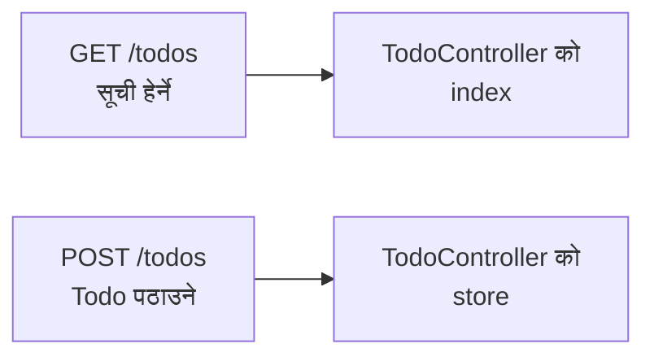
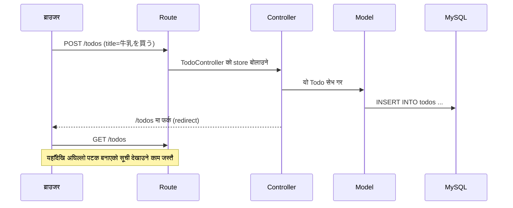
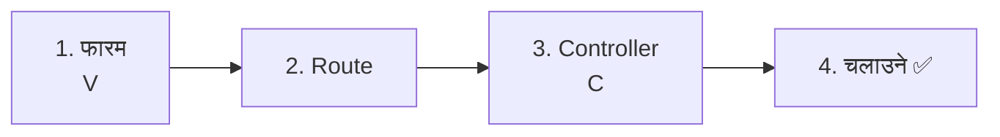
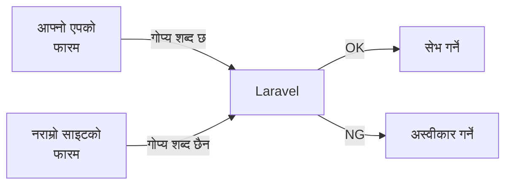
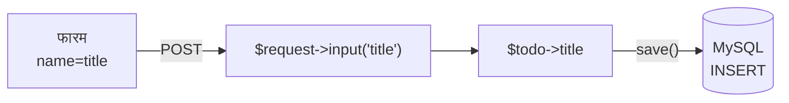
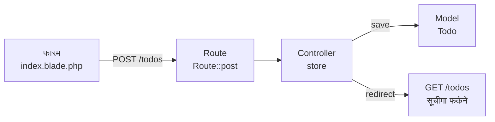

# Laravel को सुरुवात — Todo थपौं (CREATE)

> 🇯🇵 मूल प्रति (जापानी भाषामा): [20261022_資料_1.md](<../../../1年生_データ設計とアプリ開発/後期/20261022/20261022_資料_1.md>) <!-- original-ja-link -->

[अघिल्लो पटक](../20261015/20261015_資料_2.md) बनाएको Todo सूचीमा, **फारमबाट Todo थप्ने सुविधा** जोड्छौं।

## आजको लक्ष्य
- GET र POST को फरक बुझ्ने
- फारमबाट पठाएको डाटा Controller मा लिएर डाटाबेसमा सेभ गर्न सक्ने
- सेभ गरेपछि सूची पेजमा फर्काउन (redirect गर्न) सक्ने

> अभ्यासको वातावरण (`php-study`) मा mysql र laravel सुरु गरेर अभ्यास थालौं।
> अघिल्लो पटक बनाएको `/todos` को सूची पेज देखाउन सकिने अवस्थाबाट सुरु गर्छौं।

---

## 1. GET र POST

ब्राउजरबाट सर्भरलाई गरिने अनुरोध (request) का प्रकारहरू छन्। आज प्रयोग गर्ने तलका २ वटा हुन्।

| प्रकार | प्रयोग हुने अवस्था | उपमा |
|------|---------|-----------|
| **GET** | पेज **हेर्दा** (URL खोल्दा, लिङ्क क्लिक गर्दा) | मेनु हेर्न माग्नु |
| **POST** | डाटा **पठाउँदा** (फारमको submit बटन) | अर्डरको पर्ची दिनु |

अघिल्लो पटक बनाएको "Todo हेर्ने" पेज भएकाले त्यो **GET** थियो।
आज बनाउने "Todo पठाएर सेभ गर्ने" सुविधा भएकाले **POST** प्रयोग गर्छौं।

Laravel मा **एउटै URL का लागि पनि GET र POST अनुसार फरक-फरक काम** गराउन सकिन्छ।



> **पहिलो सेमेस्टरको todo.php मा चाहिँ?**
> पहिलो सेमेस्टरमा एउटै फाइलमा `<input type="hidden" name="action" value="create">` प्रयोग गरेर "कुन काम हो" छुट्याउँथ्यौं।
> Laravel मा **URL र GET/POST को संयोजन** ले कुन मेथड चल्ने भनेर तय गर्छ।

---

## 2. आजको क्रम

फारमको submit बटन थिच्दा, तलको क्रममा काम अगाडि बढ्छ।



मुख्य कुरा अन्तिमको **redirect** हो।
सेभ सकिएपछि, Controller ले स्क्रिन नबनाई "सूची पेज (`/todos`) फेरि खोल" भनेर ब्राउजरलाई फर्काउँछ।
ब्राउजरले सूची फेरि खोल्ने भएकाले, थपेको Todo सूचीमा देखिन्छ।

> **पहिलो सेमेस्टरको todo.php मा पनि गरेका थियौं**
> पहिलो सेमेस्टरमा `header('Location: index.php');` ले यही काम गरेका थियौं (PRG pattern)।
> रिलोड गर्दा पनि एउटै Todo दुई पटक दर्ता नहोस् भनेर यसो गरिन्छ।

---

## 3. बनाएर हेरौं

यस पटक टेबल र Model दुवै बनिसकेकाले, **चल्ने क्रम** (View → Route → Controller) मा बनाउँदै जान्छौं।



परिवर्तन गर्ने फाइलहरू तलका ३ वटा हुन् (`src` भित्र)। Model `Todo.php` आज परिवर्तन गर्दैनौं।

```
src/
├─ resources/views/todos/
│   └─ index.blade.php ················ 1. फारम थप्ने
├─ routes/
│   └─ web.php ························ 2. POST को Route थप्ने
└─ app/Http/Controllers/
    └─ TodoController.php ············· 3. store मेथड थप्ने
```

---

### 1. फारम बनाउने (V)

> अहिले यहाँ: **🟢 1. फारम** → 2. Route → 3. Controller → 4. चलाउने

`resources/views/todos/index.blade.php` खोलेर, `<h1>` को ठीक मुनि ★ को फारम थप्नुहोस्।

```html
<!DOCTYPE html>
<html lang="ja">
<head>
    <meta charset="UTF-8">
    <title>TODOアプリ</title>
</head>
<body>
    <h1>TODOアプリ</h1>

    {{-- ★ यहाँदेखि थप्ने --}}
    <form method="POST" action="/todos">
        @csrf
        <input type="text" name="title" placeholder="新しいTODOを入力" required>
        <button type="submit">追加</button>
    </form>
    {{-- ★ यहाँसम्म --}}

    <ul>
        @foreach ($todos as $todo)
            <li>
                <input type="checkbox" @checked($todo->is_done)>
                {{ $todo->title }}
            </li>
        @endforeach
    </ul>
</body>
</html>
```

| कोड | अर्थ |
|--------|------|
| `method="POST"` | POST बाट पठाउने |
| `action="/todos"` | `/todos` मा पठाउने |
| `name="title"` | `title` भन्ने नामले पठाउने। Controller मा यही नाम प्रयोग गरेर लिइन्छ |
| `required` | खाली भएमा पठाउन नमिल्ने बनाउने |
| `@csrf` | तल व्याख्या गरिने "गोप्य शब्द" हाल्ने |
| `{{-- --}}` | Blade को comment। स्क्रिनमा देखिँदैन |

#### `@csrf` भनेको के हो?

`@csrf` भनेको फारममा **गोप्य शब्द (CSRF token)** चुपचाप हाल्ने लेखाइ हो।
ब्राउजरमा "View page source" गर्दा, यो तल जस्तो एउटा लाइनमा बदलिएको देख्न सकिन्छ।

```html
<input type="hidden" name="_token" value="ランダムな文字列">
```

Laravel ले POST आइपुग्दा गोप्य शब्द जाँच्छ।
यसले **नराम्रो साइटले तपाईंको एपमा मनपरी फारम पठाउने आक्रमण (CSRF)** रोक्छ।



**POST को फारममा अनिवार्य रूपमा `@csrf` लेख्ने** भनेर सम्झनुहोस्।

> **`@csrf` बिर्से पनि कहिलेकाहीँ चलिहाल्छ**
> Laravel 13 ले गोप्य शब्दका साथै "एउटै साइटबाट पठाइएको हो कि" भनेर ब्राउजरसँग पनि जाँच्छ।
> त्यसैले, अभ्यासको वातावरण (`localhost`) मा `@csrf` बिर्से पनि कहिलेकाहीँ चलिहाल्छ।
> तर, सार्वजनिक गर्ने सर्भरको वातावरणअनुसार गोप्य शब्दले मात्र निर्णय गरिने भएकाले, **चले पनि अनिवार्य रूपमा लेख्नुहोस्**।

---

### 2. Route लेख्ने

> अहिले यहाँ: 1. फारम → **🟢 2. Route** → 3. Controller → 4. चलाउने

`routes/web.php` खोलेर, ★ को १ लाइन थप्नुहोस्।

```php
<?php

use Illuminate\Support\Facades\Route;
use App\Http\Controllers\TodoController;

Route::get('/', function () {
    return view('welcome');
});

Route::get('/todos', [TodoController::class, 'index']);
Route::post('/todos', [TodoController::class, 'store']);  // ★ थप्ने
```

```
Route::post( '/todos' ,  [TodoController::class, 'store'] );
~~~~~~~~~~~   ~~~~~~~     ~~~~~~~~~~~~~~~~~~~~~  ~~~~~~~
POST बाट      यो URL मा   TodoController को      store ले सम्हाल्ने
              पठाइएमा
```

`get` र `post` अनुसार, एउटै `/todos` भए पनि जिम्मा लिने मेथड फरक हुन्छ।

| Route | जिम्मा | गर्ने काम |
|--------|------|---------|
| `Route::get('/todos', ...)` | `index` | सूची देखाउने (अघिल्लो पटक) |
| `Route::post('/todos', ...)` | `store` | Todo सेभ गर्ने (आज) |

`store` (स्टोर) को अर्थ "राख्नु, सेभ गर्नु" हो। Laravel मा सेभ गर्ने मेथडलाई प्रायः `store` नाम दिइन्छ।

---

### 3. Controller लेख्ने (C)

> अहिले यहाँ: 1. फारम → 2. Route → **🟢 3. Controller** → 4. चलाउने

`app/Http/Controllers/TodoController.php` खोलेर, ★ को भाग थप्नुहोस्।

```php
<?php

namespace App\Http\Controllers;

use App\Models\Todo;
use Illuminate\Http\Request;  // ★ थप्ने (फारमको डाटा लिनका लागि)

class TodoController extends Controller
{
    public function index()
    {
        $todos = Todo::all();

        return view('todos.index', ['todos' => $todos]);
    }

    // ★ यहाँदेखि थप्ने
    public function store(Request $request)
    {
        // ① नयाँ Todo एउटा तयार गर्ने
        $todo = new Todo();

        // ② फारममा हालिएको शीर्षक राख्ने
        $todo->title = $request->input('title');

        // ③ डाटाबेसमा सेभ गर्ने
        $todo->save();

        // ④ सूची पेजमा फर्कने
        return redirect('/todos');
    }
    // ★ यहाँसम्म
}
```

| कोड | अर्थ |
|--------|------|
| `Request $request` | फारमबाट पठाइएको डाटा भएको बाकस। Laravel ले आफैं दिइदिन्छ |
| `$request->input('title')` | फारमको `name="title"` को मान निकाल्ने। पहिलो सेमेस्टरको `$_POST['title']` जस्तै |
| `new Todo()` | नयाँ Todo एउटा तयार गर्ने (अझै सेभ भएको छैन) |
| `$todo->save()` | डाटाबेसमा सेभ गर्ने। `INSERT INTO todos ...` जस्तै |
| `redirect('/todos')` | "`/todos` फेरि खोल" भनेर ब्राउजरलाई फर्काउने |

पहिलो सेमेस्टरको `todo.php` सँग तुलना गरौं।

```php
// पहिलो सेमेस्टर
$title = trim($_POST['title'] ?? '');
$stmt = $pdo->prepare("INSERT INTO todos (title) VALUES (:title)");
$stmt->execute(['title' => $title]);
header('Location: index.php');
exit;

// Laravel
$todo = new Todo();
$todo->title = $request->input('title');
$todo->save();
return redirect('/todos');
```

SQL नलेखी पनि, Model को `save()` ले `INSERT` स्टेटमेन्ट बनाइदिन्छ (ORM)।
Prepared statement पनि Laravel ले भित्रै गरिदिने भएकाले सुरक्षित छ।
साथै, पहिलो सेमेस्टरको `trim()` (अगाडि र पछाडिको खाली ठाउँ हटाउने) पनि Laravel ले आफैं गरिदिन्छ।



---

### 4. चलाउने ✅

> अहिले यहाँ: 1. फारम → 2. Route → 3. Controller → **🟢 4. चलाउने**

1. ब्राउजरमा http://localhost:8000/todos खोल्ने
2. इनपुट बाकसमा 「宿題をする」(गृहकार्य गर्ने) लेखेर `追加` (थप्ने) थिच्ने
3. सूचीको सबैभन्दा तल 「宿題をする」 देखियो भने सफल भयो

```
TODOアプリ

[ 新しいTODOを入力 ] [追加]

☐ 牛乳を買う
☑ レポートを出す
☐ 宿題をする        ← थपियो!
```

✅ **जाँच 1**: phpMyAdmin (http://localhost:8080) मा `todos` टेबल खोलेर हेर्नुहोस्।
थपेको Todo को `created_at` र `updated_at` मा मिति र समय हालिएको हुनुपर्छ। `save()` गर्दा Laravel ले आफैं हालिदिएको हो।
समय ९ घण्टा अघिको देखिनुको कारण, Laravel ले UTC (विश्व मानक समय) मा रेकर्ड गर्नु हो।
(अघिल्लो पटक phpMyAdmin मा हातैले हालेका Todo का ती फिल्डहरू भने खाली (NULL) नै हुन्छन्)

✅ **जाँच 2**: थपेपछि ब्राउजरमा रिलोड (F5) गरेर हेर्नुहोस्।
redirect गरिएकाले, एउटै Todo दुई पटक थपिँदैन।

---

## 4. काम नगरेमा

> **🔥 चलेन भने, log निकाल!**
> त्रुटिको कारण थाहा नभएमा, log निकालेर "कहाँसम्म चल्यो" भनेर पत्ता लगाउनुहोस् → [【महत्त्वपूर्ण】लग निकाल्ने तरिका](./【重要】ログの出し方.md)

| समस्या | कारण भएको ठाउँ | समाधान |
|------|----------|------|
| `The POST method is not supported for route todos.` | Route | `routes/web.php` मा `Route::post('/todos', ...)` लेख्नुभयो कि जाँच्ने |
| `Call to undefined method App\Http\Controllers\TodoController::store()` | Controller | `TodoController.php` मा `store` मेथड लेखिएको छ कि छैन र नामको हिज्जे ठीक छ कि छैन जाँच्ने |
| `Class "App\Http\Controllers\Request" does not exist` | Controller | `TodoController.php` को माथि `use Illuminate\Http\Request;` छ कि जाँच्ने |
| `Column 'title' cannot be null` | फारम | `<input>` को `name="title"` को हिज्जे जाँच्ने (Controller को `input('title')` सँग एउटै नाम राख्ने) |
| `419 Page Expired` | फारम | फारमभित्र `@csrf` छ कि जाँच्ने (अभ्यासको वातावरणमा `@csrf` नभए पनि यो नदेखिन सक्छ) |
| थपे पनि सूचीमा देखिँदैन | Controller | `$todo->save();` लेख्नुभयो कि जाँच्ने। phpMyAdmin मा डाटा छ कि पनि जाँच्ने |

---

## 5. सारांश



| आज लेखेको कुरा | छोटकरीमा |
|--------------|-----------|
| `<form method="POST">` र `@csrf` | Todo पठाउने फारम। POST को फारममा अनिवार्य रूपमा `@csrf` |
| `Route::post('/todos', ...)` | POST बाट पठाइयो भने `store` ले जिम्मा लिन्छ |
| `$request->input('title')` | फारमबाट पठाइएको मान लिने |
| `new Todo()` → `save()` | नयाँ Todo बनाएर सेभ गर्ने (INSERT) |
| `redirect('/todos')` | सेभ गरेपछि सूचीमा फर्कने |

---

## 6. अझै गरेर हेरौं (समय बचेकाहरूका लागि)

नयाँ थपेको Todo **सबैभन्दा माथि** आउने बनाएर हेरौं।
`index` मेथडको `Todo::all()` लाई तल जस्तै बदल्नुहोस्।

```php
$todos = Todo::orderBy('id', 'desc')->get();
```

यसको अर्थ `ORDER BY id DESC` (id ठूलोदेखि सानो क्रम = नयाँदेखि पुरानो क्रम) जस्तै हो।

> **`Todo::create()` भन्ने लेखाइ पनि छ**
> इन्टरनेटमा खोज्दा, `new Todo()` → `save()` को सट्टा तलको लेखाइ पनि प्रायः भेटिन्छ।
> ```php
> Todo::create(['title' => $request->input('title')]);
> ```
> १ लाइनमा लेख्न सकिने भएकाले सजिलो छ, तर यसलाई प्रयोग गर्न Model मा "कुन कोलममा हाल्न मिल्छ" भनेर लेख्ने सेटिङ (`Fillable`) चाहिन्छ।
> नलेखेमा `Add [title] to fillable property ...` भन्ने त्रुटि आउँछ।
> आज काम गर्ने तरिका बुझ्न सजिलो हुने भएकाले `new Todo()` → `save()` प्रयोग गर्‍यौं।

<!-- nav:start -->

---

📎 सँगै पढ्नुहोस् → [【महत्त्वपूर्ण】लग निकाल्ने तरिका](【重要】ログの出し方.md)

| ⬅️ अघिल्लो | 🗺️ समग्र नक्सा | अर्को ➡️ |
|:--|:--:|--:|
| [10/15 Todo सूची](../20261015/20261015_資料_2.md) | [सामग्रीको समग्र नक्सा](../../README.md) | [10/22 Todo विवरण (SHOW)](20261022_資料_2.md) |

<!-- nav:end -->
