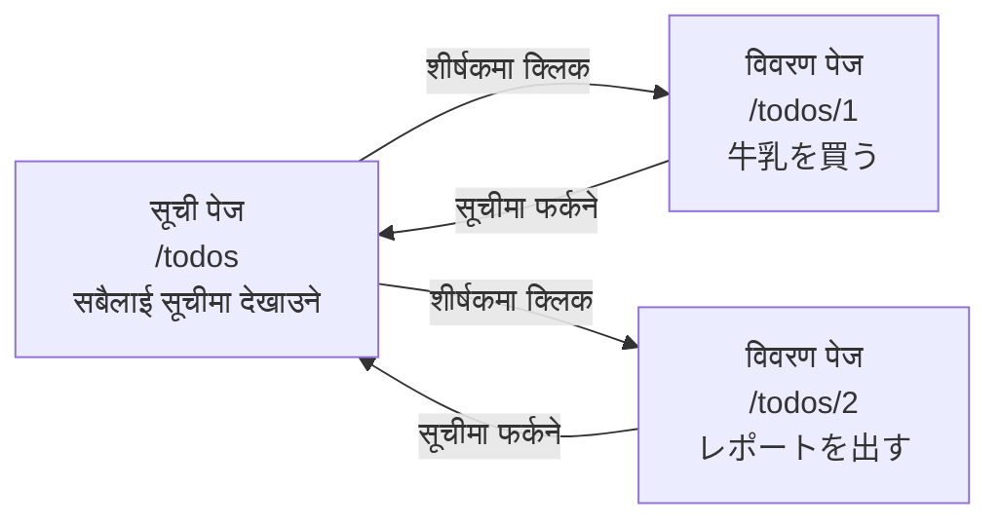
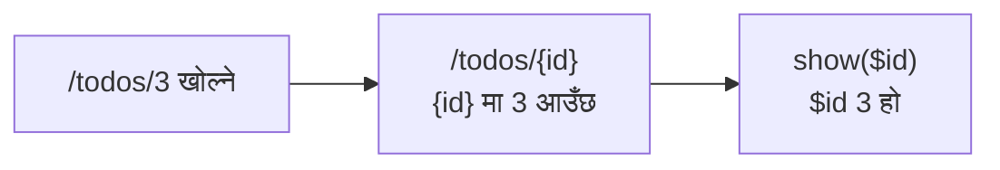
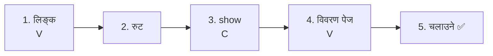
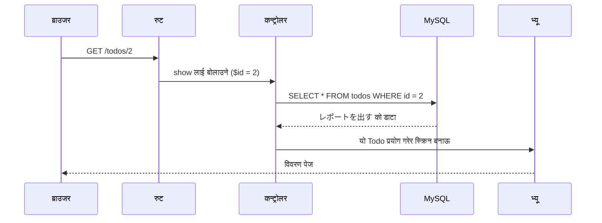
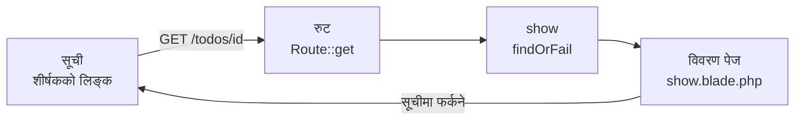

# Laravel परिचय — Todo को विवरण पेज बनाऔँ (SHOW)

> 🇯🇵 मूल प्रति (जापानी भाषामा): [20261022_資料_2.md](<../../../1年生_データ設計とアプリ開発/後期/20261022/20261022_資料_2.md>) <!-- original-ja-link -->

[सामग्री १](./20261022_資料_1.md) मा हामीले Todo थप्न सक्ने बनायौँ। अब, **एउटा Todo लाई विस्तारमा हेर्ने पेज (विवरण पेज)** बनाउँछौँ।

## आजको लक्ष्य
- URL भित्र `id` राखेर, कुन Todo हेर्ने भनेर छान्न सक्ने (रुट प्यारामिटर)
- `id` प्रयोग गरेर, एउटा मात्र Todo ल्याउन सक्ने
- एउटा Todo को जानकारी, विवरण पेजमा देखाउन सक्ने

> सामग्री १ को "Todo थप्ने" काम सकिएको अवस्थाबाट सुरु गर्छौँ।

---

## 1. सूची पेज र विवरण पेज

सूची पेज "सबै Todo लाई सूचीमा देखाउने" पेज थियो।
विवरण पेज "**एउटा मात्र Todo** लाई विस्तारमा देखाउने" पेज हो।



| | URL | जिम्मेवार | देखाउने कुरा |
|---|---|---|---|
| सूची पेज | `/todos` | `index` | सबै Todo |
| विवरण पेज | `/todos/1`, `/todos/2` … | `show` | **URL को नम्बरसँग मिल्ने `id` भएको** एउटा Todo |

URL को अन्तिम नम्बर, **हेर्न चाहेको Todo को `id`** हो।
`/todos/1` भए `id` 1 भएको Todo, `/todos/2` भए `id` 2 भएको Todo को विवरण पेज हुन्छ।

> **अनलाइन पसलमा पनि उस्तै**
> अनलाइन किनमेल गर्ने साइटमा पनि, सामानको सूचीबाट एउटामा क्लिक गर्दा, त्यो सामानको मात्र विस्तृत पेज खुल्छ।
> URL हेर्दा, त्यसमा `/items/12345` जस्तै **नम्बर राखिएको** प्रायः देखिन्छ।

---

## 2. नयाँ आउने कुराहरू

### रुट प्यारामिटर `{id}`

`/todos/1`・`/todos/2`・`/todos/3`… गरेर Todo जति छन् त्यति रुट लेख्नु धेरै गाह्रो हुन्छ।
त्यसैले, रुटमा `{id}` लेख्यो भने, **URL को त्यो भागमा जे आए पनि हुन्छ**, र त्यो मान कन्ट्रोलरमा लिन सकिन्छ।

```php
Route::get('/todos/{id}', [TodoController::class, 'show']);
```



### `findOrFail()` ले एउटा मात्र ल्याउने

सूचीमा `Todo::all()` ले **सबै** ल्यायौँ।
विवरण पेजमा, `id` प्रयोग गरेर **एउटा मात्र** ल्याउँछौँ।

| लेख्ने तरिका | ल्याउने कुरा | SQL मा यसरी लेखिन्छ |
|--------|--------------|------------|
| `Todo::all()` | सबै | `SELECT * FROM todos` |
| `Todo::findOrFail($id)` | `id` मिल्ने एउटा | `SELECT * FROM todos WHERE id = ?` |

---

## 3. बनाएर हेरौँ



परिवर्तन गर्ने फाइलहरू तलका ४ वटा हुन् (`src` भित्र)।

```
src/
├─ resources/views/todos/
│   ├─ index.blade.php ················ 1. शीर्षकलाई लिङ्क बनाउने
│   └─ show.blade.php ················· 4. विवरण पेज (नयाँ बनाउने)
├─ routes/
│   └─ web.php ························ 2. रुट थप्ने
└─ app/Http/Controllers/
    └─ TodoController.php ············· 3. show मेथड थप्ने
```

---

### 1. सूचीको शीर्षकलाई लिङ्क बनाउने (V)

> अहिले यहाँ: **🟢 1. लिङ्क** → 2. रुट → 3. show → 4. विवरण पेज → 5. चलाउने

`resources/views/todos/index.blade.php` खोलेर, `{{ $todo->title }}` लाई ★ जस्तै लिङ्कले घेर्नुहोस्।

```html
    <ul>
        @foreach ($todos as $todo)
            <li>
                <input type="checkbox" @checked($todo->is_done)>
                <a href="/todos/{{ $todo->id }}">{{ $todo->title }}</a>  {{-- ★ लिङ्क बनाउने --}}
            </li>
        @endforeach
    </ul>
```

`{{ $todo->id }}` मा, त्यो Todo को `id` आउँछ।
ब्राउजरमा सूची खोलेर, शीर्षकमा माउस राख्दा, तल बायाँ कुनामा `…/todos/1`・`…/todos/2` जस्तै, हरेक लाइनमा फरक URL देखिन्छ।

(यो बेला शीर्षक थिच्यो भने `404 Not Found` आउँछ। किनभने अझै रुट छैन)

---

### 2. रुट लेख्ने

> अहिले यहाँ: 1. लिङ्क → **🟢 2. रुट** → 3. show → 4. विवरण पेज → 5. चलाउने

`routes/web.php` मा, ★ को १ लाइन थप्नुहोस्।

```php
Route::get('/todos', [TodoController::class, 'index']);
Route::post('/todos', [TodoController::class, 'store']);
Route::get('/todos/{id}', [TodoController::class, 'show']);  // ★ थपेको
```

```
Route::get( '/todos/{id}' ,  [TodoController::class, 'show'] );
~~~~~~~~~~   ~~~~~~~~~~~     ~~~~~~~~~~~~~~~~~~~~~  ~~~~~~
GET अनुरोधमा  यो URL          TodoController को      show ले सम्हाल्छ
              खोल्दा
             ({id} जे भए पनि हुन्छ)
```

यहाँसम्म आउँदा, रुट ३ वटा भए।

| रुट | जिम्मेवार | गर्ने काम |
|--------|------|---------|
| `GET /todos` | `index` | सूची देखाउने |
| `POST /todos` | `store` | नयाँ थप्ने |
| `GET /todos/{id}` | `show` | एउटा Todo लाई विस्तारमा देखाउने |

`show` (शो) को अर्थ "देखाउनु" हो। Laravel मा, एउटा डाटा देखाउने मेथडलाई प्रायः `show` नाम दिइन्छ।

---

### 3. show मेथड लेख्ने (C)

> अहिले यहाँ: 1. लिङ्क → 2. रुट → **🟢 3. show** → 4. विवरण पेज → 5. चलाउने

`app/Http/Controllers/TodoController.php` मा, ★ को `show` मेथड थप्नुहोस्।

```php
    // (index र store छोडिएको छ)

    // ★ यहाँदेखि थप्ने
    public function show($id)
    {
        // ① id ले, हेर्न चाहेको Todo एउटा ल्याउने
        $todo = Todo::findOrFail($id);

        // ② विवरण पेज देखाउने
        return view('todos.show', ['todo' => $todo]);
    }
    // ★ यहाँसम्म
```

| कोड | अर्थ |
|--------|------|
| `show($id)` | URL को `{id}` भाग `$id` मा आउँछ |
| `Todo::findOrFail($id)` | `id` मिल्ने Todo एउटा ल्याउँछ |
| `view('todos.show', ...)` | `resources/views/todos/show.blade.php` प्रयोग गरेर स्क्रिन बनाउँछ |
| `['todo' => $todo]` | भ्यू भित्र `$todo` नामले प्रयोग गर्न मिल्ने बनाउँछ |

`index` सँग तुलना गरेर हेरौँ। संरचना लगभग उस्तै छ।

| | `index` (सूची) | `show` (विवरण) |
|---|---|---|
| ल्याउने | `Todo::all()` (सबै) | `Todo::findOrFail($id)` (एउटा) |
| भेरिएबल | `$todos` (बहुवचन) | `$todo` (एकवचन) |
| भ्यू | `todos.index` | `todos.show` |

> **`findOrFail` को "OrFail" भनेको के हो?**
> "भेटिएन भने असफल (Fail) हुन्छ" भन्ने अर्थ हो।
> `/todos/999` जस्तै, नभएको Todo खोल्न खोज्यो भने, आफैँ `404 Not Found` पेज देखाइदिन्छ।
> यस्तै देखिने `Todo::find($id)` चाहिँ, भेटिएन भने `null` (खाली) हुन्छ, र त्यसपछि भ्यूमा एरर आउँछ।

---

### 4. विवरण पेज बनाउने (V)

> अहिले यहाँ: 1. लिङ्क → 2. रुट → 3. show → **🟢 4. विवरण पेज** → 5. चलाउने

`resources/views/todos` भित्र, `show.blade.php` भन्ने फाइल नयाँ बनाउनुहोस्।

```
resources/views/todos/
  ├─ index.blade.php
  └─ show.blade.php   ← नयाँ बनाउने
```

```html
<!DOCTYPE html>
<html lang="ja">
<head>
    <meta charset="UTF-8">
    <title>TODOの詳細</title>
</head>
<body>
    <h1>{{ $todo->title }}</h1>

    <p>番号：{{ $todo->id }}</p>

    <p>
        状態：
        @if ($todo->is_done)
            完了 ✅
        @else
            未完了
        @endif
    </p>

    <a href="/todos">一覧にもどる</a>
</body>
</html>
```

| कोड | अर्थ |
|--------|------|
| `{{ $todo->title }}` | Todo को शीर्षक |
| `{{ $todo->id }}` | Todo को नम्बर (`id`) |
| `@if` 〜 `@else` 〜 `@endif` | सकिएको भए "完了 ✅" (सकियो), नभए "未完了" (बाँकी) देखाउने |

सूचीको भ्यूमा `@foreach` ले एक-एक गरेर निकालेका थियौँ, तर विवरण पेजको `$todo` **सुरुदेखि नै एउटा मात्र** भएकाले, `@foreach` चाहिँदैन।

---

### 5. चलाउने ✅

> अहिले यहाँ: 1. लिङ्क → 2. रुट → 3. show → 4. विवरण पेज → **🟢 5. चलाउने**

1. http://localhost:8000/todos खोल्नुहोस्
2. "レポートを出す" (रिपोर्ट बुझाउने) मा क्लिक गर्नुहोस्
3. तल जस्तो विवरण पेज आयो भने सफल भयो

```
レポートを出す

番号：2

状態：完了 ✅

一覧にもどる
```



✅ **जाँच १**: अरू Todo मा पनि क्लिक गरेर, हरेकको शीर्षक र अवस्था देखिन्छ कि देखिँदैन जाँच्नुहोस्।

✅ **जाँच २**: ब्राउजरको URL लाई, सिधै http://localhost:8000/todos/999 मा बदलेर खोलेर हेर्नुहोस्।
`id` 999 भएको Todo छैन, त्यसैले `404 Not Found` पेज आउँछ। यो `findOrFail` ले काम गरिरहेको संकेत हो।

---

## 4. राम्रोसँग नचलेमा

> **🔥 चलेन भने, लग निकाल!**
> एररको कारण थाहा नभएमा, `show` भित्र `Log::info()` प्रयोग गरेर, `$id` को मान जाँच्नुहोस् → [【महत्त्वपूर्ण】लग निकाल्ने तरिका](./【重要】ログの出し方.md)

| लक्षण | कारण भएको ठाउँ | उपाय |
|------|----------|------|
| शीर्षक थिच्दा `404 Not Found` | रुट | `routes/web.php` मा `Route::get('/todos/{id}', ...)` लेखेको छ कि छैन जाँच्ने |
| `Call to undefined method App\Http\Controllers\TodoController::show()` | कन्ट्रोलर | `TodoController.php` मा `show` मेथड लेखेको छ कि छैन, नामको हिज्जे जाँच्ने |
| `View [todos.show] not found.` | भ्यू | `resources/views/todos/show.blade.php` बनाएको छ कि छैन, फाइलको नाम जाँच्ने |
| `Undefined variable $todo` | कन्ट्रोलर | `view('todos.show', ['todo' => $todo])` को `'todo'` को हिज्जे जाँच्ने (`'todos'` भएको त छैन) |
| जुन Todo थिचे पनि, उही Todo आउँछ | भ्यू | सूचीको लिङ्क `href="/todos/{{ $todo->id }}"` भएको छ कि छैन जाँच्ने |

---

## 5. सारांश



| आज लेखेका कुरा | छोटकरीमा |
|--------------|-----------|
| `href="/todos/{{ $todo->id }}"` | हरेक Todo को लागि, `id` भएको लिङ्क बनाउने |
| `Route::get('/todos/{id}', ...)` | URL भित्रको `id` लाई, कन्ट्रोलरमा `$id` को रूपमा लिने |
| `Todo::findOrFail($id)` | `id` ले Todo एउटा ल्याउने। नभए 404 |
| `show.blade.php` | एउटा Todo लाई विस्तारमा देखाउने पेज |

यहाँ सिकेका **`{id}` र `findOrFail()`**, यसपछि बनाउने "सम्पादन" र "मेटाउने" मा पनि प्रयोग हुन्छन्।

---

## 6. अझ गरेर हेरौँ (समय बाँकी भएकाहरूका लागि)

विवरण पेजमा, **बनाएको मिति र समय** (`created_at`) पनि देखाएर हेरौँ।

<details>
<summary>संकेत</summary>

`show.blade.php` मा, तलको १ लाइन थप्नुहोस्।

```html
<p>作った日時：{{ $todo->created_at }}</p>
```

- सामग्री १ को फारमबाट थपेको Todo मा, मिति र समय देखिन्छ (UTC भएकाले, जापानको समयभन्दा ९ घण्टा पछाडि हुन्छ)
- अघिल्लो पटक phpMyAdmin मा हातैले हालेको Todo मा, `created_at` खाली (NULL) भएकाले, केही पनि देखिँदैन

</details>

<!-- nav:start -->

---

| ⬅️ अघिल्लो | 🗺️ समग्र नक्सा | अर्को ➡️ |
|:--|:--:|--:|
| [10/22 Todo थप्ने (CREATE)](20261022_資料_1.md) | [सामग्रीको समग्र नक्सा](../../README.md) | [10/29 Todo सम्पादन (UPDATE)](../20261029/20261029_資料_1.md) |

<!-- nav:end -->
