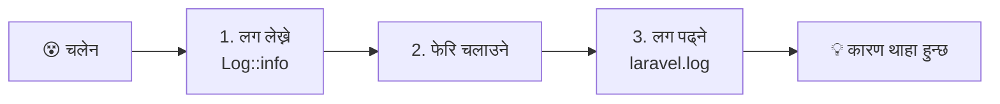
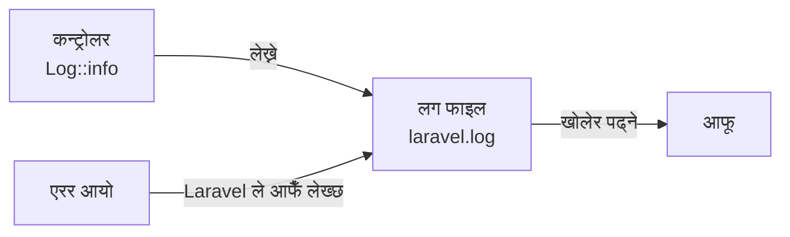
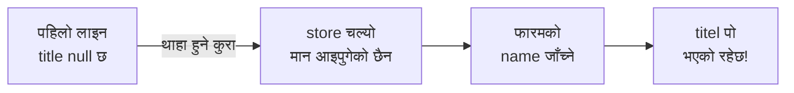
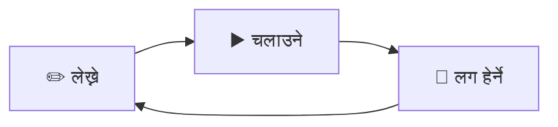

# 【महत्त्वपूर्ण】चलेन भने, लग निकाल!

> 🇯🇵 मूल प्रति (जापानी भाषामा): [【重要】ログの出し方.md](<../../../1年生_データ設計とアプリ開発/後期/20261022/【重要】ログの出し方.md>) <!-- original-ja-link -->

[Todo थपौँ (CREATE) मा फर्कने](./20261022_資料_1.md)

> ## 🔥 चलेन भने, लग निकाल!
> प्रोग्राम राम्रोसँग नचलेको बेला, **अनुमानको भरमा कोड बदल्दैमा, प्रायः ठीक हुँदैन।**
> पहिले **लग निकालेर, भित्र के भइरहेको छ हेर्ने**। यही नै कारण पत्ता लगाउने सबैभन्दा छोटो बाटो हो।
> यो पेज, अबका कक्षाहरूमा र आफ्नै प्रोजेक्ट बनाउँदा पनि सधैँ प्रयोग हुन्छ। समस्या पर्यो भने जति पटक पनि हेर्न आउनुहोस्।
>
> ## 👀 लग हेर्ने बानी बसालौँ!
> नचलेको बेला मात्र होइन, **सधैँ लग हेर्ने** गरौँ।
> "चल्यो जस्तो लागेको" गल्ती पनि, छिट्टै थाहा पाउन सकिन्छ।



## यो पेजको लक्ष्य
- लग केका लागि हुन्छ भनेर बुझ्ने
- `Log::info()` ले, आफैँ लग लेख्न सक्ने
- लग फाइल खोलेर, भित्रको कुरा पढ्न सक्ने
- सधैँ लग हेर्ने बानी बसाल्ने

---

## 1. लग भनेको

फारमको `追加` (थप्ने) थिच्दा पनि, राम्रोसँग सेभ नहुने बेला हुन्छ।
तर, कन्ट्रोलर भित्र के भइरहेको छ भन्ने कुरा, स्क्रिनबाट देखिँदैन।

- फारमको मान, ठीकसँग कन्ट्रोलरसम्म पुगेको छ?
- `store` मेथड चलेको नै छ कि छैन?

त्यस्तो बेला प्रयोग गर्ने कुरा **लग** हो।
लग भनेको, एपले "कहिले・के गर्यो" भनेर लेख्दै जाने **डायरी** जस्तै हो।



लग फाइलको ठाउँ, `src` भित्रको यहाँ हो।

```
src/
└─ storage/
    └─ logs/
        └─ laravel.log   ← यहाँ लेखिन्छ
```

> **एरर पनि आफैँ लेखिन्छ**
> आफूले केही नगरे पनि, प्रोग्राममा एरर आयो भने Laravel ले `laravel.log` मा लेखिदिन्छ।
> एरर स्क्रिन बन्द गरिहाले पनि, पछि लगमा हेर्न सकिन्छ।
>
> तर, `404 Not Found` (पेज भेटिएन)・`405` (`The POST method is not supported ...`)・`419 Page Expired` जस्ता
> **"URL वा पठाउने तरिका फरक" भएको एररहरू लगमा लेखिँदैनन्**। यस्तोमा, रुट वा फारम जाँच्नुहोस्।

---

## 2. लग लेखेर हेरौँ

अघिल्लो पटकको `store` मेथडमा, लग लेख्ने लाइन थपेर हेरौँ।
`app/Http/Controllers/TodoController.php` खोलेर, ★ भएको भाग थप्नुहोस्।

```php
<?php

namespace App\Http\Controllers;

use App\Models\Todo;
use Illuminate\Http\Request;
use Illuminate\Support\Facades\Log;  // ★ थपेको (लग प्रयोग गर्नका लागि)

class TodoController extends Controller
{
    // (index छोडिएको छ)

    public function store(Request $request)
    {
        // ★ फारमबाट आएको मान लगमा लेख्ने
        Log::info('Todoを追加します', ['title' => $request->input('title')]);

        $todo = new Todo();
        $todo->title = $request->input('title');
        $todo->save();

        // ★ सेभ भएको कुरा लगमा लेख्ने
        Log::info('Todoを保存しました', ['id' => $todo->id]);

        return redirect('/todos');
    }
}
```

| कोड | अर्थ |
|--------|------|
| `use Illuminate\Support\Facades\Log;` | लग प्रयोग गर्नका लागि चाहिने १ लाइन |
| `Log::info('सन्देश')` | लगमा "सूचना" को रूपमा लेख्ने |
| `['title' => ...]` | सन्देशसँगै, मान पनि लेख्ने (नभए पनि हुन्छ) |
| `$todo->id` | `save()` गरेपछि, आफैँ लागेको `id` थाहा हुन्छ |

---

## 3. लग हेरौँ

ब्राउजरमा http://localhost:8000/todos खोलेर, "宿題をする" (गृहकार्य गर्ने) लेखेर `追加` थिच्नुहोस्।
त्यसपछि, लग हेरौँ। हेर्ने तरिका २ वटा छन्।

### हेर्ने तरिका १: एडिटरमा खोल्ने

`src/storage/logs/laravel.log` लाई, VS Code जस्ता एडिटरमा खोल्नुहोस्।
सबैभन्दा तलसम्म स्क्रोल गर्दा, तल जस्ता लाइनहरू थपिएका हुन्छन्।

```
[2026-10-22 01:15:30] local.INFO: Todoを追加します {"title":"宿題をする"}
[2026-10-22 01:15:30] local.INFO: Todoを保存しました {"id":3}
```

| भाग | अर्थ |
|------|------|
| `[2026-10-22 01:15:30]` | लेखिएको मिति र समय |
| `local` | चलाइरहेको वातावरण (अभ्यास वातावरण `local` हो) |
| `INFO` | लगको प्रकार (सूचना) |
| `Todoを追加します` | आफूले लेखेको सन्देश ("Todo थप्दैछु") |
| `{"title":"宿題をする"}` | सँगै लेखिएको मान |

> **समय ९ घण्टा फरक छ?**
> Laravel ले, समयलाई **UTC (विश्व मानक समय)** मा रेकर्ड गर्छ। जापानको समय, UTC मा ९ घण्टा जोडेको समय हो।
> माथिको उदाहरणको `01:15:30`, जापानको समयमा `10:15:30` हो।

### हेर्ने तरिका २: PowerShell मा, रियल टाइममा हेर्ने

laravel फोल्डरमा, तलको कमान्ड चलाउनुहोस्।

```powershell
docker compose exec laravel tail -f storage/logs/laravel.log
```

लग लेखिने बित्तिकै, त्यहीँ देखिन्छ।
ब्राउजरमा `追加` थिच्दा, नयाँ लाइन थपिएको देख्न सकिन्छ।
हेर्न छोड्दा `Ctrl + C` थिच्नुहोस्।

> `tail: cannot open ... No such file or directory` आयो भने, अझै लग फाइल बनेको छैन।
> लग फाइल, पहिलो पटक १ लाइन लेखिँदा बन्छ। एक पटक ब्राउजरमा `追加` थिचेर, फेरि चलाउनुहोस्।

```mermaid
graph LR
    B[ब्राउजरमा<br>追加 (थप्ने) बटन थिच्ने] --> C[store चल्छ<br>Log::info]
    C --> F[laravel.log मा<br>१ लाइन थपिन्छ]
    F --> P[PowerShell मा<br>तुरुन्तै देखिन्छ]
```

> **`php artisan pail` प्रयोग गर्न मिल्दैन**
> इन्टरनेटमा खोज्दा, लग हेर्ने कमान्डको रूपमा `php artisan pail` भेटिन्छ।
> अभ्यास वातावरणमा, pail चलाउन चाहिने PHP को सुविधा (pcntl) राखिएको छैन, त्यसैले प्रयोग गर्न मिल्दैन।
> त्यसको सट्टा `tail -f` प्रयोग गर्छौँ।

---

## 4. लगका प्रकारहरू

लगमा, महत्त्व अनुसार प्रकारहरू हुन्छन्। धेरै प्रयोग हुने तलका ४ वटा हुन्।

| लेख्ने तरिका | प्रकार | प्रयोग गर्ने बेला |
|--------|------|---------|
| `Log::debug('...')` | डिबग | विकास गर्दै गर्दा, मान जाँच्न चाहेको बेला |
| `Log::info('...')` | सूचना | "Todo सेभ भयो" जस्ता, सामान्य घटना |
| `Log::warning('...')` | चेतावनी | एरर होइन, तर ध्यान दिनुपर्ने कुरा |
| `Log::error('...')` | एरर | असफल भएको बेला |

लग फाइलमा, `local.DEBUG`・`local.INFO`・`local.WARNING`・`local.ERROR` जस्तै प्रकार लेखिन्छ।
एरर खोज्दा, फाइलभित्र `ERROR` सर्च गर्यो भने सजिलै भेटिन्छ।

---

## 5. नचलेको बेला, लगबाट कारण खोज्ने

### लग ननिकाल्दा…

```
"सायद यहाँ गल्ती होला…"     → बदल्ने → अझै चलेन
"त्यसो भए उता होला…"        → बदल्ने → अझै चलेन
"सुरुमा कस्तो थियो होला…"   → पहिलेको जस्तो फर्काउन सकिँदैन 😱
```

अनुमानको भरमा बदल्दा, समय धेरै लाग्छ, साथै **चलिरहेको भागसम्म बिगार्न** सक्छ।

| | अनुमानले ठीक गर्ने | लग निकाल्ने |
|---|---|---|
| गर्ने काम | मनमा आएको ठाउँ बदल्ने | बदल्नुअघि, पहिले लगले भित्र हेर्ने |
| थाहा हुने कुरा | केही पनि थाहा हुँदैन | कहाँसम्म चल्यो・मान के थियो |
| नतिजा | ठीक हुन्छ कि हुँदैन भाग्यको कुरा | कारण हुन सक्ने ठाउँ पहिचान गर्न सकिन्छ |

### लगको मद्दतले कारण हुन सक्ने ठाउँ पत्ता लगाउने

लगलाई, "कहाँसम्म चल्यो" भनेर जाँच्न प्रयोग गर्न सकिन्छ।

उदाहरणका लागि, फारमको `name` लाई `name="titel"` (हिज्जे गल्ती) बनाइयो भनौँ।
`追加` थिच्दा, एरर आयो। लग हेर्दा, यसो लेखिएको छ।

```
[2026-10-22 01:20:05] local.INFO: Todoを追加します {"title":null}
[2026-10-22 01:20:05] local.ERROR: SQLSTATE[23000]: Integrity constraint violation: 1048 Column 'title' cannot be null ...
```



पहिलो लाइनबाट, **`store` सम्म चलेको छ तर, `title` को मान आइपुगेको छैन** भन्ने थाहा हुन्छ।
त्यसैले, मान पठाउने पक्ष (फारमको `name`) मा शंका गर्न सकिन्छ।

यसरी, **शंका लागेको ठाउँको अघि र पछि लग लेखेर, कहाँसम्म ठीकसँग चलेको छ भनेर जाँच्नु** नै कारण खोज्ने तरिका हो।

> **शिक्षक वा साथीलाई प्रश्न सोध्दा पनि, लग देखाऔँ**
> "चलेन" मात्र भन्दा, सोधिएको मान्छेले पनि कारण थाहा पाउँदैन।
> "`store` को सुरुमा निकालेको लगमा `title` `null` थियो" जस्तै, **लगसँगै प्रश्न** सोध्यो भने, तुरुन्तै समाधान हुन्छ।

---

## 6. लग र `dd()` को फरक

मान जाँच्ने तरिकामा, `dd()` पनि छ।

```php
dd($request->input('title'));
```

`dd()` लेख्यो भने, **त्यहीँ प्रोसेस रोकिन्छ**, र मान ब्राउजरमा देखिन्छ।

| | `Log::info()` | `dd()` |
|---|---|---|
| कहाँ देखिन्छ? | लग फाइल | ब्राउजरको स्क्रिन |
| प्रोसेस? | नरोकिई अन्तिमसम्म चल्छ | त्यहीँ रोकिन्छ |
| उपयुक्त बेला | पूरै प्रवाह पछ्याउन चाहेको बेला・पछि फेरि हेर्न चाहेको बेला | एउटा मान, त्यहीँ फटाफट हेर्न चाहेको बेला |
| पछि मेटाउने? | छोडे पनि हुन्छ | **अनिवार्य मेटाउने** (नमेटाए, सधैँ त्यहीँ रोकिन्छ) |

---

## 7. लग हेर्ने बानी बसालौँ!

लग, नचलेको बेला मात्र हेर्ने कुरा होइन। **सधैँ हेर्ने बानी** बसाल्यो भने, गल्ती छिट्टै थाहा पाउन सकिन्छ।

### विकास गर्दा, लग खुला नै राख्ने

प्रोग्राम लेखिरहेको बेला, PowerShell मा `tail -f` चलाइराख्नुहोस्।
स्क्रिन ३ वटा मिलाएर राखेर, **लेख्ने → चलाउने → लग हेर्ने** दोहोर्याउनु राम्रो हुन्छ।

```
┌──────────────┬──────────────┐
│              │              │
│  एडिटर       │  ब्राउजर     │
│  (लेख्ने)    │  (चलाउने)    │
│              │              │
├──────────────┴──────────────┤
│  PowerShell (लग हेर्ने)     │
│  tail -f storage/logs/...   │
└─────────────────────────────┘
```



### "चल्यो" भन्ने बेला पनि, लग हेर्ने

स्क्रिनमा चलेको जस्तो देखिए पनि, **भित्र फरक मान आएको** हुन सक्छ।
उदाहरणका लागि, लेखेको शीर्षक जस्ताको तस्तै आइपुगेको छ कि छैन, एक पटकको `追加` मा २ वटा सेभ भएको त छैन, आदि।
लगमा "सोचेजस्तै मान हो कि होइन" सम्म जाँचेपछि मात्र, "चल्यो" भन्न सकिन्छ।

### एरर स्क्रिन आयो भने, पहिले लग

एरर स्क्रिन आयो भने, नआत्तिई `laravel.log` को **सबैभन्दा तल** हेर्नुहोस्।
`ERROR` लेखिएको लाइनमा, के भयो भन्ने लेखिएको हुन्छ।
(`404`・`405`・`419` लगमा लेखिँदैनन्, त्यसैले स्क्रिनको सन्देश पढेर, रुट वा फारम जाँच्नुहोस्)

### लग हेर्ने बानीको चेकलिस्ट

- [ ] विकास सुरु गर्दा, `tail -f` ले लग खोलेँ
- [ ] बटन थिचेपछि वा पेज खोलेपछि, लग हेरेँ
- [ ] "चल्यो" भन्ने बेला पनि, सोचेजस्तै मान हो कि होइन लगमा जाँचेँ
- [ ] एरर आयो भने, पहिले `laravel.log` को सबैभन्दा तल हेरेँ
- [ ] प्रश्न सोध्दा, लग पनि सँगै देखाएँ

---

## 8. सारांश

> ## 🔥 चलेन भने, लग निकाल!
> ## 👀 लग हेर्ने बानी बसालौँ!

- लग भनेको, एपले "कहिले・के गर्यो" भनेर लेख्ने डायरी हो
- `use Illuminate\Support\Facades\Log;` लेखेर, `Log::info('सन्देश', [मान])` ले लेख्ने
- लग `src/storage/logs/laravel.log` मा लेखिन्छ। एरर पनि आफैँ लेखिन्छ
- `docker compose exec laravel tail -f storage/logs/laravel.log` ले, रियल टाइममा हेर्न सकिन्छ
- समय UTC मा हुन्छ (जापानको समयभन्दा ९ घण्टा पछाडि)
- राम्रोसँग नचलेको बेला, शंका लागेको ठाउँको अघि र पछि लग लेखेर "कहाँसम्म चल्यो" जाँच्ने
- विकास गर्दा `tail -f` खुला नै राखेर, **लेख्ने → चलाउने → लग हेर्ने** दोहोर्याउने

<!-- nav:start -->

---

| ⬅️ पछाडि | 🗺️ समग्र नक्सा | अर्को ➡️ |
|:--|:--:|--:|
| [10/22 Todo थप्ने (CREATE)](20261022_資料_1.md) | [सामग्रीको समग्र नक्सा](../../README.md) | [10/22 Todo विवरण (SHOW)](20261022_資料_2.md) |

<!-- nav:end -->
