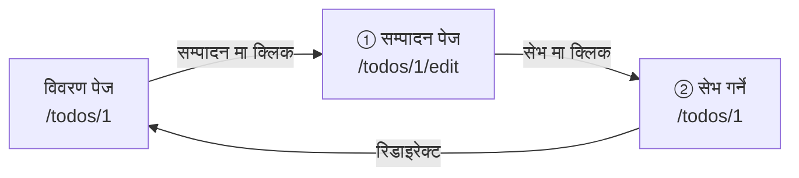
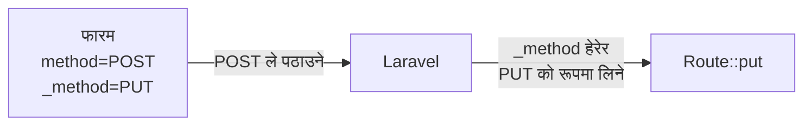
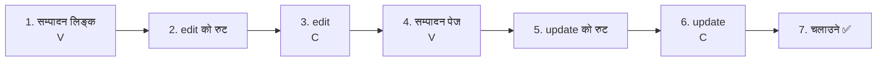
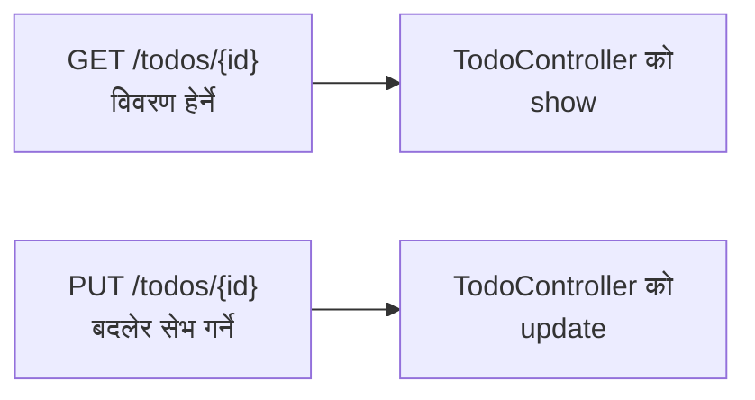
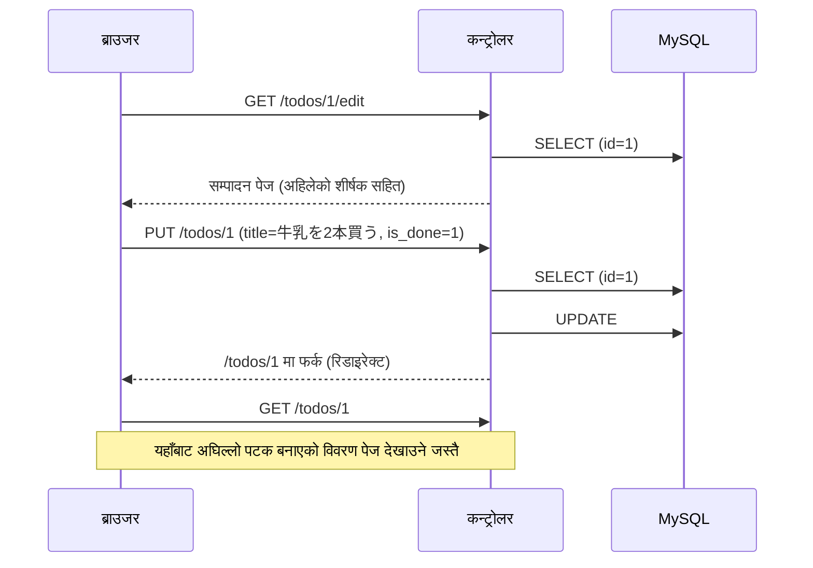
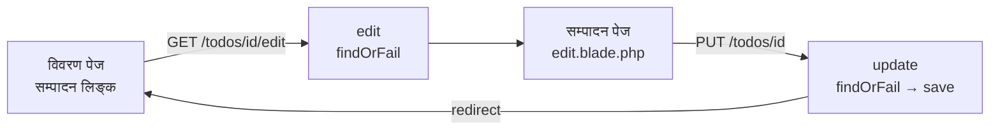

# Laravel परिचय — Todo सम्पादन गरौँ (UPDATE)

> 🇯🇵 मूल प्रति (जापानी भाषामा): [20261029_資料_1.md](<../../../1年生_データ設計とアプリ開発/後期/20261029/20261029_資料_1.md>) <!-- original-ja-link -->

[अघिल्लो पटक](../20261022/20261022_資料_2.md) बनाएको विवरण पेजमा "सम्पादन" बटन राखेर, **दर्ता गरेको Todo को शीर्षक र अवस्था (सकिएको・बाँकी) बदल्ने (सम्पादन गर्ने) सुविधा** बनाउँछौँ।

## आजको लक्ष्य
- सम्पादन पेज बनाएर, अहिलेको शीर्षक र अवस्था देखाउन सक्ने
- PUT र `@method('PUT')` प्रयोग गरेर, बदलेको कुरा पठाउन सक्ने
- बदलेको शीर्षक र अवस्था, डाटाबेसमा सेभ (UPDATE) गर्न सक्ने
- चेकबक्सको मान कसरी लिने भनेर बुझ्ने

> अभ्यास वातावरण (`php-study`) को mysql र laravel सुरु गरेपछि मात्र सुरु गर्छौँ।
> अघिल्लो पटकको "विवरण पेज (`/todos/1` आदि)" देखाउन सक्ने अवस्थाबाट सुरु गर्छौँ।

---

## 1. सम्पादन "२ वटा पेज" मिलेर बनेको हुन्छ

थप्ने काम "फारम पठाउने" १ पटकमै सकियो।
सम्पादन चाहिँ, **① सम्पादन पेज खोल्ने** → **② बदलेर पठाउने** गरी २ पटकमा बाँडिन्छ।



| | URL | प्रकार | जिम्मेवार | गर्ने काम |
|---|---|---|---|---|
| ① | `/todos/1/edit` | GET | `edit` | सम्पादन पेज देखाउने (अहिलेको शीर्षक इनपुट बक्समा राखिदिने) |
| ② | `/todos/1` | PUT | `update` | बदलेको शीर्षक सेभ गर्ने |

दुवैमा, URL भित्रको `1` **सम्पादन गर्न चाहेको Todo को `id`** हो।
अघिल्लो पटकको विवरण पेज जस्तै, **रुट प्यारामिटर `{id}`** र **`findOrFail()`** प्रयोग गर्छौँ।

> **पहिलो सेमेस्टरको todo.php मा चाहिँ?**
> पहिलो सेमेस्टरमा `index.php?edit=3` जस्तै, `?edit=` ले सम्पादन गर्ने Todo छान्थ्यौँ।
> Laravel मा, `/todos/3/edit` जस्तै **URL भित्रै `id` राख्छौँ**।

---

## 2. नयाँ आउने कुरा: PUT र `@method('PUT')`

"पहिल्यै भएको डाटा बदल्ने" बेला, **PUT** भन्ने प्रकार प्रयोग गर्नु Laravel को नियम हो।

| प्रकार | प्रयोग गर्ने बेला | अहिलेसम्म बनाएका कुरा |
|------|---------|-------------------|
| GET | हेर्ने | सूची (`/todos`)・विवरण (`/todos/1`) |
| POST | नयाँ थप्ने | थप्ने (`/todos`) |
| **PUT** | बदल्ने | **आजको सम्पादन** |

तर, HTML को फारमले **GET र POST मात्र पठाउन सक्छ**।
त्यसैले, फारम POST ले पठाएर, `@method('PUT')` ले "वास्तवमा यो PUT हो" भनेर Laravel लाई बताउँछौँ।

```html
<form method="POST" action="/todos/1">
    @csrf
    @method('PUT')
    ...
</form>
```

`@method('PUT')` चाहिँ, `<input type="hidden" name="_method" value="PUT">` भन्ने १ लाइनमा बदलिन्छ।
Laravel ले, यो `_method` हेरेर "PUT आयो" भनेर बुझ्छ।



---

## 3. बनाएर हेरौँ



परिवर्तन गर्ने फाइलहरू तलका ४ वटा हुन् (`src` भित्र)।

```
src/
├─ resources/views/todos/
│   ├─ show.blade.php ················· 1. सम्पादन लिङ्क थप्ने
│   └─ edit.blade.php ················· 4. सम्पादन पेज (नयाँ बनाउने)
├─ routes/
│   └─ web.php ························ 2・5. रुट थप्ने
└─ app/Http/Controllers/
    └─ TodoController.php ············· 3・6. edit र update थप्ने
```

---

### 1. विवरण पेजमा "सम्पादन" लिङ्क राख्ने (V)

> अहिले यहाँ: **🟢 1. सम्पादन लिङ्क** → 2. edit को रुट → 3. edit → 4. सम्पादन पेज → 5. update को रुट → 6. update → 7. चलाउने

अघिल्लो पटक बनाएको `resources/views/todos/show.blade.php` खोलेर, ★ को १ लाइन थप्नुहोस्।

```html
<body>
    <h1>{{ $todo->title }}</h1>

    <p>番号：{{ $todo->id }}</p>

    <p>
        状態：
        @if ($todo->is_done)
            完了 ✅
        @else
            未完了
        @endif
    </p>

    <a href="/todos/{{ $todo->id }}/edit">編集</a>  {{-- ★ थपेको --}}
    <a href="/todos">一覧にもどる</a>
</body>
```

`/todos/{{ $todo->id }}/edit` चाहिँ, `id` 1 भएको Todo भए `/todos/1/edit` हुन्छ।

(यो बेला "編集" (सम्पादन) थिच्यो भने `404 Not Found` आउँछ। किनभने अझै रुट छैन)

---

### 2. सम्पादन पेजको रुट लेख्ने

> अहिले यहाँ: 1. सम्पादन लिङ्क → **🟢 2. edit को रुट** → 3. edit → 4. सम्पादन पेज → 5. update को रुट → 6. update → 7. चलाउने

`routes/web.php` मा, ★ को १ लाइन थप्नुहोस्।

```php
Route::get('/todos', [TodoController::class, 'index']);
Route::post('/todos', [TodoController::class, 'store']);
Route::get('/todos/{id}', [TodoController::class, 'show']);
Route::get('/todos/{id}/edit', [TodoController::class, 'edit']);  // ★ थपेको
```

```
Route::get( '/todos/{id}/edit' ,  [TodoController::class, 'edit'] );
~~~~~~~~~~   ~~~~~~~~~~~~~~~~     ~~~~~~~~~~~~~~~~~~~~~  ~~~~~~
GET बाट      यो URL खोल्दा        TodoController को      edit ले सम्हाल्छ
```

`edit` (एडिट) को अर्थ "सम्पादन गर्नु" हो। Laravel मा, सम्पादन पेज देखाउने मेथडलाई प्रायः `edit` नाम दिइन्छ।

---

### 3. edit मेथड लेख्ने (C)

> अहिले यहाँ: 1. सम्पादन लिङ्क → 2. edit को रुट → **🟢 3. edit** → 4. सम्पादन पेज → 5. update को रुट → 6. update → 7. चलाउने

`app/Http/Controllers/TodoController.php` मा, ★ को `edit` मेथड थप्नुहोस्।

```php
    // (index・store・show छोडिएको छ)

    // ★ यहाँदेखि थप्ने
    public function edit($id)
    {
        // ① id ले, सम्पादन गर्न चाहेको Todo एउटा ल्याउने
        $todo = Todo::findOrFail($id);

        // ② सम्पादन पेज देखाउने
        return view('todos.edit', ['todo' => $todo]);
    }
    // ★ यहाँसम्म
```

अघिल्लो पटकको `show` सँग दाँजेर हेरौँ। **फरक भनेको, प्रयोग गर्ने भ्यू मात्र** हो।

| | `show` (विवरण) | `edit` (सम्पादन) |
|---|---|---|
| ल्याउने | `Todo::findOrFail($id)` | `Todo::findOrFail($id)` |
| भ्यू | `todos.show` | **`todos.edit`** |

---

### 4. सम्पादन पेज बनाउने (V)

> अहिले यहाँ: 1. सम्पादन लिङ्क → 2. edit को रुट → 3. edit → **🟢 4. सम्पादन पेज** → 5. update को रुट → 6. update → 7. चलाउने

`resources/views/todos` भित्र, `edit.blade.php` भन्ने फाइल नयाँ बनाउनुहोस्।

```
resources/views/todos/
  ├─ index.blade.php
  ├─ show.blade.php
  └─ edit.blade.php   ← नयाँ बनाउने
```

```html
<!DOCTYPE html>
<html lang="ja">
<head>
    <meta charset="UTF-8">
    <title>TODOの編集</title>
</head>
<body>
    <h1>TODOの編集</h1>

    <form method="POST" action="/todos/{{ $todo->id }}">
        @csrf
        @method('PUT')
        <input type="text" name="title" value="{{ $todo->title }}" required>
        <label>
            <input type="checkbox" name="is_done" value="1" @checked($todo->is_done)>
            完了
        </label>
        <button type="submit">保存</button>
    </form>

    <a href="/todos/{{ $todo->id }}">もどる</a>
</body>
</html>
```

| कोड | अर्थ |
|--------|------|
| `action="/todos/{{ $todo->id }}"` | `/todos/1` जस्तै, सम्पादन गरिरहेको Todo को `id` भएको URL मा पठाउने |
| `@csrf` | गोप्य शब्द (अघिल्लो पटकको थप्ने फारम जस्तै) |
| `@method('PUT')` | "वास्तवमा यो PUT हो" भनेर Laravel लाई बताउने |
| `value="{{ $todo->title }}"` | इनपुट बक्समा, **अहिलेको शीर्षक सुरुदेखि नै राखिदिने** |
| `name="is_done" value="1"` | चेक **लगाएको बेला मात्र**, `is_done=1` पठाइन्छ |
| `@checked($todo->is_done)` | सकिएको Todo भए, सुरुदेखि नै चेक लगाइदिने (10/15 को सूची जस्तै) |
| `<label>` 〜 `</label>` | "完了" (सकियो) भन्ने अक्षरमा क्लिक गर्दा पनि, चेक फेरिने बनाउने |

#### चेकबक्सले काम गर्ने महत्त्वपूर्ण तरिका

चेकबक्सले, **चेक लगाएको बेला मात्र** मान पठाउँछ।
चेक हटाएको बेला, `is_done` नै **पठाइँदैन**।

| चेकबक्स | पठाइने कुरा |
|----------------|------------|
| ☑ लगाएको | `title=…` र `is_done=1` |
| ☐ नलगाएको | `title=…` मात्र (`is_done` चाहिँ, केही पनि पठाइँदैन) |

त्यसैले, कन्ट्रोलरमा "`is_done` **पठाइएको छ कि छैन**" भन्ने आधारमा, सकिएको・बाँकी छुट्याउँछौँ (६ मा लेख्छौँ)।

थप्ने फारमसँगको फरक, तलका ४ वटा हुन्।

| | थप्ने फारम | सम्पादन फारम |
|---|---|---|
| पठाउने ठाउँ | `/todos` | `/todos/{{ $todo->id }}` |
| `@method('PUT')` | छैन | **छ** |
| इनपुट बक्स | खाली | **अहिलेको शीर्षक राखिएको** (`value`) |
| अवस्था | छैन (थपेको Todo बाँकी अवस्थामा हुन्छ) | **सकिएको जनाउने चेकबक्स** (अहिलेको अवस्था राखिएको) |

✅ **जाँच**: विवरण पेजमा "編集" (सम्पादन) थिचेर, इनपुट बक्समा अहिलेको शीर्षक र चेकबक्समा अहिलेको अवस्था देखिने सम्पादन पेज आयो भने ठीक छ।
(अझै "保存" (सेभ) नथिच्नुहोस्। थिच्यो भने एरर आउँछ)

---

### 5. सेभको रुट लेख्ने

> अहिले यहाँ: 1. सम्पादन लिङ्क → 2. edit को रुट → 3. edit → 4. सम्पादन पेज → **🟢 5. update को रुट** → 6. update → 7. चलाउने

`routes/web.php` मा, ★ को १ लाइन थप्नुहोस्।

```php
Route::get('/todos', [TodoController::class, 'index']);
Route::post('/todos', [TodoController::class, 'store']);
Route::get('/todos/{id}', [TodoController::class, 'show']);
Route::get('/todos/{id}/edit', [TodoController::class, 'edit']);
Route::put('/todos/{id}', [TodoController::class, 'update']);  // ★ थपेको
```

यहाँसम्म आउँदा, रुट ५ वटा भए।

| रुट | जिम्मेवार | गर्ने काम |
|--------|------|---------|
| `GET /todos` | `index` | सूची देखाउने |
| `POST /todos` | `store` | नयाँ थप्ने |
| `GET /todos/{id}` | `show` | एउटा Todo लाई विस्तारमा देखाउने |
| `GET /todos/{id}/edit` | `edit` | सम्पादन पेज देखाउने |
| `PUT /todos/{id}` | `update` | बदलेर सेभ गर्ने |

`/todos/{id}` लाई, **GET भए `show`, PUT भए `update`** ले जिम्मा लिन्छ।
`/todos` को "GET भए `index`, POST भए `store`" जस्तै संरचना हो।



---

### 6. update मेथड लेख्ने (C)

> अहिले यहाँ: 1. सम्पादन लिङ्क → 2. edit को रुट → 3. edit → 4. सम्पादन पेज → 5. update को रुट → **🟢 6. update** → 7. चलाउने

`TodoController.php` मा, ★ को `update` मेथड थप्नुहोस्।

```php
    // ★ यहाँदेखि थप्ने
    public function update(Request $request, $id)
    {
        // ① id ले, बदल्न चाहेको Todo एउटा ल्याउने
        $todo = Todo::findOrFail($id);

        // ② प्रविष्ट गरिएको शीर्षक र अवस्था अनुसार बदल्ने
        $todo->title = $request->input('title');
        $todo->is_done = $request->has('is_done');

        // ③ डाटाबेसमा सेभ गर्ने
        $todo->save();

        // ④ विवरण पेजमा फर्कने
        return redirect('/todos/' . $todo->id);
    }
    // ★ यहाँसम्म
```

| कोड | अर्थ |
|--------|------|
| `update(Request $request, $id)` | फारमको मान (`$request`) र, URL को `{id}` (`$id`) दुवै लिने |
| `$request->has('is_done')` | `is_done` पठाइएको भए `true` (सकियो), नभए `false` (बाँकी)। पहिलो सेमेस्टरको `isset($_POST['is_done'])` जस्तै |
| `'/todos/' . $todo->id` | अक्षर जोडेर `/todos/1` जस्तो URL बनाउने (`.` पहिलो सेमेस्टरमा सिकेको स्ट्रिङ जोड्ने तरिका) |

अघिल्लो पटक बनाएको थप्ने `store` मेथडको बनावटसँग यो लगभग उस्तै छ। फरक भनेको **① र ④** हो।

| | `store` (थप्ने) | `update` (सम्पादन) |
|---|---|---|
| ① | `new Todo()` (नयाँ बनाउने) | `Todo::findOrFail($id)` (अहिले भएको ल्याउने) |
| ② | `$todo->title = ...` | `$todo->title = ...` र `$todo->is_done = ...` |
| ③ | `save()` → `INSERT` | `save()` → **`UPDATE`** |
| ④ | सूची (`/todos`) मा फर्कने | विवरण पेज (`/todos/1` आदि) मा फर्कने |

उही `save()` प्रयोग गरे पनि, Laravel ले **नयाँ बनाएको Todo का लागि `INSERT` र ल्याएको Todo का लागि `UPDATE`** आफैँ छानेर प्रयोग गर्छ।

पहिलो सेमेस्टरको `todo.php` सँग दाँजेर हेरौँ।

```php
// पहिलो सेमेस्टर
$id = (int)($_POST['id'] ?? 0);
$title = trim($_POST['title'] ?? '');
$stmt = $pdo->prepare("UPDATE todos SET title = :title WHERE id = :id");
$stmt->execute(['title' => $title, 'id' => $id]);
header('Location: index.php');
exit;

// Laravel
$todo = Todo::findOrFail($id);
$todo->title = $request->input('title');
$todo->is_done = $request->has('is_done');
$todo->save();
return redirect('/todos/' . $todo->id);
```

पहिलो सेमेस्टरको सम्पादनमा शीर्षक मात्र थियो, तर Laravel संस्करणमा **अवस्था पनि सँगै** बदल्छौँ।

---

### 7. चलाउने ✅

> अहिले यहाँ: 1. सम्पादन लिङ्क → 2. edit को रुट → 3. edit → 4. सम्पादन पेज → 5. update को रुट → 6. update → **🟢 7. चलाउने**

1. http://localhost:8000/todos खोल्नुहोस्
2. "牛乳を買う" (दूध किन्ने) मा क्लिक गरेर, विवरण पेज खोल्नुहोस्
3. "編集" (सम्पादन) थिच्नुहोस्
4. इनपुट बक्सलाई "牛乳を2本買う" (दूध २ बोतल किन्ने) मा बदलेर, "完了" (सकियो) मा चेक लगाई `保存` (सेभ) थिच्नुहोस्
5. विवरण पेजमा फर्केर, शीर्षक "牛乳を2本買う" र अवस्था "完了 ✅" (सकियो) मा बदलिएको छ भने सफल भयो
6. फेरि एक पटक सम्पादन पेज खोलेर, चेक हटाएर `保存` गर्दा, "未完了" (बाँकी) मा फर्कन्छ भन्ने पनि जाँच्नुहोस्



✅ **जाँच १**: सूची पेजमा फर्केर, सूचीको शीर्षक र चेकबक्स पनि बदलिएको छ कि छैन जाँच्नुहोस्।

✅ **जाँच २**: phpMyAdmin मा `todos` टेबल खोलेर हेर्नुहोस्।
बदलेको Todo को `updated_at`, सेभ गरेको समयमा बदलिएको हुन्छ (UTC भएकाले, जापानको समयभन्दा ९ घण्टा पछाडि हुन्छ)।
`save()` गर्दा, Laravel ले "अपडेट गरेको समय" आफैँ राखिदियो। `created_at` चाहिँ जस्ताको तस्तै छ।

> **शीर्षक र अवस्था केही नबदली "保存" गर्यो भने?**
> केही पनि नबदलिएको बेला, Laravel ले `UPDATE` गर्दैन। त्यसैले `updated_at` पनि बदलिँदैन।

---

## 4. राम्रोसँग नचलेमा

> **🔥 चलेन भने, लग निकाल!**
> एररको कारण थाहा नभएमा, `update` भित्र `Log::info()` प्रयोग गरेर, `$id`・`title`・`is_done` को मान जाँच्नुहोस् → [【महत्त्वपूर्ण】लग निकाल्ने तरिका](../20261022/【重要】ログの出し方.md)

| लक्षण | कारण भएको ठाउँ | उपाय |
|------|----------|------|
| "編集" थिच्दा `404 Not Found` | रुट | `routes/web.php` मा `Route::get('/todos/{id}/edit', ...)` लेखेको छ कि छैन जाँच्ने |
| `Call to undefined method App\Http\Controllers\TodoController::edit()` | कन्ट्रोलर | `TodoController.php` मा `edit` मेथड लेखेको छ कि छैन, नामको हिज्जे जाँच्ने (`update` पनि उस्तै) |
| `View [todos.edit] not found.` | भ्यू | `resources/views/todos/edit.blade.php` बनाएको छ कि छैन, फाइलको नाम जाँच्ने |
| सम्पादन पेजको इनपुट बक्स खाली | भ्यू | `<input>` मा `value="{{ $todo->title }}"` छ कि छैन जाँच्ने |
| "保存" थिच्दा `The POST method is not supported for route todos/1.` | भ्यू | सम्पादन पेजको फारममा `@method('PUT')` छ कि छैन जाँच्ने |
| "保存" थिच्दा `The PUT method is not supported for route todos/1.` | रुट | `routes/web.php` मा `Route::put('/todos/{id}', ...)` लेखेको छ कि छैन जाँच्ने |
| सेभ गरे पनि, शीर्षक बदलिँदैन | कन्ट्रोलर | `update` भित्र `$todo->save();` छ कि छैन जाँच्ने |
| चेक लगाएर सेभ गरे पनि, बाँकी नै रहन्छ | भ्यू・कन्ट्रोलर | `name="is_done"` र `$request->has('is_done')` को हिज्जे उस्तै छ कि छैन जाँच्ने |
| चेक हटाएर सेभ गरे पनि, सकिएको नै रहन्छ | कन्ट्रोलर | `update` भित्र `$todo->is_done = $request->has('is_done');` छ कि छैन जाँच्ने |
| अर्कै Todo बदलियो | भ्यू | सम्पादन पेजको `action="/todos/{{ $todo->id }}"` जाँच्ने |

> `404`・`The ... method is not supported` एररहरू, लगमा लेखिँदैनन्। स्क्रिनको सन्देश पढेर, रुट वा फारम जाँच्नुहोस्।

---

## 5. सारांश



| आज लेखेका कुरा | एक शब्दमा |
|--------------|-----------|
| `Route::get('/todos/{id}/edit', ...)` र `edit` | सम्पादन पेज देखाउने। `show` सँग लगभग उस्तै |
| `value="{{ $todo->title }}"` | इनपुट बक्समा, अहिलेको शीर्षक राखिदिने |
| `<input type="checkbox" name="is_done" ...>` | अवस्था सम्पादन गर्ने चेकबक्स। चेक लगाएको बेला मात्र पठाइन्छ |
| `$request->has('is_done')` | `is_done` पठाइएको छ कि छैन भन्ने आधारमा, सकिएको・बाँकी छुट्याउने |
| `@method('PUT')` | फारम POST ले पठाएर, "वास्तवमा PUT" भनेर बताउने |
| `Route::put('/todos/{id}', ...)` र `update` | बदलेर सेभ गर्ने |
| ल्याएको Todo लाई `save()` | `UPDATE` हुन्छ (नयाँ बनाएको Todo भए `INSERT`) |

---

## 6. अझ गरेर हेरौँ (समय बाँकी भएकाहरूका लागि)

सम्पादन पेजको शीर्षकलाई, "TODOの編集" (TODO को सम्पादन) को सट्टा "『牛乳を買う』の編集" जस्तै, **सम्पादन गरिरहेको Todo को शीर्षक सहित** बनाएर हेरौँ।

<details>
<summary>संकेत</summary>

`edit.blade.php` को `<h1>` भित्र, `{{ $todo->title }}` प्रयोग गर्नुहोस्।

```html
<h1>『{{ $todo->title }}』の編集</h1>
```

</details>

---

अब, सूचीको चेकबक्सले सकिएको・बाँकी फेर्ने सुविधा बनाउँछौँ → [सकिएको・बाँकी फेरौँ (PATCH)](./20261029_資料_2.md)

<!-- nav:start -->

---

| ⬅️ अघिल्लो | 🗺️ समग्र नक्सा | अर्को ➡️ |
|:--|:--:|--:|
| [10/22 Todo विवरण (SHOW)](../20261022/20261022_資料_2.md) | [सामग्रीको समग्र नक्सा](../../README.md) | [10/29 सकिएको अवस्था फेर्ने (PATCH)](20261029_資料_2.md) |

<!-- nav:end -->
