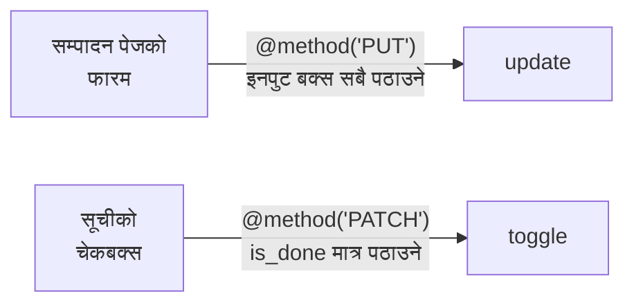
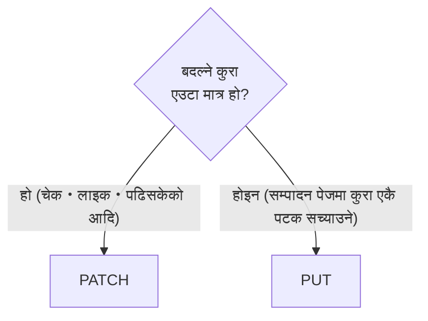
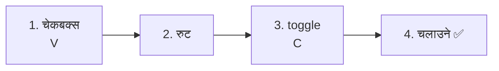
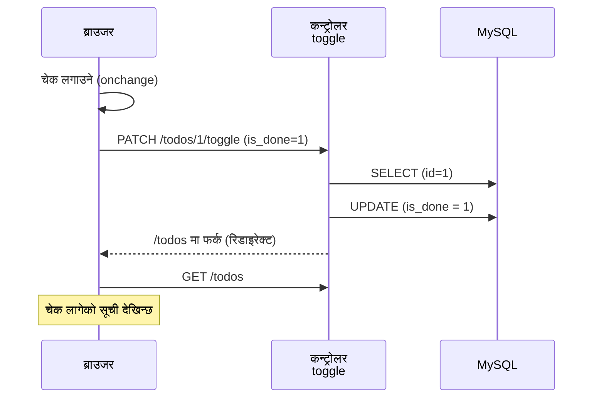
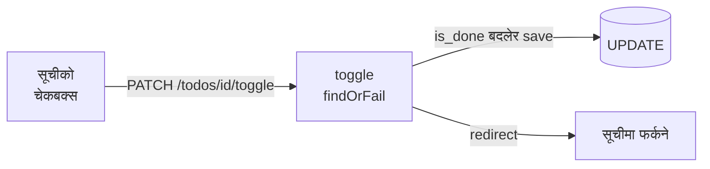

# Laravel परिचय — सकिएको・बाँकी फेरौँ (PATCH)

> 🇯🇵 मूल प्रति (जापानी भाषामा): [20261029_資料_2.md](<../../../1年生_データ設計とアプリ開発/後期/20261029/20261029_資料_2.md>) <!-- original-ja-link -->

[सामग्री १](./20261029_資料_1.md) मा Todo को शीर्षक सम्पादन गर्न सक्ने बनायौँ। अब, सूचीको चेकबक्सले **सकिएको・बाँकी फेर्ने सुविधा** बनाउँछौँ।

## आजको लक्ष्य
- PUT र PATCH को फरक बुझ्ने
- PATCH र `@method('PATCH')` प्रयोग गरेर, एउटा भाग मात्र बदल्ने आदेश पठाउन सक्ने
- चेकबक्सले, सकिएको・बाँकी फेर्न सक्ने

> सामग्री १ को "Todo सम्पादन गर्ने" काम सकिएको अवस्थाबाट सुरु गर्छौँ।

---

## 1. सकिएको・बाँकी फेर्नु भनेको

सामग्री १ मा, सम्पादन पेजबाट अवस्था (`is_done`) बदल्न सक्ने भयो।
तर, सूचीको चेकबक्स थिचे पनि **डाटाबेसमा सेभ हुँदैन** (पेज फेरि लोड गर्दा पहिलेकै जस्तो हुन्छ)।
यहाँ, सूचीको चेकबक्स **थिच्ने बित्तिकै "सकियो ⇄ बाँकी" फेरिने** बनाउँछौँ।
हरेक पटक सम्पादन पेज नखोली, सूचीबाटै त्यहीँ फेर्न सकिने हुन्छ।

```
TODOアプリ

☐ 牛乳を買う         ← चेक लगाउँदा "सकियो" हुन्छ
☑ レポートを出す     ← चेक हटाउँदा "बाँकी" मा फर्कन्छ
```

भित्रको काम, सामग्री १ मा बनाएको `update` जस्तै **UPDATE** हो। बदल्ने कुरा `title` नभई `is_done` हुन्छ, फरक यति मात्र हो।

| URL | प्रकार | जिम्मेवार | गर्ने काम |
|-----|------|------|---------|
| `/todos/1/toggle` | **PATCH** | `toggle` | `is_done` बदल्ने |

`toggle` (टगल) को अर्थ "अन・अफ फेर्नु" हो।

---

## 2. नयाँ आउने कुरा: PATCH

बदल्ने बेलाको प्रकारमा, **PUT** बाहेक **PATCH** (प्याच) पनि छ।
दुवै "बदल्ने" हुन्, तर **कति बदल्ने** भन्नेमा फरक छ।

| प्रकार | अर्थ | उदाहरण दिँदा |
|------|------|-----------|
| PUT | डाटा **पूरै** बदल्ने | कागजात नयाँ गरी फेरि लेखेर, **पूरै साट्ने** |
| **PATCH** | डाटाको **एउटा भाग मात्र** बदल्ने | कागजातको **एक ठाउँमा मात्र**, करेक्सन टेप टाँस्ने |

`patch` को अंग्रेजी अर्थ "टालो (लुगाको प्वालमा, कपडाको एउटा टुक्रा राखेर टाल्ने)" हो।

### ठेगाना कार्डले दाँजेर हेरौँ

उदाहरणका लागि, यस्तो "ठेगाना कार्ड" छ भनौँ।

```
नाम: 山田 花子
ठेगाना: 東京都〇〇区…
फोन: 090-xxxx-xxxx
```

घर सरेकाले, **ठेगाना मात्र** बदलियो।

```
【PUT】नयाँ कार्ड एउटा लेखेर, पूरै साट्ने

  ┌────────────────────────────┐
  │ नाम: 山田 花子             │ ← नबदलिए पनि लेख्ने
  │ ठेगाना: 大阪府…(नयाँ)      │ ← बदलिएको ठाउँ
  │ फोन: 090-xxxx-xxxx         │ ← नबदलिए पनि, लेख्ने
  └────────────────────────────┘

【PATCH】अहिलेको कार्डको, ठेगानाको ठाउँमा मात्र करेक्सन टेप टाँस्ने

  ┌────────────────────────────┐
  │ ठेगाना: 大阪府…(नयाँ)      │ ← बदलिएको ठाउँ मात्र
  └────────────────────────────┘
```

| | PUT | PATCH |
|---|---|---|
| पठाउने कुरा | **नाम・ठेगाना・फोन सबै** (नबदलिएको नाम र फोन पनि लेख्ने) | **ठेगाना मात्र** |
| नलेखेको कुरा? | "खाली बनाउने" भन्ने अर्थ हुन्छ | "जस्ताको तस्तै" भन्ने अर्थ हुन्छ |

PUT ले "यो नयाँ कार्ड हो" भनेर **सबै** दिन्छ, त्यसैले लेख्न बिर्सेको कुरा खाली हुन्छ।
PATCH ले "यहाँ मात्र सच्याइदेऊ" भनेर दिन्छ, त्यसैले नलेखेको कुरा जस्ताको तस्तै रहन्छ।

### Todo एपमा चाहिँ

Todo एपमा लागू गर्दा, यस्तो हुन्छ।

| | सम्पादन (`update`) | सकिएको・बाँकी फेर्ने (`toggle`) |
|---|---|---|
| कस्तो काम? | सम्पादन पेजमा, **Todo को कुरा फेरि लेखेर** सेभ गर्ने | सूचीमा, **चेक मात्र** फेर्ने |
| पठाउने कुरा | सम्पादन पेजका इनपुट बक्सहरू **सबै** (`title` र `is_done`) | **`is_done` मात्र** |
| प्रकार | **PUT** | **PATCH** |
| लेख्ने तरिका | `@method('PUT')` ／ `Route::put(...)` | `@method('PATCH')` ／ `Route::patch(...)` |



> **सम्पादन पेजमै अवस्था बदल्न मिल्छ भने, किन toggle बनाउने?**
> सम्पादन पेज "शीर्षक र अवस्था **एकै पटक** फेरि लेख्ने स्क्रिन" हो (PUT)।
> सूचीको चेकबक्स "अवस्था **मात्र**, त्यहीँ फटाफट बदल्ने" कामका लागि हो (PATCH)।
> दुवैले `is_done` बदल्छन्, तर **पठाउने कुरा (सबै कि, एउटा भाग) फरक** भएकाले, छुट्टै प्रोसेस・छुट्टै प्रकार बनाउँछौँ।
> "स्क्रिनका कुराहरू एकै पटक फेरि पठाउने" PUT, "एउटा कुरा मात्र ठ्याक्कै बदल्ने" PATCH हो।

### अलमल भएको बेला



वरपरका एपहरूमा, उदाहरणका लागि यसरी छुट्याएर प्रयोग गरिन्छ।

| काम | प्रकार | कारण |
|------|------|------|
| प्रोफाइल सम्पादन पेजमा "सेभ" | PUT | नाम・आफ्नो परिचय आदि, एकै पटक फेरि पठाउने |
| पोस्टमा "लाइक" लगाउने | PATCH | "लाइक" को एक ठाउँ मात्र बदल्ने |
| सन्देशलाई "पढिसकेको" बनाउने | PATCH | "पढिसकेको हो कि होइन" को एक ठाउँ मात्र बदल्ने |
| Todo मा चेक लगाउने | PATCH | `is_done` को एक ठाउँ मात्र बदल्ने |

### PUT र PATCH, जुनसुकैले पनि चल्छ?

Laravel मा, जुन प्रयोग गरे पनि `save()` ले उस्तै गरी सेभ गर्न सकिन्छ। **प्रोग्रामको काम बदलिँदैन**।
(ठेगाना कार्डको कुरा "PUT र PATCH को **अर्थ**" हो। Laravel मा, PUT ले नपठाएको कुरा आफैँ खाली हुँदैन)
तैपनि छुट्याएर प्रयोग गर्नुको कारण, रुट हेर्दैमा **"के गर्ने प्रोसेस हो" थाहा पाउन** सकियोस् भनेर हो।

```php
Route::put('/todos/{id}', ...);           // "Todo लाई पूरै फेरि लेख्ने रहेछ"
Route::patch('/todos/{id}/toggle', ...);  // "Todo को एउटा भाग बदल्ने रहेछ"
```

> वास्तविक विकासमा, सम्पादन पेजमा पनि PATCH प्रयोग गर्ने टिमहरू छन्। महत्त्वपूर्ण कुरा, **टिमभित्र नियम एउटै बनाउनु** हो।
> यो कक्षामा, "सम्पादन पेज PUT, एउटा कुरा मात्र बदल्दा PATCH" भनेर एउटै बनाउँछौँ।

HTML को फारमले PATCH पनि पठाउन सक्दैन, त्यसैले PUT जस्तै `@method('PATCH')` प्रयोग गर्छौँ।

> **पहिलो सेमेस्टरको todo.php मा पनि गरेका थियौँ**
> पहिलो सेमेस्टरमा `action=toggle` पठाएर, `isset($_POST['is_done']) ? 1 : 0` ले सकिएको・बाँकी छुट्याउँथ्यौँ।
> Laravel मा पनि, उही सोचले बनाउँछौँ।

---

## 3. बनाएर हेरौँ



छुने फाइलहरू तलका ३ वटा हुन् (`src` भित्र)।

```
src/
├─ resources/views/todos/
│   └─ index.blade.php ················ 1. चेकबक्सलाई फारमले घेर्ने
├─ routes/
│   └─ web.php ························ 2. रुट थप्ने
└─ app/Http/Controllers/
    └─ TodoController.php ············· 3. toggle मेथड थप्ने
```

---

### 1. सूचीको चेकबक्सले सेभ गर्न सक्ने बनाउने (V)

> अहिले यहाँ: **🟢 1. चेकबक्स** → 2. रुट → 3. toggle → 4. चलाउने

`resources/views/todos/index.blade.php` को `<li>` भित्रको भाग, तल जस्तै बदल्नुहोस्।
अहिले भएको चेकबक्सलाई **फारमले घेरेर**, `name`・`value`・`onchange` थप्नुहोस्।

```html
    <ul>
        @foreach ($todos as $todo)
            <li>
                {{-- ★ यहाँदेखि बदल्ने --}}
                <form method="POST" action="/todos/{{ $todo->id }}/toggle" style="display: inline;">
                    @csrf
                    @method('PATCH')
                    <input type="checkbox" name="is_done" value="1" onchange="this.form.submit()" @checked($todo->is_done)>
                </form>
                {{-- ★ यहाँसम्म --}}
                <a href="/todos/{{ $todo->id }}">{{ $todo->title }}</a>
            </li>
        @endforeach
    </ul>
```

| | 10/15 देखि (थिचे पनि सेभ हुँदैन) | आजदेखि (थिच्दा सेभ हुन्छ) |
|---|---|---|
| फारम | छैन | `<form ...>` ले घेर्ने |
| `name="is_done" value="1"` | छैन | छ |
| `onchange` | छैन | छ |
| `@checked(...)` | छ | छ (जस्ताको तस्तै) |

| कोड | अर्थ |
|--------|------|
| `action="/todos/{{ $todo->id }}/toggle"` | `/todos/1/toggle` जस्तै, त्यो Todo को `id` भएको URL मा पठाउने |
| `@method('PATCH')` | "वास्तवमा यो PATCH हो" भनेर Laravel लाई बताउने (एउटा भाग मात्र बदल्नका लागि) |
| `name="is_done" value="1"` | चेक **लगाएको बेला मात्र**, `is_done=1` पठाइन्छ |
| `onchange="this.form.submit()"` | चेक बदल्ने बित्तिकै, फारम पठाउने (पठाउने बटन चाहिँदैन) |
| `@checked($todo->is_done)` | सकिएको Todo भए, सुरुदेखि नै चेक लगाइदिने (10/15 जस्तै) |
| `style="display: inline;"` | फारमपछि नयाँ लाइनमा नझरी, शीर्षकसँग छेउमै राख्ने |

> **चेकबक्सले काम गर्ने महत्त्वपूर्ण तरिका (सामग्री १ को पुनरावलोकन)**
> चेकबक्सले, **चेक लगाएको बेला मात्र** `is_done=1` पठाउँछ। चेक हटाएको बेला, `is_done` नै पठाइँदैन।
> त्यसैले, कन्ट्रोलरमा सामग्री १ को `update` जस्तै, "`is_done` **पठाइएको छ कि छैन**" भन्ने आधारमा सकिएको・बाँकी छुट्याउँछौँ।

---

### 2. रुट लेख्ने

> अहिले यहाँ: 1. चेकबक्स → **🟢 2. रुट** → 3. toggle → 4. चलाउने

`routes/web.php` मा, ★ को १ लाइन थप्नुहोस्।

```php
Route::get('/todos', [TodoController::class, 'index']);
Route::post('/todos', [TodoController::class, 'store']);
Route::get('/todos/{id}', [TodoController::class, 'show']);
Route::get('/todos/{id}/edit', [TodoController::class, 'edit']);
Route::put('/todos/{id}', [TodoController::class, 'update']);
Route::patch('/todos/{id}/toggle', [TodoController::class, 'toggle']);  // ★ थपेको
```

`/todos/{id}` (शीर्षक सम्पादन गर्ने) र `/todos/{id}/toggle` (सकिएको र बाँकी अवस्था फेर्ने) का URL फरक भएकाले, तिनलाई फरक-फरक मेथडले सम्हाल्छन्।

---

### 3. toggle मेथड लेख्ने (C)

> अहिले यहाँ: 1. चेकबक्स → 2. रुट → **🟢 3. toggle** → 4. चलाउने

`TodoController.php` मा, ★ को `toggle` मेथड थप्नुहोस्।

```php
    // ★ यहाँदेखि थप्ने
    public function toggle(Request $request, $id)
    {
        // ① id ले, फेर्न चाहेको Todo एउटा ल्याउने
        $todo = Todo::findOrFail($id);

        // ② is_done पठाइएको भए सकियो (true), नभए बाँकी (false)
        $todo->is_done = $request->has('is_done');

        // ③ डाटाबेसमा सेभ गर्ने
        $todo->save();

        // ④ सूची पेजमा फर्कने
        return redirect('/todos');
    }
    // ★ यहाँसम्म
```

| कोड | अर्थ |
|--------|------|
| `$request->has('is_done')` | `is_done` पठाइएको भए `true`, नभए `false`। पहिलो सेमेस्टरको `isset($_POST['is_done'])` जस्तै |

`update` सँग दाँजेर हेरौँ।

| | `update` (सम्पादन पेज) | `toggle` (सूचीको चेकबक्स) |
|---|---|---|
| ① | `Todo::findOrFail($id)` | `Todo::findOrFail($id)` |
| ② | `title` र `is_done` बदल्ने | **`is_done` मात्र** बदल्ने |
| ③ | `save()` → `UPDATE` | `save()` → `UPDATE` |
| ④ | विवरण पेजमा फर्कने | सूची पेजमा फर्कने |

पहिलो सेमेस्टरको `todo.php` सँग दाँजेर हेरौँ।

```php
// पहिलो सेमेस्टर
$id = (int)($_POST['id'] ?? 0);
$isDone = isset($_POST['is_done']) ? 1 : 0;
$stmt = $pdo->prepare("UPDATE todos SET is_done = :is_done WHERE id = :id");
$stmt->execute(['is_done' => $isDone, 'id' => $id]);
header('Location: index.php');
exit;

// Laravel
$todo = Todo::findOrFail($id);
$todo->is_done = $request->has('is_done');
$todo->save();
return redirect('/todos');
```

---

### 4. चलाउने ✅

> अहिले यहाँ: 1. चेकबक्स → 2. रुट → 3. toggle → **🟢 4. चलाउने**

1. http://localhost:8000/todos खोल्नुहोस्
2. "牛乳を買う" (दूध किन्ने) को चेकबक्समा चेक लगाउनुहोस्
3. पेज फेरि लोड भएर, चेक लागेकै अवस्थामा छ भने सफल भयो
4. फेरि एक पटक चेक हटाएर, हटेकै अवस्थामा रहन्छ कि रहँदैन पनि जाँच्नुहोस्



✅ **जाँच १**: चेक लगाएको Todo को विवरण पेज खोलेर, "完了 ✅" (सकियो) भएको छ कि छैन जाँच्नुहोस्।

✅ **जाँच २**: phpMyAdmin मा `todos` टेबल खोलेर, `is_done` `1` (सकियो)・`0` (बाँकी) मा बदलिएको छ कि छैन जाँच्नुहोस्।

---

## 4. राम्रोसँग नचलेमा

> **🔥 चलेन भने, लग निकाल!**
> एररको कारण थाहा नभएमा, `toggle` भित्र `Log::info()` प्रयोग गरेर, `is_done` पठाइएको छ कि छैन जाँच्नुहोस् → [【महत्त्वपूर्ण】लग निकाल्ने तरिका](../20261022/【重要】ログの出し方.md)

| लक्षण | कारण भएको ठाउँ | उपाय |
|------|----------|------|
| चेक गर्दा पनि, केही हुँदैन | भ्यू | `<input>` मा `onchange="this.form.submit()"` छ कि छैन जाँच्ने |
| चेक गर्दा `404 Not Found` | रुट | `routes/web.php` मा `Route::patch('/todos/{id}/toggle', ...)` लेखेको छ कि छैन जाँच्ने |
| चेक गर्दा `The POST method is not supported for route todos/1/toggle.` | भ्यू | चेकबक्सको फारममा `@method('PATCH')` छ कि छैन जाँच्ने |
| चेक गर्दा `The PATCH method is not supported for route todos/1/toggle.` | रुट | `routes/web.php` मा `Route::put(...)` भएको त छैन जाँच्ने (`Route::patch(...)` बनाउने) |
| चेक लगाए पनि, हटेर फर्कन्छ | भ्यू・कन्ट्रोलर | `name="is_done"` र `$request->has('is_done')` को हिज्जे उस्तै छ कि छैन जाँच्ने |
| सकिएको Todo भए पनि, चेक लागेको छैन | भ्यू | `<input>` मा `@checked($todo->is_done)` छ कि छैन जाँच्ने |

---

## 5. सारांश



| आज लेखेका कुरा | छोटकरीमा |
|--------------|-----------|
| PATCH र `@method('PATCH')` | एउटा भाग मात्र बदल्दा प्रयोग गर्ने (पूरै भए PUT) |
| `onchange="this.form.submit()"` | चेक बदल्ने बित्तिकै, फारम पठाउने |
| `name="is_done" value="1"` | चेक लगाएको बेला मात्र, `is_done=1` पठाइन्छ |
| `Route::patch('/todos/{id}/toggle', ...)` | PATCH ले पठाइएमा `toggle` ले जिम्मा लिन्छ |
| `$request->has('is_done')` | `is_done` पठाइएको छ कि छैन भन्ने आधारमा, सकिएको・बाँकी छुट्याउने |

---

अब, Todo मेटाउने सुविधा बनाउँछौँ → [Todo मेटाऔँ (DELETE)](./20261029_資料_3.md)

<!-- nav:start -->

---

| ⬅️ अघिल्लो | 🗺️ समग्र नक्सा | अर्को ➡️ |
|:--|:--:|--:|
| [10/29 Todo सम्पादन (UPDATE)](20261029_資料_1.md) | [सामग्रीको समग्र नक्सा](../../README.md) | [10/29 Todo मेटाउने (DELETE)](20261029_資料_3.md) |

<!-- nav:end -->
