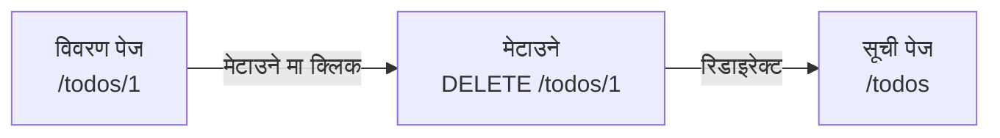
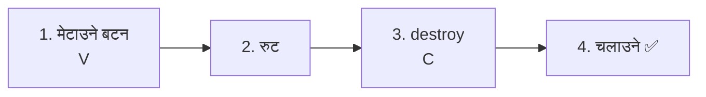
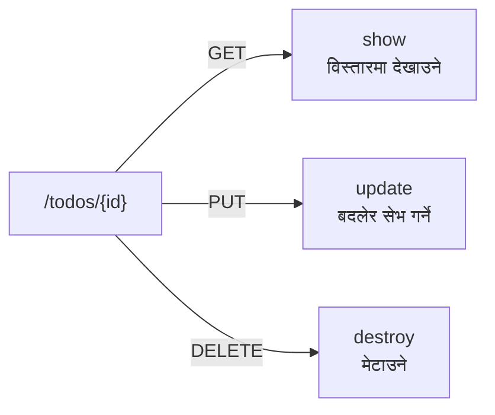
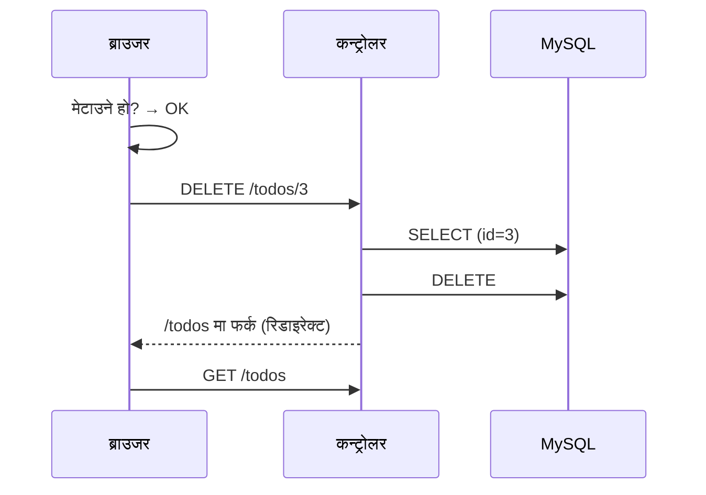
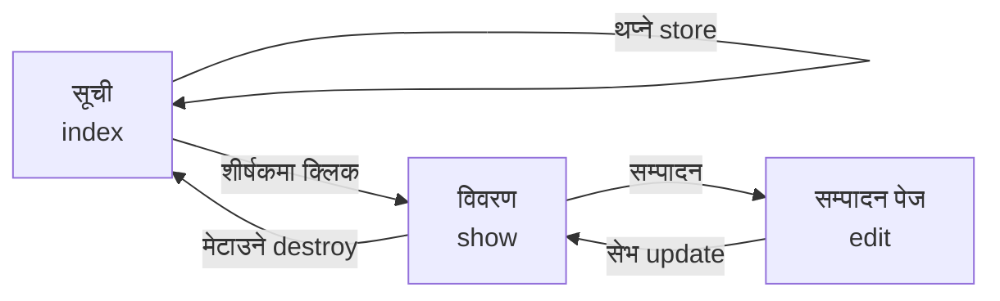

# Laravel परिचय — Todo मेटाऔँ (DELETE)

> 🇯🇵 मूल प्रति (जापानी भाषामा): [20261029_資料_3.md](<../../../1年生_データ設計とアプリ開発/後期/20261029/20261029_資料_3.md>) <!-- original-ja-link -->

[सामग्री १](./20261029_資料_1.md)・[सामग्री २](./20261029_資料_2.md) मा Todo सम्पादन गर्न सक्ने बनायौँ। अब, **Todo हटाउने (मेटाउने) सुविधा** बनाउँछौँ।

## आजको लक्ष्य
- DELETE र `@method('DELETE')` प्रयोग गरेर, मेटाउने आदेश पठाउन सक्ने
- `delete()` ले, Todo लाई डाटाबेसबाट मेटाउन सक्ने
- थप्ने, देखाउने, सम्पादन गर्ने र मेटाउने (CRUD) प्रक्रियाको समग्र रूप बुझ्ने

> सामग्री २ को "सकिएको र बाँकी अवस्था फेर्ने" काम सकिएको अवस्थाबाट सुरु गर्छौँ।

---

## 1. मेटाउने प्रक्रिया कसरी काम गर्छ

सम्पादनभन्दा फरक, मेटाउने काम **नयाँ पेज नखोली, एउटा बटन थिचेरै सकिन्छ**।



| URL | प्रकार | जिम्मेवार | गर्ने काम |
|-----|------|------|---------|
| `/todos/1` | **DELETE** | `destroy` | Todo मेटाउने |

### DELETE र `@method('DELETE')`

"डाटा मेटाउने" बेला, **DELETE** भन्ने प्रकार प्रयोग गर्नु Laravel को नियम हो।
PUT जस्तै, HTML को फारमले DELETE पठाउन सक्दैन, त्यसैले `@method('DELETE')` प्रयोग गर्छौँ।

| प्रकार | प्रयोग गर्ने बेला | लेख्ने तरिका |
|------|---------|--------|
| PUT | बदल्ने | फारममा `@method('PUT')` |
| PATCH | एउटा भाग मात्र बदल्ने | फारममा `@method('PATCH')` |
| **DELETE** | मेटाउने | फारममा `@method('DELETE')` |

> **किन लिङ्क (`<a>`) होइन, फारमको बटन?**
> लिङ्क GET ले खुल्छ। GET "हेर्ने मात्र" भन्ने नियम भएकाले, डाटा मेटाउने काममा प्रयोग गरिँदैन।
> यदि लिङ्कबाट मेटाउन मिल्ने भयो भने, URL खोल्दैमा Todo मेटिन्छ।
> डाटा बदल्ने (थप्ने・सम्पादन・मेटाउने) बेला, **फारमको बटनले पठाउने** भनेर सम्झनुहोस्।

---

## 2. बनाएर हेरौँ



परिवर्तन गर्ने फाइलहरू तलका ३ वटा हुन् (`src` भित्र)।

```
src/
├─ resources/views/todos/
│   └─ show.blade.php ················· 1. मेटाउने बटन थप्ने
├─ routes/
│   └─ web.php ························ 2. रुट थप्ने
└─ app/Http/Controllers/
    └─ TodoController.php ············· 3. destroy मेथड थप्ने
```

---

### 1. विवरण पेजमा "मेटाउने" बटन राख्ने (V)

> अहिले यहाँ: **🟢 1. मेटाउने बटन** → 2. रुट → 3. destroy → 4. चलाउने

`resources/views/todos/show.blade.php` मा, ★ को फारम थप्नुहोस्।

```html
    <a href="/todos/{{ $todo->id }}/edit">編集</a>

    {{-- ★ यहाँदेखि थप्ने --}}
    <form method="POST" action="/todos/{{ $todo->id }}" onsubmit="return confirm('削除しますか？');">
        @csrf
        @method('DELETE')
        <button type="submit">削除</button>
    </form>
    {{-- ★ यहाँसम्म --}}

    <a href="/todos">一覧にもどる</a>
```

| कोड | अर्थ |
|--------|------|
| `action="/todos/{{ $todo->id }}"` | `/todos/1` जस्तै, मेटाउन चाहेको Todo को `id` भएको URL मा पठाउने |
| `@method('DELETE')` | "वास्तवमा यो DELETE हो" भनेर Laravel लाई बताउने |
| `onsubmit="return confirm('削除しますか？');"` | पठाउनुअघि पुष्टि गर्ने डायलग देखाउने ("削除しますか？" = मेटाउने हो?)। "क्यान्सल" थिचे पठाउँदैन |

इनपुट बक्स छैन, किनभने **कुन Todo मेटाउने भन्ने कुरा URL को `id` बाटै थाहा हुन्छ**।

> **पहिलो सेमेस्टरको todo.php मा पनि गरेका थियौँ**
> `confirm()` ले पुष्टि गरेर मात्र मेटाउने तरिका, पहिलो सेमेस्टरको `todo.php` जस्तै हो।
> मेटाएको कुरा फर्काउन सकिँदैन, त्यसैले पुष्टि देखाउँदा ढुक्क हुन्छ।

---

### 2. रुट लेख्ने

> अहिले यहाँ: 1. मेटाउने बटन → **🟢 2. रुट** → 3. destroy → 4. चलाउने

`routes/web.php` मा, ★ को १ लाइन थप्नुहोस्।

```php
Route::get('/todos', [TodoController::class, 'index']);
Route::post('/todos', [TodoController::class, 'store']);
Route::get('/todos/{id}', [TodoController::class, 'show']);
Route::get('/todos/{id}/edit', [TodoController::class, 'edit']);
Route::put('/todos/{id}', [TodoController::class, 'update']);
Route::patch('/todos/{id}/toggle', [TodoController::class, 'toggle']);
Route::delete('/todos/{id}', [TodoController::class, 'destroy']);  // ★ थपेको
```

`destroy` (डिस्ट्रोय) को अर्थ "भत्काउनु・मेटाउनु" हो। Laravel मा, मेटाउने मेथडलाई प्रायः `destroy` नाम दिइन्छ।

अब `/todos/{id}` मा आएको अनुरोध **GET भए `show`, PUT भए `update`, DELETE भए `destroy`** ले सम्हाल्छ।

URL एउटै भए पनि, पठाउने तरिका (प्रकार) अनुसार अनुरोध सम्हाल्ने मेथड फरक हुन्छ।



---

### 3. destroy मेथड लेख्ने (C)

> अहिले यहाँ: 1. मेटाउने बटन → 2. रुट → **🟢 3. destroy** → 4. चलाउने

`TodoController.php` मा, ★ को `destroy` मेथड थप्नुहोस्।

```php
    // ★ यहाँदेखि थप्ने
    public function destroy($id)
    {
        // ① id ले, मेटाउन चाहेको Todo एउटा ल्याउने
        $todo = Todo::findOrFail($id);

        // ② डाटाबेसबाट मेटाउने
        $todo->delete();

        // ③ सूची पेजमा फर्कने
        return redirect('/todos');
    }
    // ★ यहाँसम्म
```

| कोड | अर्थ |
|--------|------|
| `$todo->delete()` | डाटाबेसबाट मेटाउने। `DELETE FROM todos WHERE id = ?` जस्तै |
| `redirect('/todos')` | सूची पेजमा फर्कने (मेटाइएको Todo को विवरण पेज अब उपलब्ध हुँदैन) |

पहिलो सेमेस्टरको `todo.php` सँग दाँजेर हेरौँ।

```php
// पहिलो सेमेस्टर
$id = (int)($_POST['id'] ?? 0);
$stmt = $pdo->prepare("DELETE FROM todos WHERE id = :id");
$stmt->execute(['id' => $id]);
header('Location: index.php');
exit;

// Laravel
$todo = Todo::findOrFail($id);
$todo->delete();
return redirect('/todos');
```

---

### 4. चलाउने ✅

> अहिले यहाँ: 1. मेटाउने बटन → 2. रुट → 3. destroy → **🟢 4. चलाउने**

1. http://localhost:8000/todos खोल्नुहोस्
2. मेटाए पनि हुने Todo (उदाहरणका लागि "宿題をする" (गृहकार्य गर्ने)) मा क्लिक गरेर, विवरण पेज खोल्नुहोस्
3. "削除" (मेटाउने) थिच्नुहोस्
4. "削除しますか？" (मेटाउने हो?) आयो भने `OK` थिच्नुहोस्
5. सूची पेजमा फर्किँदा त्यो Todo हटेको छ भने काम सफल भयो



✅ **जाँच १**: phpMyAdmin मा `todos` टेबल खोलेर, मेटाइएको Todo को पङ्क्ति हटेको छ कि छैन जाँच्नुहोस्।

✅ **जाँच २**: मेटाएको Todo को विवरण पेजको URL (उदाहरणका लागि http://localhost:8000/todos/3 ) सिधै खोलेर हेर्नुहोस्।
अब छैन, त्यसैले `404 Not Found` आउँछ। `findOrFail` ले काम गरिरहेको छ।

✅ **जाँच ३**: "削除" (मेटाउने) थिचेर, पुष्टि गर्ने डायलगमा `キャンセル` (क्यान्सल) थिच्दा केही पनि नमेटिने कुरा पनि जाँच्नुहोस्।

---

## 3. राम्रोसँग नचलेमा

> **🔥 चलेन भने, लग निकाल!**
> एररको कारण थाहा नभएमा, `destroy` भित्र `Log::info()` प्रयोग गरेर, `$id` को मान जाँच्नुहोस् → [【महत्त्वपूर्ण】लग निकाल्ने तरिका](../20261022/【重要】ログの出し方.md)

| लक्षण | कारण भएको ठाउँ | उपाय |
|------|----------|------|
| "削除" (मेटाउने) थिच्दा `The POST method is not supported for route todos/1.` | भ्यू | मेटाउने फारममा `@method('DELETE')` छ कि छैन जाँच्ने |
| "削除" (मेटाउने) थिच्दा `The DELETE method is not supported for route todos/1.` | रुट | `routes/web.php` मा `Route::delete('/todos/{id}', ...)` लेखेको छ कि छैन जाँच्ने |
| `Call to undefined method App\Http\Controllers\TodoController::destroy()` | कन्ट्रोलर | `TodoController.php` मा `destroy` मेथड लेखेको छ कि छैन, नामको हिज्जे जाँच्ने |
| मेटाए पनि, सूचीमा बाँकी छ | कन्ट्रोलर | `destroy` भित्र `$todo->delete();` छ कि छैन जाँच्ने |
| पुष्टि गर्ने डायलग आउँदैन | भ्यू | `<form>` मा `onsubmit="return confirm('削除しますか？');"` छ कि छैन जाँच्ने |

---

## 4. CRUD पूरा भयो!

अब Todo **थप्न, देखाउन, सम्पादन गर्न र मेटाउन** सकिने भयो।
यी ४ वटालाई मिलाएर **CRUD** (क्रड) भनिन्छ। धेरैजसो वेब एपहरू, यही CRUD को संयोजनले बनेका हुन्छन्।

| | अर्थ | SQL | यस पटकको Todo एप | बनाएको दिन |
|---|---|---|---|---|
| **C**reate | थप्ने | `INSERT` | `store` | 10/22 |
| **R**ead | देखाउने | `SELECT` | `index`・`show` | 10/15・10/22 |
| **U**pdate | सम्पादन | `UPDATE` | `edit`・`update`・`toggle` | आज |
| **D**elete | मेटाउने | `DELETE` | `destroy` | आज |

अब जम्मा ७ वटा रुट भएका छन्।

| रुट | जिम्मेवार | गर्ने काम |
|--------|------|---------|
| `GET /todos` | `index` | सूची देखाउने |
| `POST /todos` | `store` | नयाँ थप्ने |
| `GET /todos/{id}` | `show` | एउटा Todo लाई विस्तारमा देखाउने |
| `GET /todos/{id}/edit` | `edit` | सम्पादन पेज देखाउने |
| `PUT /todos/{id}` | `update` | बदलेर सेभ गर्ने |
| `PATCH /todos/{id}/toggle` | `toggle` | सकिएको र बाँकी अवस्था फेर्ने |
| `DELETE /todos/{id}` | `destroy` | मेटाउने |



<!-- nav:start -->

---

| ⬅️ अघिल्लो | 🗺️ समग्र नक्सा | अर्को ➡️ |
|:--|:--:|--:|
| [10/29 सकिएको अवस्था फेर्ने (PATCH)](20261029_資料_2.md) | [सामग्रीको समग्र नक्सा](../../README.md) | [11/05 Seeder・Factory](../20261105/20261105_資料_1.md) |

<!-- nav:end -->
