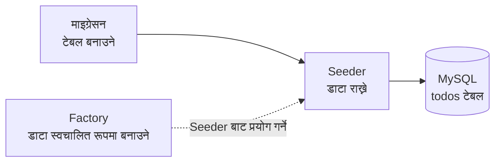
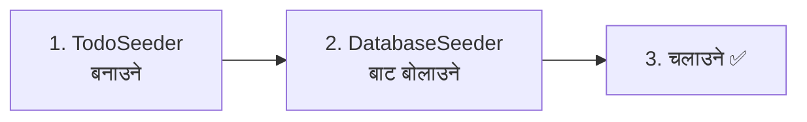
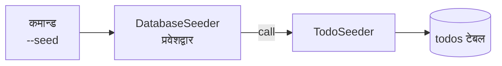
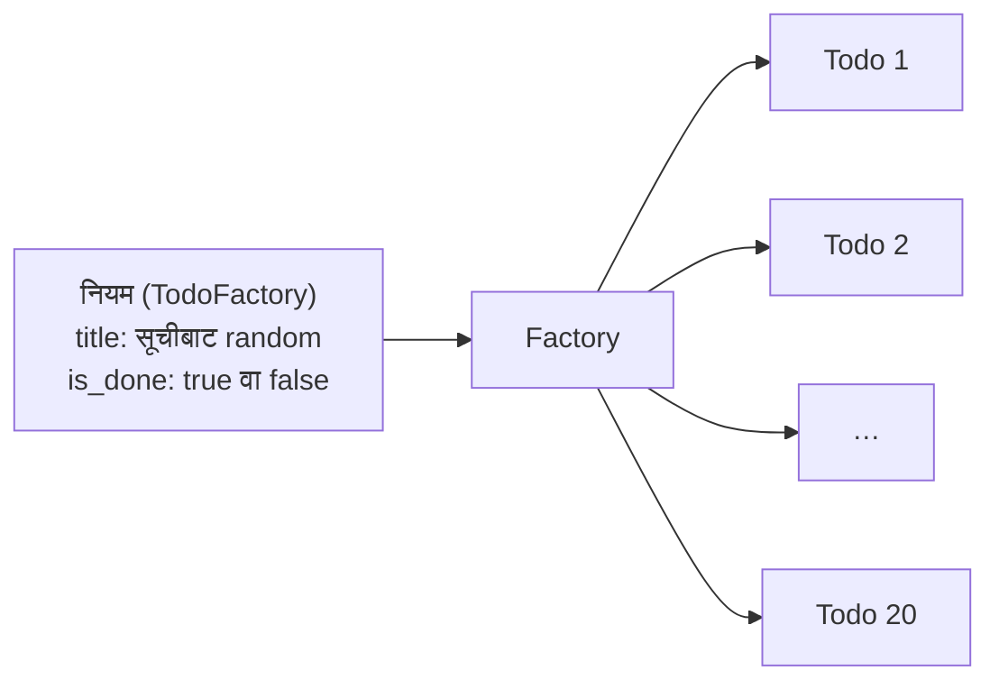
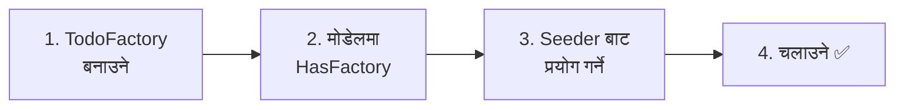
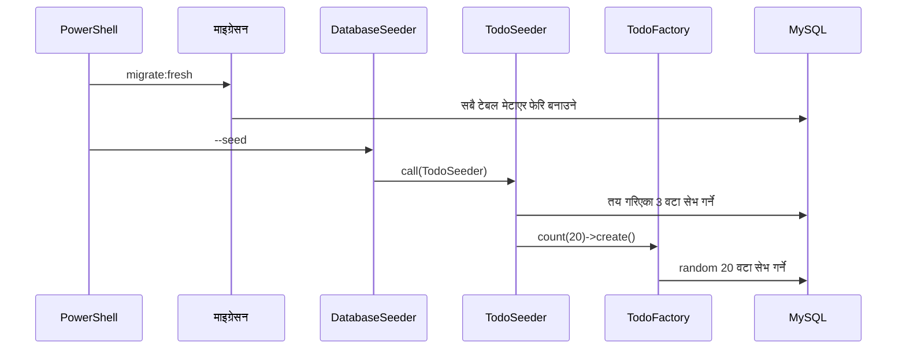
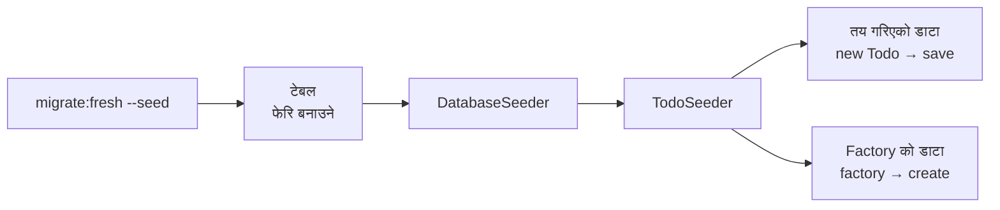

# Laravel परिचय — टेस्ट डाटा राखौं (Seeder・Factory)

> 🇯🇵 मूल प्रति (जापानी भाषामा): [20261105_資料_1.md](<../../../1年生_データ設計とアプリ開発/後期/20261105/20261105_資料_1.md>) <!-- original-ja-link -->

अहिलेसम्म Todo को डाटा phpMyAdmin मा एउटा-एउटा गरेर हातैले टाइप गर्थ्यौं, वा फर्मबाट थप्थ्यौं।
आज हामी **एउटै कमान्डले टेस्ट डाटा राख्ने तरिका** सिक्नेछौं।

## आजको लक्ष्य
- Seeder (सिडर) प्रयोग गरेर तय गरिएको टेस्ट डाटा राख्न सक्ने
- Factory (फ्याक्ट्री) प्रयोग गरेर धेरै टेस्ट डाटा स्वचालित रूपमा बनाउन सक्ने
- `migrate:fresh --seed` ले डाटाबेसलाई जुनसुकै बेला सुरुको अवस्थामा फर्काउन सक्ने

> अभ्यास वातावरण (`php-study`) को mysql र laravel चालु गरेपछि सुरु गर्छौं।
> कमान्डहरू PowerShell मा **laravel फोल्डर** मा गएपछि चलाउँछौं।

---

## 1. टेस्ट डाटा राख्ने व्यवस्था किन चाहिन्छ?

अहिलेसम्म यस्तो कहिल्यै भएको छ?

```
A: "Delete गर्ने अभ्यास गर्दा Todo सबै हराए। फेरि हातैले राख्नुपर्ने हो र…?"
B: "List पेज कस्तो देखिन्छ हेर्न मन छ, तर Todo जम्मा 3 वटा मात्र छन्।"
C: "साथीको PC र मेरो PC मा भएको डाटा फरक छ।"
```

टेस्ट डाटा **प्रोग्रामबाट राख्ने व्यवस्था** मिलायौं भने, यसो हुन्छ।

| | phpMyAdmin मा हातैले टाइप | प्रोग्रामबाट राख्ने |
|---|---|---|
| राख्न लाग्ने मेहनत | एउटा-एउटा टाइप गर्ने | एउटै कमान्ड |
| डाटा मेटियो भने | फेरि हातैले टाइप | एउटै कमान्डले पहिलेजस्तै |
| 100 वटा चाहियो भने | धेरै गाह्रो | संख्या मात्र बदले पुग्छ |
| सबैको PC मा | फरक-फरक | एउटै डाटा हुन्छ |

Laravel मा यो काम **Seeder** र **Factory** ले गर्छ।

---

## 2. Seeder र Factory

**Seeder** (सिडर) को अर्थ "बीउ (seed) छर्ने चीज" हो।
खाली टेबलमा पहिलो डाटारूपी "बीउ" छर्छ।

| नाम | काम | उदाहरण दिँदा |
|------|------|-----------|
| **माइग्रेसन** | टेबल बनाउने (10/15 मा सिकेको) | खेत बनाउने |
| **Seeder** | टेबलमा डाटा राख्ने | बीउ छर्ने |
| **Factory** | डाटा स्वचालित रूपमा धेरै बनाउने | बीउ धेरै बनाउने मेसिन |



आज यी 2 वटा कुरा यही क्रममा बनाउँछौं।

1. **Seeder** ले तय गरिएका 3 वटा Todo राख्ने
2. **Factory** ले 20 वटा Todo स्वचालित रूपमा बनाएर राख्ने

फाइलहरू `src` भित्र यहाँ छन्।

```
src/
└─ database/
    ├─ migrations/ ··········· टेबलको नक्सा (10/15 मा बनाएको)
    ├─ seeders/
    │   ├─ DatabaseSeeder.php ··· सुरुदेखि नै हुन्छ। यहींबाट सबै Seeder चलाइन्छ
    │   └─ TodoSeeder.php ······· आज बनाउने
    └─ factories/
        └─ TodoFactory.php ······ आज बनाउने
```

---

## 3. Seeder ले तय गरिएको डाटा राखौं



### 1. TodoSeeder बनाउने

> अहिले यहाँ: **🟢 1. TodoSeeder** → 2. DatabaseSeeder → 3. चलाउने

तलको कमान्डले Seeder को फाइल बनाउँछौं।

```powershell
docker compose exec laravel php artisan make:seeder TodoSeeder
```

`database/seeders/TodoSeeder.php` बन्छ, त्यसको भित्री भाग तल जस्तै बदल्नुहोस्।

```php
<?php

namespace Database\Seeders;

use App\Models\Todo;  // ← Todo मोडेल प्रयोग गर्नका लागि चाहिने 1 लाइन
use Illuminate\Database\Seeder;

class TodoSeeder extends Seeder
{
    public function run(): void
    {
        // राख्न चाहेको डाटा array मा तयार गर्ने
        $todos = [
            ['title' => '牛乳を買う',     'is_done' => false],
            ['title' => 'レポートを出す', 'is_done' => true],
            ['title' => '宿題をする',     'is_done' => false],
        ];

        // एउटा-एउटा गरेर Todo बनाएर सेभ गर्ने
        foreach ($todos as $data) {
            $todo = new Todo();
            $todo->title = $data['title'];
            $todo->is_done = $data['is_done'];
            $todo->save();
        }
    }
}
```

| कोड | अर्थ |
|--------|------|
| `run()` | Seeder चलाउँदा चल्ने मेथड |
| `$todos = [ ... ]` | राख्न चाहेको डाटाको array (पहिलो सेमेस्टरमा सिकेको associative array) |
| `foreach` | array बाट एउटा-एउटा निकालेर दोहोर्‍याउने |
| `new Todo()` देखि `save()` सम्म | 10/22 को `store` मा जस्तै लेखेर एउटा Todo सेभ गर्ने |

`store` मा फर्मबाट आएको मान राखेका थियौं, तर Seeder मा **array को मान** राखिरहेका छौं। फरक यत्ति हो।

---

### 2. DatabaseSeeder बाट बोलाउने

> अहिले यहाँ: 1. TodoSeeder → **🟢 2. DatabaseSeeder** → 3. चलाउने

`database/seeders/DatabaseSeeder.php` **Seeder को प्रवेशद्वार** हो।
Seeder चलाउने कमान्ड टाइप गर्दा, सबैभन्दा पहिले यही फाइल चल्छ।

खोल्दा, सुरुदेखि नै "टेस्टका लागि एक जना युजर बनाउने" कोड लेखिएको हुन्छ।
अहिले युजर प्रयोग गर्दैनौं, त्यसैले भित्री भाग तल जस्तै बदल्नुहोस्।

```php
<?php

namespace Database\Seeders;

use Illuminate\Database\Seeder;

class DatabaseSeeder extends Seeder
{
    public function run(): void
    {
        // TodoSeeder चलाउने
        $this->call(TodoSeeder::class);
    }
}
```

`$this->call(TodoSeeder::class)` को अर्थ "`TodoSeeder` चलाऊ है" भन्ने हो।
Seeder थपिँदै गएमा, यहाँ `$this->call(...)` थप्दै जानुहोस्।



---

### 3. चलाउने ✅

> अहिले यहाँ: 1. TodoSeeder → 2. DatabaseSeeder → **🟢 3. चलाउने**

तलको कमान्ड चलाउनुहोस्।

```powershell
docker compose exec laravel php artisan migrate:fresh --seed
```

| भाग | अर्थ |
|------|------|
| `migrate:fresh` | **सबै टेबल मेटाएर**, माइग्रेसनले फेरि बनाउने |
| `--seed` | फेरि बनाएपछि, Seeder ले डाटा राख्ने |

> ⚠️ **`migrate:fresh` ले सबै डाटा मेटाउँछ**
> phpMyAdmin वा फर्मबाट राखेका Todo पनि सबै मेटिन्छन्।
> यो अभ्यासको डाटाबेस भएकाले समस्या छैन, तर **production डाटाबेसमा कहिल्यै प्रयोग नगर्नुहोस्**।

✅ **जाँच 1**: http://localhost:8000/todos खोल्नुहोस्, 3 वटा Todo देखिए ठीक छ।

✅ **जाँच 2**: phpMyAdmin मा `todos` टेबल खोलेर हेरौं।
`save()` ले राखेकाले `created_at` र `updated_at` मा पनि मिति र समय भरिएको छ (हातैले टाइप गर्दा खाली थियो)।

✅ **जाँच 3**: केही Todo मेटाएर, फेरि एकपटक `migrate:fresh --seed` चलाएर हेरौं।
**सुरुका 3 वटामा फर्किन्छ।** यसरी जुनसुकै बेला अभ्यास फेरि सुरु गर्न सकिन्छ।

---

## 4. Factory ले धेरै डाटा बनाऔं

3 वटा भए हातैले लेख्न सकिन्छ, तर 20 वटा, 100 वटा हुँदा गाह्रो हुन्छ।
**Factory** प्रयोग गर्दा, "यस्तो खालको डाटा बनाऊ" भन्ने एउटा नियम लेखे मात्र पुग्छ, जति वटा पनि स्वचालित रूपमा बनाउन सकिन्छ।





### 1. TodoFactory बनाउने

> अहिले यहाँ: **🟢 1. TodoFactory** → 2. HasFactory → 3. Seeder बाट प्रयोग → 4. चलाउने

```powershell
docker compose exec laravel php artisan make:factory TodoFactory
```

`database/factories/TodoFactory.php` बन्छ, `definition()` भित्रको भाग तल जस्तै बदल्नुहोस्।

```php
    public function definition(): array
    {
        return [
            'title' => fake()->randomElement([
                '牛乳を買う',
                'レポートを出す',
                '宿題をする',
                '部屋のそうじ',
                '本を返す',
                'ゴミを出す',
            ]),
            'is_done' => fake()->boolean(),
        ];
    }
```

| कोड | अर्थ |
|--------|------|
| `definition()` | "एउटा Todo कुन-कुन मान राखेर बनाउने" भन्ने नियम लेख्ने ठाउँ |
| `fake()` | टेस्ट डाटाका लागि random मान बनाउने औजार (Faker) |
| `fake()->randomElement([...])` | array भित्रबाट random रूपमा एउटा छान्ने |
| `fake()->boolean()` | `true` वा `false` random रूपमा छान्ने |

`id`, `created_at`, `updated_at` पहिलेजस्तै आफैं भरिने भएकाले लेख्दैनौं।

---

### 2. मोडेलमा HasFactory लेख्ने

> अहिले यहाँ: 1. TodoFactory → **🟢 2. HasFactory** → 3. Seeder बाट प्रयोग → 4. चलाउने

Factory प्रयोग गर्न, मोडेलमा "Factory प्रयोग गर्न मिल्ने बनाउने" 1 लाइन चाहिन्छ।
`app/Models/Todo.php` खोलेर ★ भएका 2 लाइन थप्नुहोस्।

```php
<?php

namespace App\Models;

use Illuminate\Database\Eloquent\Factories\HasFactory;  // ★ थपिएको
use Illuminate\Database\Eloquent\Model;

class Todo extends Model
{
    use HasFactory;  // ★ थपिएको
}
```

अब `Todo::factory()` लेख्दा `TodoFactory` प्रयोग गर्न सकिन्छ।
(Laravel ले मोडेलको नाम `Todo` बाट `TodoFactory` आफैं खोजिदिन्छ)

---

### 3. Seeder बाट Factory प्रयोग गर्ने

> अहिले यहाँ: 1. TodoFactory → 2. HasFactory → **🟢 3. Seeder बाट प्रयोग** → 4. चलाउने

`database/seeders/TodoSeeder.php` को `run()` को अन्तिममा ★ भएको 1 लाइन थप्नुहोस्।

```php
    public function run(): void
    {
        $todos = [
            ['title' => '牛乳を買う',     'is_done' => false],
            ['title' => 'レポートを出す', 'is_done' => true],
            ['title' => '宿題をする',     'is_done' => false],
        ];

        foreach ($todos as $data) {
            $todo = new Todo();
            $todo->title = $data['title'];
            $todo->is_done = $data['is_done'];
            $todo->save();
        }

        // ★ Factory ले Todo 20 वटा बनाएर सेभ गर्ने
        Todo::factory()->count(20)->create();
    }
```

```
Todo::factory() -> count(20) -> create();
~~~~~~~~~~~~~~~    ~~~~~~~~~    ~~~~~~~~
TodoFactory ले     20 वटा       बनाएर सेभ गर्ने
```

---

### 4. चलाउने ✅

> अहिले यहाँ: 1. TodoFactory → 2. HasFactory → 3. Seeder बाट प्रयोग → **🟢 4. चलाउने**

```powershell
docker compose exec laravel php artisan migrate:fresh --seed
```

✅ **जाँच 1**: http://localhost:8000/todos खोल्नुहोस्, **23 वटा** (तय गरिएका 3 वटा + Factory का 20 वटा) Todo देखिए ठीक छ।

✅ **जाँच 2**: फेरि एकपटक `migrate:fresh --seed` चलाएर हेरौं।
सुरुका 3 वटा उस्तै रहन्छन्, तर Factory ले बनाएका 20 वटाको **शीर्षक र पूरा/अपूरा अवस्था हरेकपटक चलाउँदा बदलिन्छ**। किनभने random रूपमा बनाइएको छ।



---

## 5. कमान्डहरूको सारांश

| कमान्ड | के गर्छ |
|---------|---------|
| `php artisan make:seeder TodoSeeder` | Seeder को फाइल बनाउने |
| `php artisan make:factory TodoFactory` | Factory को फाइल बनाउने |
| `php artisan migrate:fresh --seed` | सबै टेबल फेरि बनाएर, Seeder ले डाटा राख्ने |
| `php artisan db:seed` | टेबल जस्ताको तस्तै राखेर, Seeder ले डाटा **थप्ने** |

> **`db:seed` मात्र टाइप गर्दा, डाटा बढ्दै जान्छ**
> `db:seed` ले अहिले भएको डाटा नमेटाई **थप्छ**। 2 पटक टाइप गर्दा Todo पनि दोब्बर हुन्छन्।
> सुरुको अवस्थामा फर्काउन चाहँदा `migrate:fresh --seed` प्रयोग गरौं।

(सबै कमान्डको अगाडि `docker compose exec laravel` जोडेर चलाउनुहोस्)

---

## 6. काम नगरेमा

> **🔥 काम नगरे, लग निकाल!**
> Seeder भित्र पनि `Log::info()` प्रयोग गर्न सकिन्छ → [【महत्त्वपूर्ण】लग निकाल्ने तरिका](../20261022/【重要】ログの出し方.md)

| लक्षण | कारण भएको ठाउँ | समाधान |
|------|----------|------|
| `Class "Database\Seeders\Todo" not found` | Seeder | `TodoSeeder.php` को माथि `use App\Models\Todo;` छ कि छैन जाँच्नुहोस् |
| `Call to undefined method App\Models\Todo::factory()` | मोडेल | `Todo.php` मा `use HasFactory;` लेख्नुभयो कि जाँच्नुहोस् (माथिको `use Illuminate\...\HasFactory;` पनि चाहिन्छ) |
| `Class "Database\Factories\TodoFactory" not found` | Factory | `database/factories/TodoFactory.php` छ कि छैन, फाइलको नाम र क्लासको नाम जाँच्नुहोस् |
| `Duplicate entry 'test@example.com'` | DatabaseSeeder | टेस्ट युजर बनाउने कोड बाँकी रहेकै अवस्थामा `db:seed` 2 पटक टाइप गर्नुभयो। `DatabaseSeeder.php` बदल्नुहोस्, वा `migrate:fresh --seed` प्रयोग गर्नुहोस् |
| Todo दोब्बर, तेब्बर भए | कमान्ड | `db:seed` धेरैपटक टाइप गर्नुभयो। `migrate:fresh --seed` ले फेरि सुरुबाट गर्नुहोस् |
| चलाउँदा पनि Todo राखिँदैन | DatabaseSeeder | `DatabaseSeeder.php` मा `$this->call(TodoSeeder::class);` छ कि छैन जाँच्नुहोस् |

---

## 7. सारांश



| आज लेखेको कुरा | एक वाक्यमा |
|--------------|-----------|
| `TodoSeeder` | तय गरिएको टेस्ट डाटा राख्ने |
| `DatabaseSeeder` को `$this->call(...)` | Seeder को प्रवेशद्वार। यहींबाट हरेक Seeder चलाइन्छ |
| `TodoFactory` को `definition()` | एउटा डाटा कुन-कुन मान राखेर बनाउने भन्ने नियम |
| मोडेलको `use HasFactory;` | `Todo::factory()` प्रयोग गर्न मिल्ने बनाउने |
| `Todo::factory()->count(20)->create()` | नियमअनुसार 20 वटा बनाएर सेभ गर्ने |
| `migrate:fresh --seed` | डाटाबेसलाई जुनसुकै बेला सुरुको अवस्थामा फर्काउने |

---

## 8. अझै गरेर हेरौं (समय बचेकाहरूका लागि)

1. Factory ले बनाउने संख्या **100 वटा** बनाएर, List पेज कस्तो हुन्छ हेरौं।
2. Factory को `randomElement` को सूचीमा आफैंले सोचेका Todo 5 वटा थपेर हेरौं।

<details>
<summary>संकेत</summary>

1. `TodoSeeder.php` को `count(20)` लाई `count(100)` मा बदलेर `migrate:fresh --seed` चलाउनुहोस्।
2. `TodoFactory.php` को `randomElement([...])` को array मा `'買い物に行く',` (किनमेल गर्न जाने) जस्तै गरी थप्नुहोस्।

</details>

<!-- nav:start -->

---

| ⬅️ अघिल्लो | 🗺️ समग्र नक्सा | अर्को ➡️ |
|:--|:--:|--:|
| [10/29 Todo मेटाउने (DELETE)](../20261029/20261029_資料_3.md) | [सामग्रीको समग्र नक्सा](../../README.md) | [11/05 भ्यालिडेसन](20261105_資料_2.md) |

<!-- nav:end -->
