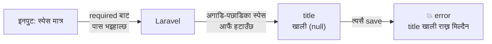
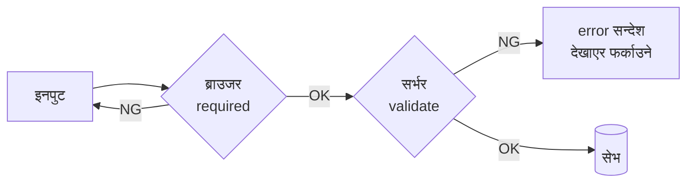
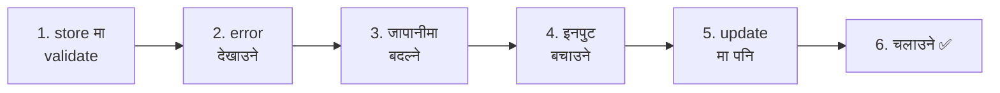
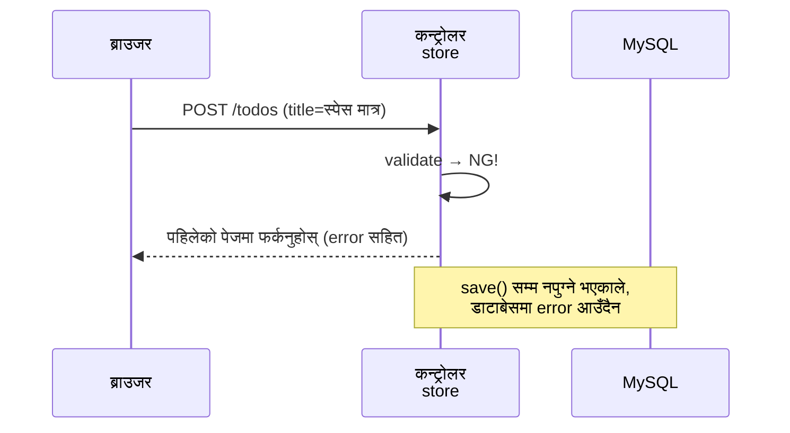
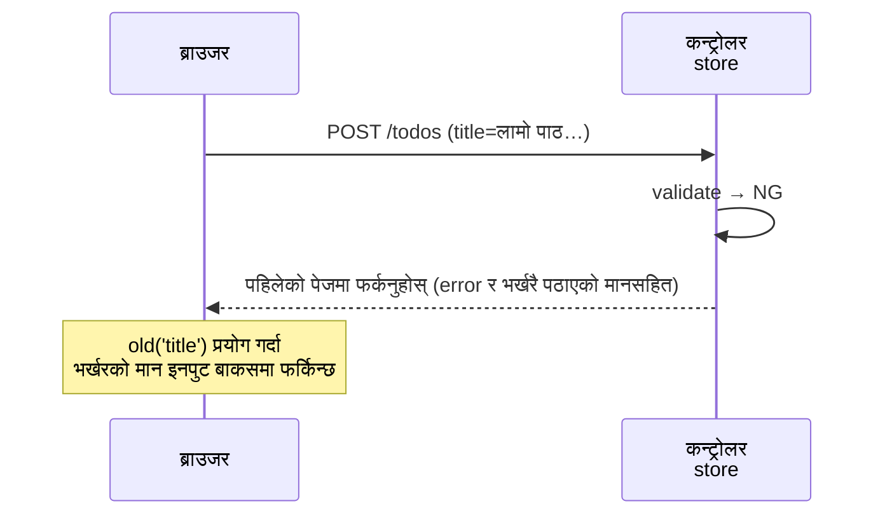
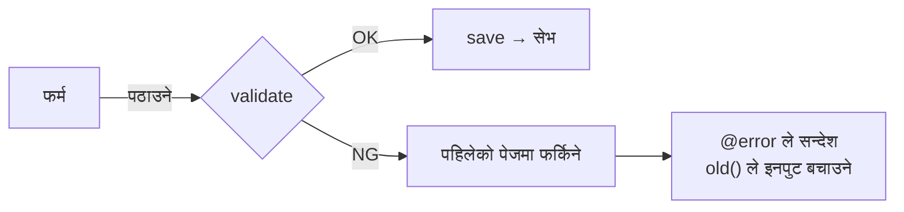

# Laravel परिचय — इनपुट जाँचौं (भ्यालिडेसन)

> 🇯🇵 मूल प्रति (जापानी भाषामा): [20261105_資料_2.md](<../../../1年生_データ設計とアプリ開発/後期/20261105/20261105_資料_2.md>) <!-- original-ja-link -->

Todo थप्ने र सम्पादन गर्ने काम त गर्न सक्ने भयौं, तर वास्तवमा **गलत इनपुट दिँदा error स्क्रिन आउने** समस्या छ।
आज हामी इनपुट गरिएको मानलाई सर्भरतर्फ जाँच्ने **भ्यालिडेसन** सिक्नेछौं।

## आजको लक्ष्य
- ब्राउजरको जाँच (`required`) मात्र किन पर्याप्त हुँदैन भन्ने बुझ्ने
- `$request->validate()` ले इनपुट जाँच्न सक्ने
- error सन्देश स्क्रिनमा देखाउन र इनपुट गरेको मान बचाइराख्न सक्ने

> 10/29 को "Todo सम्पादन गर्ने" सम्म पूरा भएको अवस्थाबाट सुरु गर्छौं।

---

## 1. गरेर हेरौं: स्पेस मात्र राखेर थप्दा…?

http://localhost:8000/todos खोलेर, इनपुट बाकसमा **half-width स्पेस मात्र** राखी `追加` (थप्ने) थिचेर हेरौं।

```
SQLSTATE[23000]: Integrity constraint violation: 1048 Column 'title' cannot be null
```

error स्क्रिन आयो। के भयो होला?



1. HTML को `required` ले "केही इनपुट गरिएको छ कि छैन" मात्र हेर्छ। स्पेस पनि "इनपुट गरिएको" मानिने भएकाले पास भइहाल्छ
2. Laravel ले पठाइएको मानको **अगाडि-पछाडिका स्पेस आफैं हटाउँछ** (10/22 मा सिकेका थियौं)। फलस्वरूप शीर्षक खाली (`null`) हुन्छ
3. `todos` टेबलको `title` खाली राख्न मिल्दैन, त्यसैले सेभ गर्दा error आउँछ

यसबाहेक, ब्राउजरको developer tools (F12) प्रयोग गरेर `required` हटाएर पठाउन पनि सकिन्छ।

---

## 2. भ्यालिडेसन भनेको के हो

**भ्यालिडेसन** (validation) भनेको "इनपुट गरिएको मान सही छ कि छैन, **सेभ गर्नुअघि** जाँच्ने काम" हो।

जाँच ब्राउजर र सर्भर गरी 2 ठाउँमा गर्न सकिन्छ।

| | ब्राउजरमा जाँच | सर्भरमा जाँच (भ्यालिडेसन) |
|---|---|---|
| लेख्ने ठाउँ | HTML (`required` आदि) | कन्ट्रोलर (`$request->validate()`) |
| राम्रो पक्ष | पठाउनुअघि नै तुरुन्तै बताइदिन्छ | **छलेर पार गर्न सकिँदैन** |
| कमजोर पक्ष | developer tools ले हटाउन सकिन्छ, स्पेस मात्रले पनि पास हुन्छ | एकपटक सर्भरमा पठाउनुपर्छ |



ब्राउजरको जाँच "प्रयोगकर्ताप्रतिको सहयोग" हो, सर्भरको जाँच "एपलाई सुरक्षित राख्ने ताल्चा" हो।
**सर्भरको जाँच अनिवार्य रूपमा लेख्ने** भनेर सम्झिराखौं।

---

## 3. बनाएर हेरौं



परिवर्तन गर्नुपर्ने फाइलहरू तलका 3 वटा हुन् (`src` भित्र)।

```
src/
├─ app/Http/Controllers/
│   └─ TodoController.php ············· 1, 3, 5. validate थप्ने
└─ resources/views/todos/
    ├─ index.blade.php ················ 2, 4. error देखाउने र old() थप्ने
    └─ edit.blade.php ················· 5. error देखाउने र old() थप्ने
```

---

### 1. store मा validate लेख्ने (C)

> अहिले यहाँ: **🟢 1. validate** → 2. error देखाउने → 3. जापानी → 4. इनपुट बचाउने → 5. update मा पनि → 6. चलाउने

`app/Http/Controllers/TodoController.php` को `store` मेथडको **सबैभन्दा सुरुमा** ★ भएको भाग थप्नुहोस्।

```php
    public function store(Request $request)
    {
        // ★ इनपुट जाँच्ने
        $request->validate([
            'title' => 'required|max:255',
        ]);

        $todo = new Todo();
        $todo->title = $request->input('title');
        $todo->save();

        return redirect('/todos');
    }
```

| कोड | अर्थ |
|--------|------|
| `$request->validate([...])` | पठाइएको मान जाँच्ने |
| `'title' => ...` | फर्मको `name="title"` को मान जाँच्ने |
| `required` | खाली हुनु हुँदैन (स्पेस मात्र भए पनि Laravel ले हटाउने भएकाले खाली हुन्छ) |
| `max:255` | 255 अक्षरसम्म (`title` कोलम `VARCHAR(255)` भएकाले) |
| `\|` | नियम छुट्याउने चिन्ह। "`required` र `max:255` दुवै" भन्ने अर्थ |

**जाँचमा अड्कियो भने त्यहीं रोकिन्छ, र इनपुट पेजमा आफैं फर्काइन्छ।** त्यसको तलको `save()` चल्दैन।



✅ **जाँच**: फेरि एकपटक स्पेस मात्र राखेर `追加` (थप्ने) थिचेर हेरौं।
error स्क्रिन आउँदैन, List पेजमै फर्किन्छ। Todo पनि थपिएको छैन।
……तर, **किन फर्काइयो भन्ने स्क्रिनबाट थाहा हुँदैन**। अर्को चरणमा error सन्देश देखाउँछौं।

---

### 2. error सन्देश देखाउने (V)

> अहिले यहाँ: 1. validate → **🟢 2. error देखाउने** → 3. जापानी → 4. इनपुट बचाउने → 5. update मा पनि → 6. चलाउने

`resources/views/todos/index.blade.php` को फर्ममा ★ भएको भाग थप्नुहोस्।

```html
    <form method="POST" action="/todos">
        @csrf
        <input type="text" name="title" placeholder="新しいTODOを入力" required>
        <button type="submit">追加</button>

        {{-- ★ यहाँदेखि थपिएको --}}
        @error('title')
            <p style="color: red;">{{ $message }}</p>
        @enderror
        {{-- ★ यहाँसम्म --}}
    </form>
```

| कोड | अर्थ |
|--------|------|
| `@error('title')` देखि `@enderror` सम्म | `title` को जाँचमा अड्किएको बेला मात्र भित्रको भाग देखाउने |
| `{{ $message }}` | error सन्देश |

✅ **जाँच**: स्पेस मात्र राखेर `追加` (थप्ने) थिच्दा, रातो अक्षरमा यस्तो देखिन्छ।

```
The title field is required.
```

अंग्रेजीमा देखियो। अर्को चरणमा जापानीमा बदल्छौं।

---

### 3. error सन्देश जापानीमा बदल्ने (C)

> अहिले यहाँ: 1. validate → 2. error देखाउने → **🟢 3. जापानी** → 4. इनपुट बचाउने → 5. update मा पनि → 6. चलाउने

`validate` को दोस्रो argument मा **सन्देशहरूको array** थप्नुहोस्।

```php
        $request->validate([
            'title' => 'required|max:255',
        ], [
            'title.required' => 'タイトルを入力してください。',        // ★ थपिएको
            'title.max' => 'タイトルは255文字以内で入力してください。',  // ★ थपिएको
        ]);
```

| कोड | अर्थ |
|--------|------|
| `'title.required' => '...'` | `title` `required` मा अड्किँदा देखाउने सन्देश |
| `'title.max' => '...'` | `title` `max` मा अड्किँदा देखाउने सन्देश |

`'कोलमको नाम.नियम'` को रूपमा, नियमैपिच्छे सन्देश तय गर्न सकिन्छ।

✅ **जाँच**: स्पेस मात्र राखेर `追加` (थप्ने) थिच्दा, "タイトルを入力してください。" (शीर्षक इनपुट गर्नुहोस्।) देखिए ठीक छ।

---

### 4. इनपुट गरेको मान बचाइराख्ने (V)

> अहिले यहाँ: 1. validate → 2. error देखाउने → 3. जापानी → **🟢 4. इनपुट बचाउने** → 5. update मा पनि → 6. चलाउने

error का कारण फर्काइँदा, इनपुट बाकस खाली हुन्छ।
लामो पाठ लेखेको भए, फेरि सुरुदेखि टाइप गर्नुपर्छ।

`index.blade.php` को `<input>` मा ★ भएको `value` थप्नुहोस्।

```html
        <input type="text" name="title" value="{{ old('title') }}" placeholder="新しいTODOを入力" required>
        {{--                            ~~~~~~~~~~~~~~~~~~~~~~~~~ ★ थपिएको --}}
```

`old('title')` भनेको "**भर्खरै पठाएको `title` को मान**" हो।
error का कारण फर्काइँदा, इनपुट बाकसमा भर्खरको मान राखिदिन सकिन्छ।

फर्काउने बेला Laravel ले "भर्खरै पठाएको मान" पनि सँगै सम्झिराख्ने भएकाले, `old()` ले निकाल्न सकिन्छ।



---

### 5. update मा पनि भ्यालिडेसन राख्ने

> अहिले यहाँ: 1. validate → 2. error देखाउने → 3. जापानी → 4. इनपुट बचाउने → **🟢 5. update मा पनि** → 6. चलाउने

सम्पादनमा पनि, स्पेस मात्र राखेर सेभ गर्दा उस्तै error आउँछ।
`TodoController.php` को `update` मा पनि `store` कै जस्तो `validate` थप्नुहोस्।

```php
    public function update(Request $request, $id)
    {
        // ★ store जस्तै जाँच
        $request->validate([
            'title' => 'required|max:255',
        ], [
            'title.required' => 'タイトルを入力してください。',
            'title.max' => 'タイトルは255文字以内で入力してください。',
        ]);

        $todo = Todo::findOrFail($id);
        $todo->title = $request->input('title');
        $todo->is_done = $request->has('is_done');
        $todo->save();

        return redirect('/todos/' . $todo->id);
    }
```

`resources/views/todos/edit.blade.php` को फर्म पनि ★ जस्तै बदल्नुहोस्।

```html
    <form method="POST" action="/todos/{{ $todo->id }}">
        @csrf
        @method('PUT')
        <input type="text" name="title" value="{{ old('title', $todo->title) }}" required>  {{-- ★ old प्रयोग गर्ने --}}
        <label>
            <input type="checkbox" name="is_done" value="1" @checked($todo->is_done)>
            完了
        </label>
        <button type="submit">保存</button>

        {{-- ★ यहाँदेखि थपिएको --}}
        @error('title')
            <p style="color: red;">{{ $message }}</p>
        @enderror
        {{-- ★ यहाँसम्म --}}
    </form>
```

`old('title', $todo->title)` को अर्थ "भर्खरै पठाएको मान छ भने त्यो, **छैन भने अहिलेको शीर्षक**" भन्ने हो।

| अवस्था | इनपुट बाकसमा आउने कुरा |
|------|----------------|
| सम्पादन पेज पहिलोपटक खोल्दा | अहिलेको शीर्षक (`$todo->title`) |
| error का कारण फर्किँदा | भर्खरै पठाएको मान (`old('title')`) |

---

### 6. चलाउने ✅

> अहिले यहाँ: 1. validate → 2. error देखाउने → 3. जापानी → 4. इनपुट बचाउने → 5. update मा पनि → **🟢 6. चलाउने**

तलका 4 वटा कुरा गरेर हेरौं।

| | गर्ने काम | यस्तो भए ठीक |
|---|---|---|
| ① | थप्ने फर्ममा स्पेस मात्र राखेर `追加` (थप्ने) | "タイトルを入力してください。" (शीर्षक इनपुट गर्नुहोस्।) देखिन्छ। Todo थपिँदैन |
| ② | थप्ने फर्ममा सामान्य Todo राखेर `追加` (थप्ने) | पहिलेजस्तै थपिन्छ |
| ③ | सम्पादनमा शीर्षकलाई स्पेस मात्र बनाएर `保存` (सेभ) | सम्पादन पेजमै फर्किन्छ, "タイトルを入力してください。" देखिन्छ |
| ④ | developer tools (F12) ले `<input>` को `required` हटाएर, खाली नै `追加` (थप्ने) | ब्राउजरको जाँच नभए पनि, सर्भरको जाँचले रोक्छ |

> **④ गर्ने तरिका**
> 1. इनपुट बाकसमा right-click →「検証」(Inspect) (वा「調べる」)
> 2. developer tools मा `<input ... required>` को `required` लाई double-click गरेर हटाउने
> 3. इनपुट बाकस खाली नै राखेर `追加` (थप्ने) थिच्ने

✅ ④ मा "タイトルを入力してください。" देखियो भने, **ब्राउजरको जाँच छलेर पार गरे पनि एप सुरक्षित छ** भन्ने पक्का गर्न सकिन्छ।

---

## 4. काम नगरेमा

> **🔥 काम नगरे, लग निकाल!** → [【महत्त्वपूर्ण】लग निकाल्ने तरिका](../20261022/【重要】ログの出し方.md)
> तर, भ्यालिडेसनमा अड्किएको कुरा लगमा लेखिँदैन (यो सामान्य व्यवहार हो, error होइन)।

| लक्षण | कारण भएको ठाउँ | समाधान |
|------|----------|------|
| स्पेस मात्र पठाउँदा, अझै `Column 'title' cannot be null` | कन्ट्रोलर | `validate` लाई `save()` भन्दा **अगाडि** लेख्नुभयो कि जाँच्नुहोस् |
| फर्काइन्छ, तर सन्देश देखिँदैन | भ्यू | `@error('title')` देखि `@enderror` सम्म लेख्नुभयो कि, `'title'` को हिज्जे जाँच्नुहोस् |
| सन्देश अंग्रेजीमै छ | कन्ट्रोलर | `'title.required'` को हिज्जे जाँच्नुहोस् (`.` ले जोड्ने) |
| फर्किँदा इनपुट बाकस खाली हुन्छ | भ्यू | `value="{{ old('title') }}"` लेख्नुभयो कि जाँच्नुहोस् |
| सम्पादन पेज खोल्दा इनपुट बाकस खाली हुन्छ | भ्यू | `old('title', $todo->title)` को दोस्रो (`$todo->title`) लेख्नुभयो कि जाँच्नुहोस् |
| सम्पादनमा स्पेस मात्र राख्दा error स्क्रिन आउँछ | कन्ट्रोलर | `update` मा पनि `validate` लेख्नुभयो कि जाँच्नुहोस् |

---

## 5. सारांश



| आज लेखेको कुरा | एक वाक्यमा |
|--------------|-----------|
| `$request->validate([...])` | सेभ गर्नुअघि, सर्भरमा इनपुट जाँच्ने |
| `'required\|max:255'` | खाली हुनु हुँदैन, 255 अक्षरसम्म |
| `'title.required' => '...'` | error सन्देश जापानीमा बदल्ने |
| `@error('title')` देखि `@enderror` सम्म | error सन्देश देखाउने |
| `old('title')` | error का कारण फर्किँदा, भर्खरको इनपुट बचाइराख्ने |

**ब्राउजरको जाँच सहयोग हो, सर्भरको जाँच ताल्चा हो। सर्भरको जाँच अनिवार्य रूपमा लेख्ने।**

---

## 6. अझै गरेर हेरौं (समय बचेकाहरूका लागि)

शीर्षकलाई **20 अक्षरसम्म** मात्र बनाएर हेरौं। 21 अक्षर वा बढीको Todo थप्न खोज्दा, "タイトルは20文字以内で入力してください。" (शीर्षक 20 अक्षरभित्र इनपुट गर्नुहोस्।) देखिने बनाउनुहोस्।

<details>
<summary>संकेत</summary>

`store` र `update` दुवैमा, `max:255` लाई `max:20` मा, सन्देशलाई पनि "20文字以内" (20 अक्षरभित्र) मा बदल्नुहोस्।

```php
        $request->validate([
            'title' => 'required|max:20',
        ], [
            'title.required' => 'タイトルを入力してください。',
            'title.max' => 'タイトルは20文字以内で入力してください。',
        ]);
```

</details>

<!-- nav:start -->

---

| ⬅️ अघिल्लो | 🗺️ समग्र नक्सा | अर्को ➡️ |
|:--|:--:|--:|
| [11/05 Seeder・Factory](20261105_資料_1.md) | [सामग्रीको समग्र नक्सा](../../README.md) | [11/12 साझा भागलाई पार्टमा बदल्ने (@include)](../20261112/20261112_資料_1.md) |

<!-- nav:end -->
