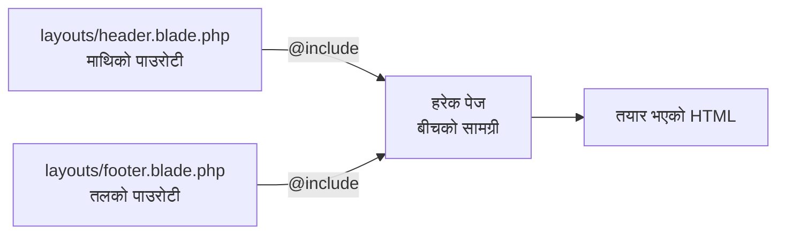
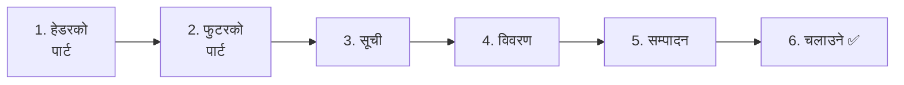
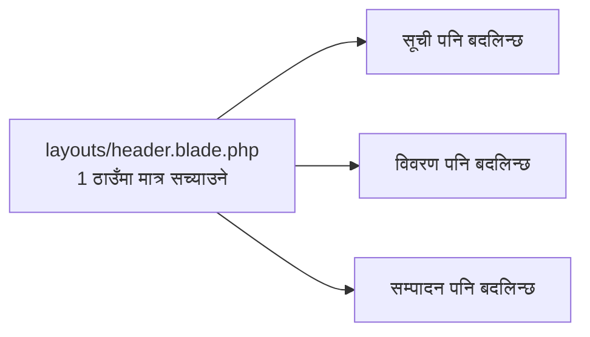
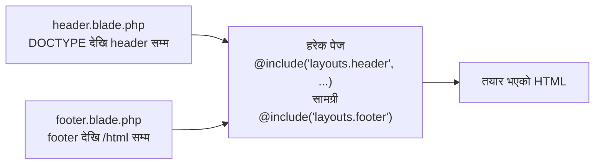

# Laravel परिचय — साझा भागलाई पार्ट बनाऔं (@include)

> 🇯🇵 मूल प्रति (जापानी भाषामा): [20261112_資料_1.md](<../../../1年生_データ設計とアプリ開発/後期/20261112/20261112_資料_1.md>) <!-- original-ja-link -->

सूची, विवरण र सम्पादन गरी पेज 3 वटा भए।
तर, हरेक फाइलमा **उही HTML** बारम्बार लेखिरहेका छौं। आज त्यो साझा भागलाई **पार्ट फाइल** मा छुट्याएर, लोड गर्ने तरिका सिक्नेछौं।

## आजको लक्ष्य
- साझा भागलाई पार्ट बनाउँदा के फाइदा हुन्छ भन्ने बुझ्ने
- हेडर र फुटरलाई पार्ट फाइलमा छुट्याएर, `@include` ले लोड गर्न सक्ने
- `@include` मा मान पठाएर, पेजअनुसार शीर्षक बदल्न सक्ने
- पार्टलाई 1 ठाउँमा सच्याउँदा सबै पेज बदलिन्छन् भन्ने पक्का गर्न सक्ने

> 11/5 को "भ्यालिडेसन" सम्म पूरा भएको अवस्थाबाट सुरु गर्छौं।

---

## 1. उही HTML धेरैपटक लेखिरहेका छौं

अहिलेका 3 वटा भ्यू तुलना गरेर हेरौं।

```
index.blade.php (सूची)         show.blade.php (विवरण)         edit.blade.php (सम्पादन)
┌─────────────────────────┐   ┌─────────────────────────┐   ┌─────────────────────────┐
│ <!DOCTYPE html>         │   │ <!DOCTYPE html>         │   │ <!DOCTYPE html>         │
│ <html lang="ja">        │   │ <html lang="ja">        │   │ <html lang="ja">        │
│ <head>                  │   │ <head>                  │   │ <head>                  │
│   <meta charset=...>    │   │   <meta charset=...>    │   │   <meta charset=...>    │
│   <title>TODOアプリ     │   │   <title>TODOの詳細     │   │   <title>TODOの編集     │
│ </head>                 │   │ </head>                 │   │ </head>                 │
│ <body>                  │   │ <body>                  │   │ <body>                  │
│ ┌─────────────────────┐ │   │ ┌─────────────────────┐ │   │ ┌─────────────────────┐ │
│ │ सूची को सामग्री       │ │   │ │ विवरणको सामग्री       │ │   │ │ सम्पादनको सामग्री     │ │
│ └─────────────────────┘ │   │ └─────────────────────┘ │   │ └─────────────────────┘ │
│ </body>                 │   │ </body>                 │   │ </body>                 │
│ </html>                 │   │ </html>                 │   │ </html>                 │
└─────────────────────────┘   └─────────────────────────┘   └─────────────────────────┘
```

पेजअनुसार फरक हुने भनेको **`<title>` र `<body>` भित्रको सामग्री मात्र** हो। बाँकी सबै, 3 वटैमा उस्तै छ।

उही कुरा धेरैपटक लेख्दा, यस्तो हुन्छ।

```
A: "सबै पेजको माथि 'TODOアプリ' को लिंक राख्न चाहन्छु। 3 वटै फाइल सच्याउनुपर्ने हो र…?"
B: "सबै पेजको तल फुटर राखेँ, तर विवरण पेजमा मात्र राख्न बिर्सेँ।"
C: "पेज 10 वटा भए, 10 ठाउँमा सच्याउनुपर्छ।"
```

---

## 2. साझा भागलाई "पार्ट" बनाउने

त्यसैले, साझा भागलाई **माथिल्लो आधा** र **तल्लो आधा** गरी 2 वटा पार्ट फाइलमा छुट्याउँछौं।
हरेक पेजले सुरुमा माथिल्लो आधा, अन्तिममा तल्लो आधा **लोड गर्ने** मात्र काम गर्छ।

```
layouts/header.blade.php (माथिल्लो आधाको पार्ट)
┌─────────────────────────┐
│ <!DOCTYPE html>         │
│ <html> <head> … </head> │
│ <body>                  │
│ <header>…</header>      │ ← स्क्रिनको माथि देखिने भाग
└─────────────────────────┘
            ＋
todos/index.blade.php (हरेक पेज)
┌─────────────────────────┐
│ सूची को सामग्री मात्र     │
└─────────────────────────┘
            ＋
layouts/footer.blade.php (तल्लो आधाको पार्ट)
┌─────────────────────────┐
│ <footer>…</footer>      │ ← स्क्रिनको तल देखिने भाग
│ </body>                 │
│ </html>                 │
└─────────────────────────┘
```

यसलाई **स्यान्डविच** सँग तुलना गर्न सकिन्छ।
माथिको पाउरोटी (हेडर) र तलको पाउरोटी (फुटर) सधैं उस्तै हुन्छन्, बीचमा राख्ने सामग्री (हरेक पेजको भित्री भाग) मात्र फरक हुन्छ।

पार्ट लोड गर्न, Blade को **`@include`** प्रयोग गर्छौं।

| लेख्ने तरिका | अर्थ |
|--------|------|
| `@include('layouts.header')` | `resources/views/layouts/header.blade.php` को सामग्री **यहीं जस्ताको तस्तै राख्ने** |
| `@include('layouts.header', ['title' => '一覧'])` | पार्ट राख्ने बेला, `$title` नाममा "一覧" (सूची) पठाउने |



> **`<head>` र `<header>` फरक कुरा हुन्**
> नाम उस्तै लाग्छ, तर काम फरक छ।
>
> | ट्याग | काम | स्क्रिनमा देखिन्छ? |
> |------|------|-------------|
> | `<head>` | पेजको जानकारी (character encoding, ट्याबको शीर्षक आदि)। ब्राउजरका लागि हो | देखिँदैन |
> | `<header>` | पेजको माथि देखिने भाग (एपको नाम, मेनु आदि) | देखिन्छ |
>
> आजको `header.blade.php` मा यी **दुवै** हुन्छन्।

---

## 3. बनाएर हेरौं



परिवर्तन गर्नुपर्ने फाइलहरू तलका 5 वटा हुन् (`src` भित्र)।

```
src/
└─ resources/views/
    ├─ layouts/
    │   ├─ header.blade.php ········· 1. हेडरको पार्ट (नयाँ बनाउने)
    │   └─ footer.blade.php ········· 2. फुटरको पार्ट (नयाँ बनाउने)
    └─ todos/
        ├─ index.blade.php ·········· 3. पार्ट लोड गर्ने गरी बदल्ने
        ├─ show.blade.php ··········· 4. पार्ट लोड गर्ने गरी बदल्ने
        └─ edit.blade.php ··········· 5. पार्ट लोड गर्ने गरी बदल्ने
```

---

### 1. हेडरको पार्ट बनाउने

> अहिले यहाँ: **🟢 1. हेडर** → 2. फुटर → 3. सूची → 4. विवरण → 5. सम्पादन → 6. चलाउने

`resources/views` भित्र `layouts` फोल्डर बनाएर, `header.blade.php` नामको फाइल बनाउनुहोस्।

```html
<!DOCTYPE html>
<html lang="ja">
<head>
    <meta charset="UTF-8">
    <title>{{ $title }} | TODOアプリ</title>
</head>
<body>
    <header>
        <a href="/todos">TODOアプリ</a>
    </header>
```

| कोड | अर्थ |
|--------|------|
| `{{ $title }}` | हरेक पेजबाट पठाइएको शीर्षक आउँछ। ब्राउजरको ट्याबमा देखिन्छ |
| `<header>` देखि `</header>` सम्म | सबै पेजको माथि देखिने भाग |

`</body>` र `</html>` यहाँ लेख्दैनौं। **फुटरको पार्ट** मा लेख्छौं।

---

### 2. फुटरको पार्ट बनाउने

> अहिले यहाँ: 1. हेडर → **🟢 2. फुटर** → 3. सूची → 4. विवरण → 5. सम्पादन → 6. चलाउने

त्यसैगरी `resources/views/layouts` भित्र `footer.blade.php` बनाउनुहोस्।

```html
    <footer>
        <p>© 2026 TODOアプリ</p>
    </footer>
</body>
</html>
```

हेडरमा खोलेका `<body>` र `<html>` लाई यहाँ बन्द गर्छौं।

---

### 3. सूची पेज बदल्ने

> अहिले यहाँ: 1. हेडर → 2. फुटर → **🟢 3. सूची** → 4. विवरण → 5. सम्पादन → 6. चलाउने

`resources/views/todos/index.blade.php` लाई तल जस्तै बदल्नुहोस्।

```html
@include('layouts.header', ['title' => '一覧'])

    <h1>TODOアプリ</h1>

    <form method="POST" action="/todos">
        @csrf
        <input type="text" name="title" value="{{ old('title') }}" placeholder="新しいTODOを入力" required>
        <button type="submit">追加</button>

        @error('title')
            <p style="color: red;">{{ $message }}</p>
        @enderror
    </form>

    <ul>
        @foreach ($todos as $todo)
            <li>
                <form method="POST" action="/todos/{{ $todo->id }}/toggle" style="display: inline;">
                    @csrf
                    @method('PATCH')
                    <input type="checkbox" name="is_done" value="1" onchange="this.form.submit()" @checked($todo->is_done)>
                </form>
                <a href="/todos/{{ $todo->id }}">{{ $todo->title }}</a>
            </li>
        @endforeach
    </ul>

@include('layouts.footer')
```

बदल्नुअघिसँग तुलना गर्दा, यस्तो भएको छ।

| | बदल्नुअघि | बदलेपछि |
|---|---|---|
| `<!DOCTYPE html>` देखि `<body>` सम्म | लेखिएको छ | `@include('layouts.header', ['title' => '一覧'])` को 1 लाइन बनाउने |
| `<body>` भित्रको सामग्री | जस्ताको तस्तै | जस्ताको तस्तै |
| `</body>` `</html>` | लेखिएको छ | `@include('layouts.footer')` को 1 लाइन बनाउने |

`['title' => '一覧']` भनेको कन्ट्रोलरमा `view('todos.index', ['todos' => $todos])` लेखेको जस्तै रूप हो।
पार्टभित्र `$title` नामले "一覧" (सूची) प्रयोग गर्न सकिन्छ।

✅ **जाँच**: http://localhost:8000/todos खोल्नुहोस्, सूची को माथि "TODOアプリ" (TODO एप) को लिंक, तल "© 2026 TODOアプリ" देखिए ठीक छ।
ब्राउजरको ट्याबमा "一覧 | TODOアプリ" देखिएको छ कि छैन, त्यो पनि पक्का गरौं।

---

### 4. विवरण पेज बदल्ने

> अहिले यहाँ: 1. हेडर → 2. फुटर → 3. सूची → **🟢 4. विवरण** → 5. सम्पादन → 6. चलाउने

`resources/views/todos/show.blade.php` लाई तल जस्तै बदल्नुहोस्।

```html
@include('layouts.header', ['title' => $todo->title])

    <h1>{{ $todo->title }}</h1>

    <p>番号：{{ $todo->id }}</p>

    <p>
        状態：
        @if ($todo->is_done)
            完了 ✅
        @else
            未完了
        @endif
    </p>

    <a href="/todos/{{ $todo->id }}/edit">編集</a>

    <form method="POST" action="/todos/{{ $todo->id }}" onsubmit="return confirm('削除しますか？');">
        @csrf
        @method('DELETE')
        <button type="submit">削除</button>
    </form>

    <a href="/todos">一覧にもどる</a>

@include('layouts.footer')
```

`['title' => $todo->title]` जस्तै गरी, **भेरिएबल** पनि पठाउन सकिन्छ।
"牛乳を買う" (दूध किन्ने) को विवरण पेज हो भने, ट्याबमा "牛乳を買う | TODOアプリ" देखिन्छ।

✅ **जाँच**: सूची बाट Todo मा क्लिक गरेर, विवरण पेजमा पनि हेडर र फुटर देखिए ठीक छ।

---

### 5. सम्पादन पेज बदल्ने

> अहिले यहाँ: 1. हेडर → 2. फुटर → 3. सूची → 4. विवरण → **🟢 5. सम्पादन** → 6. चलाउने

`resources/views/todos/edit.blade.php` लाई तल जस्तै बदल्नुहोस्।

```html
@include('layouts.header', ['title' => '編集'])

    <h1>TODOの編集</h1>

    <form method="POST" action="/todos/{{ $todo->id }}">
        @csrf
        @method('PUT')
        <input type="text" name="title" value="{{ old('title', $todo->title) }}" required>
        <label>
            <input type="checkbox" name="is_done" value="1" @checked($todo->is_done)>
            完了
        </label>
        <button type="submit">保存</button>

        @error('title')
            <p style="color: red;">{{ $message }}</p>
        @enderror
    </form>

    <a href="/todos/{{ $todo->id }}">もどる</a>

@include('layouts.footer')
```

✅ **जाँच**: विवरण पेजबाट "編集" (सम्पादन) थिचेर, सम्पादन पेजमा पनि हेडर र फुटर देखिए ठीक छ।

---

### 6. चलाउने ✅: पार्टलाई 1 ठाउँमा सच्याउँदा…?

> अहिले यहाँ: 1. हेडर → 2. फुटर → 3. सूची → 4. विवरण → 5. सम्पादन → **🟢 6. चलाउने**

अब, पार्ट बनाउँदाको सबैभन्दा ठूलो फाइदा देखिन्छ।
`layouts/header.blade.php` **मात्र** खोलेर, "TODOアプリ" लाई "わたしのTODO" (मेरो TODO) मा बदलेर हेरौं।

```html
    <header>
        <a href="/todos">わたしのTODO</a>  {{-- ★ बदलिएको --}}
    </header>
```

✅ **जाँच**: सूची, विवरण र सम्पादन गरी **3 वटै पेज** फेरि खोलेर हेरौं।
**हरेक पेजमा** हेडर "わたしのTODO" मा बदलिएको छ भने सफल भयो।



पार्ट नबनाएको भए, 3 वटै फाइल सच्याउनुपर्थ्यो।
**सच्याउने एक ठाउँमा, परिवर्तन हुने सबै पेजमा**। यही हो पार्ट बनाउनुको फाइदा।

---

## 4. काम नगरेमा

> **🔥 काम नगरे, लग निकाल!** → [【महत्त्वपूर्ण】लग निकाल्ने तरिका](../20261022/【重要】ログの出し方.md)

| लक्षण | कारण भएको ठाउँ | समाधान |
|------|----------|------|
| `View [layouts.header] not found.` | पार्ट | `resources/views/layouts/header.blade.php` को ठाउँ र फाइलको नाम जाँच्नुहोस् (`layouts` मा `s` हुन्छ। `footer` मा पनि उस्तै) |
| `Undefined variable $title` | हरेक पेज | `@include('layouts.header', ['title' => ...])` को `['title' => ...]` लेख्न बिर्सनुभएको छैन, जाँच्नुहोस् |
| ट्याबको शीर्षक अनौठो देखिन्छ | हरेक पेज | `['title' => ...]` को `'title'` र पार्टको `{{ $title }}` को नाम उस्तै छ कि जाँच्नुहोस् |
| फुटर देखिँदैन | हरेक पेज | पेजको अन्तिममा `@include('layouts.footer')` लेख्नुभयो कि जाँच्नुहोस् |
| `<!DOCTYPE html>` 2 पटक देखिन्छ | हरेक पेज | हरेक पेजमा `<!DOCTYPE html>` देखि `<body>` सम्म बाँकी छ कि जाँच्नुहोस् (हेडरको पार्टमा भएकाले मेटाउने) |

> **`@include` सुरु र अन्तिम गरी 2 ठाउँमा**
> हरेक पेजमा `@include('layouts.header', ...)` र `@include('layouts.footer')`, यी **2 ठाउँ** अनिवार्य रूपमा लेख्नुहोस्।
> फुटर लेख्न बिर्सियो भने, `</body>` र `</html>` नभएको HTML बन्छ (ब्राउजरले देखाइदिन्छ, तर सही HTML होइन)।

---

## 5. सारांश



| आज लेखेको कुरा | एक वाक्यमा |
|--------------|-----------|
| `layouts/header.blade.php` | सबै पेजको माथिल्लो आधा (`<!DOCTYPE html>` देखि `<header>` सम्म) |
| `layouts/footer.blade.php` | सबै पेजको तल्लो आधा (`<footer>` देखि `</html>` सम्म) |
| `@include('layouts.header', ['title' => ...])` | माथिल्लो आधाको पार्ट लोड गरी, शीर्षक पठाउने |
| `@include('layouts.footer')` | तल्लो आधाको पार्ट लोड गर्ने |

**साझा भागलाई पार्ट बनाऔं। सच्याउने एक ठाउँमा, परिवर्तन हुने सबै पेजमा।**

> **अरू लेख्ने तरिका पनि छन्**
> Laravel मा, पेजको पूरै "ढाँचा" लाई 1 फाइल बनाउने `@extends`, `@section`, `@yield`, वा `<x-layout>` जस्तै गरी लेख्ने **कम्पोनेन्ट** भन्ने तरिका पनि छ।
> इन्टरनेटमा देख्नुभयो भने, "उही काम अर्को तरिकाले लेखिएको रहेछ" भनेर बुझ्नुहोस्।

<!-- nav:start -->

---

| ⬅️ अघिल्लो | 🗺️ समग्र नक्सा | अर्को ➡️ |
|:--|:--:|--:|
| [11/05 भ्यालिडेसन](../20261105/20261105_資料_2.md) | [सामग्रीको समग्र नक्सा](../../README.md) | [11/12 क्याटेगरी जोड्ने](20261112_資料_2.md) |

<!-- nav:end -->
