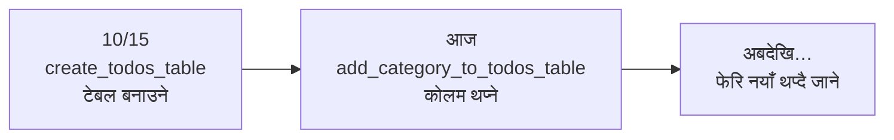
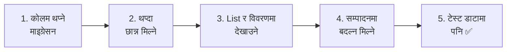
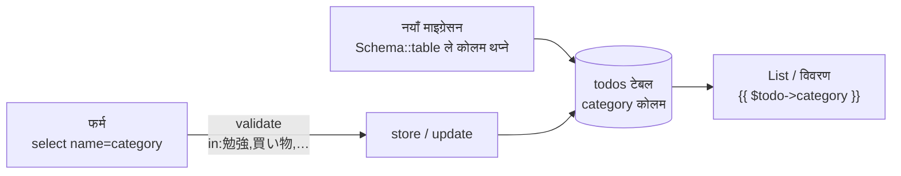

# Laravel परिचय — Todo मा क्याटेगरी जोडौं (कोलम थप्ने माइग्रेसन)

> 🇯🇵 मूल प्रति (जापानी भाषामा): [20261112_資料_2.md](<../../../1年生_データ設計とアプリ開発/後期/20261112/20261112_資料_2.md>) <!-- original-ja-link -->

Todo बढ्दै जाँदा, "यो पढाइसँग सम्बन्धित", "यो किनमेल" भनेर **वर्गीकरण** गर्न मन लाग्छ।
आज Todo मा **क्याटेगरी** जोड्न मिल्ने बनाउँछौं।

## आजको लक्ष्य
- पहिल्यै भएको टेबलमा **माइग्रेसनले कोलम थप्न** सक्ने
- select box प्रयोग गरेर तय गरिएका विकल्पहरूबाट क्याटेगरी छान्न सक्ने
- छान्न मिल्ने क्याटेगरीबाहेक अरू नपठाइयोस् भनेर, भ्यालिडेसन (`in`) ले जाँच्न सक्ने

> [सामग्री 1](./20261112_資料_1.md) को "साझा भागलाई पार्ट बनाऔं" सम्म पूरा भएको अवस्थाबाट सुरु गर्छौं।

---

## 1. आज बनाउने कुरा

क्याटेगरी, तलका **4 वटाबाट छान्ने** बनाउँछौं।

| क्याटेगरी |
|---------|
| 勉強 (पढाइ) |
| 買い物 (किनमेल) |
| 家のこと (घरको काम) |
| その他 (अन्य) |

```
TODOアプリ

[ 新しいTODOを入力 ] [ 勉強 ▼ ] [追加]

☐ [勉強] レポートを書く
☑ [買い物] 牛乳を買う
☐ [家のこと] 部屋のそうじ
```

`todos` टेबलमा, `category` (क्याटेगरी) को कोलम 1 वटा थप्छौं।

| id | title | **category** | is_done | created_at | updated_at |
|----|-------|-------------|---------|-----------|-----------|
| 1 | レポートを書く | **勉強** | 0 | … | … |
| 2 | 牛乳を買う | **買い物** | 1 | … | … |

---

## 2. नयाँ कुरा: कोलम थप्ने माइग्रेसन

10/15 मा, माइग्रेसनले `todos` टेबल **बनाएका** थियौं।
आज, पहिल्यै भएको `todos` टेबलमा **कोलम थप्छौं**।

यहाँ एउटा महत्त्वपूर्ण नियम छ।

> **एकपटक चलाइसकेको माइग्रेसन नबदल्ने। नयाँ माइग्रेसन थप्ने।**



10/15 को माइग्रेसन (`create_todos_table`) मा `category` थपे पनि, **त्यो चलाइसकेको भएकाले `migrate` गर्दा चल्दैन**।
माइग्रेसन टेबलको **परिवर्तनको रेकर्ड (डायरी)** हो। पुरानो डायरी नबदली, नयाँ पानामा "आज कोलम थपेँ" भनेर लेख्दै जान्छौं।

| | टेबल बनाउने (10/15) | कोलम थप्ने (आज) |
|---|---|---|
| फाइलको नाम | `create_todos_table` | `add_category_to_todos_table` |
| सामग्री | `Schema::create('todos', ...)` | `Schema::table('todos', ...)` |
| अर्थ | नयाँ टेबल बनाउने | पहिल्यै भएको टेबल बदल्ने |

---

## 3. बनाएर हेरौं



परिवर्तन गर्नुपर्ने फाइलहरू तल दिइएका छन् (`src` भित्र)।

```
src/
├─ database/
│   ├─ migrations/
│   │   └─ xxxx_add_category_to_todos_table.php ··· 1. नयाँ बनाउने
│   ├─ seeders/TodoSeeder.php ····················· 5. क्याटेगरी थप्ने
│   └─ factories/TodoFactory.php ·················· 5. क्याटेगरी थप्ने
├─ resources/views/todos/
│   ├─ index.blade.php ···························· 2, 3. select box र देखाउने
│   ├─ show.blade.php ····························· 3. देखाउने
│   └─ edit.blade.php ····························· 4. select box
└─ app/Http/Controllers/
    └─ TodoController.php ························· 2, 4. store र update
```

---

### 1. कोलम थप्ने माइग्रेसन बनाउने

> अहिले यहाँ: **🟢 1. माइग्रेसन** → 2. थप्ने → 3. देखाउने → 4. सम्पादन → 5. टेस्ट डाटा

तलको कमान्डले माइग्रेसन फाइल बनाउँछौं।

```powershell
docker compose exec laravel php artisan make:migration add_category_to_todos_table
```

नाम `add_〇〇_to_△△_table` राख्दा, Laravel ले "`△△` टेबल बदल्ने रहेछ" भनेर बुझेर, नमुना (template) बनाइदिन्छ।

`database/migrations/` मा `2026_11_12_xxxxxx_add_category_to_todos_table.php` बन्छ, `up()` र `down()` भित्र तल जस्तै लेख्नुहोस्।

```php
    public function up(): void
    {
        Schema::table('todos', function (Blueprint $table) {
            $table->string('category')->default('その他')->after('title');
        });
    }

    public function down(): void
    {
        Schema::table('todos', function (Blueprint $table) {
            $table->dropColumn('category');
        });
    }
```

| कोड | अर्थ |
|--------|------|
| `Schema::table('todos', ...)` | पहिल्यै भएको `todos` टेबल बदल्ने (बनाउँदा `Schema::create`) |
| `$table->string('category')` | `category` नामको string कोलम थप्ने |
| `->default('その他')` | केही नराखेमा "その他" (अन्य) बनाउने |
| `->after('title')` | `title` कोलमको पछाडि थप्ने (phpMyAdmin मा हेर्न सजिलो बनाउन) |
| `up()` | `migrate` गर्दा गर्ने काम (कोलम थप्ने) |
| `down()` | पहिलेको अवस्थामा फर्काउँदा गर्ने काम (कोलम हटाउने) |

> **किन `default('その他')` राख्ने?**
> `todos` टेबलमा पहिल्यै केही Todo छन्।
> कोलम थप्दा, अहिले भएका Todo को `category` मा के राख्ने त? `default` भयो भने, अहिले भएका सबै Todo "その他" (अन्य) हुन्छन्।

सेभ गरेपछि, माइग्रेसन चलाउनुहोस्।

```powershell
docker compose exec laravel php artisan migrate
```

✅ **जाँच**: phpMyAdmin मा `todos` टेबल खोलेर हेरौं।
`title` को पछाडि `category` कोलम बनेको छ, र अहिले भएका सबै Todo "その他" (अन्य) भएका छन् भने ठीक छ।
**अहिले भएका Todo मेटिएका छैनन्**। किनभने `migrate` ले अझै नचलाएका माइग्रेसन (आजको 1 वटा) मात्र चलाउँछ।

| कमान्ड | के गर्छ | अहिले भएको डाटा |
|---------|---------|------------|
| `migrate` | अझै नचलाएका माइग्रेसन मात्र चलाउने | **रहन्छ** |
| `migrate:fresh` | सबै टेबल मेटाएर, सबै माइग्रेसन सुरुदेखि चलाउने | मेटिन्छ |

---

### 2. थप्दा क्याटेगरी छान्न मिल्ने बनाउने

> अहिले यहाँ: 1. माइग्रेसन → **🟢 2. थप्ने** → 3. देखाउने → 4. सम्पादन → 5. टेस्ट डाटा

#### ① थप्ने फर्ममा select box थप्ने (V)

`resources/views/todos/index.blade.php` को थप्ने फर्ममा, ★ भएको select box थप्नुहोस्।

```html
    <form method="POST" action="/todos">
        @csrf
        <input type="text" name="title" value="{{ old('title') }}" placeholder="新しいTODOを入力" required>

        {{-- ★ यहाँदेखि थपिएको --}}
        <select name="category">
            <option value="勉強">勉強</option>
            <option value="買い物">買い物</option>
            <option value="家のこと">家のこと</option>
            <option value="その他">その他</option>
        </select>
        {{-- ★ यहाँसम्म --}}

        <button type="submit">追加</button>

        @error('title')
            <p style="color: red;">{{ $message }}</p>
        @enderror
    </form>
```

| कोड | अर्थ |
|--------|------|
| `<select name="category">` | `category` नाममा, छानेको कुरा पठाउने |
| `<option value="勉強">勉強</option>` | विकल्प। `value` को मान पठाइन्छ |

#### ② store मा क्याटेगरी पनि सेभ गर्ने (C)

`app/Http/Controllers/TodoController.php` को `store` मा, ★ भएको भाग थप्नुहोस्।

```php
    public function store(Request $request)
    {
        $request->validate([
            'title' => 'required|max:255',
            'category' => 'required|in:勉強,買い物,家のこと,その他',  // ★ थपिएको
        ], [
            'title.required' => 'タイトルを入力してください。',
            'title.max' => 'タイトルは255文字以内で入力してください。',
            'category.required' => 'カテゴリを選んでください。',           // ★ थपिएको
            'category.in' => 'カテゴリは、リストの中から選んでください。',  // ★ थपिएको
        ]);

        $todo = new Todo();
        $todo->title = $request->input('title');
        $todo->category = $request->input('category');  // ★ थपिएको
        $todo->save();

        return redirect('/todos');
    }
```

| कोड | अर्थ |
|--------|------|
| `'category' => 'required\|in:勉強,買い物,家のこと,その他'` | `category` यी 4 वटामध्ये **कुनै एउटा** हुनैपर्छ |
| `$todo->category = $request->input('category')` | छानिएको क्याटेगरी राख्ने |

> **select box भए पनि, किन `in` ले जाँच्ने?**
> select box मा 4 वटा मात्र विकल्प छन्, तर 11/5 मा सिकेजस्तै, **ब्राउजरको जाँच छलेर पार गर्न सकिन्छ**।
> developer tools ले `<option value="勉強">` लाई `<option value="ゲーム">` (गेम) मा बदलेर पठाउन पनि सकिन्छ।
> सर्भरतर्फको `in` ले, तय गरिएका 4 वटाबाहेक अरूलाई रोक्छ।

---

### 3. List र विवरणमा क्याटेगरी देखाउने

> अहिले यहाँ: 1. माइग्रेसन → 2. थप्ने → **🟢 3. देखाउने** → 4. सम्पादन → 5. टेस्ट डाटा

#### ① List (V)

`index.blade.php` को `<li>` भित्र, ★ भएको भाग थप्नुहोस्।

```html
            <li>
                <form method="POST" action="/todos/{{ $todo->id }}/toggle" style="display: inline;">
                    @csrf
                    @method('PATCH')
                    <input type="checkbox" name="is_done" value="1" onchange="this.form.submit()" @checked($todo->is_done)>
                </form>
                [{{ $todo->category }}]  {{-- ★ थपिएको --}}
                <a href="/todos/{{ $todo->id }}">{{ $todo->title }}</a>
            </li>
```

#### ② विवरण (V)

`show.blade.php` को "番号" (नम्बर) को तल, ★ भएको 1 लाइन थप्नुहोस्।

```html
    <p>番号：{{ $todo->id }}</p>

    <p>カテゴリ：{{ $todo->category }}</p>  {{-- ★ थपिएको --}}
```

✅ **जाँच**: List मा क्याटेगरी छानेर Todo थपेर हेरौं।
List मा `[勉強] レポートを書く` जस्तै देखिन्छ, र विवरण पेजमा पनि "カテゴリ：勉強" (क्याटेगरी: पढाइ) देखिए ठीक छ।

---

### 4. सम्पादनमा क्याटेगरी बदल्न मिल्ने बनाउने

> अहिले यहाँ: 1. माइग्रेसन → 2. थप्ने → 3. देखाउने → **🟢 4. सम्पादन** → 5. टेस्ट डाटा

#### ① सम्पादन फर्ममा select box थप्ने (V)

`edit.blade.php` को फर्ममा, ★ भएको select box थप्नुहोस्।

```html
    <form method="POST" action="/todos/{{ $todo->id }}">
        @csrf
        @method('PUT')
        <input type="text" name="title" value="{{ old('title', $todo->title) }}" required>

        {{-- ★ यहाँदेखि थपिएको --}}
        <select name="category">
            <option value="勉強" @selected($todo->category === '勉強')>勉強</option>
            <option value="買い物" @selected($todo->category === '買い物')>買い物</option>
            <option value="家のこと" @selected($todo->category === '家のこと')>家のこと</option>
            <option value="その他" @selected($todo->category === 'その他')>その他</option>
        </select>
        {{-- ★ यहाँसम्म --}}

        <label>
            <input type="checkbox" name="is_done" value="1" @checked($todo->is_done)>
            完了
        </label>
        <button type="submit">保存</button>

        @error('title')
            <p style="color: red;">{{ $message }}</p>
        @enderror
    </form>
```

| कोड | अर्थ |
|--------|------|
| `@selected($todo->category === '勉強')` | अहिलेको क्याटेगरी "勉強" (पढाइ) हो भने, सुरुदेखि नै यो विकल्प छानिएको बनाउने |

`@selected` भनेको चेकबक्सको `@checked` को select box संस्करण हो।
`( )` भित्रको कुरा `true` भएको बेला मात्र, `<option>` मा `selected` जोड्छ।

#### ② update मा क्याटेगरी पनि सेभ गर्ने (C)

`TodoController.php` को `update` मा, `store` जस्तै ★ भएको भाग थप्नुहोस्।

```php
    public function update(Request $request, $id)
    {
        $request->validate([
            'title' => 'required|max:255',
            'category' => 'required|in:勉強,買い物,家のこと,その他',  // ★ थपिएको
        ], [
            'title.required' => 'タイトルを入力してください。',
            'title.max' => 'タイトルは255文字以内で入力してください。',
            'category.required' => 'カテゴリを選んでください。',           // ★ थपिएको
            'category.in' => 'カテゴリは、リストの中から選んでください。',  // ★ थपिएको
        ]);

        $todo = Todo::findOrFail($id);
        $todo->title = $request->input('title');
        $todo->category = $request->input('category');  // ★ थपिएको
        $todo->is_done = $request->has('is_done');
        $todo->save();

        return redirect('/todos/' . $todo->id);
    }
```

✅ **जाँच**: सम्पादन पेज खोल्दा, अहिलेको क्याटेगरी सुरुदेखि नै छानिएको छ कि छैन पक्का गरौं।
क्याटेगरी बदलेर `保存` (सेभ) गर्दा, विवरण पेजको क्याटेगरी बदलियो भने ठीक छ।

---

### 5. टेस्ट डाटामा पनि क्याटेगरी राख्ने

> अहिले यहाँ: 1. माइग्रेसन → 2. थप्ने → 3. देखाउने → 4. सम्पादन → **🟢 5. टेस्ट डाटा**

11/5 मा बनाएका Seeder र Factory मा पनि, क्याटेगरी थपिराखौं।

#### ① TodoSeeder (तय गरिएको डाटा)

`database/seeders/TodoSeeder.php` को array र `foreach` मा, ★ भएको भाग थप्नुहोस्।

```php
        $todos = [
            ['title' => '牛乳を買う',     'category' => '買い物', 'is_done' => false],  // ★ category थपिएको
            ['title' => 'レポートを出す', 'category' => '勉強',   'is_done' => true],   // ★
            ['title' => '宿題をする',     'category' => '勉強',   'is_done' => false],  // ★
        ];

        foreach ($todos as $data) {
            $todo = new Todo();
            $todo->title = $data['title'];
            $todo->category = $data['category'];  // ★ थपिएको
            $todo->is_done = $data['is_done'];
            $todo->save();
        }
```

#### ② TodoFactory (स्वचालित रूपमा बनाइने डाटा)

`database/factories/TodoFactory.php` को `definition()` मा, ★ भएको 1 लाइन थप्नुहोस्।

```php
        return [
            'title' => fake()->randomElement([
                '牛乳を買う',
                'レポートを出す',
                '宿題をする',
                '部屋のそうじ',
                '本を返す',
                'ゴミを出す',
            ]),
            'category' => fake()->randomElement(['勉強', '買い物', '家のこと', 'その他']),  // ★ थपिएको
            'is_done' => fake()->boolean(),
        ];
```

```powershell
docker compose exec laravel php artisan migrate:fresh --seed
```

✅ **जाँच**: List खोलेर, 23 वटा Todo मा हरेकको क्याटेगरी जोडिएको छ भने ठीक छ।
`migrate:fresh` ले सबै माइग्रेसन सुरुदेखि चलाउने भएकाले, **आजको माइग्रेसन पनि सँगै** चल्छ।

---

## 4. काम नगरेमा

> **🔥 काम नगरे, लग निकाल!** → [【महत्त्वपूर्ण】लग निकाल्ने तरिका](../20261022/【重要】ログの出し方.md)

| लक्षण | कारण भएको ठाउँ | समाधान |
|------|----------|------|
| `Unknown column 'category'` | माइग्रेसन | `php artisan migrate` चलाउनुभयो कि जाँच्नुहोस् |
| `migrate` गर्दा पनि `category` कोलम बन्दैन | माइग्रेसन | 10/15 को माइग्रेसनमा थप्नुभएको त छैन, जाँच्नुहोस् (**नयाँ माइग्रेसन** मा लेख्ने) |
| "カテゴリは、リストの中から選んでください。" (क्याटेगरी सूचीबाट छान्नुहोस्।) देखिन्छ | भ्यू / कन्ट्रोलर | `<option value="...">` र `in:...` का क्याटेगरी नाम **1 अक्षर पनि फरक नभई** उस्तै छन् कि जाँच्नुहोस् |
| थपेँ, तर क्याटेगरी सबै "その他" (अन्य) हुन्छ | कन्ट्रोलर | `store` मा `$todo->category = $request->input('category');` छ कि छैन जाँच्नुहोस् |
| सम्पादन पेजमा, अहिलेको क्याटेगरी छानिएको हुँदैन | भ्यू | `@selected($todo->category === '...')` लेखिएको छ कि छैन र क्याटेगरीको नाम मिलेको छ कि छैन जाँच्नुहोस् |

---

## 5. सारांश



| आज लेखेको कुरा | एक वाक्यमा |
|--------------|-----------|
| `make:migration add_category_to_todos_table` | पहिल्यै भएको टेबलमा कोलम थप्ने माइग्रेसन बनाउने |
| `Schema::table(...)` र `->default(...)` | कोलम थप्ने। अहिले भएको डाटामा `default` को मान राखिन्छ |
| `php artisan migrate` | अझै नचलाएका माइग्रेसन मात्र चलाउने (डाटा रहन्छ) |
| `<select>` र `<option>` | तय गरिएका विकल्पहरूबाट छान्ने |
| `@selected(...)` | अहिलेको मानलाई सुरुदेखि नै छानिएको बनाउने (`@checked` को select box संस्करण) |
| `'in:勉強,買い物,…'` | तय गरिएका मानबाहेक अरूलाई सर्भरतर्फ रोक्ने |

**एकपटक चलाइसकेको माइग्रेसन नबदल्ने। परिवर्तन नयाँ माइग्रेसनले थप्दै जाने।**

---

## 6. अझै गरेर हेरौं (समय बचेकाहरूका लागि)

क्याटेगरीमा "部活" (क्लब गतिविधि) थपेर हेरौं।
कुन-कुन फाइल सच्याउनुपर्छ, आफैं सोचेर हेर्नुहोस्।

<details>
<summary>संकेत</summary>

"部活" लाई तलका **4 ठाउँमा** थप्नुहोस्।

1. `index.blade.php` को थप्ने फर्मको `<option>`
2. `edit.blade.php` को सम्पादन फर्मको `<option>` (`@selected` पनि)
3. `TodoController.php` को `store` को `in:...`
4. `TodoController.php` को `update` को `in:...`

(Factory बाट पनि "部活" भएको डाटा बनाउन चाहनुहुन्छ भने, `TodoFactory.php` को `randomElement` मा पनि थप्नुहोस्)

उही क्याटेगरीको सूची **4 ठाउँमा लेखिरहेका छौं** भन्ने ख्याल गर्नुभयो?
1 ठाउँमा थप्न बिर्सियो भने, "छान्न मिल्छ तर सेभ हुँदैन" जस्ता बग आउँछन्। यस्ता ठाउँलाई पनि, वास्तवमा सामग्री 1 मा जस्तै **साझा बनाउन** मन लाग्छ।

</details>

<!-- nav:start -->

---

| ⬅️ अघिल्लो | 🗺️ समग्र नक्सा | अर्को ➡️ |
|:--|:--:|--:|
| [11/12 साझा भागलाई पार्टमा बदल्ने (@include)](20261112_資料_1.md) | [सामग्रीको समग्र नक्सा](../../README.md) | [11/19 विद्यार्थी व्यवस्थापन ① सूची・विवरण](../20261119/20261119_資料_1.md) |

<!-- nav:end -->
