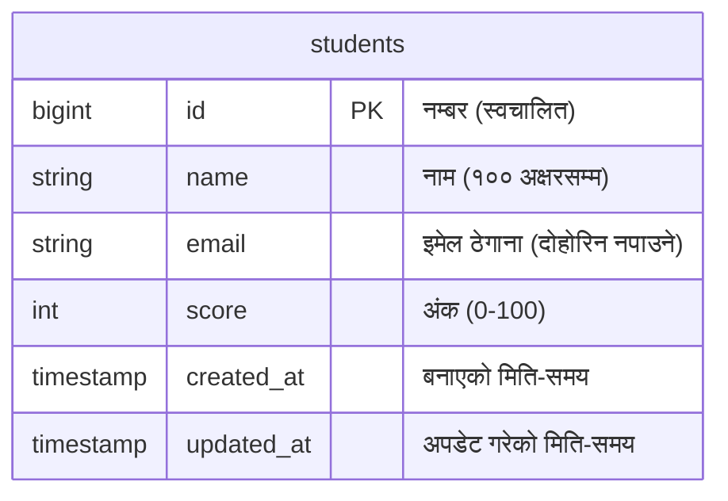
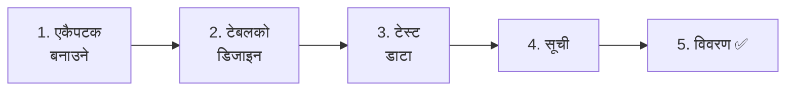
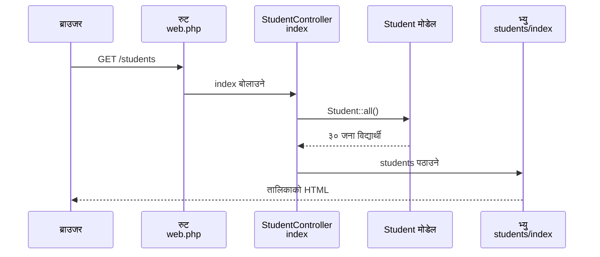

# विद्यार्थी व्यवस्थापन एप बनाऔं ① — तयारी, सूची र विवरण

> 🇯🇵 मूल प्रति (जापानी भाषामा): [20261119_資料_1.md](<../../../1年生_データ設計とアプリ開発/後期/20261119/20261119_資料_1.md>) <!-- original-ja-link -->

आजदेखि हामी नयाँ **विद्यार्थी व्यवस्थापन एप** बनाउन सुरु गर्छौं।
Todo एपमा सिकेका कुराहरू प्रयोग गरेर, यसपटक **आफ्नै बलमा** बनाउँदै जाऔं।

## आजको लक्ष्य
- `make:model -mf` प्रयोग गरेर मोडेल, माइग्रेसन र Factory एकैपटक बनाउन सक्ने
- विद्यार्थीको टेबल बनाएर टेस्ट डाटा हाल्न सक्ने
- विद्यार्थीको सूची पेज र विवरण पेज बनाउन सक्ने

> अभ्यास वातावरण (`php-study`) मा mysql र laravel सुरु गरेर अभ्यास थालौं।
> Todo एप भएकै **उही प्रोजेक्ट (`src`)** मा विद्यार्थी व्यवस्थापन एप थप्दै जान्छौं।

---

## 1. विद्यार्थी व्यवस्थापन एप भनेको के हो

शिक्षकले विद्यार्थीहरूको **नाम, इमेल ठेगाना र अंक** व्यवस्थापन गर्ने एप हो।

```
生徒管理アプリ

[ 生徒を追加 ]

| 名前       | 点数 |
|------------|------|
| 山田 太郎  |  85  |
| 佐藤 花子  |  92  |
| 鈴木 一郎  |  70  |
```

यो एपलाई अबका ३ कक्षामा क्रमशः विकसित गर्दै जान्छौं।

| कक्षा | के बनाउने |
|----|---------|
| **पहिलो पटक (आज)** | विद्यार्थीको सूची, विवरण, थप्ने, सम्पादन र मेटाउने (CRUD) |
| दोस्रो पटक | लगइन (शिक्षकले मात्र प्रयोग गर्न सक्ने बनाउने) |
| तेस्रो पटक | रिलेसन (कुन शिक्षकले दर्ता गरेको विद्यार्थी हो भनेर रेकर्ड गर्ने) |

> **दोस्रो वर्षसँग जोडिने एप**
> दोस्रो वर्षमा यो एपलाई **API** (स्क्रिन नभई डाटा मात्र फर्काउने व्यवस्था) मा परिवर्तन गर्छौं।
> आज बनाउने टेबल र URL दोस्रो वर्षमा पनि त्यस्तै प्रयोग गर्छौं।

### Todo एपसँग तुलना गरौं

बनाउने तरिका Todo एपसँग लगभग उस्तै छ।

| | Todo एप | विद्यार्थी व्यवस्थापन एप |
|---|---|---|
| टेबल | `todos` | `students` |
| मोडेल | `Todo` | `Student` |
| कन्ट्रोलर | `TodoController` | `StudentController` |
| URL | `/todos` | `/students` |
| भ्युको फोल्डर | `resources/views/todos/` | `resources/views/students/` |

### विद्यार्थीको टेबल



Todo को टेबलसँग यी कुरामा फरक छ।

| कोलम | नयाँ कुरा |
|----|------------|
| `email` | **एउटै इमेल ठेगाना भएका २ जना विद्यार्थी दर्ता गर्न सकिँदैन** (दोहोरिन नपाउने) |
| `score` | अक्षर होइन, **पूर्णांक** (`integer`) राखिन्छ |

---

## 2. बनाएर हेरौं



### 1. मोडेल, माइग्रेसन र Factory एकैपटक बनाउने

> अहिले यहाँ: **🟢 1. एकैपटक बनाउने** → 2. डिजाइन → 3. टेस्ट डाटा → 4. सूची → 5. विवरण

Todo बनाउँदा माइग्रेसन, मोडेल र Factory एउटा-एउटा गरेर बनाएका थियौं।
यसपटक **एउटै कमान्डले एकैपटक** बनाउँछौं।

```powershell
docker compose exec laravel php artisan make:model Student -mf
```

| भाग | अर्थ |
|------|------|
| `make:model Student` | `Student` मोडेल बनाउने |
| `-m` | माइग्रेसन पनि सँगै बनाउने (**m**igration) |
| `-f` | Factory पनि सँगै बनाउने (**f**actory) |

यी ३ वटा फाइल बन्छन्।

```
src/
├─ app/Models/Student.php ··································· मोडेल
├─ database/migrations/xxxx_create_students_table.php ······· माइग्रेसन
└─ database/factories/StudentFactory.php ···················· Factory
```

`-f` राखेकाले, मोडेलमा सुरुदेखि नै `HasFactory` हुन्छ (Todo मा हामीले हातैले थपेका थियौं)।

```php
class Student extends Model
{
    /** @use HasFactory<\Database\Factories\StudentFactory> */
    use HasFactory;
}
```

---

### 2. टेबलको डिजाइन लेख्ने (माइग्रेसन)

> अहिले यहाँ: 1. एकैपटक बनाउने → **🟢 2. डिजाइन** → 3. टेस्ट डाटा → 4. सूची → 5. विवरण

`database/migrations/xxxx_create_students_table.php` खोलेर, `up()` भित्र यसरी लेख्नुहोस्।

```php
    public function up(): void
    {
        Schema::create('students', function (Blueprint $table) {
            $table->id();
            $table->string('name', 100);
            $table->string('email')->unique();
            $table->integer('score')->default(0);
            $table->timestamps();
        });
    }
```

| कोड | अर्थ |
|--------|------|
| `$table->string('name', 100)` | नाम। १०० अक्षरसम्म |
| `$table->string('email')->unique()` | इमेल ठेगाना। **एउटै मान २ पटक राख्न सकिँदैन** |
| `$table->integer('score')->default(0)` | अंक। पूर्णांक, केही नराखे 0 |

👀 **चलाउनुअघि हेर्नुहोस्**: phpMyAdmin (http://localhost:8080) को `laravel` डाटाबेसमा `students` टेबल **अझै छैन** भनेर पक्का गर्नुहोस्।
डिजाइन लेखेर मात्र टेबल बनिसकेको हुँदैन।

```powershell
docker compose exec laravel php artisan migrate
```

✅ **जाँच**: phpMyAdmin मा `students` टेबल बनेको छ भने ठीक छ।

---

### 3. टेस्ट डाटा हाल्ने (Factory र Seeder)

> अहिले यहाँ: 1. एकैपटक बनाउने → 2. डिजाइन → **🟢 3. टेस्ट डाटा** → 4. सूची → 5. विवरण

#### ① Factory मा विद्यार्थी बनाउने तरिका लेख्ने

`database/factories/StudentFactory.php` को `definition()` भित्र यसरी लेख्नुहोस्।

```php
    public function definition(): array
    {
        return [
            'name' => fake('ja_JP')->name(),
            'email' => fake()->unique()->safeEmail(),
            'score' => fake()->numberBetween(0, 100),
        ];
    }
```

| कोड | अर्थ |
|--------|------|
| `fake('ja_JP')->name()` | **जापानी नाम** र्‍यान्डम रूपमा बनाउँछ (उदाहरण: 山田 太郎) |
| `fake()->unique()->safeEmail()` | इमेल ठेगाना र्‍यान्डम रूपमा बनाउँछ। `unique()` ले एउटै ठेगाना दोहोरिन दिँदैन |
| `fake()->numberBetween(0, 100)` | 0 देखि 100 सम्मको पूर्णांक र्‍यान्डम रूपमा बनाउँछ |

> अभ्यासमा वास्तविक विद्यार्थीको नाम वा इमेल ठेगाना प्रयोग गर्दैनौं। Factory ले **काल्पनिक डाटा** बनाउँछ।

#### ② Seeder बनाएर ३० जना हाल्ने

```powershell
docker compose exec laravel php artisan make:seeder StudentSeeder
```

`database/seeders/StudentSeeder.php` को `run()` भित्र यसरी लेख्नुहोस्।

```php
<?php

namespace Database\Seeders;

use App\Models\Student;
use Illuminate\Database\Seeder;

class StudentSeeder extends Seeder
{
    public function run(): void
    {
        Student::factory()->count(30)->create();
    }
}
```

`database/seeders/DatabaseSeeder.php` मा ★ भएको १ लाइन थप्नुहोस्।

```php
    public function run(): void
    {
        $this->call(TodoSeeder::class);
        $this->call(StudentSeeder::class);  // ★ थप्ने
    }
```

```powershell
docker compose exec laravel php artisan migrate:fresh --seed
```

✅ **जाँच**: phpMyAdmin मा `students` टेबल खोल्दा ३० जना विद्यार्थी छन् भने ठीक छ।
(`migrate:fresh` भएकाले Todo को डाटा पनि सुरुकै अवस्थामा फर्किन्छ)

---

### 4. सूची पेज बनाउने

> अहिले यहाँ: 1. एकैपटक बनाउने → 2. डिजाइन → 3. टेस्ट डाटा → **🟢 4. सूची** → 5. विवरण

#### ① कन्ट्रोलर बनाउने

```powershell
docker compose exec laravel php artisan make:controller StudentController
```

`app/Http/Controllers/StudentController.php` लाई यसरी लेख्नुहोस्।

```php
<?php

namespace App\Http\Controllers;

use App\Models\Student;
use Illuminate\Http\Request;

class StudentController extends Controller
{
    public function index()
    {
        $students = Student::all();

        return view('students.index', ['students' => $students]);
    }
}
```

`TodoController` को `index` मा `Todo` को सट्टा `Student` राखिएको मात्र हो।

#### ② रुट लेख्ने

`routes/web.php` मा ★ भएका २ लाइन थप्नुहोस्।

```php
use App\Http\Controllers\StudentController;  // ★ थप्ने (माथितिर लेख्ने)

// (Todo का रुटहरू यहाँ देखाइएको छैन)

Route::get('/students', [StudentController::class, 'index']);  // ★ थप्ने
```

#### ③ भ्यु बनाउने

`resources/views` भित्र `students` फोल्डर बनाएर `index.blade.php` बनाउनुहोस्।
11/12 मा बनाएका **हेडर र फुटरका कम्पोनेन्ट** यहाँ पनि प्रयोग गर्छौं।

```html
@include('layouts.header', ['title' => '生徒一覧'])

    <h1>生徒一覧</h1>

    <table border="1">
        <tr>
            <th>名前</th>
            <th>点数</th>
        </tr>
        @foreach ($students as $student)
            <tr>
                <td><a href="/students/{{ $student->id }}">{{ $student->name }}</a></td>
                <td>{{ $student->score }}</td>
            </tr>
        @endforeach
    </table>

@include('layouts.footer')
```

| कोड | अर्थ |
|--------|------|
| `<table>` | तालिका बनाउँछ। `<tr>` एउटा पङ्क्ति, `<th>` शीर्षक र `<td>` एउटा सेल हो |
| `border="1"` | तालिकामा किनाराको रेखा लगाउँछ |

#### ④ हेडरमा 「生徒管理」(विद्यार्थी व्यवस्थापन) को लिङ्क थप्ने

`resources/views/layouts/header.blade.php` मा ★ भएको लिङ्क थप्नुहोस्।

```html
    <header>
        <a href="/todos">TODOアプリ</a>
        <a href="/students">生徒管理</a>  {{-- ★ थप्ने --}}
    </header>
```

**कम्पोनेन्टको एक ठाउँ मात्र सच्याउँदा, Todo को पेज र विद्यार्थीको पेज दुवैमा लिङ्क देखिन्छ** (11/12 मा सिकेको साझा बनाउने तरिकाको शक्ति यही हो)।

`/students` खोलेदेखि सूची देखिँदासम्मको प्रक्रिया Todo को जस्तै हो।



✅ **जाँच**: http://localhost:8000/students खोल्दा ३० जना विद्यार्थी तालिकामा देखिन्छन् भने ठीक छ।

---

### 5. विवरण पेज बनाउने

> अहिले यहाँ: 1. एकैपटक बनाउने → 2. डिजाइन → 3. टेस्ट डाटा → 4. सूची → **🟢 5. विवरण**

#### ① कन्ट्रोलरमा show थप्ने

`StudentController.php` मा ★ भएको `show` थप्नुहोस्।

```php
    // ★ यहाँदेखि थप्ने
    public function show($id)
    {
        $student = Student::findOrFail($id);

        return view('students.show', ['student' => $student]);
    }
    // ★ यहाँसम्म
```

#### ② रुट थप्ने

```php
Route::get('/students', [StudentController::class, 'index']);
Route::get('/students/{id}', [StudentController::class, 'show']);  // ★ थप्ने
```

#### ③ भ्यु बनाउने

`resources/views/students/show.blade.php` बनाउनुहोस्।

```html
@include('layouts.header', ['title' => $student->name])

    <h1>{{ $student->name }}</h1>

    <p>番号：{{ $student->id }}</p>
    <p>メールアドレス：{{ $student->email }}</p>
    <p>点数：{{ $student->score }}点</p>

    <a href="/students">一覧にもどる</a>

@include('layouts.footer')
```

✅ **जाँच**: सूचीमा विद्यार्थीको नाममा क्लिक गर्दा विवरण पेज देखिन्छ भने ठीक छ।
http://localhost:8000/students/999 जस्तै, नभएको विद्यार्थीको URL खोल्दा `404 Not Found` आउँछ भनेर पनि जाँच गरौं।

---

## 3. काम नगरेमा

> **🔥 चलेन भने, लग निकाल!** → [【महत्त्वपूर्ण】लग निकाल्ने तरिका](../20261022/【重要】ログの出し方.md)

| लक्षण | कारण भएको ठाउँ | उपाय |
|------|----------|------|
| `Table 'laravel.students' doesn't exist` | माइग्रेसन | `php artisan migrate` (वा `migrate:fresh --seed`) चलाएको छ कि छैन जाँच्नुहोस् |
| `Call to undefined method App\Models\Student::factory()` | मोडेल | `make:model` मा `-f` राख्न बिर्सिएको। `Student.php` मा `use HasFactory;` थप्नुहोस् |
| नाम अंग्रेजीमा आउँछ (उदाहरण: John Smith) | Factory | `fake('ja_JP')->name()` को `'ja_JP'` लेखेको छ कि छैन जाँच्नुहोस् |
| `Target class [StudentController] does not exist.` | रुट | `web.php` को माथि `use App\Http\Controllers\StudentController;` छ कि छैन जाँच्नुहोस् |
| `View [students.index] not found.` | भ्यु | `resources/views/students/index.blade.php` को स्थान जाँच्नुहोस् (`students` को अन्त्यमा `s` हुन्छ) |
| `Undefined variable $title` | भ्यु | `@include('layouts.header', ['title' => ...])` को `['title' => ...]` लेख्न बिर्सिएको छैन कि जाँच्नुहोस् |

---

## 4. सारांश

| आज लेखेको कुरा | छोटकरीमा |
|--------------|-----------|
| `make:model Student -mf` | मोडेल, माइग्रेसन र Factory एकैपटक बनाउने |
| `->unique()` (माइग्रेसन) | एउटै मान २ पटक राख्न नसकिने कोलम बनाउने |
| `$table->integer(...)` | पूर्णांकको कोलम |
| `fake('ja_JP')->name()` | जापानी नाम र्‍यान्डम रूपमा बनाउने |
| `index` र `show` | Todo कै ढाँचामा सूची र विवरण बनाउने |
| `<table>` | सूचीलाई तालिकामा देखाउने |

**बनाउने तरिका Todo कै जस्तो हो। नाम `Todo` बाट `Student` मा बदलेर सोच्यौं भने, आफैं बनाउन सकिन्छ।**

अब विद्यार्थी थप्ने, सम्पादन गर्ने र मेटाउने बनाउँछौं → [विद्यार्थी व्यवस्थापन एप बनाऔं ② — थप्ने, सम्पादन र मेटाउने](./20261119_資料_2.md)

<!-- nav:start -->

---

| ⬅️ अघिल्लो | 🗺️ समग्र नक्सा | अर्को ➡️ |
|:--|:--:|--:|
| [11/12 क्याटेगरी जोड्ने](../20261112/20261112_資料_2.md) | [सामग्रीको समग्र नक्सा](../../README.md) | [11/19 विद्यार्थी व्यवस्थापन ② थप्ने・सम्पादन・मेटाउने](20261119_資料_2.md) |

<!-- nav:end -->
