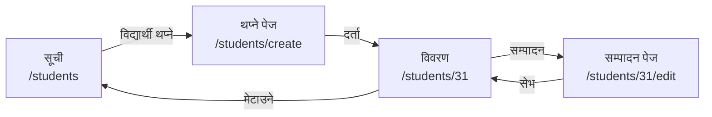
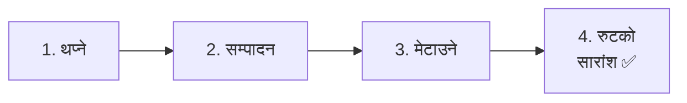
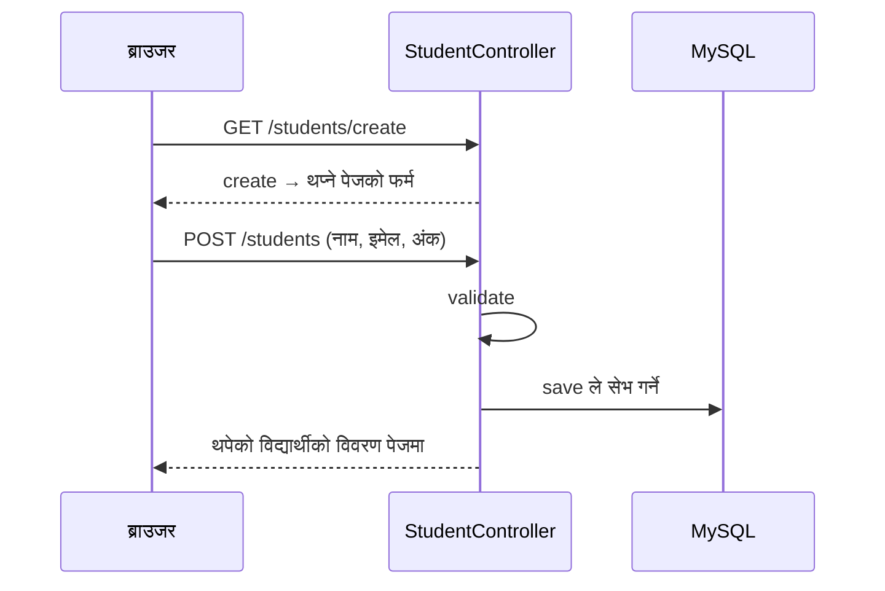
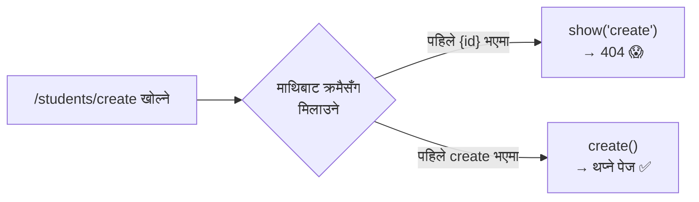
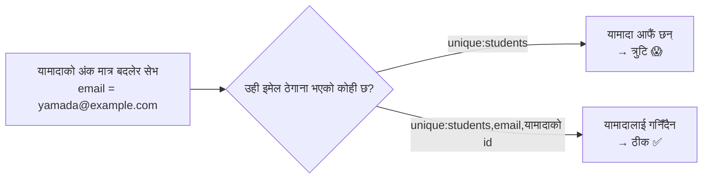

# विद्यार्थी व्यवस्थापन एप बनाऔं ② — थप्ने, सम्पादन र मेटाउने

> 🇯🇵 मूल प्रति (जापानी भाषामा): [20261119_資料_2.md](<../../../1年生_データ設計とアプリ開発/後期/20261119/20261119_資料_2.md>) <!-- original-ja-link -->

[सामग्री 1](./20261119_資料_1.md) मा विद्यार्थीको सूची र विवरण बन्यो।
अब विद्यार्थी **थप्न, सम्पादन गर्न र मेटाउन** सकिने बनाउँछौं।

## आजको लक्ष्य
- धेरै इनपुट फिल्ड भएको फर्म, थप्ने छुट्टै पेजको रूपमा बनाउन सक्ने
- इमेल ठेगाना दोहोरिएको (`unique`) र अंकको दायरा (`integer`, `min`, `max`) जाँच्न सक्ने
- सम्पादन गर्दा **आफ्नै इमेल ठेगानालाई दोहोरिएको छ कि छैन भनेर गरिने जाँचबाट हटाउन** सक्ने

> सामग्री 1 को "सूची र विवरण" बनिसकेको अवस्थाबाट सुरु गर्छौं।

---

## 1. Todo सँगको फरक

बनाउने तरिका Todo सँग लगभग उस्तै भए पनि, २ वटा कुरामा फरक छ।

| | Todo एप | विद्यार्थी व्यवस्थापन एप |
|---|---|---|
| थप्ने फर्मको स्थान | सूची पेजको माथि | **थप्ने छुट्टै पेज** (`/students/create`) बनाउने |
| इनपुट फिल्ड | शीर्षक मात्र | नाम, इमेल ठेगाना र अंक गरी **३ वटा** |

इनपुट फिल्ड धेरै भएकाले सूचीको माथि राख्दा हेर्न गाह्रो हुन्छ। त्यसैले **थप्ने पेज** छुट्टै बनाउँछौं।



---

## 2. बनाएर हेरौं



### 1. थप्न सकिने बनाउने

> अहिले यहाँ: **🟢 1. थप्ने** → 2. सम्पादन → 3. मेटाउने → 4. रुटको सारांश

#### ① थप्ने पेज देखाउने (create)

`StudentController.php` मा ★ भएको `create` थप्नुहोस्।

```php
    // ★ यहाँदेखि थप्ने
    public function create()
    {
        return view('students.create');
    }
    // ★ यहाँसम्म
```

`create` ले **थप्ने फर्म देखाउने मात्र** काम गर्छ। डाटाबेस प्रयोग गर्दैन।

#### ② थप्ने पेजको भ्यु बनाउने

`resources/views/students/create.blade.php` बनाउनुहोस्।

```html
@include('layouts.header', ['title' => '生徒の追加'])

    <h1>生徒の追加</h1>

    <form method="POST" action="/students">
        @csrf

        <p>
            名前：
            <input type="text" name="name" value="{{ old('name') }}" required>
            @error('name') <span style="color: red;">{{ $message }}</span> @enderror
        </p>

        <p>
            メールアドレス：
            <input type="email" name="email" value="{{ old('email') }}" required>
            @error('email') <span style="color: red;">{{ $message }}</span> @enderror
        </p>

        <p>
            点数：
            <input type="number" name="score" value="{{ old('score') }}" min="0" max="100" required>
            @error('score') <span style="color: red;">{{ $message }}</span> @enderror
        </p>

        <button type="submit">登録</button>
    </form>

    <a href="/students">一覧にもどる</a>

@include('layouts.footer')
```

| कोड | अर्थ |
|--------|------|
| `type="email"` | इमेल ठेगानाको लागि इनपुट फिल्ड। इमेल ठेगानाको ढाँचा मिलेको छ कि छैन, ब्राउजरले जाँचिदिन्छ |
| `type="number" min="0" max="100"` | संख्याको लागि इनपुट फिल्ड। 0 देखि 100 सम्म मात्र राख्न दिन्छ |
| `@error('name')` 〜 `@enderror` | हरेक इनपुट फिल्डमा त्रुटि सन्देश देखाउँछ (11/5 जस्तै) |
| `old('name')` | त्रुटि आएर फर्किँदा, लेखेको मान बचाइराख्छ (11/5 जस्तै) |

सूची पेज (`students/index.blade.php`) को `<h1>` मुनि, थप्ने पेजमा जाने लिङ्क पनि थपिदिऔं।

```html
    <h1>生徒一覧</h1>

    <a href="/students/create">生徒を追加</a>  {{-- ★ थप्ने --}}
```

#### ③ सेभ गर्ने (store)

`StudentController.php` मा ★ भएको `store` थप्नुहोस्।

```php
    // ★ यहाँदेखि थप्ने
    public function store(Request $request)
    {
        $request->validate([
            'name' => 'required|max:100',
            'email' => 'required|email|unique:students',
            'score' => 'required|integer|min:0|max:100',
        ], [
            'name.required' => '名前を入力してください。',
            'name.max' => '名前は100文字以内で入力してください。',
            'email.required' => 'メールアドレスを入力してください。',
            'email.email' => 'メールアドレスの形で入力してください。',
            'email.unique' => 'そのメールアドレスは、すでに登録されています。',
            'score.required' => '点数を入力してください。',
            'score.integer' => '点数は整数で入力してください。',
            'score.min' => '点数は0以上で入力してください。',
            'score.max' => '点数は100以下で入力してください。',
        ]);

        $student = new Student();
        $student->name = $request->input('name');
        $student->email = $request->input('email');
        $student->score = $request->input('score');
        $student->save();

        return redirect('/students/' . $student->id);
    }
    // ★ यहाँसम्म
```

नयाँ देखिएका भ्यालिडेसन नियमहरू यी हुन्।

| नियम | अर्थ |
|--------|------|
| `email` | इमेल ठेगानाको ढाँचा हो कि होइन (`@` छ कि छैन आदि) |
| `unique:students` | `students` टेबलमा **उही मान पहिल्यै छैन** कि |
| `integer` | पूर्णांक हो कि होइन |
| `min:0`・`max:100` | 0 वा बढी, 100 वा कम हो कि होइन (`integer` सँगै प्रयोग गर्दा **संख्याको मान** हेरेर जाँच्छ) |

> **`max:100` को अर्थ २ ठाउँमा फरक हुन्छ**
> `name` को `max:100` भनेको "**१०० अक्षरसम्म**", `score` को `max:100` भनेको "**100 वा कम**" हो।
> `integer` भए संख्याको मान, नभए अक्षरको संख्या हेरेर जाँच्छ।

सेभ गरेपछि, थपेको विद्यार्थीको विवरण पेजमा पुगिन्छ।

थप्ने काम "फर्म देखाउने (`create`)" र "सेभ गर्ने (`store`)" गरी **२ पटकको आदान-प्रदान** मा बाँडिएको छ।



#### ④ रुट थप्ने

`routes/web.php` मा ★ भएका २ लाइन थप्नुहोस्। **लेख्ने क्रममा ध्यान दिनुहोस्।**

```php
Route::get('/students', [StudentController::class, 'index']);
Route::get('/students/create', [StudentController::class, 'create']);  // ★ थप्ने ({id} भन्दा माथि!)
Route::post('/students', [StudentController::class, 'store']);         // ★ थप्ने
Route::get('/students/{id}', [StudentController::class, 'show']);
```

> ⚠️ **`/students/create` लाई `/students/{id}` भन्दा माथि लेख्ने**
> रुटहरू **माथिबाट क्रमैसँग** मिलाएर हेरिन्छन्।
> `/students/{id}` पहिले लेख्यौं भने, `/students/create` को `create` लाई `{id}` भनेर बुझिन्छ।
> त्यसपछि `show('create')` चल्छ, `id` `create` भएको विद्यार्थी खोज्छ, र `404 Not Found` आउँछ।



✅ **जाँच**: सूचीको 「生徒を追加」(विद्यार्थी थप्ने) बाट एक जना विद्यार्थी दर्ता गरेर हेरौं। तलका ३ वटा पनि प्रयास गर्नुहोस्।

| गर्ने काम | यस्तो भए ठीक छ |
|---------|------------|
| सामान्य तरिकाले दर्ता गर्ने | विवरण पेज देखिन्छ |
| सूचीमा भएको विद्यार्थीकै **उही इमेल ठेगाना** ले दर्ता गर्ने | 「そのメールアドレスは、すでに登録されています。」(त्यो इमेल ठेगाना पहिल्यै दर्ता भइसकेको छ।) देखिन्छ |
| डेभलपर टुल्सबाट अंकको `max="100"` हटाएर `150` राखी दर्ता गर्ने | 「点数は100以下で入力してください。」(अंक 100 वा कम राख्नुहोस्।) देखिन्छ |

---

### 2. सम्पादन गर्न सकिने बनाउने

> अहिले यहाँ: 1. थप्ने → **🟢 2. सम्पादन** → 3. मेटाउने → 4. रुटको सारांश

#### ① सम्पादन पेज देखाउने (edit)

`StudentController.php` मा ★ भएको `edit` थप्नुहोस्।

```php
    // ★ यहाँदेखि थप्ने
    public function edit($id)
    {
        $student = Student::findOrFail($id);

        return view('students.edit', ['student' => $student]);
    }
    // ★ यहाँसम्म
```

#### ② सम्पादन पेजको भ्यु बनाउने

`resources/views/students/edit.blade.php` बनाउनुहोस्। थप्ने पेजसँग फरक भएका ठाउँमा ★ लगाइएको छ।

```html
@include('layouts.header', ['title' => '生徒の編集'])

    <h1>生徒の編集</h1>

    <form method="POST" action="/students/{{ $student->id }}">  {{-- ★ पठाउने ठाउँ --}}
        @csrf
        @method('PUT')  {{-- ★ PUT --}}

        <p>
            名前：
            <input type="text" name="name" value="{{ old('name', $student->name) }}" required>  {{-- ★ हालको मान --}}
            @error('name') <span style="color: red;">{{ $message }}</span> @enderror
        </p>

        <p>
            メールアドレス：
            <input type="email" name="email" value="{{ old('email', $student->email) }}" required>  {{-- ★ हालको मान --}}
            @error('email') <span style="color: red;">{{ $message }}</span> @enderror
        </p>

        <p>
            点数：
            <input type="number" name="score" value="{{ old('score', $student->score) }}" min="0" max="100" required>  {{-- ★ हालको मान --}}
            @error('score') <span style="color: red;">{{ $message }}</span> @enderror
        </p>

        <button type="submit">保存</button>
    </form>

    <a href="/students/{{ $student->id }}">もどる</a>

@include('layouts.footer')
```

विवरण पेज (`students/show.blade.php`) मा पनि सम्पादन पेजमा जाने लिङ्क थपिदिऔं।

```html
    <p>点数：{{ $student->score }}点</p>

    <a href="/students/{{ $student->id }}/edit">編集</a>  {{-- ★ थप्ने --}}
```

#### ③ सेभ गर्ने (update)

`StudentController.php` मा ★ भएको `update` थप्नुहोस्।

```php
    // ★ यहाँदेखि थप्ने
    public function update(Request $request, $id)
    {
        // ① पहिले, सम्पादन गर्ने विद्यार्थीलाई ल्याउने
        $student = Student::findOrFail($id);

        // ② जाँच गर्ने (email दोहोरिएको छ कि छैन भनेर जाँच गर्दा यही विद्यार्थीलाई हटाउने)
        $request->validate([
            'name' => 'required|max:100',
            'email' => 'required|email|unique:students,email,' . $student->id,
            'score' => 'required|integer|min:0|max:100',
        ], [
            'name.required' => '名前を入力してください。',
            'name.max' => '名前は100文字以内で入力してください。',
            'email.required' => 'メールアドレスを入力してください。',
            'email.email' => 'メールアドレスの形で入力してください。',
            'email.unique' => 'そのメールアドレスは、すでに登録されています。',
            'score.required' => '点数を入力してください。',
            'score.integer' => '点数は整数で入力してください。',
            'score.min' => '点数は0以上で入力してください。',
            'score.max' => '点数は100以下で入力してください。',
        ]);

        // ③ मान बदलेर सेभ गर्ने
        $student->name = $request->input('name');
        $student->email = $request->input('email');
        $student->score = $request->input('score');
        $student->save();

        return redirect('/students/' . $student->id);
    }
    // ★ यहाँसम्म
```

##### `unique:students,email,` को पछाडि `$student->id` राख्नुको कारण

मानौं, सम्पादन पेजमा **अंक मात्र** बदलेर सेभ गर्नुभयो।
इमेल ठेगाना नबदलेकाले, `students` टेबलमा **आफ्नै इमेल ठेगाना** पहिल्यै छ।
`store` कै जस्तो `unique:students` मात्र राख्यौं भने, "पहिल्यै दर्ता भइसकेको छ" भन्ने त्रुटि आउँछ।



| लेख्ने तरिका | अर्थ |
|--------|------|
| `unique:students` | `students` टेबलमा उही मान छैन कि |
| `unique:students,email,` . `$student->id` | `students` टेबलको `email` कोलममा उही मान छैन कि। **तर यो विद्यार्थी (`$student->id`) लाई गनिँदैन** |

> **किन `$id` होइन, `$student->id` प्रयोग गर्ने?**
> `$id` URL बाट आएको मान हो। URL लाई प्रयोगकर्ताले जति पनि बदल्न सक्छ।
> एकपटक `findOrFail` ले ल्याएको `$student->id` चाहिँ **डाटाबेसबाट आएको भरपर्दो मान** हो।
> Laravel को आधिकारिक डकुमेन्टेसनले पनि, दोहोरिएको छ कि छैन भनेर गरिने जाँचबाट हटाउने ID का लागि "प्रयोगकर्ताले पठाएको मान प्रयोग नगर्नुहोस्" भनेर सावधान गराएको छ।
> त्यसैले **पहिले `findOrFail` ले ल्याउने** क्रम राखेका छौं।

#### ④ रुट थप्ने

```php
Route::get('/students/{id}', [StudentController::class, 'show']);
Route::get('/students/{id}/edit', [StudentController::class, 'edit']);  // ★ थप्ने
Route::put('/students/{id}', [StudentController::class, 'update']);     // ★ थप्ने
```

✅ **जाँच**: तलका ३ वटा प्रयास गरौं।

| गर्ने काम | यस्तो भए ठीक छ |
|---------|------------|
| अंक मात्र बदलेर सेभ गर्ने | त्रुटि नआई, विवरण पेजको अंक बदलिन्छ |
| नाम बदलेर सेभ गर्ने | विवरण पेजको नाम बदलिन्छ |
| इमेल ठेगानालाई **अर्को विद्यार्थी** को जस्तै बनाएर सेभ गर्ने | 「そのメールアドレスは、すでに登録されています。」(त्यो इमेल ठेगाना पहिल्यै दर्ता भइसकेको छ।) देखिन्छ |

---

### 3. मेटाउन सकिने बनाउने

> अहिले यहाँ: 1. थप्ने → 2. सम्पादन → **🟢 3. मेटाउने** → 4. रुटको सारांश

#### ① destroy लेख्ने

`StudentController.php` मा ★ भएको `destroy` थप्नुहोस्।

```php
    // ★ यहाँदेखि थप्ने
    public function destroy($id)
    {
        $student = Student::findOrFail($id);
        $student->delete();

        return redirect('/students');
    }
    // ★ यहाँसम्म
```

#### ② विवरण पेजमा मेटाउने बटन थप्ने

`students/show.blade.php` को सम्पादन लिङ्कमुनि ★ भएको फर्म थप्नुहोस्।

```html
    <a href="/students/{{ $student->id }}/edit">編集</a>

    {{-- ★ यहाँदेखि थप्ने --}}
    <form method="POST" action="/students/{{ $student->id }}" onsubmit="return confirm('削除しますか？');">
        @csrf
        @method('DELETE')
        <button type="submit">削除</button>
    </form>
    {{-- ★ यहाँसम्म --}}
```

#### ③ रुट थप्ने

```php
Route::delete('/students/{id}', [StudentController::class, 'destroy']);  // ★ थप्ने
```

✅ **जाँच**: विवरण पेजमा 「削除」(मेटाउने) थिच्दा, सूचीबाट त्यो विद्यार्थी हराउँछ भने ठीक छ।

---

### 4. रुटको सारांश ✅

> अहिले यहाँ: 1. थप्ने → 2. सम्पादन → 3. मेटाउने → **🟢 4. रुटको सारांश**

विद्यार्थी व्यवस्थापन एपका रुटहरू जम्मा **७ वटा** भए। `routes/web.php` अहिले यस्तो छ।

```php
Route::get('/students', [StudentController::class, 'index']);
Route::get('/students/create', [StudentController::class, 'create']);
Route::post('/students', [StudentController::class, 'store']);
Route::get('/students/{id}', [StudentController::class, 'show']);
Route::get('/students/{id}/edit', [StudentController::class, 'edit']);
Route::put('/students/{id}', [StudentController::class, 'update']);
Route::delete('/students/{id}', [StudentController::class, 'destroy']);
```

| रुट | जिम्मेवार | गर्ने काम | स्क्रिन |
|--------|------|---------|------|
| `GET /students` | `index` | सूची देखाउने | छ |
| `GET /students/create` | `create` | थप्ने पेज देखाउने | छ |
| `POST /students` | `store` | थपेर सेभ गर्ने | छैन (विवरणमा) |
| `GET /students/{id}` | `show` | विवरण देखाउने | छ |
| `GET /students/{id}/edit` | `edit` | सम्पादन पेज देखाउने | छ |
| `PUT /students/{id}` | `update` | मान बदलेर सेभ गर्ने | छैन (विवरणमा) |
| `DELETE /students/{id}` | `destroy` | मेटाउने | छैन (सूचीमा) |

> **यी ७ वटा Laravel को निश्चित ढाँचा हो**
> सूची, थप्ने, विवरण, सम्पादन र मेटाउने सबै राख्दा, धेरैजसो एपमा यही ७ वटा रुट हुन्छन्।
> त्यसैले Laravel मा यी ७ वटालाई **१ लाइनमा लेख्न सकिने** `Route::resource('students', StudentController::class);` भन्ने तरिका पनि छ।
> आज, एउटा-एउटाको अर्थ बुझियोस् भनेर ७ लाइनमा लेख्यौं।
>
> **दोस्रो वर्षमा**, यीमध्ये **स्क्रिन देखाउने मात्र काम गर्ने `create` र `edit` बाहेकका ५ वटा** लाई API को रूपमा परिवर्तन गर्छौं।

---

## 3. काम नगरेमा

> **🔥 चलेन भने, लग निकाल!** → [【महत्त्वपूर्ण】लग निकाल्ने तरिका](../20261022/【重要】ログの出し方.md)

| लक्षण | कारण भएको ठाउँ | उपाय |
|------|----------|------|
| 「生徒を追加」(विद्यार्थी थप्ने) थिच्दा `404 Not Found` | रुट | `/students/create` को रुट `/students/{id}` भन्दा **माथि** छ कि छैन जाँच्नुहोस् |
| अंक मात्र बदलेर सेभ गर्दा 「すでに登録されています」(पहिल्यै दर्ता भइसकेको छ) | कन्ट्रोलर | `update` को `unique:students,email,` पछाडि `. $student->id` छ कि छैन जाँच्नुहोस् |
| अर्को विद्यार्थीकै इमेल ठेगानाले दर्ता भइहाल्छ | कन्ट्रोलर | `store` मा `unique:students` छ कि छैन जाँच्नुहोस् |
| `SQLSTATE[23000]: ... Duplicate entry` | कन्ट्रोलर | भ्यालिडेसनमा `unique` लेख्न बिर्सिएको छैन कि जाँच्नुहोस् (डाटाबेसतिरको `unique` ले रोकेको हो) |
| अंकमा `150` राख्दा पनि दर्ता भइहाल्छ | कन्ट्रोलर | `score` मा `integer` छ कि छैन जाँच्नुहोस् (नभए संख्याको मान होइन, **अक्षरको संख्या** (३ अक्षर) हेरेर जाँच्छ) |
| त्रुटि आएर फर्किँदा इनपुट फिल्ड खाली हुन्छ | भ्यु | `value="{{ old('...') }}"` लेखेको छ कि छैन जाँच्नुहोस् |

---

## 4. सारांश

| आज लेखेको कुरा | छोटकरीमा |
|--------------|-----------|
| `create` र `create.blade.php` | थप्ने फर्म देखाउने मात्र पेज |
| `email`・`unique:students` | इमेल ठेगानाको ढाँचा हो कि, दोहोरिएको छैन कि |
| `integer`・`min:0`・`max:100` | 0 देखि 100 सम्मको पूर्णांक हो कि |
| `unique:students,email,` . `$student->id` | सम्पादन गर्दा दोहोरिएको छ कि छैन भनेर गरिने जाँचबाट आफूलाई हटाउने |
| `/students/create` लाई `{id}` भन्दा माथि | रुटहरू माथिबाट क्रमैसँग मिलाएर हेरिन्छन् |
| ७ वटा रुट | सूची, थप्ने, विवरण, सम्पादन र मेटाउनेको Laravel निश्चित ढाँचा |

**Todo मा सिकेका कुराले मात्रै नयाँ एप बनाउन सकियो।** अर्को कक्षामा यो एपमा **लगइन** थपेर, शिक्षकले मात्र प्रयोग गर्न सक्ने बनाउँछौं।

<!-- nav:start -->

---

| ⬅️ अघिल्लो | 🗺️ समग्र नक्सा | अर्को ➡️ |
|:--|:--:|--:|
| [11/19 विद्यार्थी व्यवस्थापन ① सूची・विवरण](20261119_資料_1.md) | [सामग्रीको समग्र नक्सा](../../README.md) | [11/26 विद्यार्थी व्यवस्थापन ③ लगइन](../20261126/20261126_資料_1.md) |

<!-- nav:end -->
