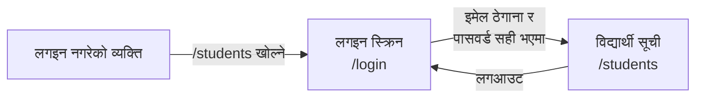
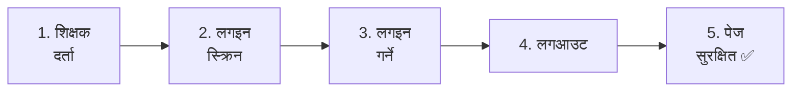
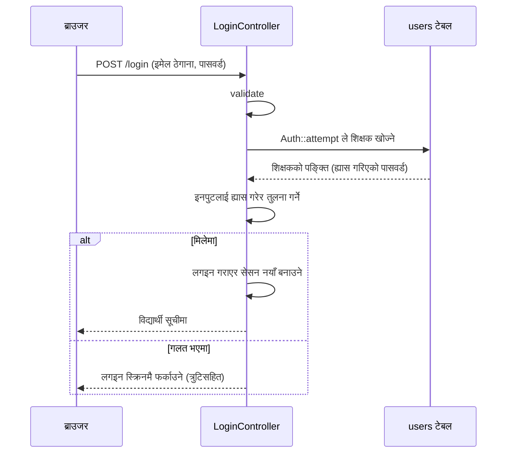
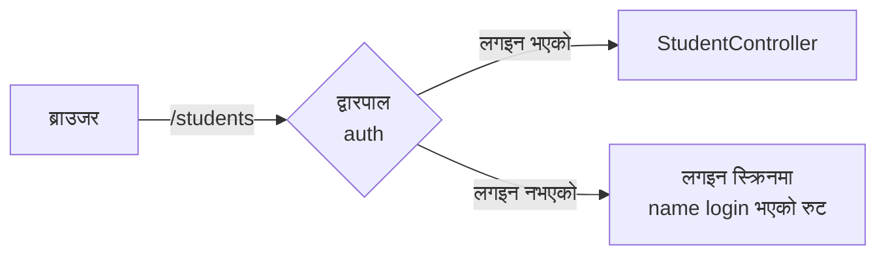
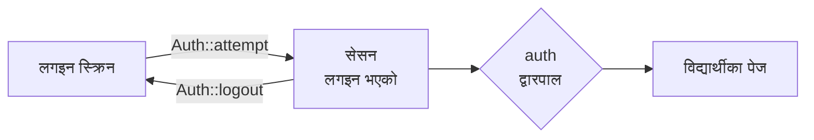

# विद्यार्थी व्यवस्थापन एप बनाऔं ③ — लगइन

> 🇯🇵 मूल प्रति (जापानी भाषामा): [20261126_資料_1.md](<../../../1年生_データ設計とアプリ開発/後期/20261126/20261126_資料_1.md>) <!-- original-ja-link -->

विद्यार्थीको नाम र इमेल ठेगाना **जसले पनि हेर्न नपाउने जानकारी** हो।
आज विद्यार्थी व्यवस्थापन एपमा **लगइन** थपेर, शिक्षकले मात्र प्रयोग गर्न सक्ने बनाउँछौं।

## आजको लक्ष्य
- लगइनको व्यवस्था (पासवर्डको ह्यासिङ, सेसन) बुझ्न सक्ने
- लगइन स्क्रिन र लगआउट बनाउन सक्ने
- लगइन नगरेको व्यक्तिले विद्यार्थीका पेज हेर्न नपाउने बनाउन सक्ने (`auth`)

> 11/19 को "विद्यार्थी व्यवस्थापन एप (थप्ने, सम्पादन र मेटाउने)" बनिसकेको अवस्थाबाट सुरु गर्छौं।

---

## 1. लगइनको व्यवस्था

### आज बनाउने कुरा



- लगइन नगरेको व्यक्तिले `/students` खोल्दा, **लगइन स्क्रिनमा पठाइन्छ**
- सही इमेल ठेगाना र पासवर्ड हालेपछि, विद्यार्थीका पेज प्रयोग गर्न सकिन्छ
- Todo एपका पेज भने पहिलेझैं जसले पनि प्रयोग गर्न सक्छ

### शिक्षकलाई `users` टेबलमा राख्ने

लगइन गर्ने शिक्षकलाई Laravel मा **सुरुदेखि नै भएको `users` टेबल** मा राख्छौं।
(अभ्यास वातावरण पहिलोपटक सुरु गरेदेखि नै, वास्तवमा यो टेबल सधैं थियो)

| कोलम | अर्थ |
|----|------|
| `name` | शिक्षकको नाम |
| `email` | लगइन गर्न प्रयोग गर्ने इमेल ठेगाना |
| `password` | पासवर्ड (**ह्यास गरेर** राखिन्छ) |

### पासवर्डको "ह्यासिङ"

पासवर्डलाई **जस्ताको तस्तै डाटाबेसमा राख्नु हुँदैन**।
यदि डाटाबेसको सामग्री चुहियो भने, सबैको पासवर्ड थाहा भइहाल्छ।

त्यसैले पासवर्डलाई **ह्यास गरेर** (फेरि मूल रूपमा फर्काउन नसकिने, अस्तव्यस्त अक्षरमा बदलेर) मात्र राख्छौं।

```
हालेको पासवर्ड             डाटाबेसमा राखिने कुरा
password          ─→     $2y$12$Kx8f3...(लगभग ६० वटा अव्यवस्थित अक्षर)
```

| | सामान्य इन्क्रिप्सन | ह्यासिङ |
|---|---|---|
| मूल रूपमा फर्काउन सकिन्छ? | सकिन्छ (साँचो भएमा) | **सकिँदैन** |
| लगइन गर्दा? | — | हालेको पासवर्डलाई पनि त्यसै गरी ह्यास गरेर **तुलना गर्छ** |

ह्यासिङ Laravel ले आफैं गरिदिन्छ।

### सेसन: "लगइन भएको छ" भनेर सम्झिराख्ने व्यवस्था

एकपटक लगइन गरेपछि, हरेक पेजमा जाँदा फेरि पासवर्ड हाल्नु पर्‍यो भने झन्झट हुन्छ।
Laravel ले **सेसन** भन्ने व्यवस्थामार्फत "यो व्यक्तिले लगइन गरेको छ" भनेर सम्झिराख्छ।

> उदाहरण दिँदा, यो **मनोरञ्जन पार्कको प्रवेश रिस्टब्यान्ड** जस्तै हो।
> प्रवेशद्वार (लगइन स्क्रिन) मा टिकट (पासवर्ड) देखाएपछि रिस्टब्यान्ड पाइन्छ।
> त्यसपछि रिस्टब्यान्ड देखाए मात्र पुग्छ, जुनसुकै राइड (पेज) मा पनि छिर्न सकिन्छ।

---

## 2. बनाएर हेरौं



परिवर्तन गर्ने फाइलहरू यी हुन् (`src` भित्र)।

```
src/
├─ database/seeders/
│   ├─ UserSeeder.php ·················· 1. शिक्षक दर्ता गर्ने (नयाँ बनाउने)
│   └─ DatabaseSeeder.php ·············· 1. UserSeeder बोलाउने
├─ app/Http/Controllers/
│   └─ LoginController.php ············· 2・3・4. लगइन・लगआउट (नयाँ बनाउने)
├─ resources/views/
│   ├─ login.blade.php ················· 2. लगइन स्क्रिन (नयाँ बनाउने)
│   └─ layouts/header.blade.php ········ 4. शिक्षकको नाम र लगआउट बटन
└─ routes/web.php ······················ 2・3・4・5. रुट
```

---

### 1. शिक्षक दर्ता गर्ने (Seeder)

> अहिले यहाँ: **🟢 1. शिक्षक दर्ता** → 2. लगइन स्क्रिन → 3. लगइन → 4. लगआउट → 5. पेज सुरक्षित

```powershell
docker compose exec laravel php artisan make:seeder UserSeeder
```

`database/seeders/UserSeeder.php` लाई यसरी लेख्नुहोस्।

```php
<?php

namespace Database\Seeders;

use App\Models\User;
use Illuminate\Database\Seeder;

class UserSeeder extends Seeder
{
    public function run(): void
    {
        $user = new User();
        $user->name = '山田先生';
        $user->email = 'teacher@example.com';
        $user->password = 'password';  // सेभ गर्दा आफैं ह्यास हुन्छ
        $user->save();
    }
}
```

`database/seeders/DatabaseSeeder.php` को **सबैभन्दा माथि** ★ भएको १ लाइन थप्नुहोस्।

```php
    public function run(): void
    {
        $this->call(UserSeeder::class);  // ★ थप्ने
        $this->call(TodoSeeder::class);
        $this->call(StudentSeeder::class);
    }
```

```powershell
docker compose exec laravel php artisan migrate:fresh --seed
```

✅ **जाँच**: phpMyAdmin मा `users` टेबल खोलेर हेरौं।
山田先生 (यामादा सर) को `password`, `password` नभई **`$2y$12$...` जस्तो अस्तव्यस्त अक्षर** भएको छ भने ठीक छ।

> **किन आफैं ह्यास हुन्छ?**
> `app/Models/User.php` खोल्दा `'password' => 'hashed'` भन्ने एउटा लाइन छ।
> यसको अर्थ "`password` मा मान राखेपछि आफैं ह्यास गरिदेऊ" भन्ने सेटिङ हो। यो Laravel ले सुरुदेखि नै लेखिदिएको हुन्छ।

> ⚠️ **phpMyAdmin बाट शिक्षकलाई सिधै नथप्नुहोस्**
> phpMyAdmin मा `password` मा `password` हाल्यौं भने, ह्यास नभई जस्ताको तस्तै राखिन्छ र लगइन गर्न सकिँदैन।
> शिक्षकलाई Seeder (वा पछि बनाइने जस्तो स्क्रिन) बाट दर्ता गर्नुहोस्।

---

### 2. लगइन स्क्रिन बनाउने

> अहिले यहाँ: 1. शिक्षक दर्ता → **🟢 2. लगइन स्क्रिन** → 3. लगइन → 4. लगआउट → 5. पेज सुरक्षित

#### ① कन्ट्रोलर बनाउने

```powershell
docker compose exec laravel php artisan make:controller LoginController
```

`app/Http/Controllers/LoginController.php` लाई यसरी लेख्नुहोस्।

```php
<?php

namespace App\Http\Controllers;

use Illuminate\Http\Request;
use Illuminate\Support\Facades\Auth;

class LoginController extends Controller
{
    // लगइन स्क्रिन देखाउने
    public function showForm()
    {
        return view('login');
    }
}
```

#### ② भ्यु बनाउने

`resources/views/login.blade.php` बनाउनुहोस्।

```html
@include('layouts.header', ['title' => 'ログイン'])

    <h1>ログイン</h1>

    <form method="POST" action="/login">
        @csrf

        <p>
            メールアドレス：
            <input type="email" name="email" value="{{ old('email') }}" required>
        </p>

        <p>
            パスワード：
            <input type="password" name="password" required>
        </p>

        @error('email')
            <p style="color: red;">{{ $message }}</p>
        @enderror

        <button type="submit">ログイン</button>
    </form>

@include('layouts.footer')
```

| कोड | अर्थ |
|--------|------|
| `type="password"` | टाइप गरेका अक्षर `●●●` को रूपमा देखिने इनपुट फिल्ड |
| पासवर्डमा `old()` छैन | सुरक्षाका लागि, त्रुटि आएर फर्किँदा पनि पासवर्ड बचाइँदैन |

#### ③ रुट लेख्ने

`routes/web.php` मा ★ भएको भाग थप्नुहोस्।

```php
use App\Http\Controllers\LoginController;  // ★ थप्ने (माथितिर लेख्ने)

Route::get('/login', [LoginController::class, 'showForm'])->name('login');  // ★ थप्ने
```

| कोड | अर्थ |
|--------|------|
| `->name('login')` | यो रुटलाई `login` भन्ने **नाम** दिने |

> **किन नाम दिने?**
> यसपछि "5. पेज सुरक्षित गर्ने" मा, लगइन नगरेको व्यक्तिलाई **लगइन स्क्रिनमा पठाउने** व्यवस्था प्रयोग गर्छौं।
> त्यतिबेला Laravel ले `login` नाम भएको रुट खोजेर त्यहाँ पठाउँछ। नाम भएन भने कहाँ पठाउने थाहा हुँदैन।

✅ **जाँच**: http://localhost:8000/login खोल्दा लगइन स्क्रिन देखिन्छ भने ठीक छ।

---

### 3. लगइन गर्न सकिने बनाउने

> अहिले यहाँ: 1. शिक्षक दर्ता → 2. लगइन स्क्रिन → **🟢 3. लगइन** → 4. लगआउट → 5. पेज सुरक्षित

#### ① login मेथड लेख्ने

`LoginController.php` मा ★ भएको `login` थप्नुहोस्।

```php
    // ★ यहाँदेखि थप्ने
    public function login(Request $request)
    {
        // ① इनपुट जाँच गर्ने
        $credentials = $request->validate([
            'email' => 'required|email',
            'password' => 'required',
        ]);

        // ② इमेल ठेगाना र पासवर्ड सही छन् कि छैनन्, पक्का गर्ने
        if (Auth::attempt($credentials)) {
            // ③ सही भए, सेसन नयाँ बनाएर विद्यार्थी सूचीमा पठाउने
            $request->session()->regenerate();

            return redirect()->intended('/students');
        }

        // ④ गलत भए, लगइन स्क्रिनमै फर्काउने
        return back()->withErrors([
            'email' => 'メールアドレスかパスワードがちがいます。',
        ])->onlyInput('email');
    }
    // ★ यहाँसम्म
```

| कोड | अर्थ |
|--------|------|
| `$credentials = $request->validate([...])` | जाँच गरिसकेपछि `email` र `password` निकाल्छ |
| `Auth::attempt($credentials)` | `users` टेबलबाट त्यो इमेल ठेगाना भएको शिक्षक खोज्छ, र पासवर्डलाई ह्यास गरेर तुलना गर्छ। मिलेमा **लगइन गराएर** `true` फर्काउँछ |
| `$request->session()->regenerate()` | सेसन (रिस्टब्यान्ड) नयाँ बनाउँछ। अरूको रिस्टब्यान्ड प्रयोग हुन नपाओस् भनेर |
| `redirect()->intended('/students')` | लगइन गर्नुअघि खोल्न खोजेको पेजमा फर्काउँछ। त्यस्तो पेज नभए `/students` मा |
| `back()->withErrors([...])` | अघिल्लो पेज (लगइन स्क्रिन) मा फर्काएर त्रुटि सन्देश देखाउँछ |
| `->onlyInput('email')` | फर्किँदा इमेल ठेगाना मात्र बचाउँछ (पासवर्ड बचाउँदैन) |

लगइनको प्रक्रियालाई चित्रमा देखाउँदा यस्तो हुन्छ।



> **"इमेल ठेगाना वा पासवर्ड गलत छ" भनेर एकैसाथ भन्नुको कारण**
> "यो इमेल ठेगाना दर्ता गरिएको छैन" भनेर बताइदियौं भने, खराब मनसाय भएका व्यक्तिलाई "यो इमेल ठेगाना दर्ता भएको रहेछ" भन्ने थाहा हुन्छ।
> त्यसैले कुन गलत छ भनेर जानीजानी बताउँदैनौं।

#### ② रुट थप्ने

```php
Route::get('/login', [LoginController::class, 'showForm'])->name('login');
Route::post('/login', [LoginController::class, 'login']);  // ★ थप्ने
```

✅ **जाँच**: लगइन स्क्रिनमा तलका २ वटा प्रयास गरौं।

| इनपुट | यस्तो भए ठीक छ |
|------|------------|
| `teacher@example.com` ／ `password` | विद्यार्थी सूचीमा पुगिन्छ |
| `teacher@example.com` ／ `abc` | 「メールアドレスかパスワードがちがいます。」(इमेल ठेगाना वा पासवर्ड गलत छ।) देखिन्छ |

---

### 4. लगआउट र लगइन भएको बेला देखाइने जानकारी

> अहिले यहाँ: 1. शिक्षक दर्ता → 2. लगइन स्क्रिन → 3. लगइन → **🟢 4. लगआउट** → 5. पेज सुरक्षित

#### ① logout मेथड लेख्ने

`LoginController.php` मा ★ भएको `logout` थप्नुहोस्।

```php
    // ★ यहाँदेखि थप्ने
    public function logout(Request $request)
    {
        Auth::logout();

        $request->session()->invalidate();
        $request->session()->regenerateToken();

        return redirect('/login');
    }
    // ★ यहाँसम्म
```

| कोड | अर्थ |
|--------|------|
| `Auth::logout()` | लगआउट गर्छ |
| `$request->session()->invalidate()` | सेसन (रिस्टब्यान्ड) प्रयोग गर्न नमिल्ने बनाउँछ |
| `$request->session()->regenerateToken()` | `@csrf` को गोप्य शब्द (टोकन) पनि नयाँ बनाउँछ |

#### ② रुट थप्ने

```php
Route::post('/logout', [LoginController::class, 'logout']);  // ★ थप्ने
```

> **लगआउट पनि POST**
> लगआउटले "लगइन भएको" भन्ने **अवस्था बदल्ने** काम गर्ने भएकाले लिङ्क (GET) को सट्टा फर्मको बटन (POST) बाट पठाउँछौं।
> (10/29 को "डाटा बदल्दा फर्मको बटनबाट पठाउने" भन्ने सोचसँग उस्तै हो)

#### ③ हेडरमा शिक्षकको नाम र लगआउट बटन देखाउने

`resources/views/layouts/header.blade.php` मा ★ भएको भाग थप्नुहोस्।

```html
    <header>
        <a href="/todos">TODOアプリ</a>
        <a href="/students">生徒管理</a>

        {{-- ★ यहाँदेखि थप्ने --}}
        @auth
            {{ Auth::user()->name }} さん
            <form method="POST" action="/logout" style="display: inline;">
                @csrf
                <button type="submit">ログアウト</button>
            </form>
        @endauth

        @guest
            <a href="/login">ログイン</a>
        @endguest
        {{-- ★ यहाँसम्म --}}
    </header>
```

| कोड | अर्थ |
|--------|------|
| `@auth` 〜 `@endauth` | **लगइन भएको बेला** मात्र देखाउँछ |
| `@guest` 〜 `@endguest` | **लगइन नभएको बेला** मात्र देखाउँछ |
| `Auth::user()->name` | लगइन गरेका शिक्षकको नाम |

✅ **जाँच**: लगइन गरेपछि हेडरमा 「山田先生 さん」(यामादा सर) र 「ログアウト」(लगआउट) बटन देखिन्छ।
「ログアウト」(लगआउट) थिच्दा लगइन स्क्रिनमा फर्किन्छ, र हेडरमा 「ログイン」(लगइन) लिङ्क देखिन थाल्छ भने ठीक छ।
(हेडर कम्पोनेन्ट भएकाले, Todo का पेजमा पनि त्यसै गरी देखिन्छ)

---

### 5. लगइन नगरेका व्यक्तिबाट पेज सुरक्षित गर्ने

> अहिले यहाँ: 1. शिक्षक दर्ता → 2. लगइन स्क्रिन → 3. लगइन → 4. लगआउट → **🟢 5. पेज सुरक्षित**

अहिलेसम्मको अवस्थामा, लगइन नगरे पनि `/students` खोल्न सकिन्छ।
`routes/web.php` का विद्यार्थीका रुटहरूलाई ★ मा जस्तै **`auth` को समूह** ले घेर्नुहोस्।

```php
// ★ यहाँदेखि: लगइन भएका व्यक्तिले मात्र प्रयोग गर्न सक्ने रुटहरू
Route::middleware('auth')->group(function () {
    Route::get('/students', [StudentController::class, 'index']);
    Route::get('/students/create', [StudentController::class, 'create']);
    Route::post('/students', [StudentController::class, 'store']);
    Route::get('/students/{id}', [StudentController::class, 'show']);
    Route::get('/students/{id}/edit', [StudentController::class, 'edit']);
    Route::put('/students/{id}', [StudentController::class, 'update']);
    Route::delete('/students/{id}', [StudentController::class, 'destroy']);
});
// ★ यहाँसम्म
```

| कोड | अर्थ |
|--------|------|
| `Route::middleware('auth')` | "लगइन भएको छ कि छैन" भनेर रुटभन्दा **पहिले** जाँच्छ |
| `->group(function () { ... })` | `{ }` भित्रका **सबै** रुटमा त्यो जाँच लगाउँछ |

**मिडलवेयर** भनेको कन्ट्रोलरको **अगाडि उभिने द्वारपाल** जस्तै हो।



✅ **जाँच**: तलको क्रममा प्रयास गरौं।

1. लगआउट गरेपछि http://localhost:8000/students खोल्ने → **लगइन स्क्रिनमा पठाइन्छ**
2. त्यहीँबाट लगइन गर्ने → **विद्यार्थी सूचीमा फर्किन्छ** (`intended` को कारणले)
3. लगआउट गरेर http://localhost:8000/todos खोल्ने → **Todo लगइन नगरी प्रयोग गर्न सकिन्छ**

---

## 3. रुटको सारांश

`routes/web.php` मा लगइन र विद्यार्थीका रुटहरू यस्ता भए।

```php
// लगइन・लगआउट
Route::get('/login', [LoginController::class, 'showForm'])->name('login');
Route::post('/login', [LoginController::class, 'login']);
Route::post('/logout', [LoginController::class, 'logout']);

// लगइन भएका व्यक्तिका लागि मात्र
Route::middleware('auth')->group(function () {
    Route::get('/students', [StudentController::class, 'index']);
    // …(विद्यार्थीका ७ वटा रुट)
});
```

---

## 4. काम नगरेमा

> **🔥 चलेन भने, लग निकाल!** → [【महत्त्वपूर्ण】लग निकाल्ने तरिका](../20261022/【重要】ログの出し方.md)

| लक्षण | कारण भएको ठाउँ | उपाय |
|------|----------|------|
| `Route [login] not defined.` | रुट | `/login` को रुटमा `->name('login')` राखेको छ कि छैन जाँच्नुहोस् |
| सही हुनुपर्ने हो तर लगइन हुँदैन | डाटा | phpMyAdmin मा शिक्षकको `password` `$2y$...` भएको छ कि छैन जाँच्नुहोस्। जस्ताको तस्तै अक्षर छ भने, `migrate:fresh --seed` चलाएर Seeder बाट फेरि हाल्नुहोस् |
| `Class "App\Http\Controllers\Auth" not found` | कन्ट्रोलर | `LoginController.php` को माथि `use Illuminate\Support\Facades\Auth;` छ कि छैन जाँच्नुहोस् |
| लगआउट थिच्दा `419 Page Expired` | भ्यु | लगआउटको फर्ममा `@csrf` छ कि छैन जाँच्नुहोस् (अभ्यास वातावरणमा `@csrf` नभए पनि यो त्रुटि नआउन सक्छ) |
| लगआउटको लिङ्क थिच्दा `The GET method is not supported` | भ्यु | लगआउटलाई `<a>` होइन, `<form method="POST">` को बटन बनाउनुहोस् |
| लगइन नगरे पनि विद्यार्थीका पेज हेर्न सकिन्छ | रुट | विद्यार्थीका रुटहरू `Route::middleware('auth')->group(...)` को `{ }` **भित्र** छन् कि छैनन् जाँच्नुहोस् |

---

## 5. सारांश



| आज लेखेको कुरा | छोटकरीमा |
|--------------|-----------|
| `'password' => 'hashed'` (User मोडेल) | पासवर्डलाई आफैं ह्यास गर्ने (सुरुदेखि नै लेखिएको हुन्छ) |
| `Auth::attempt($credentials)` | इमेल ठेगाना र पासवर्ड सही भए लगइन गराउने |
| `$request->session()->regenerate()` | लगइन गरेपछि सेसन नयाँ बनाउने |
| `Auth::logout()` | लगआउट गर्ने |
| `@auth`・`@guest` | लगइन भएको बेला र नभएको बेला मात्र देखाउने |
| `Auth::user()` | लगइन गरेका शिक्षक |
| `Route::middleware('auth')->group(...)` | लगइन भएका व्यक्तिले मात्र प्रयोग गर्न सक्ने रुट बनाउने |
| `->name('login')` | लगइन नगरेको व्यक्तिलाई पठाउने ठाउँ |

**पासवर्ड ह्यास गर्ने। लगइन अवस्था सेसनले सम्झिन्छ। पेज सुरक्षित गर्ने काम मिडलवेयरको।**

> **दोस्रो वर्षमा**, यो सेसनको सट्टा **टोकन** (Sanctum) ले लगइन पुष्टि गर्ने व्यवस्थामा परिवर्तन गर्छौं।
> स्क्रिन नभएको API मा "रिस्टब्यान्ड" को सट्टा "गोप्य शब्दको स्ट्रिङ" हरेक पटक सँगै पठाइन्छ।

अर्को कक्षामा, विद्यार्थीलाई **कुन शिक्षकले दर्ता गर्‍यो** भनेर रेकर्ड गर्न सकिने बनाउँछौं (रिलेसन)।

<!-- nav:start -->

---

| ⬅️ अघिल्लो | 🗺️ समग्र नक्सा | अर्को ➡️ |
|:--|:--:|--:|
| [11/19 विद्यार्थी व्यवस्थापन ② थप्ने・सम्पादन・मेटाउने](../20261119/20261119_資料_2.md) | [सामग्रीको समग्र नक्सा](../../README.md) | [12/03 विद्यार्थी व्यवस्थापन ④ रिलेसन](../20261203/20261203_資料_1.md) |

<!-- nav:end -->
