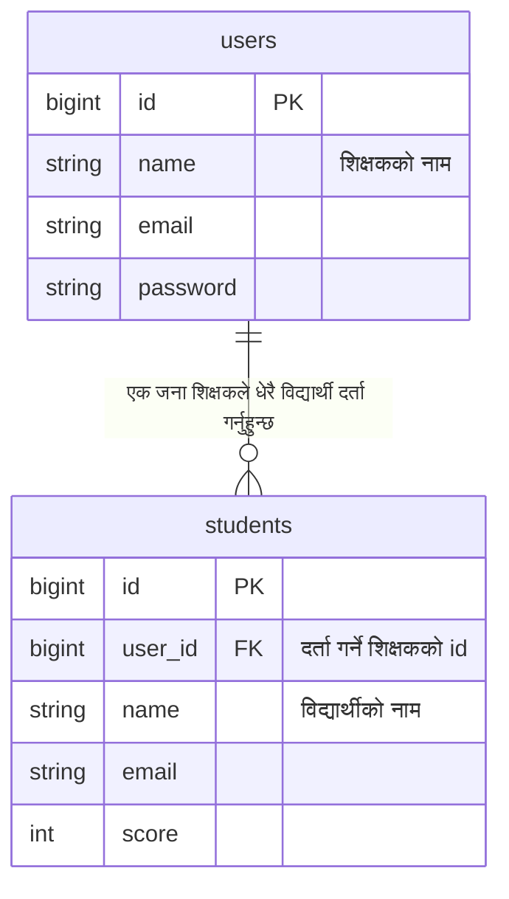
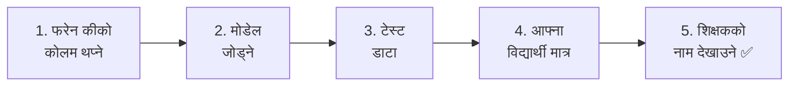
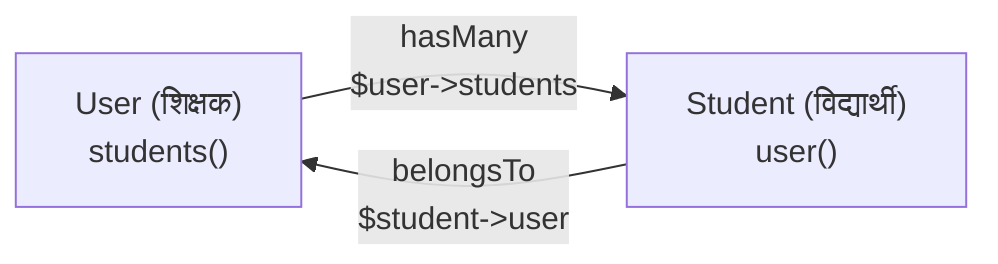
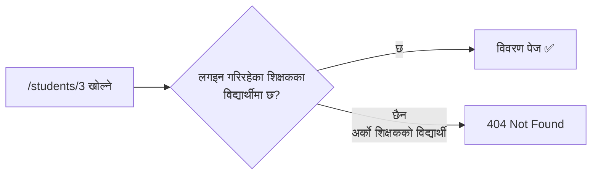
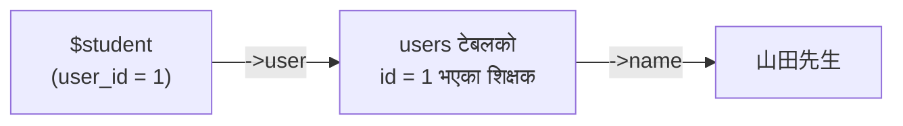
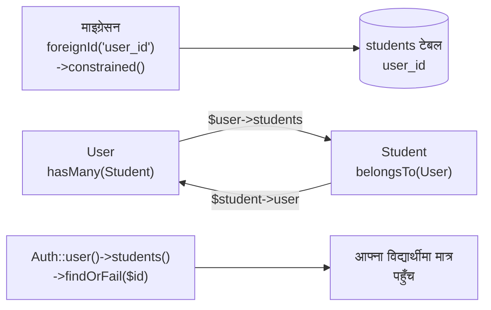

# विद्यार्थी व्यवस्थापन एप बनाऔं ④ — रिलेसन (शिक्षक र विद्यार्थीलाई जोड्ने)

> 🇯🇵 मूल प्रति (जापानी भाषामा): [20261203_資料_1.md](<../../../1年生_データ設計とアプリ開発/後期/20261203/20261203_資料_1.md>) <!-- original-ja-link -->

अघिल्लो पटक, शिक्षकले लगइन गर्न सक्ने हुनुभयो।
तर अहिले, **जुनसुकै शिक्षकले लगइन गरे पनि सबै विद्यार्थी देखिन्छन्**।
आज, विद्यार्थीलाई **कुन शिक्षकले दर्ता गर्नुभयो** भनेर रेकर्ड गरी, **आफ्ना विद्यार्थी मात्र** व्यवस्थापन गर्न सकिने बनाउँछौं।

## आजको लक्ष्य
- एक-देखि-धेरै (1:N) सम्बन्धलाई ER डायग्राम र टेबल (फरेन की) ले देखाउन सक्ने
- `hasMany`, `belongsTo` प्रयोग गरेर मोडेलहरूलाई आपसमा जोड्न सक्ने
- लगइन गरेका शिक्षकका विद्यार्थीलाई मात्र सूचीमा हेर्न, उनीहरूको विवरण हेर्न, सम्पादन गर्न र मेटाउन सक्ने

> 11/26 को "लगइन" काम गरिरहेको अवस्थाबाट सुरु गर्छौं।

---

## 1. शिक्षक र विद्यार्थीको सम्बन्ध

### एक जना शिक्षकले धेरै विद्यार्थीको जिम्मा लिनुहुन्छ



| शिक्षक (users) | विद्यार्थी (students) |
|--------------|-----------------|
| यामादा सर (id: 1) | यामादा सरका विद्यार्थी 15 जना |
| सातो सर (id: 2) | सातो सरका विद्यार्थी 15 जना |

यस्तो सम्बन्धलाई **एक-देखि-धेरै** (1:N) भनिन्छ।

- शिक्षकको दृष्टिले हेर्दा, विद्यार्थी **धेरै** (N) हुन्छन्
- विद्यार्थीको दृष्टिले हेर्दा, शिक्षक **एक जना** (1) हुनुहुन्छ

### फरेन की: विद्यार्थीको रेकर्डमा "शिक्षकको नम्बर" राख्ने

विद्यार्थीको टेबलमा, **दर्ता गर्ने शिक्षकको `id`** राख्ने कोलम (`user_id`) थप्छौं।

| id | **user_id** | name | email | score |
|----|------------|------|-------|-------|
| 1 | **1** | 田中 一郎 | … | 85 |
| 2 | **1** | 鈴木 花子 | … | 92 |
| 3 | **2** | 高橋 次郎 | … | 70 |

`user_id` `1` भएका विद्यार्थी यामादा सरका हुन्, `2` भएका विद्यार्थी सातो सरका हुन्।

यसरी, **अर्को टेबलको `id` राख्ने कोलम** लाई **फरेन की** भनिन्छ।

> **शिक्षकको "नाम" को सट्टा "id" किन राख्ने?**
> नाम राख्यौं भने, शिक्षकले नाम परिवर्तन गर्दा विद्यार्थीका सबै पङ्क्ति सच्याउनुपर्छ।
> `id` राख्यौं भने, शिक्षकको नाम बदलिए पनि विद्यार्थीका पङ्क्ति सच्याउनु पर्दैन।

---

## 2. बनाएर हेरौं



परिवर्तन गर्ने फाइलहरू यी हुन् (`src` भित्र)।

```
src/
├─ database/
│   ├─ migrations/xxxx_add_user_id_to_students_table.php ··· 1. नयाँ बनाउने
│   ├─ factories/StudentFactory.php ························· 3. user_id थप्ने
│   └─ seeders/
│       ├─ UserSeeder.php ··································· 3. शिक्षक 2 जना बनाउने
│       └─ StudentSeeder.php ································ 3. हरेक शिक्षकका लागि विद्यार्थी बनाउने
├─ app/Models/
│   ├─ User.php ············································· 2. students() थप्ने
│   └─ Student.php ·········································· 2. user() थप्ने
├─ app/Http/Controllers/StudentController.php ··············· 4. आफ्ना विद्यार्थीमा मात्र पहुँच सीमित गर्ने
└─ resources/views/students/show.blade.php ·················· 5. शिक्षकको नाम देखाउने
```

---

### 1. फरेन कीको कोलम थप्ने (माइग्रेसन)

> अहिले यहाँ: **🟢 1. फरेन की** → 2. मोडेल → 3. टेस्ट डाटा → 4. आफ्ना विद्यार्थी मात्र → 5. शिक्षकको नाम

11/12 मा सिकेको "**कोलम थप्ने माइग्रेसन**" बनाउँछौं।

```powershell
docker compose exec laravel php artisan make:migration add_user_id_to_students_table
```

`up()` र `down()` भित्र यसरी लेख्नुहोस्।

```php
    public function up(): void
    {
        Schema::table('students', function (Blueprint $table) {
            $table->foreignId('user_id')
                ->after('id')
                ->constrained()
                ->cascadeOnDelete();
        });
    }

    public function down(): void
    {
        Schema::table('students', function (Blueprint $table) {
            $table->dropForeign(['user_id']);
            $table->dropColumn('user_id');
        });
    }
```

| कोड | अर्थ |
|--------|------|
| `foreignId('user_id')` | फरेन कीका लागि `user_id` कोलम थप्छ (`id` जस्तै ठूलो पूर्णाङ्कको कोलम) |
| `->after('id')` | `id` कोलमको पछाडि थप्छ (हेर्न सजिलो बनाउन) |
| `->constrained()` | `user_id` मा **`users` टेबलमा भएको `id` मात्र राख्न सकिने** बनाउँछ (फरेन की कन्स्ट्रेन्ट) |
| `->cascadeOnDelete()` | शिक्षकलाई मेटाइयो भने, उहाँका विद्यार्थीलाई पनि सँगै मेटाउँछ |
| `dropForeign` → `dropColumn` | पहिलेको अवस्थामा फर्काउँदा, पहिले कन्स्ट्रेन्ट हटाएर त्यसपछि कोलम मेटाउँछ |

> **`constrained()` ले "`users` टेबल" हो भनेर कसरी थाहा पाउँछ?**
> कोलमको नाम `user_id` भएकाले। Laravel ले "`user_id` हो भने `users` टेबलको `id` हुनुपर्छ" भनेर आफैं बुझ्छ।

**अहिले `migrate` नगर्नुहोस्।** कारण "3. टेस्ट डाटा" मा बताउँछौं।

---

### 2. मोडेल जोड्ने (hasMany, belongsTo)

> अहिले यहाँ: 1. फरेन की → **🟢 2. मोडेल** → 3. टेस्ट डाटा → 4. आफ्ना विद्यार्थी मात्र → 5. शिक्षकको नाम

टेबल मात्र जोडेर PHP कोडबाट "यो शिक्षकका विद्यार्थी" निकाल्न सकिँदैन।
**मोडेलमा पनि सम्बन्ध लेख्नुपर्छ।**

#### ① शिक्षक (User) मा "धेरै विद्यार्थी" लेख्ने

`app/Models/User.php` मा ★ भएको भाग थप्नुहोस्।

```php
use Illuminate\Database\Eloquent\Relations\HasMany;  // ★ थप्ने (माथि भएका use को लहरमा)

class User extends Authenticatable
{
    // (सुरुदेखि भएको कोड जस्ताको तस्तै राख्ने)

    // ★ यहाँदेखि थप्ने: यो शिक्षकले दर्ता गरेका विद्यार्थीहरू
    public function students(): HasMany
    {
        return $this->hasMany(Student::class);
    }
    // ★ यहाँसम्म
}
```

#### ② विद्यार्थी (Student) मा "शिक्षक एक जना" लेख्ने

`app/Models/Student.php` मा ★ भएको भाग थप्नुहोस्।

```php
<?php

namespace App\Models;

use Illuminate\Database\Eloquent\Factories\HasFactory;
use Illuminate\Database\Eloquent\Model;
use Illuminate\Database\Eloquent\Relations\BelongsTo;  // ★ थप्ने

class Student extends Model
{
    /** @use HasFactory<\Database\Factories\StudentFactory> */
    use HasFactory;

    // ★ यहाँदेखि थप्ने: यो विद्यार्थीलाई दर्ता गर्ने शिक्षक
    public function user(): BelongsTo
    {
        return $this->belongsTo(User::class);
    }
    // ★ यहाँसम्म
}
```

| मोडेल | लेखेको कुरा | अर्थ | प्रयोग गर्ने तरिका |
|--------|----------|------|-------|
| `User` | `hasMany(Student::class)` | शिक्षकसँग **धेरै विद्यार्थी हुन्छन्** (has many) | `$user->students` ले त्यो शिक्षकका **सबै** विद्यार्थी |
| `Student` | `belongsTo(User::class)` | विद्यार्थी **एक जना शिक्षकसँग सम्बन्धित हुन्छ** (belongs to) | `$student->user` ले त्यो विद्यार्थीको **एक जना** शिक्षक |



> **नाम राख्ने नियम**
> "धेरै" तर्फको नाम **बहुवचन** (`students`) र "एक" तर्फको नाम **एकवचन** (`user`) मा राख्छौं।
> अङ्ग्रेजीमा पढ्दा, `$user->students` (शिक्षकका विद्यार्थीहरू), `$student->user` (विद्यार्थीको शिक्षक) भनेर स्वाभाविक रूपमा पढिन्छ।

---

### 3. टेस्ट डाटा फेरि बनाउने

> अहिले यहाँ: 1. फरेन की → 2. मोडेल → **🟢 3. टेस्ट डाटा** → 4. आफ्ना विद्यार्थी मात्र → 5. शिक्षकको नाम

#### `migrate` को सट्टा `migrate:fresh` किन?

अहिले `students` टेबलमा 30 जना विद्यार्थी छन्।
यहाँ `user_id` कोलम थप्दा, **अहिले भएका 30 जनाको `user_id` मा के राख्ने?**
`constrained()` भएकाले, `users` टेबलमा नभएको नम्बर राख्न सकिँदैन।

त्यसैले यस पटक, `migrate:fresh --seed` ले **टेबल फेरि बनाएर, शिक्षक तोकिएका विद्यार्थी फेरि राख्छौं**।
त्यसका लागि, पहिले Seeder र Factory सच्याउँछौं।

#### ① शिक्षक 2 जना बनाउने (UserSeeder)

`database/seeders/UserSeeder.php` को `run()` मा ★ भएको दोस्रो शिक्षक थप्नुहोस्।

```php
    public function run(): void
    {
        $user = new User();
        $user->name = '山田先生';
        $user->email = 'teacher@example.com';
        $user->password = 'password';
        $user->save();

        // ★ यहाँदेखि थप्ने
        $user = new User();
        $user->name = '佐藤先生';
        $user->email = 'teacher2@example.com';
        $user->password = 'password';
        $user->save();
        // ★ यहाँसम्म
    }
```

#### ② हरेक शिक्षकका लागि 15-15 जना विद्यार्थी बनाउने (StudentSeeder)

`database/seeders/StudentSeeder.php` को `run()` लाई यसरी परिवर्तन गर्नुहोस्।

```php
<?php

namespace Database\Seeders;

use App\Models\Student;
use App\Models\User;  // ★ थप्ने
use Illuminate\Database\Seeder;

class StudentSeeder extends Seeder
{
    public function run(): void
    {
        // हरेक शिक्षकका लागि 15-15 जना विद्यार्थी बनाउने
        foreach (User::all() as $user) {
            Student::factory()->count(15)->for($user)->create();
        }
    }
}
```

| कोड | अर्थ |
|--------|------|
| `User::all()` | सबै शिक्षक ल्याउँछ |
| `->for($user)` | "यो शिक्षकको विद्यार्थीका रूपमा बनाऊ"। `user_id` मा `$user->id` राखिन्छ |

#### ③ Factory मा पनि user_id थप्ने (StudentFactory)

`database/factories/StudentFactory.php` को `definition()` मा ★ भएको 1 लाइन थप्नुहोस्।

```php
use App\Models\User;  // ★ थप्ने (माथितिर लेख्ने)

    public function definition(): array
    {
        return [
            'user_id' => User::factory(),  // ★ थप्ने
            'name' => fake('ja_JP')->name(),
            'email' => fake()->unique()->safeEmail(),
            'score' => fake()->numberBetween(0, 100),
        ];
    }
```

`User::factory()` को अर्थ "शिक्षक तोकिएको छैन भने, एक जना शिक्षक पनि बनाऊ" भन्ने हो।
आजको Seeder मा `->for($user)` ले शिक्षक तोकेकाले, नयाँ शिक्षक बनाइँदैन।

#### ④ फेरि बनाउने

```powershell
docker compose exec laravel php artisan migrate:fresh --seed
```

✅ **जाँच**: phpMyAdmin मा यी 2 कुरा जाँच्नुहोस्।

- `users` टेबलमा यामादा सर र सातो सर गरी 2 जना हुनुहुन्छ
- `students` टेबलमा `user_id` कोलम छ, र `1` भएका विद्यार्थी 15 जना, `2` भएका विद्यार्थी 15 जना छन्

---

### 4. आफ्ना विद्यार्थी मात्र हेर्न सकिने बनाउने

> अहिले यहाँ: 1. फरेन की → 2. मोडेल → 3. टेस्ट डाटा → **🟢 4. आफ्ना विद्यार्थी मात्र** → 5. शिक्षकको नाम

`app/Http/Controllers/StudentController.php` परिवर्तन गर्छौं।
माथितिर `use Illuminate\Support\Facades\Auth;` थपेपछि, ★ भएका ठाउँहरू बदल्नुहोस्।

```php
use Illuminate\Support\Facades\Auth;  // ★ थप्ने
```

#### ① सूची (index): आफ्ना विद्यार्थी मात्र

```php
    public function index()
    {
        $students = Auth::user()->students;  // ★ Student::all() बाट बदल्ने

        return view('students.index', ['students' => $students]);
    }
```

`Auth::user()` भनेको लगइन गरिरहेका शिक्षक हुन्।
`->students` ले **उहाँका विद्यार्थी मात्र** ल्याउँछ। यो 2 मा लेखेको `hasMany` का कारण सम्भव भएको हो।

#### ② थप्ने (store): दर्ता गर्ने शिक्षक रेकर्ड गर्ने

```php
        $student = new Student();
        $student->user_id = Auth::id();  // ★ थप्ने: लगइन गरिरहेका शिक्षकको id
        $student->name = $request->input('name');
        $student->email = $request->input('email');
        $student->score = $request->input('score');
        $student->save();
```

| कोड | अर्थ |
|--------|------|
| `Auth::id()` | लगइन गरिरहेका शिक्षकको `id` |

#### ③ विवरण, सम्पादन, मेटाउने: आफ्ना विद्यार्थीमा मात्र पहुँच सीमित गर्ने

`show`, `edit`, `update`, `destroy` का 4 वटै ठाउँमा भएको `Student::findOrFail($id)` लाई **सबै** यसरी बदल्नुहोस्।

```php
        // बदल्नुअघि
        $student = Student::findOrFail($id);

        // बदलेपछि
        $student = Auth::user()->students()->findOrFail($id);
```

`Auth::user()->students()` ले "लगइन गरिरहेका शिक्षकका विद्यार्थीहरूमध्येबाट", र `findOrFail($id)` ले "`id` मिल्ने विद्यार्थी खोज्ने" भन्ने अर्थ दिन्छ।
**अर्को शिक्षकको विद्यार्थीको `id` खोल्न खोजे पनि, भेटिँदैन, त्यसैले `404 Not Found`** हुन्छ।



> **`students` र `students()` को फरक**
>
> | लेख्ने तरिका | अर्थ | प्रयोग हुने अवस्था |
> |-------|------|---------|
> | `Auth::user()->students` | ती शिक्षकका विद्यार्थी **सबै ल्याउँछ** | सूची (सबै चाहिँदा) |
> | `Auth::user()->students()` | "ती शिक्षकका विद्यार्थीहरूमध्येबाट" भन्ने **सर्त मात्र** लगाउँछ। यसपछि `->findOrFail($id)` जस्ता कुरा जोडेर लेख्न सकिन्छ | विवरण, सम्पादन, मेटाउने (एक जना खोज्दा) |

✅ **जाँच**: यो क्रममा प्रयास गर्नुहोस्।

| गर्ने काम | यस्तो भयो भने ठीक छ |
|---------|------------|
| यामादा सर (`teacher@example.com`) बनेर लगइन गरी सूची खोल्ने | 15 जना विद्यार्थी मात्र देखिन्छन् |
| एक जना विद्यार्थी थप्ने | phpMyAdmin मा, थपेको विद्यार्थीको `user_id` `1` भएको हुन्छ |
| सूचीबाट कुनै विद्यार्थीको विवरण पेज खोली, URL को नम्बर टिपेर राख्ने (उदाहरण: `/students/3`) | — |
| लगआउट गरी, सातो सर (`teacher2@example.com`) बनेर लगइन गर्ने | सूचीमा यामादा सरका भन्दा फरक 15 जना देखिन्छन् |
| टिपेर राखेको यामादा सरको विद्यार्थीको URL सिधै खोल्ने | **`404 Not Found`** हुन्छ (अर्को शिक्षकका विद्यार्थी हेर्न सकिँदैन) |

---

### 5. विवरण पेजमा दर्ता गर्ने शिक्षकको नाम देखाउने

> अहिले यहाँ: 1. फरेन की → 2. मोडेल → 3. टेस्ट डाटा → 4. आफ्ना विद्यार्थी मात्र → **🟢 5. शिक्षकको नाम**

`resources/views/students/show.blade.php` मा ★ भएको 1 लाइन थप्नुहोस्।

```html
    <p>番号：{{ $student->id }}</p>
    <p>メールアドレス：{{ $student->email }}</p>
    <p>点数：{{ $student->score }}点</p>
    <p>登録した先生：{{ $student->user->name }}</p>  {{-- ★ थप्ने --}}
```

`$student->user` ले त्यो विद्यार्थीका शिक्षक (`belongsTo`), र `->name` ले ती शिक्षकको नाम ल्याउँछ।
SQL को `JOIN` नलेखे पनि, Laravel ले `users` टेबलबाट ल्याइदिन्छ।

✅ **जाँच**: विवरण पेजमा "登録した先生：山田先生" (दर्ता गर्ने शिक्षक: यामादा सर) जस्तो देखियो भने ठीक छ।



---

## 3. काम नगरेमा

> **🔥 काम गरेन भने, लग निकाल्नुहोस्!** → [【महत्त्वपूर्ण】लग निकाल्ने तरिका](../20261022/【重要】ログの出し方.md)

| लक्षण | कारण भएको ठाउँ | समाधान |
|------|----------|------|
| `migrate` गर्दा `Cannot add or update a child row: a foreign key constraint fails` | माइग्रेसन | अहिले भएका विद्यार्थीमा राख्ने शिक्षक छैनन्। `migrate:fresh --seed` ले फेरि बनाउनुहोस् |
| `Call to undefined method App\Models\User::students()` | मोडेल | `User.php` मा `students()` मेथड लेख्नुभयो कि जाँच्नुहोस् |
| `Return value must be of type App\Models\HasMany` | मोडेल | `User.php` को माथि `use Illuminate\Database\Eloquent\Relations\HasMany;` छ कि जाँच्नुहोस् (`Student.php` को `BelongsTo` पनि त्यस्तै) |
| सूचीमा सबै (30 जना) देखिन्छन् | कन्ट्रोलर | `index` मा `Auth::user()->students` भएको छ कि जाँच्नुहोस् |
| अर्को शिक्षकको विद्यार्थीको विवरण पेज हेर्न सकिन्छ | कन्ट्रोलर | `show`, `edit`, `update`, `destroy` **चारवटैमा** `Auth::user()->students()->findOrFail($id)` मा बदल्नुभयो कि जाँच्नुहोस् |
| विद्यार्थी थप्दा `Field 'user_id' doesn't have a default value` | कन्ट्रोलर | `store` मा `$student->user_id = Auth::id();` छ कि जाँच्नुहोस् |
| शिक्षकको नाम भएको ठाउँमा `Attempt to read property "name" on null` | मोडेल, डाटा | `Student.php` मा `user()` लेख्नुभयो कि, र त्यो विद्यार्थीको `user_id` अनुसारका शिक्षक हुनुहुन्छ कि जाँच्नुहोस् |

---

## 4. सारांश



| आज लेखेको कुरा | एक वाक्यमा |
|--------------|-----------|
| `foreignId('user_id')->constrained()` | फरेन कीको कोलम थपेर, `users` मा भएको `id` मात्र राख्न सकिने बनाउँछ |
| `hasMany(Student::class)` | शिक्षकसँग धेरै विद्यार्थी हुन्छन् (`$user->students`) |
| `belongsTo(User::class)` | विद्यार्थी एक जना शिक्षकसँग सम्बन्धित हुन्छ (`$student->user`) |
| `->for($user)` (Factory) | यो शिक्षकको विद्यार्थीका रूपमा टेस्ट डाटा बनाउँछ |
| `Auth::id()` | लगइन गरिरहेका शिक्षकको `id` |
| `Auth::user()->students` | लगइन गरिरहेका शिक्षकका सबै विद्यार्थी |
| `Auth::user()->students()->findOrFail($id)` | आफ्ना विद्यार्थीमध्येबाट एक जना खोज्छ। अर्को शिक्षकको विद्यार्थी भए 404 |

**टेबललाई फरेन कीले जोड्ने। मोडेललाई hasMany, belongsTo ले जोड्ने।**

यसरी, विद्यार्थी व्यवस्थापन एप पूरा भयो 🎉
सूची, थप्ने, विवरण, सम्पादन, मेटाउने (CRUD), लगइन र रिलेसन गरी, वेब एपका महत्त्वपूर्ण संरचनाहरू सबै तयार भए।

> **दोस्रो वर्षमा**, यो एपलाई **API** मा परिवर्तन गर्छौं।
> टेबल (`users`, `students`) र रिलेसन (`hasMany`, `belongsTo`) **जस्ताको तस्तै** प्रयोग गर्छौं।
> बदलिने कुरा भनेको, "HTML स्क्रिन फर्काउने" भाग "JSON डाटा फर्काउने" हुनु, र लगइन सेसनबाट टोकनमा बदलिनु हो।

<!-- nav:start -->

---

| ⬅️ अघिल्लो | 🗺️ समग्र नक्सा | अर्को ➡️ |
|:--|:--:|--:|
| [11/26 विद्यार्थी व्यवस्थापन ③ लगइन](../20261126/20261126_資料_1.md) | [सामग्रीको समग्र नक्सा](../../README.md) | [12/10 विद्यार्थी व्यवस्थापन ⑤ शिक्षकको नयाँ दर्ता](../20261210/20261210_資料_1.md) |

<!-- nav:end -->
