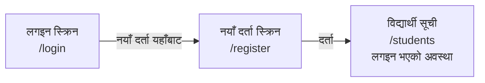
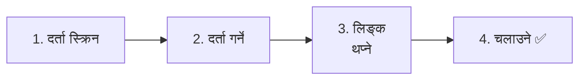
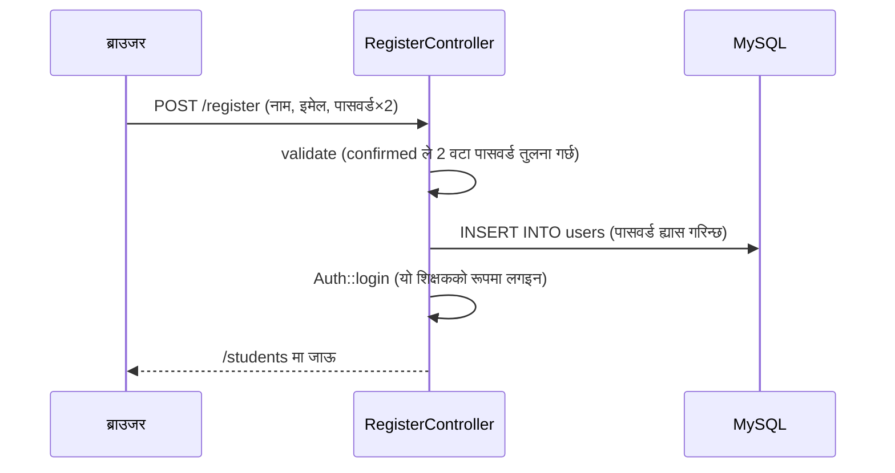

# विद्यार्थी व्यवस्थापन एप बनाऔं ⑤ — शिक्षकको नयाँ दर्ता

> 🇯🇵 मूल प्रति (जापानी भाषामा): [20261210_資料_1.md](<../../../1年生_データ設計とアプリ開発/後期/20261210/20261210_資料_1.md>) <!-- original-ja-link -->

अहिले, शिक्षकलाई **Seeder बाट मात्र दर्ता गर्न सकिन्छ**। नयाँ शिक्षक आउनुहुँदा हरेक पटक प्रोग्राम परिवर्तन गर्नु झन्झटिलो हुन्छ।
आज, स्क्रिनबाटै **शिक्षकको अकाउन्ट बनाउन सकिने** (नयाँ दर्ता गर्ने) व्यवस्था बनाउँछौं।

## आजको लक्ष्य
- नयाँ दर्ताको स्क्रिन बनाएर, शिक्षकलाई `users` टेबलमा सेभ गर्न सक्ने
- पासवर्ड पुष्टि गर्न दोस्रो पटक हालिएको पासवर्डलाई भ्यालिडेसन (`confirmed`) ले जाँच्न सक्ने
- दर्ता गरेपछि, सिधै लगइन भएको अवस्थामा पुर्‍याउन सक्ने (`Auth::login`)

> 12/3 को "रिलेसन" सम्म पूरा भएको अवस्थाबाट सुरु गर्छौं।

---

## 1. आज बनाउने कुरा



```
新規登録

名前：             [ 鈴木先生            ]
メールアドレス：   [ suzuki@example.com  ]
パスワード：       [ ●●●●●●●●            ]
パスワード（確認）：[ ●●●●●●●●            ]

[登録]
```

### लगइनसँगको फरक

यो 11/26 को लगइनजस्तै गरी बनाइन्छ।

| | लगइन (11/26) | नयाँ दर्ता (आज) |
|---|---|---|
| URL | `/login` | `/register` |
| गर्ने काम | `users` मा भएका शिक्षक हुन् कि **जाँच्ने** | `users` मा नयाँ शिक्षक **थप्ने** |
| इनपुट फिल्ड | इमेल ठेगाना, पासवर्ड | नाम, इमेल ठेगाना, पासवर्ड, **पासवर्ड (पुष्टि)** |
| अन्त्यमा | `Auth::attempt()` ले लगइन | `Auth::login()` ले लगइन |

> **दोस्रो वर्षमा**, यो नयाँ दर्तालाई पनि API (`POST /api/register`) मा परिवर्तन गर्छौं।
> जाँचका नियम (भ्यालिडेसन) दोस्रो वर्षमा पनि जस्ताको तस्तै प्रयोग गर्छौं।

---

## 2. बनाएर हेरौं



परिवर्तन गर्ने फाइलहरू यी हुन् (`src` भित्र)।

```
src/
├─ app/Http/Controllers/
│   └─ RegisterController.php ·········· 1, 2. नयाँ दर्ता (नयाँ बनाउने)
├─ resources/views/
│   ├─ register.blade.php ·············· 1. नयाँ दर्ता स्क्रिन (नयाँ बनाउने)
│   ├─ login.blade.php ················· 3. नयाँ दर्तामा जाने लिङ्क
│   └─ layouts/header.blade.php ········ 3. नयाँ दर्तामा जाने लिङ्क
└─ routes/web.php ······················ 1, 2. रुट
```

---

### 1. नयाँ दर्ताको स्क्रिन बनाउने

> अहिले यहाँ: **🟢 1. दर्ता स्क्रिन** → 2. दर्ता गर्ने → 3. लिङ्क → 4. चलाउने

#### ① कन्ट्रोलर बनाउने

```powershell
docker compose exec laravel php artisan make:controller RegisterController
```

`app/Http/Controllers/RegisterController.php` लाई यसरी लेख्नुहोस्।

```php
<?php

namespace App\Http\Controllers;

use App\Models\User;
use Illuminate\Http\Request;
use Illuminate\Support\Facades\Auth;

class RegisterController extends Controller
{
    // नयाँ दर्ताको स्क्रिन देखाउने
    public function showForm()
    {
        return view('register');
    }
}
```

#### ② भ्यू बनाउने

`resources/views/register.blade.php` बनाउनुहोस्।

```html
@include('layouts.header', ['title' => '新規登録'])

    <h1>新規登録</h1>

    <form method="POST" action="/register">
        @csrf

        <p>
            名前：
            <input type="text" name="name" value="{{ old('name') }}" required>
            @error('name') <span style="color: red;">{{ $message }}</span> @enderror
        </p>

        <p>
            メールアドレス：
            <input type="email" name="email" value="{{ old('email') }}" required>
            @error('email') <span style="color: red;">{{ $message }}</span> @enderror
        </p>

        <p>
            パスワード（8文字以上）：
            <input type="password" name="password" required>
            @error('password') <span style="color: red;">{{ $message }}</span> @enderror
        </p>

        <p>
            パスワード（確認）：
            <input type="password" name="password_confirmation" required>
        </p>

        <button type="submit">登録</button>
    </form>

    <a href="/login">ログインはこちら</a>

@include('layouts.footer')
```

| कोड | अर्थ |
|--------|------|
| `name="password"` | पासवर्ड |
| `name="password_confirmation"` | पासवर्ड पुष्टि गर्न **दोस्रो पटक हाल्ने फिल्ड**। नाममा `password` को पछाडि `_confirmation` जोड्ने **नियम** छ |

> **पासवर्ड किन 2 पटक हाल्ने?**
> पासवर्ड `●●●` को रूपमा देखिने भएकाले, गलत टाइप गरे पनि थाहा हुँदैन।
> 2 पटक हाल्न लगाएर **दुवै उस्तै छन् कि छैनन्** तुलना गर्दा, गलत टाइप भएको थाहा पाउन सकिन्छ।

#### ③ रुट लेख्ने

`routes/web.php` मा ★ भएको भाग थप्नुहोस्।

```php
use App\Http\Controllers\RegisterController;  // ★ थप्ने (माथितिर लेख्ने)

Route::get('/register', [RegisterController::class, 'showForm']);  // ★ थप्ने
```

✅ **जाँच**: http://localhost:8000/register खोल्दा नयाँ दर्ताको स्क्रिन देखियो भने ठीक छ।

---

### 2. दर्ता गर्न सकिने बनाउने

> अहिले यहाँ: 1. दर्ता स्क्रिन → **🟢 2. दर्ता गर्ने** → 3. लिङ्क → 4. चलाउने

#### ① register मेथड लेख्ने

`RegisterController.php` मा ★ भएको `register` थप्नुहोस्।

```php
    // ★ यहाँदेखि थप्ने
    public function register(Request $request)
    {
        // ① इनपुट जाँच्ने
        $request->validate([
            'name' => 'required|string|max:255',
            'email' => 'required|email|unique:users,email',
            'password' => 'required|min:8|confirmed',
        ], [
            'name.required' => '名前を入力してください。',
            'name.max' => '名前は255文字以内で入力してください。',
            'email.required' => 'メールアドレスを入力してください。',
            'email.email' => 'メールアドレスの形で入力してください。',
            'email.unique' => 'そのメールアドレスは、すでに登録されています。',
            'password.required' => 'パスワードを入力してください。',
            'password.min' => 'パスワードは8文字以上で入力してください。',
            'password.confirmed' => 'パスワード（確認）が一致しません。',
        ]);

        // ② शिक्षकलाई सेभ गर्ने
        $user = new User();
        $user->name = $request->input('name');
        $user->email = $request->input('email');
        $user->password = $request->input('password');  // सेभ गर्दा स्वचालित रूपमा ह्यास हुन्छ
        $user->save();

        // ③ सिधै लगइन गराउने
        Auth::login($user);
        $request->session()->regenerate();

        // ④ विद्यार्थी सूचीमा पठाउने
        return redirect('/students');
    }
    // ★ यहाँसम्म
```

नयाँ देखिएका कुराहरू यी हुन्।

| कोड | अर्थ |
|--------|------|
| `string` | स्ट्रिङ (अक्षरहरूको शृङ्खला) हुनुपर्ने |
| `unique:users,email` | `users` टेबलको `email` कोलममा उस्तै मान छैन कि (एउटै इमेल ठेगानाले 2 पटक दर्ता गर्न सकिँदैन) |
| `min:8` | 8 अक्षर वा बढी (`integer` नभएकाले **अक्षरको सङ्ख्या** ले जाँच्छ) |
| `confirmed` | `password` र `password_confirmation` **उस्तै छन् कि** |
| `Auth::login($user)` | पासवर्ड नजाँची, **यो शिक्षकको रूपमा लगइन गराउँछ** |

> **`Auth::attempt` र `Auth::login` को फरक**
>
> | | `Auth::attempt($credentials)` (11/26) | `Auth::login($user)` (आज) |
> |---|---|---|
> | पासवर्ड | जाँच्छ | जाँच्दैन |
> | प्रयोग हुने अवस्था | लगइन स्क्रिन (प्रयोगकर्ता सम्बन्धित अकाउन्टकै व्यक्ति हो कि होइन थाहा हुँदैन) | नयाँ दर्ता गरेलगत्तै (प्रयोगकर्ता भर्खरै दर्ता गरेको व्यक्ति नै हो भन्ने थाहा हुन्छ) |
>
> दर्ता गरेलगत्तै फेरि लगइन स्क्रिनमा पासवर्ड हाल्न लगाउनु झन्झटिलो हुन्छ, होइन र?
> प्रयोगकर्ता भर्खरै दर्ता गरेको व्यक्ति नै भएकाले, सिधै लगइन गराउँछौं।

> **पासवर्ड जस्ताको तस्तै राख्दा ठीक हुन्छ?**
> 11/26 मा सिकेअनुसार, `User` मोडेलको `'password' => 'hashed'` का कारण **सेभ गर्दा स्वचालित रूपमा ह्यास हुन्छ**।
> दोस्रो वर्षको सामग्रीमा `Hash::make(...)` ले आफैं ह्यास गरिएको छ, तर Laravel ले "पहिले नै ह्यास भइसकेको मान" लाई दोहोर्‍याएर ह्यास गर्दैन, त्यसैले दुवै तरिकाले सही रूपमा काम गर्छ।

#### ② रुट थप्ने

```php
Route::get('/register', [RegisterController::class, 'showForm']);
Route::post('/register', [RegisterController::class, 'register']);  // ★ थप्ने
```



---

### 3. नयाँ दर्तामा जाने लिङ्क थप्ने

> अहिले यहाँ: 1. दर्ता स्क्रिन → 2. दर्ता गर्ने → **🟢 3. लिङ्क** → 4. चलाउने

#### ① लगइन स्क्रिनमा

`resources/views/login.blade.php` को `</form>` को तल ★ भएको 1 लाइन थप्नुहोस्।

```html
        <button type="submit">ログイン</button>
    </form>

    <a href="/register">新規登録はこちら</a>  {{-- ★ थप्ने --}}
```

#### ② हेडरमा

`resources/views/layouts/header.blade.php` को `@guest` भित्र ★ भएको 1 लाइन थप्नुहोस्।

```html
        @guest
            <a href="/login">ログイン</a>
            <a href="/register">新規登録</a>  {{-- ★ थप्ने --}}
        @endguest
```

लगइन नगरेको बेला मात्र, हेडरमा "新規登録" (नयाँ दर्ता) देखिन्छ।

---

### 4. चलाउने ✅

> अहिले यहाँ: 1. दर्ता स्क्रिन → 2. दर्ता गर्ने → 3. लिङ्क → **🟢 4. चलाउने**

लगआउट गरेपछि, यो क्रममा प्रयास गर्नुहोस्।

| | गर्ने काम | यस्तो भयो भने ठीक छ |
|---|---|---|
| ① | नयाँ दर्तामा, नाम "鈴木先生" (सुजुकी सर), इमेल ठेगाना `suzuki@example.com`, पासवर्ड `password123` (दुवै पटक उस्तै) हालेर दर्ता गर्ने | विद्यार्थी सूचीमा पुगिन्छ, र हेडरमा "鈴木先生 さん" (सुजुकी सर) देखिन्छ |
| ② | विद्यार्थी सूची हेर्ने | **विद्यार्थी 0 जना** (सुजुकी सरले अहिलेसम्म कसैलाई दर्ता गर्नुभएको छैन। यो 12/3 को रिलेसनका कारण हो) |
| ③ | phpMyAdmin मा `users` टेबल हेर्ने | सुजुकी सर हुनुहुन्छ, र `password` ह्यास (`$2y$12$...`) भएको छ |
| ④ | लगआउट गरी, सुजुकी सरको इमेल ठेगाना र पासवर्डले लगइन गर्ने | लगइन गर्न सकिन्छ |
| ⑤ | फेरि `suzuki@example.com` ले नयाँ दर्ता गर्ने | "そのメールアドレスは、すでに登録されています。" (त्यो इमेल ठेगाना पहिले नै दर्ता भइसकेको छ) देखिन्छ |
| ⑥ | पासवर्ड र पुष्टिमा फरक-फरक कुरा हालेर दर्ता गर्ने | "パスワード（確認）が一致しません。" (पासवर्ड (पुष्टि) मिलेन) देखिन्छ |
| ⑦ | पासवर्ड `abc` राखेर दर्ता गर्ने | "パスワードは8文字以上で入力してください。" (पासवर्ड 8 अक्षर वा बढीको हाल्नुहोस्) देखिन्छ |

---

## 3. रुटको सारांश

लगइन र नयाँ दर्तासँग सम्बन्धित रुटहरू अब यस्ता भए।

```php
// लगइन/लगआउट
Route::get('/login', [LoginController::class, 'showForm'])->name('login');
Route::post('/login', [LoginController::class, 'login']);
Route::post('/logout', [LoginController::class, 'logout']);

// नयाँ दर्ता
Route::get('/register', [RegisterController::class, 'showForm']);
Route::post('/register', [RegisterController::class, 'register']);
```

नयाँ दर्ताको रुट `Route::middleware('auth')` को **बाहिर** लेख्नुहोस्।
किनभने यो अहिलेसम्म अकाउन्ट नभएका (लगइन गर्न नसक्ने) व्यक्तिले प्रयोग गर्ने पेज हो।

---

## 4. काम नगरेमा

> **🔥 काम गरेन भने, लग निकाल्नुहोस्!** → [【महत्त्वपूर्ण】लग निकाल्ने तरिका](../20261022/【重要】ログの出し方.md)

| लक्षण | कारण भएको ठाउँ | समाधान |
|------|----------|------|
| उस्तै पासवर्ड हालेको भए पनि "一致しません" (मिलेन) देखिन्छ | भ्यू | पासवर्ड पुष्टि गर्ने फिल्डको नाम `password_confirmation` भएको छ कि जाँच्नुहोस् (हिज्जेमा एउटा अक्षर मात्र फरक भए पनि तुलना गर्न सकिँदैन) |
| नयाँ दर्ताको स्क्रिन खोल्दा लगइन स्क्रिनमा पुर्‍याइन्छ | रुट | `/register` को रुट `Route::middleware('auth')` को `{ }` को **बाहिर** छ कि जाँच्नुहोस् |
| दर्ता गरे पनि लगइन भएको अवस्था हुँदैन | कन्ट्रोलर | `Auth::login($user);` लेख्नुभयो कि जाँच्नुहोस् |
| दर्ता गरेका शिक्षकको अकाउन्टले लगइन गर्न सकिँदैन | डाटा | phpMyAdmin मा `password` ह्यास भएको छ कि जाँच्नुहोस्। `User.php` को `'password' => 'hashed'` मेटाउनुभएको छैन कि जाँच्नुहोस् |
| `Class "App\Http\Controllers\User" not found` | कन्ट्रोलर | `RegisterController.php` को माथि `use App\Models\User;` छ कि जाँच्नुहोस् |
| `Target class [RegisterController] does not exist.` | रुट | `web.php` को माथि `use App\Http\Controllers\RegisterController;` छ कि जाँच्नुहोस् |

---

## 5. सारांश

| आज लेखेको कुरा | एक वाक्यमा |
|--------------|-----------|
| `name="password_confirmation"` | पासवर्ड पुष्टि गर्न दोस्रो पटक हाल्ने फिल्ड। नाम नियमअनुसार तोकिएको हुन्छ |
| `confirmed` | `password` र `password_confirmation` उस्तै छन् कि जाँच्छ |
| `unique:users,email` | एउटै इमेल ठेगाना भएका शिक्षक 2 जना दर्ता गर्न सकिँदैन |
| `min:8` | पासवर्ड 8 अक्षर वा बढी |
| `new User()` → `save()` | शिक्षकलाई सेभ गर्छ (पासवर्ड स्वचालित रूपमा ह्यास हुन्छ) |
| `Auth::login($user)` | पासवर्ड नजाँची, ती शिक्षकको रूपमा लगइन गराउँछ |

**नयाँ दर्ता भनेको "प्रयोगकर्ता थपेर, सिधै लगइन"। लगइन भनेको "व्यक्ति आफैं हो कि जाँचेर, लगइन"।**

यसरी, शिक्षकले आफैं अकाउन्ट बनाएर आफ्ना विद्यार्थीहरूलाई व्यवस्थापन गर्न सक्ने एप तयार भयो।

<!-- nav:start -->

---

| ⬅️ अघिल्लो | 🗺️ समग्र नक्सा | अर्को ➡️ |
|:--|:--:|--:|
| [12/03 विद्यार्थी व्यवस्थापन ④ रिलेसन](../20261203/20261203_資料_1.md) | [सामग्रीको समग्र नक्सा](../../README.md) | — |

<!-- nav:end -->
