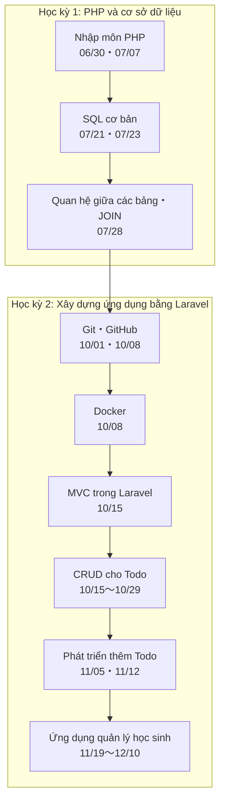

# Năm 1｜Thiết kế dữ liệu và phát triển ứng dụng — Sơ đồ tổng quan tài liệu

> 🇯🇵 Bản gốc (tiếng Nhật): [README.md](<../1年生_データ設計とアプリ開発/README.md>) <!-- original-ja-link -->

Trong môn học này, chúng ta sẽ đi theo thứ tự: **tạo trang web chạy bằng PHP → lưu dữ liệu vào cơ sở dữ liệu → xây dựng ứng dụng bằng Laravel**.

Ở mỗi tài liệu, bạn có thể dùng **phần hướng dẫn ở cuối trang** để chuyển sang tài liệu trước, tài liệu sau hoặc quay về trang này.
Nếu không biết nên xem tài liệu nào, hãy quay lại trang này nhé.

## Tiến trình tổng thể

Các trang nên xem khi gặp khó khăn

| Khi nào | Trang cần xem |
|:--|:--|
| Quên lệnh | [Danh sách các lệnh quan trọng](後期/重要コマンド一覧.md) |
| Laravel không chạy như mong muốn | [[Quan trọng] Cách xuất log](後期/20261022/【重要】ログの出し方.md) |
| Quên cách khởi động PHP・MySQL ở học kỳ 1 | [Các bước khởi động ứng dụng quản lý Todo](前期/20260723/Todo管理アプリ起動する流れ.md) |

---

## Học kỳ 1: PHP và cơ sở dữ liệu

| Ngày | Tài liệu | Bài tập・Đáp án | Bổ sung |
|:--|:--|:--|:--|
| 06/30 | [Nhập môn PHP](前期/20260630/20260630_資料.md) | [Bài tập](前期/20260630/20260630_演習.md)・[Đáp án](前期/20260630/20260630_解答.md) | [Cách chạy máy chủ phát triển PHP](前期/PHP開発サーバーの立て方.md) |
| 07/07 | [Kiến thức cơ bản về PHP và biểu mẫu](前期/20260707/20260707_資料.md) | [Bài tập](前期/20260707/20260707_演習.md)・[Đáp án](前期/20260707/20260707_解答.md) | |
| 07/14 | [Bài tập thực hành](前期/20260714/20260714_資料_1.md) | | |
| 07/21 | [Vì sao cần cơ sở dữ liệu](前期/20260721/20260721_資料.md) [SQL cơ bản ① (SELECT)](前期/20260721/20260721_資料_2.md) | [Bài tập](前期/20260721/20260721_演習.md)・[Đáp án](前期/20260721/20260721_解答.md) | [Cách dựng máy chủ cơ sở dữ liệu (với XAMPP)](前期/データベースサーバーの立て方/データベースサーバーの立て方.md) [Nhập môn cơ sở dữ liệu quan hệ](前期/20260721/リレーショナルデータベース入門.md) |
| 07/23 | [SQL cơ bản ② (INSERT・UPDATE・DELETE)](前期/20260723/20260723_資料.md) | [Bài tập](前期/20260723/20260723_演習.md)・[Đáp án](前期/20260723/20260723_解答.md) | [Các bước khởi động ứng dụng quản lý Todo](前期/20260723/Todo管理アプリ起動する流れ.md) [Cách xử lý lỗi kết nối PDO_MySQL](前期/20260723/PDO_MySQL接続エラー対処法.md) |
| 07/28 | [Quan hệ giữa các bảng・JOIN](前期/20260728/20260728_資料.md) | [Bài tập](前期/20260728/20260728_演習.md)・[Đáp án](前期/20260728/20260728_解答.md) | [Nhập môn JOIN](前期/20260728/JOIN入門.md) |

## Học kỳ 2: Xây dựng ứng dụng bằng Laravel

| Ngày | Tài liệu | Bổ sung |
|:--|:--|:--|
| 10/01 | [Ôn tập học kỳ 1](後期/20261001/20261001_復習.md) [Nhập môn quản lý mã nguồn](後期/20261001/20261001_資料_1.md) | |
| 10/08 | [Tài khoản GitHub và repository](後期/20261008/20261008_資料_1.md) [Đẩy môi trường thực hành lên (push)](後期/20261008/20261008_資料_2.md) [Nhập môn Docker](後期/20261008/20261008_資料_3.md) | |
| 10/15 | [Cơ chế MVC](後期/20261015/20261015_資料_1.md) [Danh sách Todo](後期/20261015/20261015_資料_2.md) | |
| 10/22 | [Thêm Todo (CREATE)](後期/20261022/20261022_資料_1.md) [Chi tiết Todo (SHOW)](後期/20261022/20261022_資料_2.md) | [[Quan trọng] Cách xuất log](後期/20261022/【重要】ログの出し方.md) |
| 10/29 | [Sửa Todo (UPDATE)](後期/20261029/20261029_資料_1.md) [Chuyển trạng thái hoàn thành (PATCH)](後期/20261029/20261029_資料_2.md) [Xóa Todo (DELETE)](後期/20261029/20261029_資料_3.md) | |
| 11/05 | [Seeder・Factory](後期/20261105/20261105_資料_1.md) [Kiểm tra dữ liệu (validation)](後期/20261105/20261105_資料_2.md) | |
| 11/12 | [Tách phần dùng chung thành các thành phần riêng (@include)](後期/20261112/20261112_資料_1.md) [Thêm danh mục](後期/20261112/20261112_資料_2.md) | |
| 11/19 | [Quản lý học sinh ① Danh sách・Chi tiết](後期/20261119/20261119_資料_1.md) [Quản lý học sinh ② Thêm・Sửa・Xóa](後期/20261119/20261119_資料_2.md) | |
| 11/26 | [Quản lý học sinh ③ Đăng nhập](後期/20261126/20261126_資料_1.md) | |
| 12/03 | [Quản lý học sinh ④ Quan hệ (Relation)](後期/20261203/20261203_資料_1.md) | |
| 12/10 | [Quản lý học sinh ⑤ Đăng ký giáo viên mới](後期/20261210/20261210_資料_1.md) | |

Trang có thể dùng bất cứ lúc nào: [Danh sách các lệnh quan trọng](後期/重要コマンド一覧.md)
