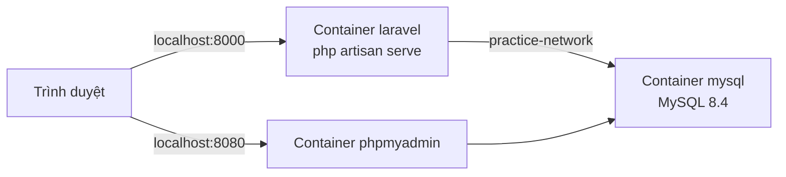
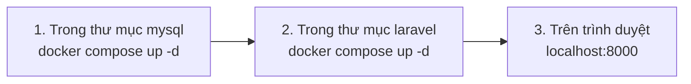

# Môi trường luyện tập Laravel × MySQL (Docker)

> 🇯🇵 Bản gốc (tiếng Nhật): [README.md](<../../1年生_データ設計とアプリ開発/practice/README.md>) <!-- original-ja-link -->

Chúng ta khởi động Laravel và MySQL thành **hai container riêng biệt**.
Hai container này được kết nối với nhau qua một network tên là `practice-network`.



```
practice/
  mysql/
    compose.yaml    ← MySQL và phpMyAdmin
  laravel/
    compose.yaml    ← Laravel
    Dockerfile
    entrypoint.sh
    src/            ← Laravel được tạo tự động ở lần khởi động đầu tiên
```

> Hãy khởi động Docker Desktop và kiểm tra rằng góc dưới bên trái hiển thị **Engine running** rồi mới bắt đầu.
> Cách cài Docker Desktop → [Cài đặt Docker Desktop](../後期/20261008/20261008_資料.md)

> **Hãy tắt XAMPP trước**
> Nếu bạn đang dùng XAMPP, hãy mở XAMPP Control Panel và bấm **Stop** tất cả những gì đang chạy (Apache, MySQL, v.v.) rồi mới bắt đầu.
> Nếu MySQL của XAMPP đang chạy, nó sẽ chiếm cùng cổng `3306`, nên container MySQL không thể khởi động được.

---

## 1. Nơi lưu thư mục

Tạo một thư mục tên `git` trong ổ C, rồi đặt từng dự án vào bên trong thư mục đó.

```
C:\git\practice
```

Bạn cũng có thể đặt ở Desktop.

> **Hãy nhớ bạn đã lưu ở đâu**
> Mỗi lần khởi động hay dừng, bạn sẽ dùng `cd` để di chuyển vào thư mục đó. Nếu quên mất nơi lưu thì bạn sẽ không thao tác được.

> **Tránh đặt trong OneDrive**
> Nếu đặt bên trong `C:\Users\<ユーザー名>\OneDrive\...`, việc đồng bộ có thể xung đột khiến máy chạy chậm hoặc gây lỗi.
> Trên một số máy, Desktop nằm bên trong OneDrive, vì vậy nếu phân vân thì hãy đặt ở `C:\git`.

---

## 2. Khởi động (thứ tự rất quan trọng)

**Luôn khởi động theo thứ tự mysql → laravel**.
Vì network `practice-network` được tạo ở phía mysql.



Chạy trong PowerShell. (Nếu bạn lưu ở vị trí khác với `C:\git\practice`, hãy thay bằng đường dẫn đến vị trí đã lưu.)

```powershell
cd C:\git\practice\mysql
docker compose up -d
```

```powershell
cd C:\git\practice\laravel
docker compose up -d
```

**Chỉ ở lần đầu tiên**, việc cài đặt Laravel sẽ mất vài phút. Bạn có thể xem tiến trình bằng lệnh sau (nhấn `Ctrl + C` để dừng xem).

```powershell
docker compose logs -f
```

Khi thấy dòng `Server running on [http://0.0.0.0:8000]` là đã sẵn sàng.

| URL cần mở | Nội dung hiển thị |
|---------|--------------|
| http://localhost:8000 | Trang chủ của Laravel ✅ |
| http://localhost:8080 | phpMyAdmin (các bảng đã được tạo trong cơ sở dữ liệu `laravel` ✅) |

---

## 3. Dừng

Dừng theo **thứ tự ngược lại** với lúc khởi động (laravel → mysql).

```powershell
cd C:\git\practice\laravel
docker compose down
```

```powershell
cd C:\git\practice\mysql
docker compose down
```

Dù đã `down`, dữ liệu trong cơ sở dữ liệu vẫn không bị mất (vẫn còn trong volume `mysql-data`).

---

## 4. Thông tin kết nối

| Mục | Từ Laravel | Từ máy tính (A5:SQL Mk-2, v.v.) |
|------|-------------|--------------------------|
| Host | `mysql` | `127.0.0.1` |
| Cổng | `3306` | `3306` |
| Cơ sở dữ liệu | `laravel` | `laravel` |
| Tên người dùng | `laravel` | `laravel` |
| Mật khẩu | `password` | `password` |

Cổng ở phía máy tính là `3306`, trùng với MySQL của XAMPP. Vì vậy, hãy tắt MySQL của XAMPP.
Cấu hình của Laravel được ghi trong `laravel/src/.env`.

---

## 5. Dùng lệnh artisan

`php artisan` được chạy bên trong container laravel. Trong thư mục laravel, hãy gõ như sau.

```powershell
docker compose exec laravel php artisan migrate
docker compose exec laravel php artisan make:controller TodoController
```

---

## 6. Khi gặp sự cố

| Triệu chứng | Cách xử lý |
|------|------|
| `network practice-network declared as external, but could not be found` | Chưa khởi động mysql trước → chạy `docker compose up -d` trong thư mục mysql |
| Log cứ hiện mãi dòng `MySQL の起動を待っています...` | Kiểm tra xem container mysql có đang chạy không trong mục `Containers` của Docker Desktop |
| `port is already allocated` (cổng đang bị sử dụng) | Trong XAMPP Control Panel, nhấn Stop để dừng MySQL và các dịch vụ tương tự. Đồng thời dừng các chương trình khác sử dụng cùng cổng, chẳng hạn như `php -S` |
| Lần cài đặt đầu tiên bị lỗi giữa chừng | Trong thư mục laravel, chạy `docker compose down` → xóa thư mục `src` → chạy lại `docker compose up -d` |
| Muốn làm lại cơ sở dữ liệu từ đầu | Trong thư mục mysql, chạy `docker compose down -v` (**toàn bộ dữ liệu sẽ bị xóa**) |
