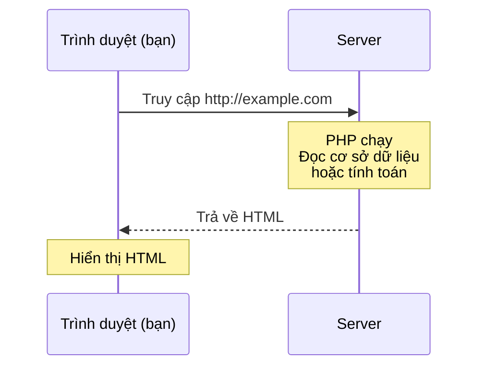

# Năm 1｜Thiết kế dữ liệu và phát triển ứng dụng — 2026/06/30

> 🇯🇵 Bản gốc (tiếng Nhật): [20260630_資料.md](<../../../1年生_データ設計とアプリ開発/前期/20260630/20260630_資料.md>) <!-- original-ja-link -->

---

## Về cách đánh giá môn học này

| Hạng mục | Tỉ lệ |
| --- | --- |
| Tỉ lệ chuyên cần | 30% |
| Thái độ học tập | 10% |
| Bài nộp | 60% |

> ⚠️ **Quan trọng: Nếu tỉ lệ chuyên cần dưới 60%, bạn sẽ không được công nhận tín chỉ, bất kể điểm bài nộp và thái độ học tập.**\
> Đi muộn hoặc về sớm có thể bị tính là vắng mặt tùy theo quyết định của giáo viên phụ trách. Hãy luôn có mặt đúng giờ.

---

## Mục tiêu hôm nay

- Giải thích được sự khác nhau giữa phía server và phía client
- Tự cài đặt được môi trường chạy PHP
- Chạy được file PHP đầu tiên

---

## 1. Sự khác nhau giữa phía client và phía server

```
Phía client (đã học ở học kỳ trước)
  Chạy trên trình duyệt → HTML / CSS / JavaScript
  Được thực thi trên thiết bị của người dùng

Phía server (bắt đầu học từ học kỳ này)
  Chạy trên server → PHP / Python / Ruby / Go, v.v.
  Được thực thi trên server rồi gửi kết quả về trình duyệt
```

**Vì sao cần phía server?**

| Việc muốn làm | Chỉ có client | Cần server |
| --- | --- | --- |
| Hiển thị văn bản | ✅ Làm được | — |
| Đọc cơ sở dữ liệu | ❌ Không làm được | ✅ Cần |
| Quản lý mật khẩu an toàn | ❌ Nguy hiểm | ✅ Cần |
| Chức năng đăng nhập | ❌ Không làm được | ✅ Cần |

---

## 2. PHP là gì

**PHP = ngôn ngữ lập trình phía server, chuyên dùng để phát triển ứng dụng web.**

Quá trình trao đổi giữa trình duyệt và server diễn ra như sau.



**Hãy so sánh với JavaScript:**

| Hạng mục | JavaScript | PHP |
| --- | --- | --- |
| Nơi chạy | Trình duyệt | Server |
| Cách viết biến | `let x = 5;` | `$x = 5;` |
| Nối chuỗi | `"Hello" + "World"` | `"Hello" . "World"` |
| Mảng | `let arr = [1, 2, 3]` | `$arr = [1, 2, 3]` |
| Xuất kết quả | `console.log()` | `echo` |

---

## 3. Cài đặt môi trường: cài PHP

### Với Mac (dùng Homebrew)

Nếu chưa cài Homebrew, hãy cài trước theo hướng dẫn trên [brew.sh](https://brew.sh).

```bash
brew install php
```

### Với Windows

1. Truy cập [windows.php.net/download](https://windows.php.net/download/)
2. Tải file ZIP "VS16 x64 Non Thread Safe"
3. Giải nén vào `C:\php`
4. Thêm `C:\php` vào biến môi trường PATH

### Kiểm tra hoạt động

```bash
php --version
# → Nếu hiện PHP 8.x.x ... là OK
```

---

## 4. File PHP đầu tiên

### Tạo thư mục làm việc (đặt ở đâu cũng được)

```
Mac:     ~/study/
Windows: C:\Users\ユーザー名\study\
```

### Tạo `index.php`

```php
<?php
// Code PHP bắt đầu bằng <?php
// echo tương đương với console.log của JS

echo "こんにちは PHP！";

// Biến bắt đầu bằng $ (điểm khác lớn so với JavaScript)
$namae = "田中太郎";
$nenrei = 20;

// Nhúng biến vào trong chuỗi (chỉ với dấu nháy kép)
echo "名前: $namae";
echo "年齢: {$nenrei}歳";  // Đặt biến trong {} để tránh nhầm lẫn

// Tương đương với template literal của JS
// JS: `名前: ${namae}`
// PHP: "名前: {$namae}"
?>
```

**Khởi động server cục bộ và kiểm tra trên trình duyệt:**

```bash
# Di chuyển vào thư mục study rồi chạy
cd ~/study
php -S localhost:8000
```

Truy cập `http://localhost:8000/index.php`

---

## 5. Cú pháp cơ bản của PHP (so sánh với JS)

```php
<?php
// ========== Biến ==========
$name = "Alice";      // Tương đương let trong JS (cần có $)
$age = 20;
$pi = 3.14;
$isStudent = true;

// ========== Xuất kết quả ==========
echo "Hello";          // Xuất ra không xuống dòng
echo "World\n";        // Xuống dòng bằng \n
echo $name . "\n";     // Nối chuỗi bằng . (tương đương + trong JS)

// Có thể trộn thẻ PHP với HTML (đặc trưng của PHP)
?>
<h1>こんにちは、<?= $name ?>さん！</h1>
<!-- <?= là cách viết tắt của echo -->
<?php

// ========== Rẽ nhánh điều kiện (giống như JS) ==========
if ($age >= 18) {
    echo "成人です\n";
} else {
    echo "未成年です\n";
}

// ========== Vòng lặp ==========
for ($i = 1; $i <= 5; $i++) {   // $i giống với i trong JS
    echo $i . "回目\n";
}

// ========== Mảng ==========
$fruits = ["りんご", "みかん", "ぶどう"];
echo $fruits[0] . "\n";  // → りんご

// Duyệt mảng
foreach ($fruits as $fruit) {  // Tương đương forEach trong JS
    echo $fruit . "\n";
}
?>
```

---

## Tổng kết

| Khái niệm | JavaScript | PHP |
| --- | --- | --- |
| Biến | `let x` | `$x` |
| Xuất kết quả | `console.log()` | `echo` |
| Nối chuỗi | `"a" + "b"` | `"a" . "b"` |
| Duyệt mảng | `forEach` | `foreach` |
| Nơi chạy | Trình duyệt | Server |

---

## Nội dung buổi sau

Chúng ta sẽ học kỹ về biến, kiểu dữ liệu, toán tử, mảng và mảng kết hợp trong PHP.\
Trong khi học, hãy lưu ý rằng "các khái niệm giống với JavaScript sẽ xuất hiện với cách viết khác" nhé.

<!-- nav:start -->

---

📎 Đọc thêm → [Cách chạy máy chủ phát triển PHP](../PHP開発サーバーの立て方.md)

| ⬅️ Trước | 🗺️ Tổng quan | Tiếp ➡️ |
|:--|:--:|--:|
| — | [Sơ đồ tổng quan tài liệu](../../README.md) | [06/30 Bài tập](20260630_演習.md) |

<!-- nav:end -->
