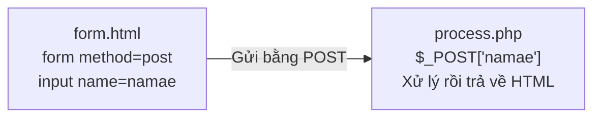
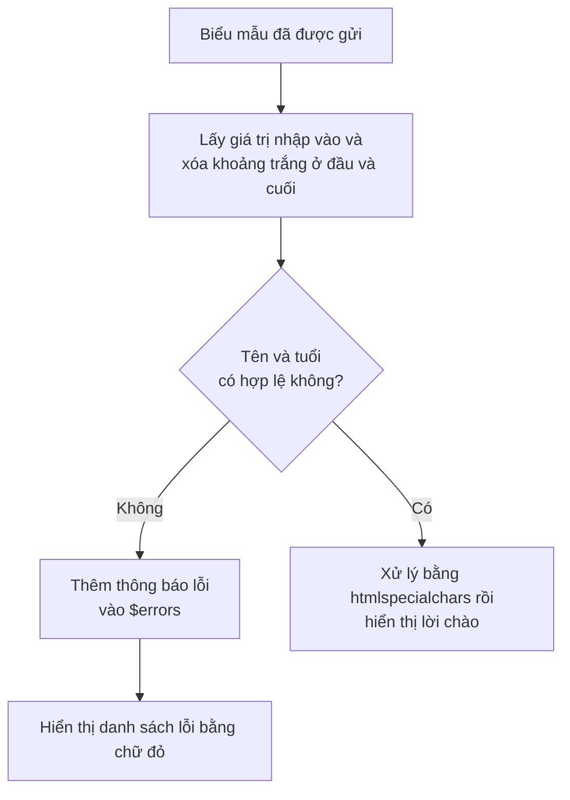

# Năm 1｜Thiết kế dữ liệu và phát triển ứng dụng — 2026/07/07

> 🇯🇵 Bản gốc (tiếng Nhật): [20260707_資料.md](<../../../1年生_データ設計とアプリ開発/前期/20260707/20260707_資料.md>) <!-- original-ja-link -->

---

## Mục tiêu hôm nay

- Sử dụng được biến, kiểu dữ liệu, mảng và mảng kết hợp trong PHP
- Viết được câu lệnh rẽ nhánh điều kiện và hàm
- Nhận dữ liệu từ biểu mẫu HTML bằng PHP và xử lý một cách an toàn

---

## 1. Biến và kiểu dữ liệu

```php
<?php
// Biến luôn bắt đầu bằng $
$namae    = "田中太郎";   // Chuỗi (string)
$nenrei   = 20;           // Số nguyên (int)
$身長     = 1.75;         // Số thực (float)
$isStudent = true;        // Giá trị đúng/sai (bool)

// Kiểm tra kiểu bằng gettype() (tương đương typeof trong JS)
echo gettype($namae);     // → string
echo gettype($nenrei);    // → integer

// Chuyển đổi kiểu
$str = "42";
$num = (int)$str;         // Chuyển chuỗi thành số nguyên
echo $num + 1;            // → 43
```

---

## 2. Xử lý chuỗi

```php
<?php
$namae = "田中太郎";

echo mb_strlen($namae);   // → 4 (số ký tự. Các hàm mb_ hỗ trợ tiếng Nhật)

// Nhúng biến vào chuỗi
echo "名前: {$namae}さん";

// Các hàm xử lý chuỗi hay dùng
echo strtolower("HELLO");              // → hello
echo strtoupper("hello");              // → HELLO
echo trim("  hello  ");                // → hello (xóa khoảng trắng ở đầu và cuối)
echo str_replace("猫", "犬", "猫が好き"); // → 犬が好き
```

---

## 3. Mảng

```php
<?php
$scores = [85, 72, 91, 68, 78];

echo $scores[0];          // → 85 (bắt đầu từ 0)
echo count($scores);      // → 5 (tương đương .length trong JS)

$scores[] = 95;           // Thêm vào cuối (tương đương push trong JS)
sort($scores);            // Sắp xếp tăng dần
rsort($scores);           // Sắp xếp giảm dần

// Các hàm xử lý mảng hay dùng
$doubled  = array_map(fn($x) => $x * 2, $scores);       // map trong JS
$big      = array_filter($scores, fn($x) => $x >= 80);  // filter trong JS
$total    = array_sum($scores);                           // Tổng
$average  = array_sum($scores) / count($scores);          // Trung bình
```

---

## 4. Mảng kết hợp (tương đương object trong JS)

```php
<?php
// Mảng kết hợp = các cặp khóa và giá trị
$person = [
    "namae"  => "田中太郎",
    "nenrei" => 20,
    "email"  => "tanaka@example.com",
];

echo $person["namae"];   // → 田中太郎

$person["hobby"] = "プログラミング";  // Thêm khóa
$person["nenrei"] = 21;               // Thay đổi giá trị

// Lấy ra khóa và giá trị bằng foreach
foreach ($person as $key => $value) {
    echo "{$key}: {$value}\n";
}

// ========== Mảng chứa các mảng kết hợp (mảng object trong JS) ==========
$students = [
    ["id" => 1, "name" => "田中太郎", "score" => 85],
    ["id" => 2, "name" => "鈴木花子", "score" => 72],
];

foreach ($students as $student) {
    echo "ID:{$student['id']} {$student['name']} {$student['score']}点\n";
}
```

---

## 5. Rẽ nhánh điều kiện

```php
<?php
$score = 72;

// if/elseif/else (trong PHP viết là elseif)
if ($score >= 90) {
    echo "S評価";
} elseif ($score >= 80) {
    echo "A評価";
} elseif ($score >= 70) {
    echo "B評価";
} else {
    echo "D評価";
}

// Toán tử ba ngôi (giống JS)
$result = ($score >= 60) ? "合格" : "不合格";

// Biểu thức match (từ PHP 8.0 trở đi, phiên bản cải tiến của switch)
$status = "active";
$label = match($status) {
    "active"   => "有効",
    "inactive" => "無効",
    default    => "不明",
};
echo $label;  // → 有効
```

---

## 6. Hàm

```php
<?php
// Hàm có khai báo kiểu (có thể ghi kiểu cho tham số và giá trị trả về)
function calcTax(float $price, float $taxRate = 0.1): float {
    return $price * (1 + $taxRate);
}

echo calcTax(1000);       // → 1100 (mặc định 10%)
echo calcTax(1000, 0.08); // → 1080 (8%)

// Trả về nhiều giá trị (trả về bằng mảng kết hợp)
function calcStats(array $numbers): array {
    return [
        "total"   => array_sum($numbers),
        "average" => array_sum($numbers) / count($numbers),
        "max"     => max($numbers),
        "min"     => min($numbers),
    ];
}

$stats = calcStats([85, 72, 91, 68]);
echo "平均: " . $stats["average"];  // → 平均: 79

// Hàm mũi tên (từ PHP 7.4 trở đi)
$double = fn($n) => $n * 2;
echo $double(5);  // → 10
```

---

## 7. Biểu mẫu và cách nhận dữ liệu ($_POST)

Nội dung nhập vào biểu mẫu sẽ được gửi đến PHP như sau.



### form.html

```html
<form action="process.php" method="post">
  <input type="text"  name="namae"   placeholder="名前">
  <input type="number" name="age"    placeholder="年齢">
  <textarea name="message"></textarea>
  <button type="submit">送信する</button>
</form>
```

### process.php

```php
<?php
$namae   = $_POST["namae"]   ?? "";
$age     = $_POST["age"]     ?? "";
$message = $_POST["message"] ?? "";

// !! Quan trọng !! Phòng chống XSS: vô hiệu hóa thẻ HTML bằng htmlspecialchars
$safeName    = htmlspecialchars($namae,   ENT_QUOTES, 'UTF-8');
$safeMessage = htmlspecialchars($message, ENT_QUOTES, 'UTF-8');

echo "<p>名前: {$safeName}</p>";
echo "<p>年齢: {$age}歳</p>";
echo "<p>メッセージ: {$safeMessage}</p>";
?>
```

---

## 8. Phòng chống XSS

```php
<?php
// ❌ Ví dụ nguy hiểm (không có htmlspecialchars)
$input = "<script>alert('ハッキング！')</script>";
echo $input;
// → Trình duyệt sẽ thực thi <script>!

// ✅ Ví dụ an toàn
echo htmlspecialchars($input, ENT_QUOTES, 'UTF-8');
// → Hiển thị như một chuỗi bình thường, dạng &lt;script&gt;...
?>
```

> **Quy tắc:** Luôn xử lý dữ liệu người dùng nhập bằng `htmlspecialchars()` trước khi hiển thị!

---

## 9. Validation (kiểm tra dữ liệu nhập)

Đoạn code bên dưới kiểm tra dữ liệu nhập theo thứ tự sau.



```php
<?php
$errors = [];
$namae  = "";
$age    = "";

if ($_SERVER["REQUEST_METHOD"] === "POST") {
    $namae = trim($_POST["namae"] ?? "");
    $age   = trim($_POST["age"]   ?? "");

    if (empty($namae)) {
        $errors[] = "名前は必須です";
    } elseif (mb_strlen($namae) > 50) {
        $errors[] = "名前は50文字以内にしてください";
    }

    if (empty($age)) {
        $errors[] = "年齢は必須です";
    } elseif (!is_numeric($age) || $age < 0 || $age > 150) {
        $errors[] = "年齢は0〜150の数値を入力してください";
    }

    if (empty($errors)) {
        $safeName = htmlspecialchars($namae, ENT_QUOTES, 'UTF-8');
        echo "<p>こんにちは、{$safeName}さん（{$age}歳）！</p>";
    }
}

if (!empty($errors)) {
    echo "<ul style='color:red;'>";
    foreach ($errors as $error) {
        echo "<li>" . htmlspecialchars($error) . "</li>";
    }
    echo "</ul>";
}
?>
```

---

## Tổng kết

| Chức năng | JavaScript | PHP |
| --- | --- | --- |
| Biến | `let x = 1` | `$x = 1` |
| Độ dài mảng | `arr.length` | `count($arr)` |
| Thêm vào cuối | `arr.push(v)` | `$arr[] = v` |
| forEach | `arr.forEach(fn)` | `foreach ($arr as $v)` |
| Object | `{key: value}` | `["key" => value]` |
| else if | `else if` | `elseif` |
| Hàm mũi tên | `(x) => x * 2` | `fn($x) => $x * 2` |
| Nhận dữ liệu biểu mẫu | `fetch` / `FormData` | `$_POST["name"]` |
| Phòng chống XSS | Dùng `textContent` | `htmlspecialchars()` |

---

## Nội dung buổi sau

Chúng ta sẽ học qua trải nghiệm thực tế "vì sao cần cơ sở dữ liệu".  
Bạn sẽ tự cảm nhận được những giới hạn khi cố gắng quản lý dữ liệu chỉ bằng mảng của PHP.

<!-- nav:start -->

---

| ⬅️ Trước | 🗺️ Tổng quan | Tiếp ➡️ |
|:--|:--:|--:|
| [06/30 Bài tập](../20260630/20260630_演習.md) | [Sơ đồ tổng quan tài liệu](../../README.md) | [07/07 Bài tập](20260707_演習.md) |

<!-- nav:end -->
