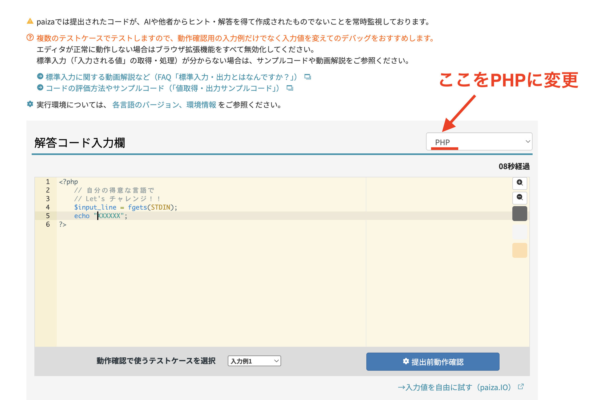

# Bài tập thực hành (ngày 14 tháng 7 năm 2026)

> 🇯🇵 Bản gốc (tiếng Nhật): [20260714_資料_1.md](<../../../1年生_データ設計とアプリ開発/前期/20260714/20260714_資料_1.md>) <!-- original-ja-link -->

Vì đã khởi động được server PHP, trước tiên hãy thử làm các bài tập từ trước đến nay.

## Chuẩn bị

- [Cách chạy máy chủ phát triển PHP](../PHP開発サーバーの立て方.md)

## Bài tập

1. [20260630_演習](../20260630/20260630_演習.md)
2. [20260707_演習](../20260707/20260707_演習.md)


Bạn có thể viết gộp tất cả các bài vào một file `index.php`, nhưng cũng có thể tách mỗi bài ra một file (ví dụ: `1-1.php` / `1-2.php`) theo cách làm trong mục "Truy cập theo cấu trúc thư mục cho từng chương" của [Cách chạy máy chủ phát triển PHP](../PHP開発サーバーの立て方.md).

### Ví dụ về cấu trúc thư mục

```
study/
  index.php
  0630/
    1.php
    2.php
    3.php
    4.php
  0707/
    1-1.php
    1-2.php
    2-1.php
```

### Lệnh khởi động server

"cd" có nghĩa là di chuyển sang thư mục khác.

```bash
cd /Users/<ユーザー名>/Desktop/study
php -S localhost:8000
```

### Cách truy cập bằng URL

Vì server được khởi động ngay trong thư mục `study` (`php -S localhost:8000`), nên URL tương ứng với đường dẫn tương đối tính từ `study/`.

```
http://localhost:8000/0630/1.php
http://localhost:8000/0630/2.php
http://localhost:8000/0707/1-1.php
http://localhost:8000/0707/1-2.php
```

## Về cách sử dụng AI

**Được phép dùng AI như Gemini!** Tuy nhiên, hãy lưu ý những điểm sau.

- Hiểu được ngôn ngữ lập trình
- Những gì tra cứu là biết được thì không cần học thuộc
- Nếu không hiểu, hãy nhờ AI "thêm comment giải thích vào code"


## Ai làm xong bài tập và còn thời gian thì hãy đăng ký Paiza và thử sức với bài kiểm tra kỹ năng bằng PHP

https://paiza.jp/challenges

Ngôn ngữ nộp bài mặc định đang là một ngôn ngữ khác, vì vậy hãy đổi sang PHP như hình dưới đây.



**Lưu ý: Trong bài kiểm tra kỹ năng, Paiza luôn giám sát để phát hiện code được viết dựa trên gợi ý hoặc đáp án từ AI hay người khác.** Khác với các bài tập trước đây, hãy tự mình giải bài mà không sử dụng AI.

<!-- nav:start -->

---

| ⬅️ Trước | 🗺️ Tổng quan | Tiếp ➡️ |
|:--|:--:|--:|
| [07/07 Bài tập](../20260707/20260707_演習.md) | [Sơ đồ tổng quan tài liệu](../../README.md) | [07/21 Vì sao cần cơ sở dữ liệu](../20260721/20260721_資料.md) |

<!-- nav:end -->
