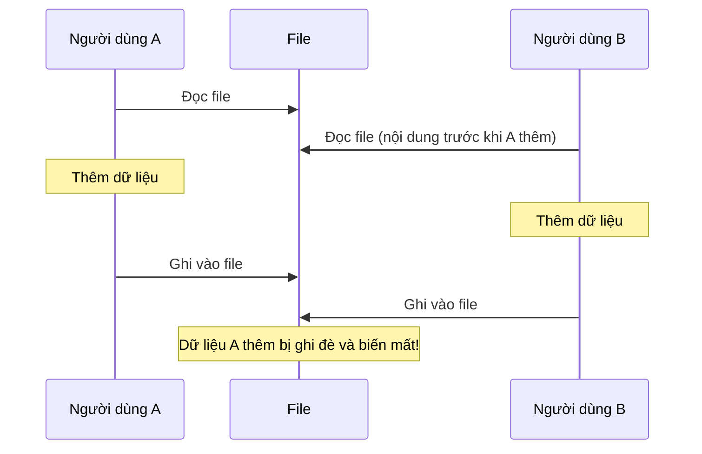
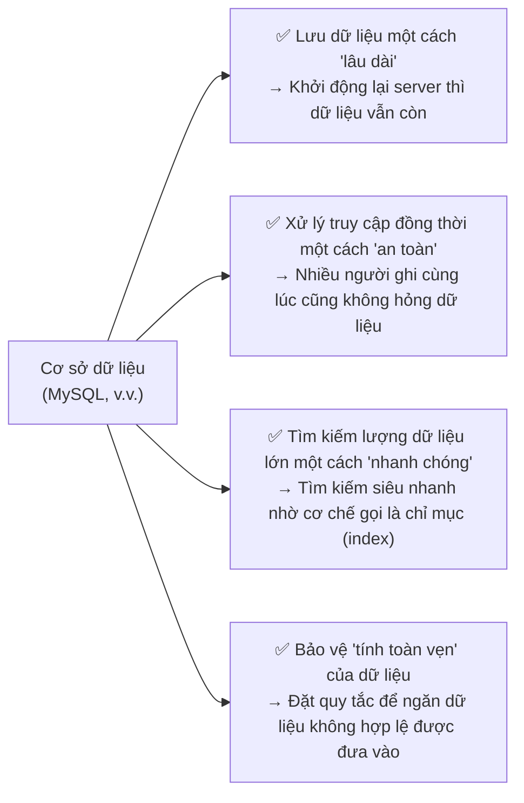
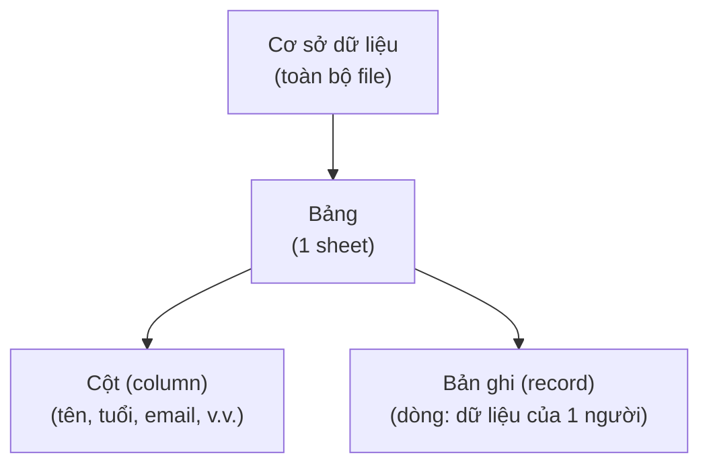
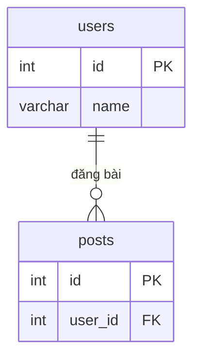

# Tiết 06｜Vì sao cần cơ sở dữ liệu — Chỉ dùng mảng của PHP thì có giới hạn

> 🇯🇵 Bản gốc (tiếng Nhật): [20260721_資料.md](<../../../1年生_データ設計とアプリ開発/前期/20260721/20260721_資料.md>) <!-- original-ja-link -->

## Mục tiêu hôm nay
- Giải thích được những vấn đề khi quản lý dữ liệu chỉ bằng mảng của PHP
- Hiểu được cơ sở dữ liệu giải quyết những vấn đề gì
- Giải thích được các khái niệm cơ bản của MySQL (bảng, dòng, cột)

---

## 1. Thử quản lý dữ liệu chỉ bằng mảng

Trước tiên, hãy thử xây dựng một "hệ thống quản lý người dùng" chỉ bằng mảng của PHP.

```php
<?php
// Thử lưu trạng thái bằng file
// users.php
$users = [
    ["id" => 1, "name" => "田中太郎", "email" => "tanaka@example.com"],
    ["id" => 2, "name" => "鈴木花子", "email" => "suzuki@example.com"],
];

// Hàm thêm người dùng mới
function addUser(array &$users, string $name, string $email): void {
    $newId = count($users) + 1;
    $users[] = ["id" => $newId, "name" => $name, "email" => $email];
}

addUser($users, "山田次郎", "yamada@example.com");

// Hiển thị
foreach ($users as $user) {
    echo "{$user['id']}: {$user['name']}\n";
}
```

### Vấn đề 1: Khởi động lại server thì dữ liệu bị mất

```
Chương trình PHP được chạy lại từ đầu mỗi khi có request
 → Lần nào cũng bắt đầu từ $users = []
 → Dữ liệu đã thêm ở lần trước sẽ bị mất!
```

### Vấn đề 2: Nhiều người truy cập cùng lúc thì dữ liệu bị hỏng

Khi A và B ghi dữ liệu gần như cùng một lúc, chuyện sau sẽ xảy ra.



### Vấn đề 3: Dữ liệu càng nhiều thì tìm kiếm càng chậm

```php
// Tìm một địa chỉ email cụ thể trong 1 triệu người dùng
foreach ($users as $user) {
    if ($user["email"] === "target@example.com") {
        return $user;  // Trường hợp xấu nhất phải lặp 1 triệu lần...
    }
}
```

---

## 2. Những gì cơ sở dữ liệu giải quyết được



---

## 3. Các khái niệm cơ bản của cơ sở dữ liệu

Bạn sẽ dễ hiểu hơn nếu hình dung cơ sở dữ liệu có **cấu trúc giống bảng tính (spreadsheet)**.



```
Ví dụ: bảng users

 id │ name     │ email                │ created_at
────┼──────────┼──────────────────────┼─────────────────
  1 │ 田中太郎 │ tanaka@example.com   │ 2024-01-01 10:00
  2 │ 鈴木花子 │ suzuki@example.com   │ 2024-01-02 11:00
  3 │ 山田次郎 │ yamada@example.com   │ 2024-01-03 12:00
```

---

## 4. Cơ bản về MySQL

**MySQL = cơ sở dữ liệu quan hệ mã nguồn mở được sử dụng nhiều nhất thế giới**

[Về cơ sở dữ liệu quan hệ](./リレーショナルデータベース入門.md)

Laravel cũng dùng MySQL như một lựa chọn tiêu chuẩn.

```
Cơ sở dữ liệu quan hệ (RDB) là:
- Quản lý dữ liệu bằng các bảng
- Có thể liên kết các bảng với nhau bằng "quan hệ (relation)"
- Thao tác bằng ngôn ngữ gọi là SQL (Structured Query Language)

Ví dụ:
  Bảng users (thông tin người dùng)
  Bảng posts (thông tin bài đăng)
  → Có thể quản lý bài đăng thuộc về người dùng nào bằng posts.user_id
```

Nếu vẽ quan hệ giữa users và posts thành sơ đồ thì sẽ như sau (1 người dùng có thể có nhiều bài đăng).



---

## 5. Chuẩn bị MySQL (Windows: XAMPP / Mac: DBngin)

Hãy dùng một trong hai công cụ, tùy theo hệ điều hành của bạn.

### Với Windows: XAMPP

**XAMPP = công cụ miễn phí giúp cài đặt cùng lúc Apache / MySQL (MariaDB) / PHP / phpMyAdmin**

#### Cài đặt

Tải về từ [apachefriends.org](https://www.apachefriends.org/) rồi cài đặt

#### Khởi động MySQL server

1. Mở XAMPP Control Panel
2. Bấm "Start" ở dòng "MySQL" để khởi động

### Với Mac: DBngin

**DBngin = công cụ miễn phí giúp khởi động MySQL / PostgreSQL / Redis chỉ với một cú nhấp chuột**

#### Cài đặt

Tải về từ [dbngin.com](https://dbngin.com/) rồi cài đặt

#### Tạo và khởi động MySQL server

1. Mở DBngin
2. Nút "+" → chọn "MySQL"
3. Chọn phiên bản rồi bấm "Create" (phiên bản nào cũng được, nếu phân vân thì chọn bản ổn định mới nhất)
4. Bấm "Start" ở server vừa tạo để khởi động

### Thông tin kết nối chung

Với cả hai công cụ, mặc định MySQL sẽ được khởi động với các thiết lập sau.

```
Host:     127.0.0.1
Port:     3306
User:     root
Password: (để trống cũng được)
```

※ Nếu cổng 3306 đã được một MySQL server khác sử dụng, hãy đổi sang số cổng khác trong công cụ (khi đó, thiết lập kết nối của công cụ GUI cũng phải đổi theo số cổng đó).

---

## 6. Thao tác với MySQL bằng công cụ GUI (Windows: phpMyAdmin / Mac: TablePlus)

### Với Windows: phpMyAdmin

**phpMyAdmin = màn hình quản lý MySQL đi kèm sẵn với XAMPP (thao tác trên trình duyệt)**

Khi MySQL đang ở trạng thái Start trong XAMPP Control Panel, hãy truy cập địa chỉ sau trên trình duyệt.

```
http://localhost/phpmyadmin/
```

Bạn không cần nhập thông tin kết nối (khi XAMPP khởi động, nó sẽ tự động kết nối bằng người dùng root).

### Với Mac: TablePlus

**TablePlus = công cụ thao tác với MySQL bằng GUI (có thể luyện viết SQL bằng tay)**

#### Cài đặt

Tải về từ [tableplus.com](https://tableplus.com/)

#### Thiết lập kết nối (khi kết nối tới MySQL đã khởi động bằng DBngin)

```
Name:     local
Host:     127.0.0.1
Port:     3306
User:     root
Password: (để trống cũng được)
Database: (sẽ tạo sau)
```

---

## 7. Tạo cơ sở dữ liệu đầu tiên

Trên Windows dùng tab "SQL" của phpMyAdmin, trên Mac dùng tab SQL của TablePlus để chạy đoạn sau:

```sql
-- Tạo cơ sở dữ liệu
CREATE DATABASE school_db;

-- Sử dụng cơ sở dữ liệu vừa tạo
USE school_db;

-- Tạo bảng
CREATE TABLE users (
    id    INT AUTO_INCREMENT PRIMARY KEY,  -- Tự động đánh số
    name  VARCHAR(100) NOT NULL,           -- Chuỗi tối đa 100 ký tự (bắt buộc)
    email VARCHAR(255) NOT NULL UNIQUE,    -- UNIQUE = không được trùng
    age   INT,                             -- Số nguyên (không bắt buộc)
    created_at TIMESTAMP DEFAULT CURRENT_TIMESTAMP  -- Ngày giờ tạo
);

-- Thử thêm dữ liệu
INSERT INTO users (name, email, age) VALUES ('田中太郎', 'tanaka@example.com', 20);
INSERT INTO users (name, email, age) VALUES ('鈴木花子', 'suzuki@example.com', 22);

-- Lấy dữ liệu ra
SELECT * FROM users;
```

---

## Ngoài lề: Ví dụ chạy SQL từ PHP

PHP có sẵn một chức năng tiêu chuẩn để kết nối cơ sở dữ liệu gọi là **PDO (PHP Data Objects)**.

```php
<?php
$pdo = new PDO(
    'mysql:host=127.0.0.1;port=3306;dbname=school_db;charset=utf8mb4',
    'root',
    '' // Mặc định của XAMPP/DBngin là mật khẩu trống
);

// Câu lệnh SQL sẽ chạy
$sql = "SELECT * FROM users";

$stmt = $pdo->query($sql);
$users = $stmt->fetchAll(PDO::FETCH_ASSOC);

foreach ($users as $user) {
    echo "{$user['id']}: {$user['name']}\n";
}
```

---

## Tổng kết

| Vấn đề | Chỉ dùng mảng | Cơ sở dữ liệu |
|------|---------|------------|
| Lưu trữ lâu dài | ❌ Bị mất | ✅ Vẫn còn |
| Truy cập đồng thời | ❌ Bị hỏng | ✅ An toàn |
| Tìm kiếm dữ liệu lớn | ❌ Chậm | ✅ Nhanh |
| Tính toàn vẹn dữ liệu | ❌ Không kiểm tra | ✅ Bảo vệ được bằng quy tắc |

---

## Nội dung buổi sau (tiết 07)

SQL cơ bản: học cách lấy dữ liệu ra bằng `SELECT` / `WHERE` / `ORDER BY`.  
Chúng ta sẽ thực hành bằng cách viết và chạy SQL thật trên TablePlus.

<!-- nav:start -->

---

📎 Đọc thêm → [Cách dựng máy chủ cơ sở dữ liệu (với XAMPP)](../データベースサーバーの立て方/データベースサーバーの立て方.md)・[Nhập môn cơ sở dữ liệu quan hệ](リレーショナルデータベース入門.md)

| ⬅️ Trước | 🗺️ Tổng quan | Tiếp ➡️ |
|:--|:--:|--:|
| [07/14 Bài tập thực hành](../20260714/20260714_資料_1.md) | [Sơ đồ tổng quan tài liệu](../../README.md) | [07/21 SQL cơ bản ① (SELECT)](20260721_資料_2.md) |

<!-- nav:end -->
