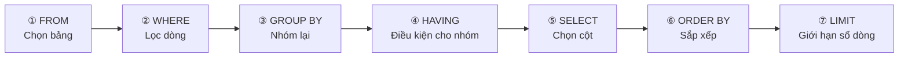

# Tiết 07｜SQL cơ bản ① — SELECT / WHERE / ORDER BY

> 🇯🇵 Bản gốc (tiếng Nhật): [20260721_資料_2.md](<../../../1年生_データ設計とアプリ開発/前期/20260721/20260721_資料_2.md>) <!-- original-ja-link -->

## Mục tiêu hôm nay
- Lấy được dữ liệu bằng SELECT
- Chỉ định điều kiện để lọc dữ liệu bằng WHERE
- Sắp xếp được dữ liệu bằng ORDER BY
- Giới hạn được số dòng lấy ra bằng LIMIT

---

## Chuẩn bị: Thêm dữ liệu luyện tập

Hãy chạy đoạn sau trong tab SQL của TablePlus:

```sql
-- Tạo cơ sở dữ liệu và bảng
CREATE DATABASE IF NOT EXISTS school_db;
USE school_db;

-- Bảng học sinh
CREATE TABLE IF NOT EXISTS students (
    id         INT AUTO_INCREMENT PRIMARY KEY,
    name       VARCHAR(100) NOT NULL,
    age        INT NOT NULL,
    class      VARCHAR(10) NOT NULL,
    score      INT NOT NULL,
    enrolled_at DATE NOT NULL
);

-- Chèn dữ liệu kiểm thử
INSERT INTO students (name, age, class, score, enrolled_at) VALUES
('田中太郎', 18, 'A', 85, '2024-04-01'),
('鈴木花子', 19, 'A', 72, '2024-04-01'),
('山田次郎', 18, 'B', 91, '2024-04-01'),
('佐藤三郎', 20, 'B', 58, '2024-04-01'),
('伊藤美咲', 18, 'A', 78, '2024-04-01'),
('渡辺一郎', 19, 'C', 95, '2024-04-01'),
('加藤幸子', 18, 'C', 45, '2024-04-01'),
('吉田健太', 20, 'B', 88, '2024-04-01'),
('山本麻衣', 19, 'A', 67, '2024-04-01'),
('中村龍一', 18, 'C', 73, '2024-04-01');
```

---

## 1. SELECT — Lấy dữ liệu ra

```sql
-- Lấy tất cả các cột và tất cả các dòng (* = tất cả các cột)
SELECT * FROM students;

-- Chỉ lấy một số cột nhất định
SELECT name, score FROM students;

-- Đặt bí danh cho cột (AS)
SELECT name AS 名前, score AS 点数 FROM students;
```

---

## 2. WHERE — Lọc theo điều kiện

```sql
-- Học sinh có score từ 80 trở lên
SELECT * FROM students WHERE score >= 80;

-- Học sinh có class là 'A'
SELECT * FROM students WHERE class = 'A';

-- age bằng 18 và score từ 70 trở lên
SELECT * FROM students WHERE age = 18 AND score >= 70;

-- class là 'A' hoặc 'B'
SELECT * FROM students WHERE class = 'A' OR class = 'B';

-- class là 'A' hoặc 'B' (dùng IN thì viết ngắn hơn)
SELECT * FROM students WHERE class IN ('A', 'B');

-- score từ 60 trở lên và dưới 90 (BETWEEN)
SELECT * FROM students WHERE score BETWEEN 60 AND 89;

-- name có chứa "太" (LIKE = khớp một phần)
SELECT * FROM students WHERE name LIKE '%太%';
-- % = bao nhiêu ký tự cũng được (ký tự đại diện)

-- score không phải NULL (IS NOT NULL)
SELECT * FROM students WHERE score IS NOT NULL;
```

---

## 3. ORDER BY — Sắp xếp

```sql
-- score tăng dần (từ thấp đến cao)
SELECT * FROM students ORDER BY score ASC;   -- ASC = ascending (tăng dần)

-- score giảm dần (từ cao đến thấp)
SELECT * FROM students ORDER BY score DESC;  -- DESC = descending (giảm dần)

-- Sắp xếp class tăng dần, trong cùng class thì score giảm dần
SELECT * FROM students ORDER BY class ASC, score DESC;
```

---

## 4. LIMIT — Giới hạn số dòng lấy ra

```sql
-- Chỉ lấy 5 dòng đầu
SELECT * FROM students ORDER BY score DESC LIMIT 5;

-- Lấy 5 dòng bắt đầu từ dòng thứ 6 (dùng cho phân trang)
-- LIMIT số dòng OFFSET vị trí bắt đầu
SELECT * FROM students ORDER BY id ASC LIMIT 5 OFFSET 5;
```

---

## 5. Hàm tổng hợp

```sql
-- Đếm số dòng
SELECT COUNT(*) FROM students;
-- → 10

-- Tổng, trung bình, lớn nhất, nhỏ nhất của score
SELECT
    COUNT(*)    AS 人数,
    SUM(score)  AS 合計点,
    AVG(score)  AS 平均点,
    MAX(score)  AS 最高点,
    MIN(score)  AS 最低点
FROM students;

-- GROUP BY: điểm trung bình theo từng lớp
SELECT class, AVG(score) AS 平均点, COUNT(*) AS 人数
FROM students
GROUP BY class
ORDER BY 平均点 DESC;
```

---

## 6. Thứ tự thực thi của SELECT (quan trọng!)

SQL không được thực thi theo thứ tự viết, mà theo thứ tự sau.



```sql
SELECT name, score       -- ⑤ Chọn các cột cần lấy
FROM students            -- ① Chọn bảng
WHERE score >= 70        -- ② Lọc theo điều kiện
GROUP BY class           -- ③ Nhóm lại
HAVING AVG(score) >= 75  -- ④ Điều kiện cho nhóm (sau WHERE)
ORDER BY score DESC      -- ⑥ Sắp xếp
LIMIT 5;                 -- ⑦ Giới hạn số dòng
```

---

## Tổng kết

| SQL | Ý nghĩa |
|-----|------|
| `SELECT * FROM bảng` | Lấy toàn bộ dữ liệu |
| `WHERE điều_kiện` | Lọc theo điều kiện |
| `AND` / `OR` | Kết hợp nhiều điều kiện |
| `IN (giá_trị_1, giá_trị_2)` | Khớp với một trong nhiều giá trị |
| `LIKE '%chuỗi%'` | Tìm kiếm khớp một phần |
| `ORDER BY cột ASC/DESC` | Sắp xếp |
| `LIMIT số` | Giới hạn số dòng lấy ra |
| `COUNT(*)` / `AVG()` / `SUM()` | Hàm tổng hợp |
| `GROUP BY cột` | Nhóm lại |

---

## Nội dung buổi sau (tiết 08)

Chúng ta sẽ học INSERT / UPDATE / DELETE.  
Bạn sẽ có thể thêm, cập nhật và xóa dữ liệu.

<!-- nav:start -->

---

| ⬅️ Trước | 🗺️ Tổng quan | Tiếp ➡️ |
|:--|:--:|--:|
| [07/21 Vì sao cần cơ sở dữ liệu](20260721_資料.md) | [Sơ đồ tổng quan tài liệu](../../README.md) | [07/21 Bài tập](20260721_演習.md) |

<!-- nav:end -->
