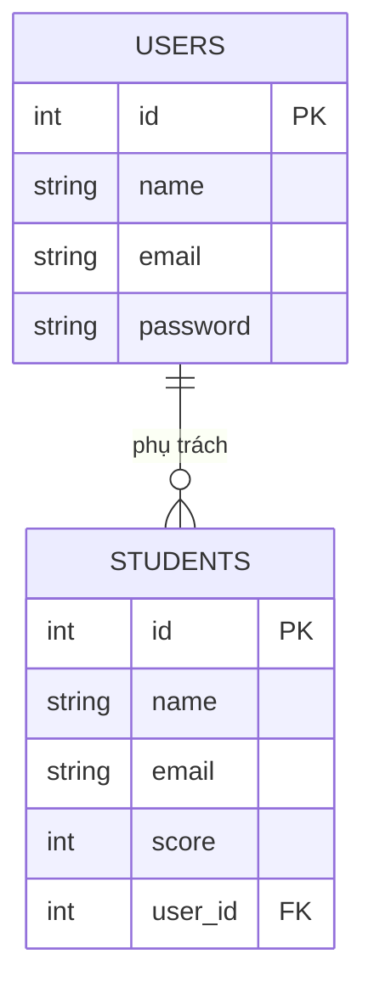

> 🇯🇵 Bản gốc (tiếng Nhật): [リレーショナルデータベース入門.md](<../../../1年生_データ設計とアプリ開発/前期/20260721/リレーショナルデータベース入門.md>) <!-- original-ja-link -->

## Bài này giúp bạn hiểu

- Bảng, hàng, cột
- Khóa chính
- Khóa ngoại và sự liên kết giữa các bảng
- Lý do tách bảng

## Cơ sở dữ liệu = tập hợp các bảng được sắp xếp gọn gàng

Thay vì ghi chép rời rạc trên giấy, "cơ sở dữ liệu" là cơ chế sắp xếp và lưu trữ dữ liệu dưới dạng bảng. Đặc điểm của RDB (cơ sở dữ liệu quan hệ) là có thể liên kết (= tạo quan hệ) nhiều bảng (table) như vậy với nhau để xử lý.

## Bảng, hàng, cột

Ứng dụng này có 2 bảng với vai trò khác nhau. Chúng ta sẽ lấy từng bảng làm ví dụ để xem tên gọi của từng thành phần.

### 🎓 Bảng students (dữ liệu học sinh)

| id | name | email | score |
|----|------|-------|-------|
| 1  | 田中太郎 | tanaka@example.com | 80 |
| 2  | 佐藤花子 | sato@example.com | 95 |

- **Bảng (table)**: chính là cái bảng này (tạo nhiều bảng theo từng mục đích sử dụng)
- **Cột (column)**: các mục theo chiều dọc như `id` `name` `email` `score`
- **Hàng (record)**: dữ liệu của một bản ghi (ở đây là thông tin của một học sinh)

### 🔑 Bảng users (thông tin đăng nhập của giáo viên, quản trị viên)

| id | name | email | password |
|----|------|-------|----------|
| 1  | 小山先生 | koyama@example.com | $2y$10$abcdefGhIjKlmn...(đã băm) |
| 2  | 田中先生 | tanaka-t@example.com | $2y$10$OpQrStUvWxYz...(đã băm) |

- **Bảng (table)**: `users` (thông tin tài khoản dùng để đăng nhập, có vai trò khác với students)
- **Cột (column)**: `id` `name` `email` `password`
- **Hàng (record)**: dữ liệu của một bản ghi (ở đây là thông tin đăng nhập của một giáo viên hoặc quản trị viên)

> 💡 `password` không được lưu nguyên chuỗi đã nhập (văn bản thuần), mà được lưu sau khi biến đổi một chiều gọi là băm (hash). Mục đích là để dù nội dung cơ sở dữ liệu có bị lộ, người khác cũng không biết được mật khẩu gốc.

## Khóa chính: ID để phân biệt dữ liệu một cách duy nhất

Nếu chỉ tìm theo `name` (tên), khi có người trùng cả họ lẫn tên thì không thể xác định được đúng người. Vì vậy, ta dùng một con số tuyệt đối không trùng với hàng khác (**khóa chính**). `id` trong bảng ở trên chính là khóa chính. Chỉ cần nói "Cho tôi dữ liệu có id = 1" là có thể lọc ra đúng một bản ghi chứa thông tin của 田中太郎. Hãy hình dung khóa chính giống như số định danh cá nhân hay mã hội viên, sẽ dễ hiểu hơn.

## Khóa ngoại: sự liên kết giữa các bảng

Bản chất của RDB (= nguồn gốc của từ "quan hệ") là có thể liên kết nhiều bảng với nhau thông qua ID.

Ứng dụng này có 2 bảng: bảng `users` dùng để đăng nhập (tài khoản giáo viên/quản trị viên) và
bảng `students` chứa dữ liệu học sinh. Hiện tại, 2 bảng này là các bảng độc lập,
chưa được liên kết với nhau bằng ID.

Nếu muốn ghi lại "giáo viên (user) nào đã đăng ký/phụ trách học sinh (student) nào",
ta sẽ thêm một cột tên là `user_id` vào bảng `students` để liên kết chúng.

Nếu cho `STUDENTS.user_id` (khóa ngoại) tham chiếu đến `USERS.id` (khóa chính),
ta có thể biểu diễn mối quan hệ 1 giáo viên (user) phụ trách nhiều học sinh (student) (quan hệ một-nhiều).

## Tại sao phải tách bảng?

Nếu không tách mà gộp tất cả vào 1 bảng, tên và địa chỉ email của cùng một giáo viên phụ trách sẽ bị lặp lại ở mỗi hàng tương ứng với từng học sinh mà giáo viên đó phụ trách.

| student_id | student_name | staff_name | staff_email |
|-----------|-------|-------------|---------------|
| 101 | 田中花子 | 小山先生 | koyama@example.com |
| 103 | 田中次郎 | 小山先生 | koyama@example.com |

Như vậy, khi thầy Koyama đổi địa chỉ email, ta phải tìm và sửa tất cả các hàng liên quan, rất dễ bị sót. Nếu tách thành bảng users và bảng students rồi liên kết bằng ID, thông tin của thầy Koyama chỉ nằm ở 1 chỗ, và khi sửa cũng chỉ cần sửa 1 chỗ. Cách suy nghĩ "tách bảng để tránh trùng lặp" này được gọi là **chuẩn hóa**.

## Tóm tắt

- Cơ sở dữ liệu là cơ chế sắp xếp và lưu trữ dữ liệu
- RDB quản lý dữ liệu dưới dạng "bảng", và bảng được tạo thành từ "cột (mục)" và "hàng (dữ liệu của một bản ghi)"
- Khóa chính là dấu hiệu nhận biết (ID) để phân biệt duy nhất từng bản ghi
- Khóa ngoại là cơ chế tham chiếu đến khóa chính của bảng khác để liên kết các bảng với nhau
- Bằng cách tách bảng và liên kết chúng, ta có thể tránh trùng lặp cùng một thông tin và giúp dữ liệu dễ quản lý hơn

Sau này sẽ còn xuất hiện "SQL", "chỉ mục (index)", "giao dịch (transaction)"..., nhưng trước mắt chỉ cần hình dung được nền tảng này là OK.

<!-- nav:start -->

---

| ⬅️ Quay lại | 🗺️ Tổng quan | Tiếp ➡️ |
|:--|:--:|--:|
| [07/21 Tại sao cần DB](20260721_資料.md) | [Sơ đồ tổng thể tài liệu](../../README.md) | [07/21 SQL cơ bản ① (SELECT)](20260721_資料_2.md) |

<!-- nav:end -->
