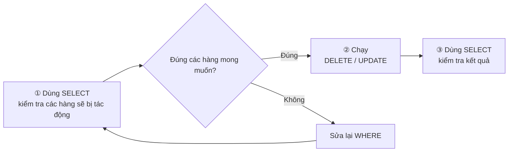
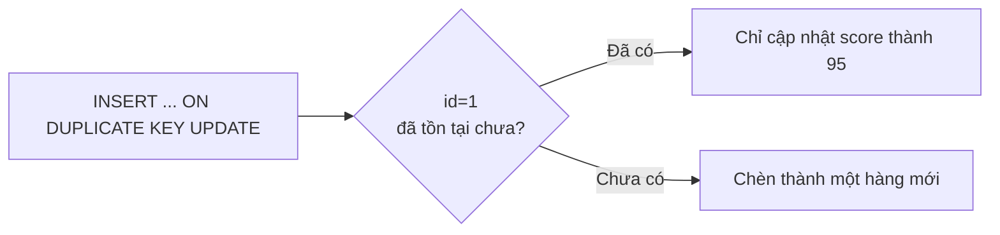

# Buổi 08｜SQL cơ bản ② — INSERT / UPDATE / DELETE

> 🇯🇵 Bản gốc (tiếng Nhật): [20260723_資料.md](<../../../1年生_データ設計とアプリ開発/前期/20260723/20260723_資料.md>) <!-- original-ja-link -->

## Mục tiêu hôm nay
- Thêm được dữ liệu bằng INSERT
- Cập nhật được dữ liệu bằng UPDATE
- Xóa được dữ liệu bằng DELETE
- Hiểu tầm quan trọng của WHERE (nếu quên thì toàn bộ các hàng sẽ bị thay đổi)

---

## 1. INSERT — Thêm dữ liệu

```sql
-- Khi đưa giá trị vào tất cả các cột (có thể bỏ qua tên cột)
INSERT INTO students VALUES (NULL, '新入生A', 18, 'A', 80, '2024-04-01');
-- ↑ id là AUTO_INCREMENT nên để NULL là OK

-- Chỉ định riêng một số cột để đưa giá trị vào (khuyến nghị)
INSERT INTO students (name, age, class, score, enrolled_at)
VALUES ('新入生B', 19, 'B', 75, '2024-04-01');

-- Thêm nhiều hàng cùng lúc
INSERT INTO students (name, age, class, score, enrolled_at)
VALUES
    ('新入生C', 18, 'C', 88, '2024-04-01'),
    ('新入生D', 20, 'A', 62, '2024-04-01'),
    ('新入生E', 19, 'B', 71, '2024-04-01');
```

---

## 2. UPDATE — Cập nhật dữ liệu

```sql
-- !! Cực kỳ quan trọng !!
-- Nếu quên WHERE thì tất cả các hàng sẽ bị cập nhật!
-- Nhất định phải kiểm tra WHERE rồi mới chạy!

-- Cập nhật score của học sinh có id là 1 thành 90
UPDATE students SET score = 90 WHERE id = 1;

-- Cập nhật nhiều cột cùng lúc (ngăn cách bằng dấu phẩy)
UPDATE students SET score = 95, class = 'S' WHERE id = 1;

-- Không có WHERE (nguy hiểm! tất cả các hàng sẽ bị cập nhật)
-- UPDATE students SET score = 0;  ← Làm thế này thì tất cả mọi người sẽ bị 0 điểm!

-- Cập nhật dựa trên giá trị hiện tại (ví dụ: cộng 5 điểm cho tất cả mọi người)
UPDATE students SET score = score + 5;  -- Nếu cố ý làm vậy thì không sao
```

---

## 3. DELETE — Xóa dữ liệu

```sql
-- !! Cực kỳ quan trọng !!
-- Nếu quên WHERE thì tất cả các hàng sẽ bị xóa!
-- DELETE không thể hoàn tác!

-- Xóa học sinh có id là 5
DELETE FROM students WHERE id = 5;

-- Xóa tất cả học sinh có score dưới 50
DELETE FROM students WHERE score < 50;

-- Không có WHERE (tuyệt đối không được làm)
-- DELETE FROM students;  ← Bảng sẽ trống rỗng!
```

> **Nguyên tắc vàng trong thực tế:**  
> 1. Trước khi UPDATE/DELETE, dùng SELECT để kiểm tra các hàng sẽ bị tác động  
> 2. Sao lưu (backup) trước khi chạy  
> 3. Nhất định phải kiểm tra WHERE

---

## 4. Cách UPDATE/DELETE an toàn

Đừng chạy ngay lập tức, hãy làm theo thứ tự sau.



```sql
-- Bước 1: Trước tiên dùng SELECT để kiểm tra các hàng sẽ bị tác động
SELECT * FROM students WHERE score < 50;
-- → Kiểm tra trực tiếp các hàng sẽ bị xóa

-- Bước 2: Nếu không có vấn đề gì thì chạy DELETE
DELETE FROM students WHERE score < 50;

-- Kiểm tra lại
SELECT * FROM students;
```

---

## 5. Mẫu hay dùng: UPSERT

```sql
-- INSERT OR UPDATE (nếu dữ liệu đã tồn tại thì cập nhật, nếu chưa có thì thêm mới)
-- Trong MySQL dùng INSERT ... ON DUPLICATE KEY UPDATE
INSERT INTO students (id, name, score)
VALUES (1, '田中太郎', 95)
ON DUPLICATE KEY UPDATE score = 95;
-- id=1 đã tồn tại → chỉ score được cập nhật thành 95
-- id=1 chưa tồn tại → được thêm mới
```

Nếu vẽ thành sơ đồ, quá trình sẽ rẽ nhánh như sau.



---

## 6. Tóm tắt CRUD

| Thao tác | SQL | Ý nghĩa |
|------|-----|------|
| **C**reate (tạo) | `INSERT INTO ... VALUES ...` | Thêm dữ liệu |
| **R**ead (đọc) | `SELECT ... FROM ...` | Lấy dữ liệu |
| **U**pdate (cập nhật) | `UPDATE ... SET ... WHERE ...` | Cập nhật dữ liệu |
| **D**elete (xóa) | `DELETE FROM ... WHERE ...` | Xóa dữ liệu |

> **CRUD = Create / Read / Update / Delete** là các thao tác cơ bản của ứng dụng Web.  
> Trong bài thực hành Laravel, bạn cũng sẽ gặp lại chính những khái niệm này.

---

## Giới thiệu buổi sau (Buổi 09)

Chúng ta sẽ học về quan hệ giữa các bảng và JOIN.  
Bạn sẽ có thể nối bảng người dùng và bảng đơn hàng để lấy ra "ai đã đặt mua gì" chỉ bằng 1 câu lệnh SQL.

<!-- nav:start -->

---

| ⬅️ Trước | 🗺️ Tổng quan | Tiếp ➡️ |
|:--|:--:|--:|
| [07/21 Bài tập](../20260721/20260721_演習.md) | [Sơ đồ tổng thể tài liệu](../../README.md) | [07/23 Bài tập](20260723_演習.md) |

<!-- nav:end -->
