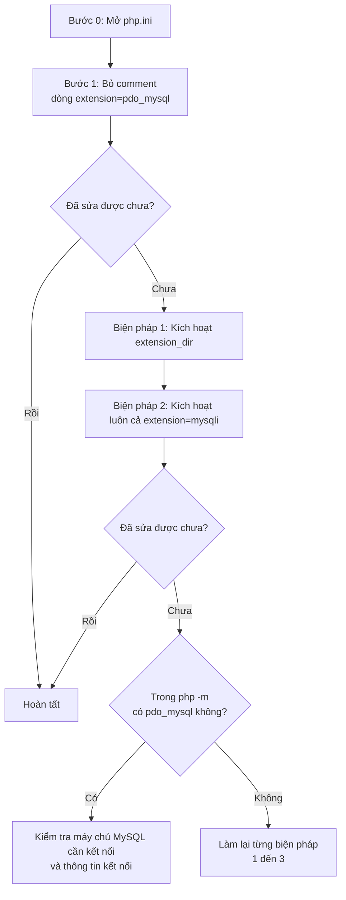

# Cách xử lý khi extension PDO MySQL không được kích hoạt

> 🇯🇵 Bản gốc (tiếng Nhật): [PDO_MySQL接続エラー対処法.md](<../../../1年生_データ設計とアプリ開発/前期/20260723/PDO_MySQL接続エラー対処法.md>) <!-- original-ja-link -->

## Lỗi được đề cập

Đây là cách xử lý khi bạn gặp lỗi như dưới đây.

```
Fatal error: Uncaught PDOException: could not find driver in C:\Users\nishida\Desktop\apple\5.php:2
Stack trace:
#0 C:\Users\nishida\Desktop\apple\5.php(2): PDO->__construct('mysql:host=127....', 'root', Object(SensitiveParameterValue))
#1 {main}
  thrown in C:\Users\nishida\Desktop\apple\5.php on line 2
```

### Ý nghĩa của lỗi này

Khi kết nối từ PHP đến MySQL (cơ sở dữ liệu), ta dùng một cơ chế gọi là `PDO`, nhưng ngoài ra còn cần thêm một thành phần gọi là "driver" để thực sự giao tiếp với MySQL.

`could not find driver` là lỗi có nghĩa là "Không tìm thấy driver đó". Nói cách khác, lỗi xảy ra vì **PHP không tải được extension (driver) tên là `pdo_mysql`**.

Hầu hết nguyên nhân nằm ở thiết lập trong php.ini (file cấu hình của PHP). Hãy thử lần lượt các bước dưới đây từ trên xuống. Sau mỗi lần thử, nhất định phải "khởi động lại server" ([Biện pháp 3](#biện-pháp-3-khởi-động-lại-server-thật-chắc-chắn)) rồi mới kiểm tra trên trình duyệt. Chỉ thay đổi thiết lập thôi thì PHP sẽ chưa áp dụng.

Toàn bộ quy trình như sau.



※ Ở bất kỳ bước nào, sau khi thay đổi và lưu, nhất định phải làm Biện pháp 3 (khởi động lại server) rồi mới kiểm tra.

---

## Bước 0: Mở php.ini

Từ đây chúng ta sẽ chỉnh sửa file php.ini nhiều lần. Trước tiên hãy xem cách mở file.

1. Mở `C:\php\php.ini` từ Explorer (thư mục) hoặc VS Code.
   - Nếu không tìm thấy, hãy gõ `php --ini` trong terminal, vị trí của file php.ini đang được dùng sẽ hiện ra.
2. Từ đây trở đi, chúng ta sẽ chỉnh sửa nội dung của file php.ini này.

---

## Bước 1: Bỏ comment dòng extension=pdo_mysql

Trong php.ini có rất nhiều thiết lập để bật/tắt các chức năng (extension). Nếu đầu dòng có dấu `;` (dấu chấm phẩy) thì có nghĩa là "dòng đó bị vô hiệu (đã bị comment)".

1. Khi đang mở php.ini, nhấn `Ctrl + F` (tìm kiếm), nhập `extension=pdo_mysql` để tìm.
2. Bạn sẽ thấy một dòng có dấu `;` ở đầu như dưới đây.

   ```ini
   ;extension=pdo_mysql
   ```

3. Chỉ xóa dấu `;` ở đầu dòng.

   ```ini
   extension=pdo_mysql
   ```

4. Lưu bằng `Ctrl + S`.
5. Khởi động lại server theo [Biện pháp 3](#biện-pháp-3-khởi-động-lại-server-thật-chắc-chắn), rồi kiểm tra hoạt động trên trình duyệt.

Thường thì làm đến đây là sửa được, nhưng nếu vẫn chưa được thì hãy chuyển sang phần tiếp theo.

---

## Nếu đến đây vẫn chưa giải quyết được

Nếu đã bỏ comment `;extension=pdo_mysql` mà vẫn chưa giải quyết được, nhiều khả năng PHP chưa nhận ra "vị trí thư mục chứa file thực tế của extension (file DLL)".

Hãy kiểm tra lần lượt các biện pháp sau.

## Biện pháp 1: Kích hoạt thiết lập extension_dir (★ nguyên nhân phổ biến nhất)

`extension=pdo_mysql` chỉ đơn thuần là một chỉ thị "hãy dùng chức năng tên là pdo_mysql". Thiết lập cho PHP biết file thực sự tạo nên chức năng đó (file DLL) nằm ở đâu chính là `extension_dir`. Nếu chỗ này không được thiết lập đúng, PHP sẽ rơi vào tình trạng có chỉ thị nhưng không tìm thấy file DLL.

1. Mở `C:\php\php.ini`.
2. Nhấn `Ctrl + F` trên bàn phím và tìm `extension_dir`.
3. Tìm dòng như dưới đây (đầu dòng thường có dấu `;`).

   ```ini
   ;extension_dir = "ext"
   ```

4. Xóa dấu `;` (dấu chấm phẩy) ở đầu để kích hoạt.

   ```ini
   extension_dir = "ext"
   ```

5. Lưu bằng `Ctrl + S`, rồi khởi động lại server theo [Biện pháp 3](#biện-pháp-3-khởi-động-lại-server-thật-chắc-chắn) và kiểm tra.

   ※ Nếu vẫn chưa giải quyết được, hãy thử chỉ định bằng đường dẫn đầy đủ (đường dẫn tuyệt đối) thay vì đường dẫn tương đối `"ext"`.

   ```ini
   extension_dir = "C:\php\ext"
   ```

   Đây là cách viết để nói rõ ràng với PHP rằng "Hãy xem thư mục `ext` nằm trong thư mục `C:\php` nhé", không gây nhầm lẫn. Sau khi sửa, hãy lưu lại và khởi động lại server lần nữa.

## Biện pháp 2: Thử kích hoạt luôn cả extension=mysqli

`mysqli` cũng là một extension khác dùng để kết nối với MySQL. Tùy môi trường, có trường hợp `mysqli` cũng cần được kích hoạt để `pdo_mysql` hoạt động bình thường. Để chắc ăn, hãy kích hoạt luôn cả nó.

1. Tìm `extension=mysqli` trong php.ini.
2. Nếu đầu dòng có dấu `;` thì xóa đi.

   ```ini
   extension=mysqli
   ```

3. Lưu bằng `Ctrl + S`, rồi khởi động lại server và kiểm tra.

## Biện pháp 3: Khởi động lại server thật chắc chắn

Dù đã sửa php.ini, thay đổi sẽ không tự động được áp dụng cho PHP server đang chạy. Lý do là file cấu hình chỉ được đọc một lần duy nhất "khi khởi động server". Vì vậy, sau khi thay đổi thiết lập, nhất định phải dừng server hoàn toàn một lần rồi khởi động lại.

1. Mở terminal (màn hình đen) ở phía dưới VS Code.
2. Click vào terminal và nhấn `Ctrl + C` vài lần để dừng server hoàn toàn. Nếu terminal hiện `^C` và trở về trạng thái có thể nhập lệnh (prompt) thì server đã dừng.
3. Nhập lại lệnh khởi động server.

   ```bash
   php -S localhost:8000
   ```

4. Tải lại (refresh) trang cần kiểm tra trên trình duyệt (ví dụ: `http://localhost:8000/5.php`).

---

## Cách kiểm tra nếu vẫn chưa giải quyết được

Có một cách để kiểm tra trực tiếp "hiện tại pdo_mysql đã thực sự được tải hay chưa".

1. Chạy lệnh sau trong terminal.

   ```bash
   php -m
   ```

   Đây là lệnh hiển thị "danh sách các extension hiện đang được PHP tải".

2. Hãy tìm xem trong danh sách hiện ra có chữ `pdo_mysql` hay không.
   - **Nếu có** → Bản thân extension đã được tải. Nếu lỗi vẫn tiếp diễn, hãy kiểm tra xem máy chủ MySQL cần kết nối đã được khởi động chưa, và thông tin kết nối (tên host, tên người dùng, mật khẩu, v.v.) có đúng không.
   - **Nếu không có** → Extension vẫn chưa được tải. Hãy làm lại các biện pháp 1 đến 3 ở trên, từng cái một và thật chắc chắn (luôn đi kèm lưu file & khởi động lại server).

<!-- nav:start -->

---

| ⬅️ Quay lại | 🗺️ Tổng quan | Tiếp ➡️ |
|:--|:--:|--:|
| [Ứng dụng quản lý Todo: các bước khởi động](Todo管理アプリ起動する流れ.md) | [Sơ đồ tổng thể tài liệu](../../README.md) | [07/28 Quan hệ giữa các bảng・JOIN](../20260728/20260728_資料.md) |

<!-- nav:end -->
