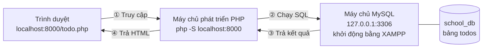
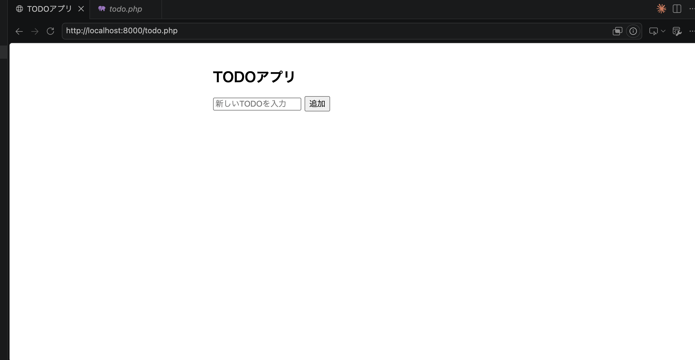
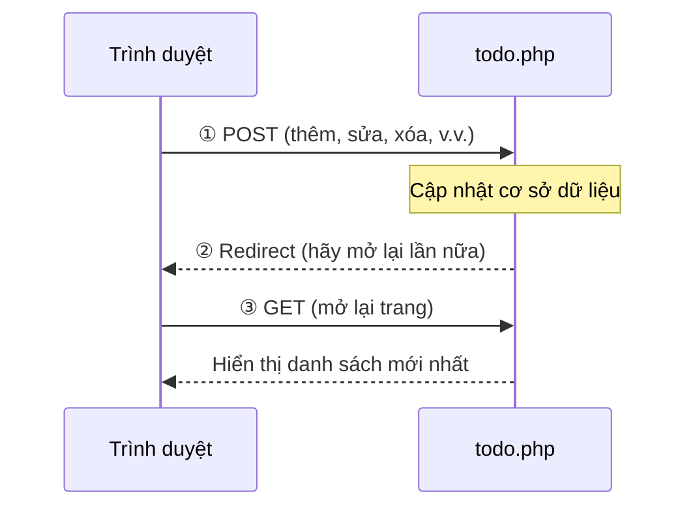

# Ứng dụng quản lý Todo: các bước khởi động

> 🇯🇵 Bản gốc (tiếng Nhật): [Todo管理アプリ起動する流れ.md](<../../../1年生_データ設計とアプリ開発/前期/20260723/Todo管理アプリ起動する流れ.md>) <!-- original-ja-link -->

`todo.php` là ứng dụng kết nối với MySQL bằng PHP + PDO, cho phép thêm, sửa, chuyển trạng thái hoàn thành và xóa TODO. Để chạy được, cần khởi động sẵn **2 thứ**: "máy chủ cơ sở dữ liệu" và "máy chủ phát triển PHP".

## Toàn cảnh (hình dung trạng thái khi đang chạy)



- **Máy chủ phát triển PHP**: phụ trách chạy `todo.php` (chương trình chính). Nhận truy cập từ trình duyệt và thực thi PHP.
- **Máy chủ MySQL (XAMPP)**: phụ trách lưu trữ dữ liệu (bảng `todos` của `school_db`). Thực thi các câu lệnh SQL do PHP yêu cầu rồi trả dữ liệu về.
- Hai thứ này là **các tiến trình (process) riêng biệt**, và cần để cả hai luôn chạy (chỉ cần một trong hai bị dừng là sẽ báo lỗi).

## Điều kiện tiên quyết

- Đã cài đặt XAMPP
- Đã cài đặt PHP (kiểm tra bằng `php -v`)
- Thay `<tên-người-dùng>` trong các lệnh dưới đây bằng tên người dùng trên máy tính của bạn

---

## 0. Chuẩn bị todo.php trong thư mục study của bạn

Sao chép file `todo.php` được phát vào bên trong thư mục `study` trên máy tính của bạn (ví dụ: `study/20260723/`).

- Có thể kéo thả để sao chép nguyên file
- Hoặc sao chép nội dung rồi dán vào file `todo.php` mới tạo trong môi trường của bạn

Cách nào cũng được, miễn là `todo.php` nằm trong thư mục `study` nơi bạn sẽ chạy lệnh `php -S`.

---

## 1. Khởi động MySQL bằng XAMPP

Mở XAMPP Control Panel, kiểm tra xem trong cột `Actions` của `MySQL` có đang hiển thị `Stop` (= đang chạy) không. Nếu đang hiển thị `Start` thì hãy click vào đó để khởi động.

(Xem chi tiết các bước tại [Cách thiết lập máy chủ cơ sở dữ liệu](../データベースサーバーの立て方/データベースサーバーの立て方.md))

`todo.php` sẽ kết nối đến MySQL bằng thông tin kết nối dưới đây, nên thiết lập của bạn cần khớp với thông tin này.

```php
$pdo = new PDO(
    'mysql:host=127.0.0.1;port=3306;dbname=school_db;charset=utf8mb4',
    'root',
    '' // Mặc định của XAMPP/DBngin là mật khẩu trống
);
```

- Host: `127.0.0.1` (chính máy tính của bạn)
- Port: `3306` (port chuẩn của MySQL)
- Tên database: `school_db`
- Tên người dùng: `root`　Mật khẩu: trống

Bản thân database `school_db` cần được tạo trước bằng phpMyAdmin hoặc công cụ tương tự (bảng `todos` sẽ được `todo.php` tự động tạo khi khởi động, nên không cần tạo bảng thủ công).

---

## 2. Khởi động máy chủ phát triển PHP

Mở terminal, di chuyển đến ngay trong thư mục `study` chứa `todo.php`, rồi khởi động server phát triển của PHP.

```bash
cd /Users/<tên-người-dùng>/Desktop/study
php -S localhost:8000
```

(Xem chi tiết các bước tại [Cách thiết lập máy chủ phát triển PHP](../PHP開発サーバーの立て方.md))

---

## 3. Truy cập bằng trình duyệt

Giữ nguyên server đang chạy, dùng trình duyệt truy cập URL tương ứng với vị trí bạn đặt `todo.php`.

```
http://localhost:8000/20260723/todo.php
```

Hãy sao chép URL ở trên, dán vào thanh địa chỉ của trình duyệt để truy cập.

※ Đây là ví dụ khi đặt file trong `study/20260723/`. Hãy điều chỉnh URL thực tế theo "đường dẫn tương đối tính từ thư mục đã khởi động `php -S` (`study/`)".

Nếu màn hình ứng dụng TODO hiện ra là khởi động thành công.

---

## 4. Kiểm tra hoạt động

### Mở được màn hình này là OK!




- Nhập văn bản vào ô nhập rồi nhấn "追加" (Thêm) → có được thêm vào danh sách không
- Đánh dấu vào checkbox → nội dung có bị gạch ngang và được xem là đã hoàn thành không
- Nhấn "編集" (Sửa) → có sửa nội dung rồi "保存" (Lưu) được không
- Nhấn "削除" (Xóa) → sau hộp thoại xác nhận có bị xóa không

Nếu mọi thao tác đều được phản ánh và bạn quay lại `index.php` (= `todo.php`) thì ứng dụng đang hoạt động bình thường (nhờ mẫu PRG, sau mỗi thao tác trang sẽ tự động được tải lại).

Luồng của mẫu PRG (Post → Redirect → Get) như sau.



---

## Dừng server

Nhấn `Ctrl + C` trong terminal đã chạy `php -S` để dừng máy chủ phát triển PHP. MySQL có thể dừng bằng nút `Stop` trong XAMPP Control Panel.

---

## Khi không chạy được

Nếu gặp các lỗi liên quan đến PDO như `could not find driver`, hãy xem [Cách xử lý lỗi kết nối PDO_MySQL](./PDO_MySQL接続エラー対処法.md).

<!-- nav:start -->

---

📎 Đọc thêm → [Cách xử lý lỗi kết nối PDO_MySQL](PDO_MySQL接続エラー対処法.md)

| ⬅️ Trước | 🗺️ Tổng quan | Tiếp ➡️ |
|:--|:--:|--:|
| [07/23 Bài tập](20260723_演習.md) | [Sơ đồ tổng thể tài liệu](../../README.md) | [07/28 Quan hệ giữa các bảng・JOIN](../20260728/20260728_資料.md) |

<!-- nav:end -->
