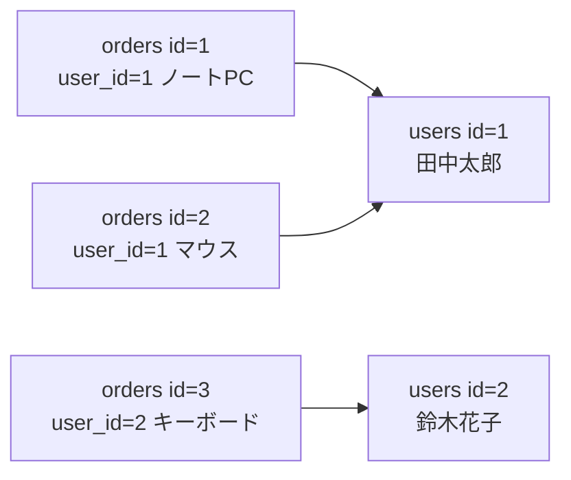
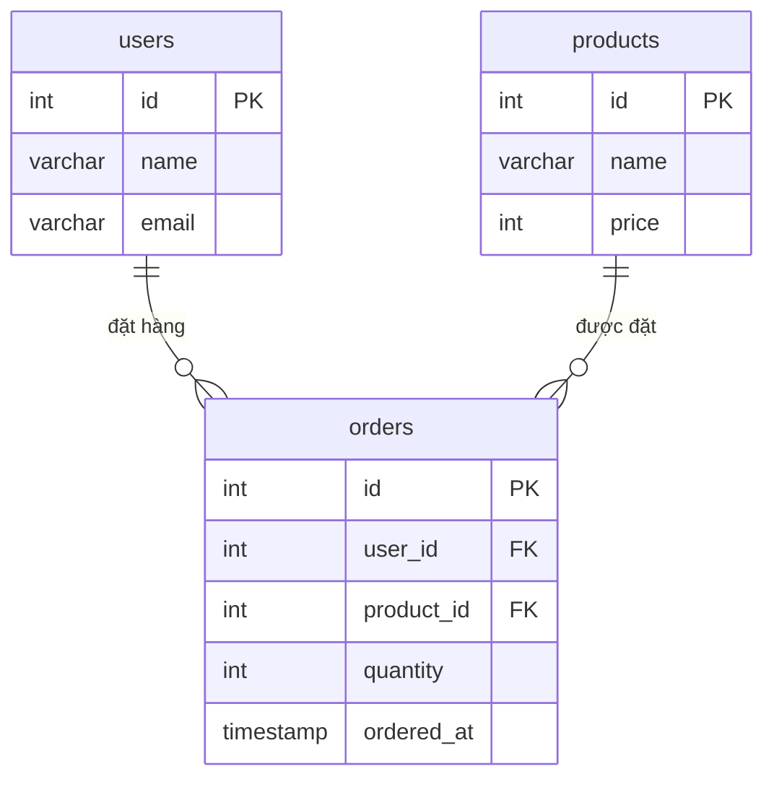
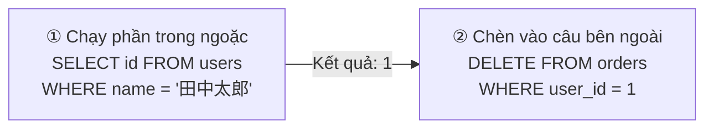

# Buổi 09｜Quan hệ giữa các bảng・JOIN — Kết hợp dữ liệu từ nhiều bảng

> 🇯🇵 Bản gốc (tiếng Nhật): [20260728_資料.md](<../../../1年生_データ設計とアプリ開発/前期/20260728/20260728_資料.md>) <!-- original-ja-link -->

## Mục tiêu hôm nay
- Giải thích được tại sao phải tách bảng (chuẩn hóa)
- Hiểu khái niệm khóa ngoại
- Nối được các bảng bằng INNER JOIN / LEFT JOIN

---

[Về cơ sở dữ liệu quan hệ](../20260721/リレーショナルデータベース入門.md)

## 1. Tại sao phải tách bảng?

Ví dụ không tốt: nhồi tất cả vào 1 bảng

```
Bảng orders (ví dụ không tốt)
id │ user_name │ user_email         │ product_name │ price
───┼───────────┼────────────────────┼──────────────┼───────
 1 │ 田中太郎  │ tanaka@example.com │ ノートPC     │ 98000
 2 │ 田中太郎  │ tanaka@example.com │ マウス       │  3200
 3 │ 鈴木花子  │ suzuki@example.com │ キーボード   │  8500
```

**Vấn đề:**
- Thông tin của 田中太郎 bị lặp lại ở 2 hàng (nếu email thay đổi thì phải cập nhật tất cả các hàng)
- Dữ liệu dễ bị mâu thuẫn

**Giải pháp: Tách bảng và liên kết bằng khóa ngoại (chuẩn hóa)**

---

## 2. Khóa ngoại (Foreign Key)

**Bảng users**

| id | name | email |
|----|------|-------|
| 1 | 田中太郎 | tanaka@... |
| 2 | 鈴木花子 | suzuki@... |

**Bảng orders**

| id | user_id | product | price |
|----|---------|---------|-------|
| 1 | 1 | ノートPC | 98000 |
| 2 | 1 | マウス | 3200 |
| 3 | 2 | キーボード | 8500 |

`orders.user_id` đang tham chiếu đến `users.id`. Đây chính là "khóa ngoại (Foreign Key)".



---

## 3. Tạo bảng và thiết lập khóa ngoại

```sql
USE school_db;

-- Bảng users
CREATE TABLE users (
    id    INT AUTO_INCREMENT PRIMARY KEY,
    name  VARCHAR(100) NOT NULL,
    email VARCHAR(255) NOT NULL UNIQUE
);

-- Bảng products
CREATE TABLE products (
    id    INT AUTO_INCREMENT PRIMARY KEY,
    name  VARCHAR(100) NOT NULL,
    price INT NOT NULL
);

-- Bảng orders (liên kết bằng khóa ngoại)
CREATE TABLE orders (
    id         INT AUTO_INCREMENT PRIMARY KEY,
    user_id    INT NOT NULL,
    product_id INT NOT NULL,
    quantity   INT NOT NULL DEFAULT 1,
    ordered_at TIMESTAMP DEFAULT CURRENT_TIMESTAMP,
    
    -- Ràng buộc khóa ngoại (giữ tính toàn vẹn tham chiếu)
    FOREIGN KEY (user_id)    REFERENCES users(id),
    FOREIGN KEY (product_id) REFERENCES products(id)
);

-- Dữ liệu thử nghiệm
INSERT INTO users (name, email) VALUES
    ('田中太郎', 'tanaka@example.com'),
    ('鈴木花子', 'suzuki@example.com'),
    ('山田次郎', 'yamada@example.com');

INSERT INTO products (name, price) VALUES
    ('ノートPC', 98000),
    ('マウス', 3200),
    ('キーボード', 8500);

INSERT INTO orders (user_id, product_id, quantity) VALUES
    (1, 1, 1),  -- 田中 mua 1 máy tính xách tay
    (1, 2, 2),  -- 田中 mua 2 con chuột
    (2, 3, 1),  -- 鈴木 mua 1 bàn phím
    (3, 1, 1),  -- 山田 mua 1 máy tính xách tay
    (2, 1, 1);  -- 鈴木 mua 1 máy tính xách tay
```

Nếu vẽ quan hệ giữa 3 bảng thành sơ đồ thì sẽ như sau. orders tham chiếu đến cả users và products bằng khóa ngoại.



---

[Về sự khác nhau giữa INNER JOIN và LEFT JOIN](./JOIN入門.md)

## 4. INNER JOIN — Chỉ nối dữ liệu có ở cả hai bảng

```sql
-- Nối thông tin của users vào orders
SELECT
    orders.id,
    users.name    AS ユーザー名,
    users.email,
    orders.quantity
FROM orders
INNER JOIN users ON orders.user_id = users.id;

-- Nối 3 bảng (orders + users + products)
SELECT
    orders.id,
    users.name      AS ユーザー名,
    products.name   AS 商品名,
    products.price  AS 単価,
    orders.quantity AS 数量,
    products.price * orders.quantity AS 合計金額
FROM orders
INNER JOIN users    ON orders.user_id    = users.id
INNER JOIN products ON orders.product_id = products.id
ORDER BY orders.id;
```

---

## 5. LEFT JOIN — Giữ lại tất cả các hàng của bảng bên trái

```sql
-- Khi muốn hiển thị cả những người dùng chưa đặt hàng
SELECT
    users.name,
    COUNT(orders.id) AS 注文数
FROM users
LEFT JOIN orders ON users.id = orders.user_id
GROUP BY users.id, users.name;

-- Người dùng có 0 đơn hàng cũng được hiển thị
-- Nếu dùng INNER JOIN thì chỉ còn những người dùng có đơn hàng
```

### 5-1. Ứng dụng: Chỉ tìm những người dùng chưa đặt hàng

Khi nối bằng LEFT JOIN, nếu bên phải (orders) không có hàng nào khớp thì các cột đó sẽ thành `NULL`. Tận dụng tính chất này, ta có thể lọc ra "chỉ những hàng không khớp".

```sql
SELECT users.name, users.email
FROM users
LEFT JOIN orders ON users.id = orders.user_id
WHERE orders.id IS NULL;
```

**Cách suy nghĩ:**
1. Dùng `LEFT JOIN` để giữ lại tất cả users (người nào không có orders thì các cột tương ứng sẽ thành `NULL`)
2. Dùng `WHERE orders.id IS NULL` để lọc ra chỉ "những hàng không khớp với orders"
   → Tức là chỉ còn lại "những người chưa đặt hàng lần nào"

Mẫu này không dùng được với `INNER JOIN` (vì các hàng không khớp vốn dĩ không xuất hiện trong kết quả). Hãy ghi nhớ "LEFT JOIN + `IS NULL`" như một mẫu kinh điển luôn dùng cùng nhau, sẽ rất hữu ích.

---

## 6. Kết hợp với tổng hợp

```sql
-- Tổng số tiền mua theo từng người dùng
SELECT
    users.name AS ユーザー名,
    COUNT(orders.id) AS 注文件数,
    SUM(products.price * orders.quantity) AS 合計金額
FROM users
INNER JOIN orders    ON users.id          = orders.user_id
INNER JOIN products  ON orders.product_id = products.id
GROUP BY users.id, users.name
ORDER BY 合計金額 DESC;
```

---

## 7. HAVING — Lọc "sau khi" tổng hợp

`WHERE` lọc các hàng **trước** khi tổng hợp, còn `HAVING` lọc kết quả **sau** khi đã tổng hợp bằng `GROUP BY`.

```sql
-- Chỉ hiển thị những người dùng có tổng tiền từ 100000 yên trở lên
SELECT
    users.name AS ユーザー名,
    SUM(products.price * orders.quantity) AS 合計金額
FROM users
INNER JOIN orders   ON users.id          = orders.user_id
INNER JOIN products ON orders.product_id = products.id
GROUP BY users.id, users.name
HAVING SUM(products.price * orders.quantity) >= 100000;
```

**Sự khác nhau giữa WHERE và HAVING:**

| | Lọc khi nào | Dùng được gì |
|---|---|---|
| `WHERE` | **Trước** khi tổng hợp bằng `GROUP BY` | Các cột gốc của từng hàng (như `orders.quantity`) |
| `HAVING` | **Sau** khi tổng hợp bằng `GROUP BY` | Kết quả tổng hợp như `SUM()` `COUNT()` |

Ta viết theo thứ tự `SELECT ... FROM ... WHERE ... GROUP BY ... HAVING ... ORDER BY`, nhưng thứ tự thực sự được xử lý là `WHERE`→`GROUP BY`→`HAVING`→`ORDER BY`. Hãy ghi nhớ: "`HAVING SUM(...) >= 100000` thì OK, `WHERE SUM(...) >= 100000` thì không được (vì lúc đó chưa tổng hợp nên SUM chưa tồn tại)".

---

## 8. Truy vấn con — Viết SELECT bên trong SELECT

Khi `INSERT` hay `DELETE`, có lúc ta không biết `id` của đối tượng. Những lúc như vậy, **truy vấn con (subquery)** — dùng trực tiếp kết quả của `SELECT` làm điều kiện — sẽ rất tiện.

```sql
-- Ví dụ: muốn dùng id của "田中太郎" làm điều kiện, nhưng không biết id là số mấy

-- ① Không phải là cách sai, nhưng bị tách thành 2 bước
SELECT id FROM users WHERE name = '田中太郎';  -- Kết quả: 1
DELETE FROM orders WHERE user_id = 1;          -- Tự tay nhập số 1 vừa kiểm tra

-- ② Dùng truy vấn con thì có thể viết bằng 1 câu lệnh
DELETE FROM orders
WHERE user_id = (SELECT id FROM users WHERE name = '田中太郎');
```

Hãy hình dung: câu `SELECT` bên trong `( )` được chạy trước và trở thành 1 giá trị (ở đây là `id`), rồi được chèn vào chỗ `WHERE user_id = (chỗ này)` ở bên ngoài. Nghĩ theo kiểu "đọc phần trong ngoặc trước" sẽ dễ hiểu hơn.



```sql
-- Ví dụ dùng tương tự với INSERT
INSERT INTO orders (user_id, product_id, quantity)
VALUES (
    (SELECT id FROM users WHERE name = '田中太郎'),
    (SELECT id FROM products WHERE name = 'USBハブ'),
    3
);
```

---

## Tóm tắt

| Khái niệm | Giải thích |
|------|------|
| Khóa ngoại | Cột tham chiếu đến khóa chính của bảng khác |
| INNER JOIN | Chỉ nối dữ liệu có ở cả hai bảng |
| LEFT JOIN | Nối tất cả các hàng của bảng bên trái + các hàng khớp của bảng bên phải |
| `ON BảngA.col = BảngB.col` | Điều kiện nối |
| LEFT JOIN + `WHERE ... IS NULL` | Mẫu kinh điển để chỉ tìm các hàng không khớp với bảng bên phải |
| `WHERE` | Lọc các hàng trước khi tổng hợp |
| `HAVING` | Lọc kết quả sau khi đã tổng hợp bằng `GROUP BY` |
| Truy vấn con `(SELECT ...)` | Nhúng kết quả của `SELECT` vào làm điều kiện hoặc giá trị của một câu SQL khác |

---

## Giới thiệu buổi sau (Buổi 10)

Trong buổi bài tập SQL, các bạn sẽ tự mình thao tác với cơ sở dữ liệu quản lý đơn hàng.  
Chúng ta sẽ giải các bài thực tế kết hợp SELECT / INSERT / UPDATE / DELETE / JOIN.

<!-- nav:start -->

---

📎 Đọc thêm → [Nhập môn JOIN](JOIN入門.md)

| ⬅️ Trước | 🗺️ Tổng quan | Tiếp ➡️ |
|:--|:--:|--:|
| [Ứng dụng quản lý Todo: các bước khởi động](../20260723/Todo管理アプリ起動する流れ.md) | [Sơ đồ tổng thể tài liệu](../../README.md) | [07/28 Bài tập SQL](20260728_演習.md) |

<!-- nav:end -->
