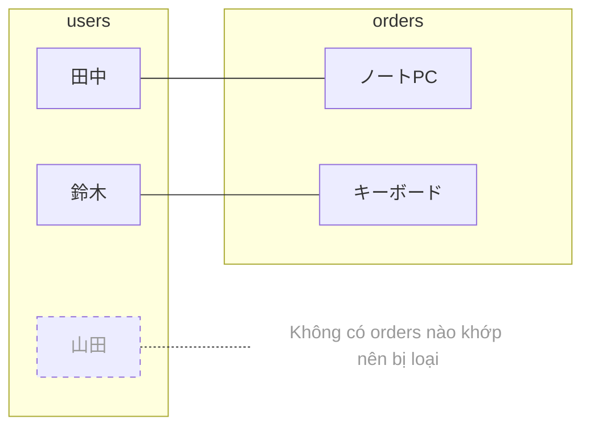
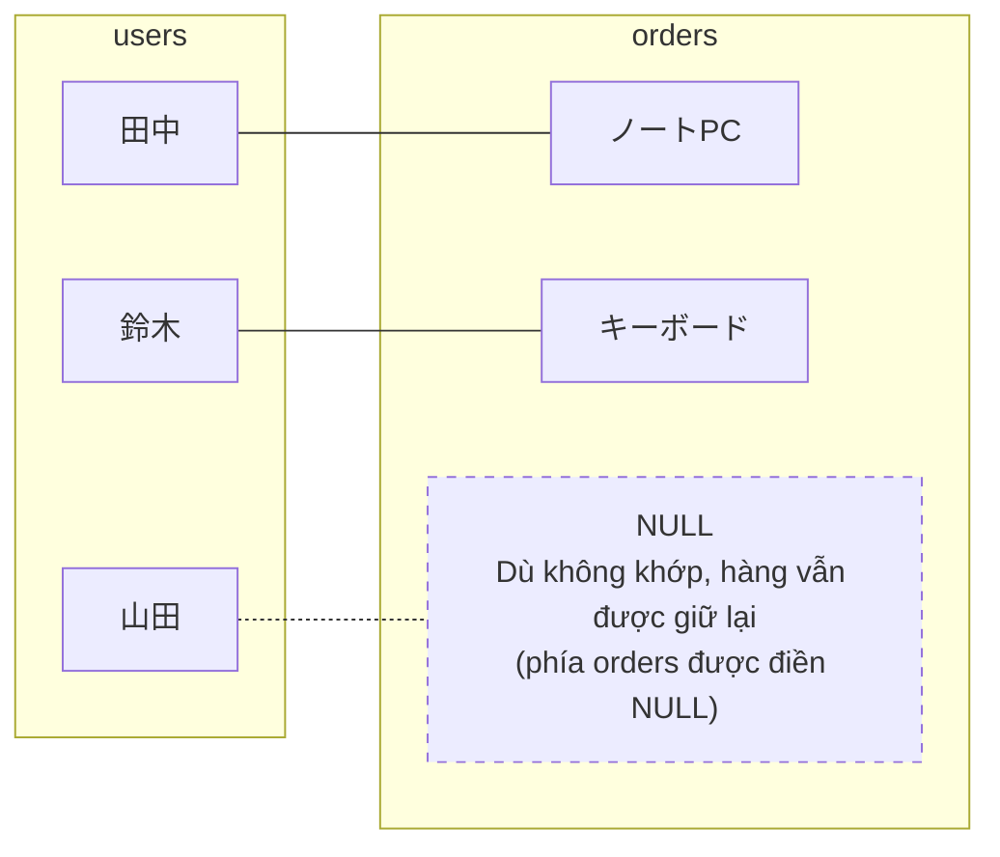

> 🇯🇵 Bản gốc (tiếng Nhật): [JOIN入門.md](<../../../1年生_データ設計とアプリ開発/前期/20260728/JOIN入門.md>) <!-- original-ja-link -->

## Bài này giúp bạn hiểu

- INNER JOIN nối "chỉ những dữ liệu có ở cả hai bảng"
- LEFT JOIN nối "tất cả các hàng của bảng bên trái + các hàng khớp của bảng bên phải"
- Dù cùng 2 bảng và cùng điều kiện nối, số hàng trong kết quả sẽ thay đổi tùy theo loại JOIN

## 2 bảng sẽ dùng

Chúng ta sẽ tìm hiểu qua `users` (người dùng) và `orders` (đơn hàng). Điểm quan trọng là **山田次郎 chưa đặt hàng lần nào**.

### 🧑 Bảng users

| id | name |
|----|------|
| 1  | 田中太郎 |
| 2  | 鈴木花子 |
| 3  | 山田次郎 |

### 🛒 Bảng orders

| id | user_id | product |
|----|---------|---------|
| 1  | 1       | ノートPC |
| 2  | 2       | キーボード |

`orders.user_id` đang tham chiếu đến `users.id` (khóa ngoại). Trong `orders` không có hàng nào tham chiếu đến 山田次郎 (id=3).

## INNER JOIN: Chỉ nối dữ liệu có ở cả hai bảng

```sql
SELECT users.name, orders.product
FROM users
INNER JOIN orders ON users.id = orders.user_id;
```

**Kết quả:**

| name | product |
|------|---------|
| 田中太郎 | ノートPC |
| 鈴木花子 | キーボード |

Hình dung về INNER JOIN (chỉ những cặp được nối với nhau mới có trong kết quả)



山田次郎 không có hàng nào khớp trong `orders`, nên **bị loại khỏi kết quả**. Đó chính là ý nghĩa của "chỉ nối dữ liệu có ở cả hai bảng".

## LEFT JOIN: Nối tất cả các hàng của bảng bên trái + các hàng khớp của bảng bên phải

```sql
SELECT users.name, orders.product
FROM users
LEFT JOIN orders ON users.id = orders.user_id;
```

**Kết quả:**

| name | product |
|------|---------|
| 田中太郎 | ノートPC |
| 鈴木花子 | キーボード |
| 山田次郎 | NULL    |

Hình dung về LEFT JOIN (giữ lại tất cả các hàng của bảng bên trái)



Trong `FROM users LEFT JOIN orders`, **bảng users được viết ở phía FROM (bên trái) là bảng làm cơ sở**. 山田次郎 dù không có đơn hàng vẫn được giữ lại thành một hàng, và các cột phía `orders` được điền `NULL` (không có dữ liệu tương ứng).

## Mẹo phân biệt

- **`FROM A LEFT JOIN B`** → **A là bên trái**, tất cả các hàng của A luôn được giữ lại
- Khi có hàng không khớp, các cột của bên phải (B) sẽ tự động thành `NULL`
- `INNER JOIN` không có cơ chế "giữ lại tất cả" này, chỉ những hàng khớp mới được giữ lại

## Nên dùng loại nào?

| Mục đích | JOIN cần dùng |
|---|---|
| Chỉ muốn xem dữ liệu của những người có đơn hàng | `INNER JOIN` |
| Muốn liệt kê tất cả mọi người, kể cả người có 0 đơn hàng (ví dụ: tìm những người chưa đặt hàng để gửi email thông báo) | `LEFT JOIN` |
| Muốn đếm số đơn hàng theo từng người dùng (cả người chưa đặt hàng cũng được hiển thị với số đơn hàng là 0) | `LEFT JOIN` + `COUNT` |

Ví dụ thứ 3 chính là câu SQL hiển thị cả những người dùng có 0 đơn hàng, đã học ở mục "5. LEFT JOIN" trong `20260728_資料.md`. Nếu làm điều tương tự bằng `INNER JOIN`, những người dùng chưa đặt hàng như 山田次郎 sẽ không hề xuất hiện trong kết quả.

## Tóm tắt

- `INNER JOIN` nối "chỉ những dữ liệu có ở cả hai bảng" → các hàng không khớp sẽ bị loại
- `LEFT JOIN` nối "tất cả các hàng của bảng bên trái trong `FROM` + các hàng khớp của bảng bên phải" → dù không khớp, các hàng của bảng bên trái vẫn được giữ lại, còn bên phải sẽ thành `NULL`
- Hãy ghi nhớ: khi "muốn xem tất cả mọi người/tất cả dữ liệu không bỏ sót" thì dùng LEFT JOIN, khi "chỉ cần dữ liệu có đủ ở cả hai bên" thì dùng INNER JOIN

<!-- nav:start -->

---

| ⬅️ Quay lại | 🗺️ Tổng quan | Tiếp ➡️ |
|:--|:--:|--:|
| [07/28 Quan hệ giữa các bảng・JOIN](20260728_資料.md) | [Sơ đồ tổng thể tài liệu](../../README.md) | [07/28 Bài tập SQL](20260728_演習.md) |

<!-- nav:end -->
