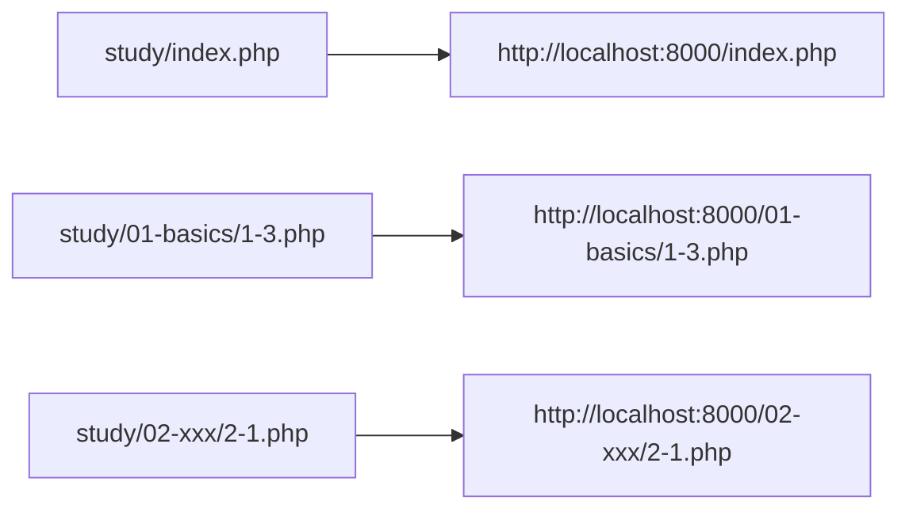

# Cách thiết lập máy chủ phát triển PHP

> 🇯🇵 Bản gốc (tiếng Nhật): [PHP開発サーバーの立て方.md](<../../1年生_データ設計とアプリ開発/前期/PHP開発サーバーの立て方.md>) <!-- original-ja-link -->

Dù mở file PHP trực tiếp bằng trình duyệt thì nó cũng không được thực thi (mã nguồn sẽ hiển thị nguyên vẹn hoặc bị tải xuống).
PHP là ngôn ngữ được thông dịch ở phía server, nên nhất định phải truy cập thông qua một server như `php -S`.

## Điều kiện tiên quyết

- Đã cài đặt PHP (kiểm tra bằng `php -v`)
- Ở đây ta dùng server phát triển được tích hợp sẵn trong `php` (không phù hợp để sử dụng trong môi trường production)
- Thay `<tên-người-dùng>` trong các lệnh dưới đây bằng tên người dùng trên máy tính của bạn (ví dụ: `taro`, `hanako`... Nếu dùng Mac thì có thể kiểm tra bằng lệnh `whoami`)

## Cách 1: Khởi động ngay trong thư mục study

```bash
cd /Users/<tên-người-dùng>/Desktop/study
php -S localhost:8000
```

`cd` (change directory) là lệnh thay đổi "vị trí hiện tại (thư mục hiện hành)" của terminal.
Bằng cách di chuyển vào thư mục `study` với `cd /Users/<tên-người-dùng>/Desktop/study` rồi mới chạy `php -S`,
`study` sẽ là thư mục khởi động, đồng thời là thư mục gốc (root) của Web.

Thư mục nơi bạn chạy `php -S` sẽ trở thành "gốc của Web (`/`)".
Vì `contact.php` nằm ngay trong `study/`, nên URL sẽ là:

```
http://localhost:8000/contact.php
http://localhost:8000/1-3.php
http://localhost:8000/index.php
```

## Truy cập với cấu trúc thư mục theo từng chương

Khi số bài tập tăng lên, hãy tạo các thư mục con theo từng chương để sắp xếp (ví dụ: `01-basics/`).

```
study/
  index.php
  contact.php
  01-basics/
    1-1.php
    1-2.php
    1-3.php
  02-xxx/
    2-1.php
```

Server vẫn được khởi động **ngay trong thư mục study** như trước (không thay đổi nơi khởi động).

```bash
cd /Users/<tên-người-dùng>/Desktop/study
php -S localhost:8000
```

Vì thư mục khởi động trở thành gốc của Web, nên với các file đặt trong thư mục con,
cần **đưa tên thư mục đó vào URL**:

```
http://localhost:8000/index.php
http://localhost:8000/01-basics/1-3.php
http://localhost:8000/02-xxx/2-1.php
```

Nói cách khác, "đường dẫn nơi đặt file" = "đường dẫn trong URL" (đường dẫn tương đối tính từ `study/`), tương ứng trực tiếp với nhau.



## Dừng server

Nhấn `Ctrl + C` trong terminal đã khởi động server.

## Về số port

Phần `8000` có thể chỉ định bằng bất kỳ số nào, miễn là port đó đang trống (ví dụ: `php -S localhost:8080`).

<!-- nav:start -->

---

| ⬅️ Quay lại | 🗺️ Tổng quan | Tiếp ➡️ |
|:--|:--:|--:|
| [06/30 Nhập môn PHP](20260630/20260630_資料.md) | [Sơ đồ tổng thể tài liệu](../README.md) | [06/30 Bài tập](20260630/20260630_演習.md) |

<!-- nav:end -->
