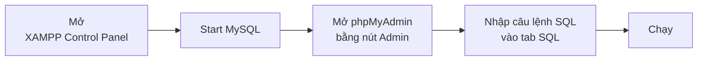
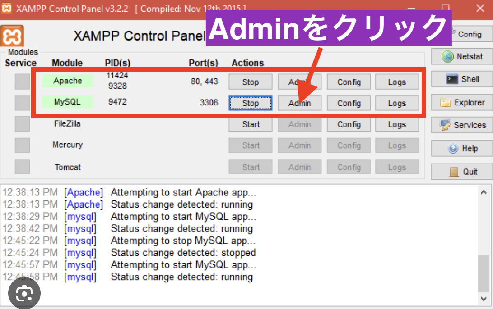
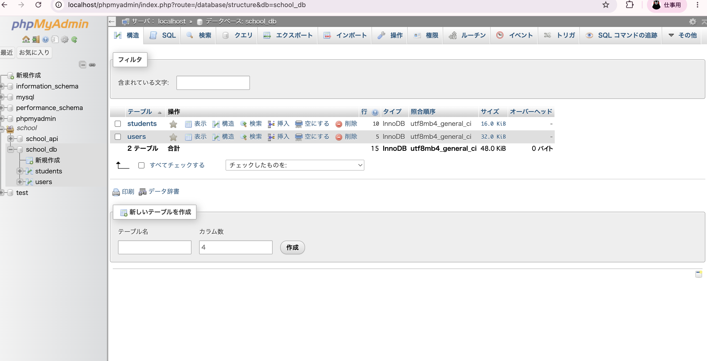
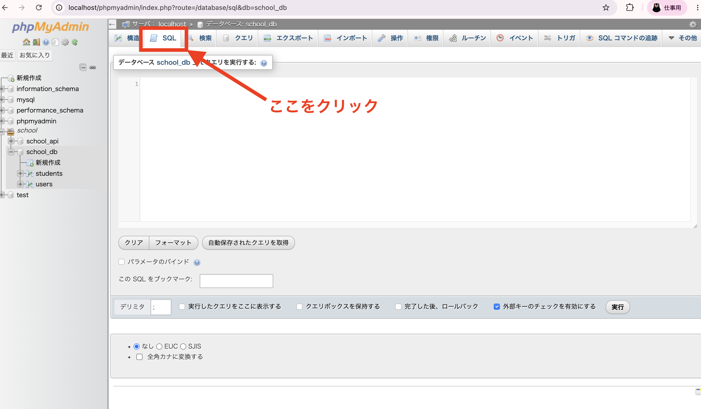

# Cách thiết lập máy chủ cơ sở dữ liệu (với XAMPP)

> 🇯🇵 Bản gốc (tiếng Nhật): [データベースサーバーの立て方.md](<../../../1年生_データ設計とアプリ開発/前期/データベースサーバーの立て方/データベースサーバーの立て方.md>) <!-- original-ja-link -->

## Bài này giúp bạn hiểu

- XAMPP đang khởi động những gì
- Cách mở phpMyAdmin (màn hình quản lý cơ sở dữ liệu)
- Cách chạy câu lệnh SQL trong phpMyAdmin

Toàn bộ quy trình như sau.

## 1. XAMPP là gì?

XAMPP (đọc là "zam-pu") là phần mềm giúp bạn dễ dàng cài đặt lên máy tính 2 thứ sau, vốn cần thiết để chạy ứng dụng Web.

- **Apache**: máy chủ web dùng để hiển thị trang Web
- **MySQL**: máy chủ cơ sở dữ liệu dùng để lưu trữ dữ liệu

Khi phát triển ứng dụng, ta cần "nơi lưu trữ dữ liệu (cơ sở dữ liệu)", vì vậy trước tiên cần khởi động MySQL.

## 2. Khởi động XAMPP và kiểm tra hoạt động

Mở ứng dụng XAMPP (XAMPP Control Panel).

Nếu cột `Actions` ở hàng `Apache` và `MySQL` hiển thị `Stop` thì nghĩa là chúng đã được khởi động. Nếu đang hiển thị `Start` thì chúng chưa được khởi động, hãy click vào nút đó để khởi động.

## 3. Mở phpMyAdmin (màn hình quản lý)

Click vào nút `Admin` ở hàng MySQL.

Khi đó, một màn hình tên là **phpMyAdmin** sẽ mở ra trên trình duyệt. phpMyAdmin là công cụ quản lý giúp bạn xem và chỉnh sửa dữ liệu được lưu trong MySQL ngay trên màn hình. Tại đây, bạn có thể xem danh sách các bảng (`students`, `users`, v.v.) trong cơ sở dữ liệu đã được tạo (ví dụ: `school_db`).

## 4. Chạy câu lệnh SQL

Nếu muốn trực tiếp tạo bảng hay thêm/cập nhật dữ liệu bằng câu lệnh SQL, hãy click vào tab `SQL` ở phía trên màn hình.

Khi mở tab, một ô nhập để gõ câu lệnh SQL sẽ hiện ra. Hãy nhập câu lệnh SQL vào đó và nhấn nút "実行" (Chạy), câu lệnh SQL đó sẽ được áp dụng vào cơ sở dữ liệu.

## Tóm tắt

- XAMPP là công cụ giúp chạy cùng lúc Apache (máy chủ web) và MySQL (cơ sở dữ liệu)
- Từ nút `Admin` của MySQL, có thể mở màn hình quản lý cơ sở dữ liệu tên là phpMyAdmin
- Từ tab `SQL` của phpMyAdmin, có thể trực tiếp chạy câu lệnh SQL

<!-- nav:start -->

---

| ⬅️ Quay lại | 🗺️ Tổng quan | Tiếp ➡️ |
|:--|:--:|--:|
| [07/21 Tại sao cần DB](../20260721/20260721_資料.md) | [Sơ đồ tổng thể tài liệu](../../README.md) | [07/21 SQL cơ bản ① (SELECT)](../20260721/20260721_資料_2.md) |

<!-- nav:end -->
