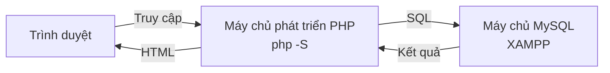
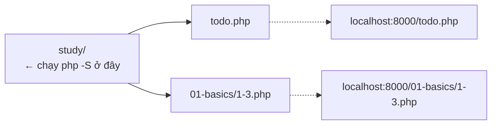
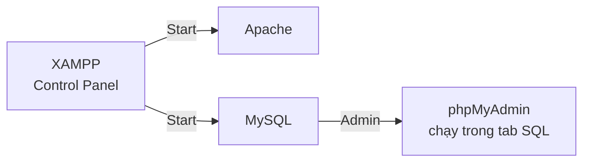
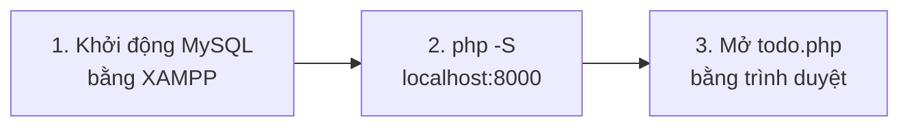

# Nhìn lại học kỳ 1 (Ôn tập)

> 🇯🇵 Bản gốc (tiếng Nhật): [20261001_復習.md](<../../../1年生_データ設計とアプリ開発/後期/20261001/20261001_復習.md>) <!-- original-ja-link -->

Trước khi bước vào học kỳ 2, hãy cùng nhớ lại "công việc chuẩn bị để chạy ứng dụng" đã làm ở học kỳ 1.
Để chạy được ứng dụng Web, chúng ta cần **2 máy chủ**.



- **Máy chủ phát triển PHP**: phụ trách chạy chương trình PHP
- **Máy chủ MySQL**: phụ trách lưu trữ dữ liệu

**Chỉ cần một trong hai bị dừng là ứng dụng sẽ không chạy được.**

---

## 1. Máy chủ phát triển PHP

PHP là ngôn ngữ chạy ở phía server, nên dù mở file `.php` trực tiếp bằng trình duyệt thì nó cũng không được thực thi.
Vì vậy, chúng ta đã khởi động server phát triển có sẵn trong PHP.

Trên Windows, hãy chạy bằng **PowerShell** (tìm "PowerShell" trong Start menu).

```powershell
cd C:\Users\<tên-người-dùng>\Desktop\study
php -S localhost:8000
```

> **Nếu bị báo là không tìm thấy `php`**
> Hãy chỉ định vị trí để khởi động PHP có sẵn trong XAMPP.
>
> ```powershell
> C:\xampp\php\php.exe -S localhost:8000
> ```

Thư mục nơi bạn chạy `php -S` sẽ trở thành `/` (gốc) của URL.
Với các file nằm trong thư mục con, hãy thêm cả tên thư mục đó vào URL để truy cập.



Khi muốn dừng, hãy nhấn `Ctrl + C` trong PowerShell đã dùng để khởi động.

Xem chi tiết → [Cách thiết lập máy chủ phát triển PHP](../../前期/PHP開発サーバーの立て方.md)

---

## 2. XAMPP (MySQL)

Để có nơi lưu trữ dữ liệu, chúng ta đã khởi động MySQL bằng XAMPP.
Nhấn nút `Start` trong XAMPP Control Panel, nếu hiển thị đổi thành `Stop` là đang chạy.



Nhấn nút `Admin` ở hàng MySQL, màn hình quản lý cơ sở dữ liệu (phpMyAdmin) sẽ mở ra.
Từ tab `SQL`, chúng ta đã có thể chạy trực tiếp câu lệnh SQL.

Xem chi tiết → [Cách thiết lập máy chủ cơ sở dữ liệu (với XAMPP)](../../前期/データベースサーバーの立て方/データベースサーバーの立て方.md)

---

## 3. Thứ tự để chạy ứng dụng

Chúng ta đã kết nối từ PHP đến MySQL bằng PDO và chạy ứng dụng quản lý Todo (`todo.php`).
Hãy khởi động theo thứ tự sau.



Xem chi tiết → [Ứng dụng quản lý Todo: các bước khởi động](../../前期/20260723/Todo管理アプリ起動する流れ.md)

<!-- nav:start -->

---

| ⬅️ Trước | 🗺️ Tổng quan | Tiếp ➡️ |
|:--|:--:|--:|
| [07/28 Bài tập SQL](../../前期/20260728/20260728_演習.md) | [Sơ đồ tổng thể tài liệu](../../README.md) | [10/01 Nhập môn quản lý mã nguồn](20261001_資料_1.md) |

<!-- nav:end -->
