# Nhập môn quản lý mã nguồn — Quản lý code bằng SourceTree và GitHub

> 🇯🇵 Bản gốc (tiếng Nhật): [20261001_資料_1.md](<../../../1年生_データ設計とアプリ開発/後期/20261001/20261001_資料_1.md>) <!-- original-ja-link -->

## Mục tiêu hôm nay
- Hiểu vì sao cần quản lý mã nguồn
- Có thể commit, push và pull bằng SourceTree

[Ôn tập học kỳ trước](./20261001_復習.md)

---

## 1. Vì sao cần quản lý mã nguồn?

Bạn đã bao giờ gặp tình huống như thế này chưa?

```
study/
  todo.php
  todo_コピー.php
  todo_動いてたやつ.php
  todo_最新2.php   ← Bản nào mới là bản mới nhất thật sự?
```

Nếu lưu lại bằng cách sao chép file, bạn sẽ không biết bản nào là mới nhất và mình đã sửa chỗ nào.
Nếu máy tính bị hỏng, mọi thứ sẽ mất hết.

Khi dùng Git, bạn có thể tạo **điểm lưu (save point)** giống như khi chơi game.
Dù có lỡ làm hỏng, bạn vẫn luôn có thể quay lại trạng thái lúc code còn chạy được.

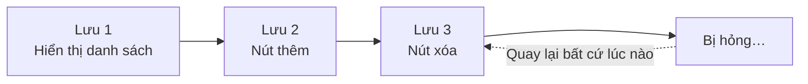

---

## 2. Git, GitHub và SourceTree

Tên nghe giống nhau, nhưng mỗi cái có vai trò khác nhau.

| Tên | Là gì? | Ví dụ dễ hiểu |
|------|-----------|-----------|
| **Git** | Cơ chế ghi lại lịch sử thay đổi | Chức năng lưu game |
| **GitHub** | Dịch vụ lưu lịch sử đó trên Internet | Kho lưu game trên đám mây |
| **SourceTree** | Ứng dụng thao tác Git qua giao diện | Màn hình lưu game |

Thông thường, Git được dùng bằng cách gõ lệnh trong PowerShell hoặc công cụ tương tự, nhưng hôm nay chúng ta sẽ dùng SourceTree để thao tác **bằng chuột**.

---

## 3. Học thuật ngữ qua sơ đồ

Trong Git, file sẽ di chuyển qua lại giữa "thư mục làm việc → máy tính của bạn → GitHub".
Tên của mỗi mũi tên chính là tên của thao tác đó.

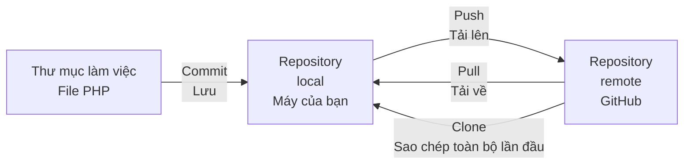

- **Repository**: "chiếc hộp" quản lý lịch sử. Repository trên máy của bạn gọi là **local**, còn repository trên GitHub gọi là **remote**
- **Commit**: ghi lại thay đổi thành một điểm lưu
- **Push**: tải các điểm lưu trên máy của bạn lên GitHub
- **Pull**: tải trạng thái mới nhất trên GitHub về máy của bạn
- **Clone**: sao chép toàn bộ repository trên GitHub về máy lần đầu tiên

---

## 4. Cài đặt SourceTree

Tải trình cài đặt từ trang web chính thức rồi chạy nó.

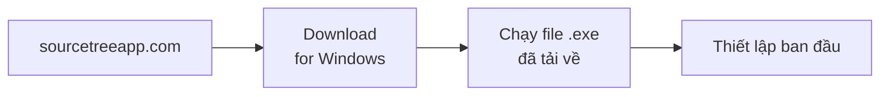

Trong lúc cài đặt, bạn sẽ được hỏi một vài câu.

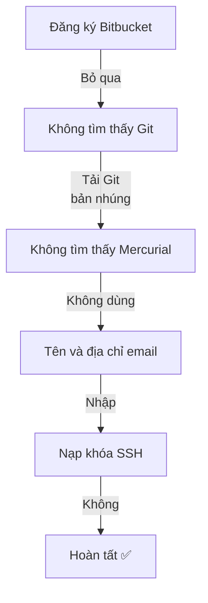

| Câu hỏi | Lựa chọn |
|------------|---------|
| Đăng ký Bitbucket (Atlassian) | Bỏ qua (`スキップ`) (hôm nay không dùng) |
| Không tìm thấy Git | **Tải Git bản nhúng** (cài Git dành riêng cho SourceTree) |
| Không tìm thấy Mercurial | Không muốn dùng Mercurial (`Mercurialを使いたくない`) (hôm nay không dùng) |
| Tên và địa chỉ email | Nhập vào. Tên này sẽ được ghi lại là **tác giả của commit** |
| Có nạp khóa SSH không | Không (`いいえ`) (hôm nay dùng token nên không cần) |

> Chữ trên màn hình có thể hơi khác tùy phiên bản. Nếu phân vân, hãy hỏi giáo viên.

> **Hãy đặt tên để người khác biết là bạn**
> Hôm nay cả lớp dùng chung một repository, nên hãy đặt **tên giúp biết đó là commit của ai**, ví dụ như `yamada-taro`.

---

## 5. Cách làm việc hôm nay

Hôm nay, cả lớp sẽ dùng chung một **repository luyện tập** mà giáo viên đã chuẩn bị trên GitHub.
Bạn chưa dùng tài khoản GitHub của mình mà sẽ kết nối bằng 3 thông tin giáo viên phát.

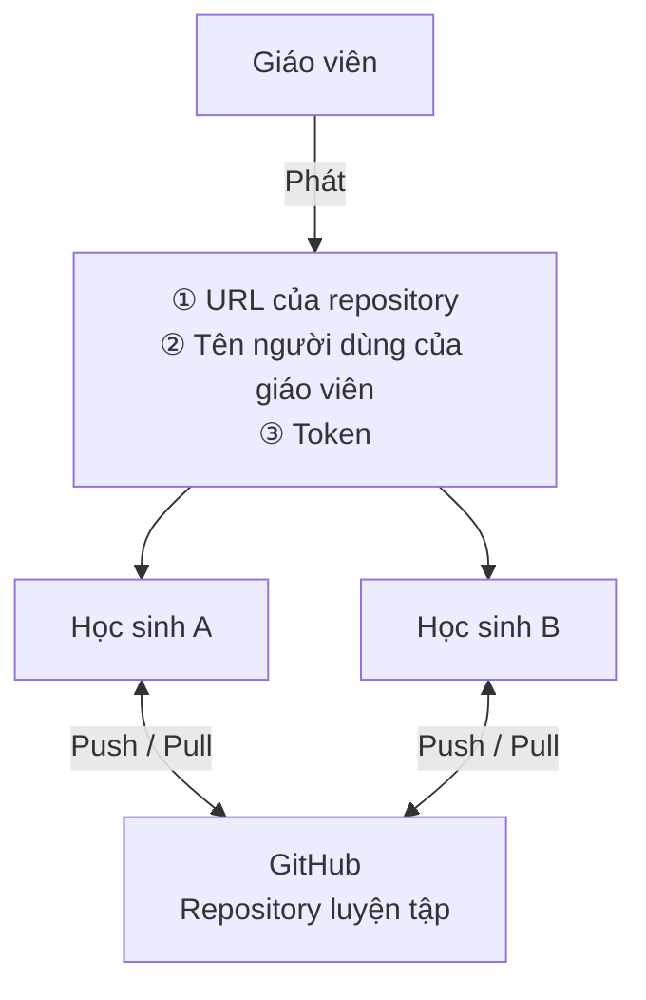

**Token** là mật mã dùng thay cho mật khẩu, để báo với GitHub rằng "người này được phép thao tác" (một chuỗi ký tự dài bắt đầu bằng `github_pat_`).
Token hôm nay đã được giới hạn để chỉ thao tác được trên repository luyện tập.

> ⚠️ **Không cho người khác xem token, không dán lên mạng xã hội hay ứng dụng chat**

---

## 6. Clone

Sao chép repository của giáo viên về máy của bạn.

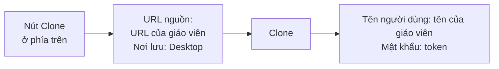

Nhấn `Clone` ở phía trên của SourceTree rồi nhập như sau.

| Mục | Nội dung cần nhập |
|------|------------|
| Đường dẫn / URL nguồn | URL của repository nhận từ giáo viên |
| Đường dẫn nơi lưu | `C:\Users\<ユーザー名>\Desktop\<リポジトリ名>` |

Nếu được hỏi tên người dùng và mật khẩu, hãy **dán token vào ô mật khẩu**.

✅ Nếu trên Desktop xuất hiện thư mục `<リポジトリ名>` và bên trong có `README.md` là thành công.

Token đã nhập sẽ được lưu trong "Credential Manager" (資格情報マネージャー) của Windows, nên từ lần sau sẽ không bị hỏi nữa.

> **Khi không thấy thư mục trên Desktop**
> Trên máy có dùng OneDrive, vị trí Desktop có thể là `C:\Users\<ユーザー名>\OneDrive\デスクトップ`.
> Cách chắc chắn nhất là nhấn nút `...` ở mục nơi lưu và chọn Desktop trong File Explorer.

---

## 7. Commit

Đưa file PHP bạn đã làm ở học kỳ trước vào thư mục vừa clone rồi commit.
Vì cả lớp dùng chung một repository, hãy tạo **thư mục mang tên của bạn** rồi đặt file vào trong đó.
Làm như vậy sẽ không bị trùng với file của người khác.

```
<リポジトリ名>/
  README.md
  yamada-taro/     ← Thư mục của bạn
    todo.php
  suzuki-hanako/   ← Của người khác
    todo.php
```

Sau khi sao chép file bằng File Explorer, hãy mở mục Trạng thái file (`ファイルステータス`) ở bên trái SourceTree.
Đưa file đang hiển thị trong "Unstaged files" (ステージしていないファイル) lên "Staged" (ステージ), viết message rồi commit.

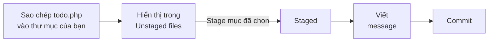

**Stage** là nơi chọn "những file sẽ đưa vào lần lưu này".

Trong commit message, hãy ghi **mình đã làm gì** để sau này xem lại vẫn hiểu.

| ❌ Message không tốt | ⭕ Message tốt |
|----------|----------|
| Sửa | Sửa lỗi nút xóa Todo không hoạt động |
| Cập nhật | Thêm cột hạn chót vào danh sách Todo |

---

## 8. Push

Chỉ commit thôi thì thay đổi mới được ghi lại trên máy của bạn.
Hãy push để tải lên GitHub.

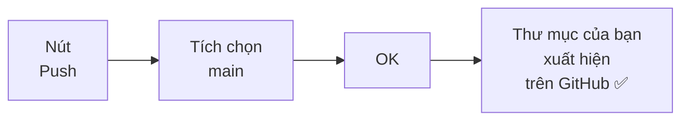

Nếu thư mục của bạn xuất hiện trên trang GitHub mà giáo viên chiếu lên màn hình là thành công.

### Khi gặp lỗi (rejected)

Nếu người khác đã push trước, trạng thái trên GitHub sẽ mới hơn máy của bạn.
Nếu cứ thế push, GitHub sẽ từ chối (rejected).
Hãy **pull trước để lấy bản mới nhất về**, rồi push lại.

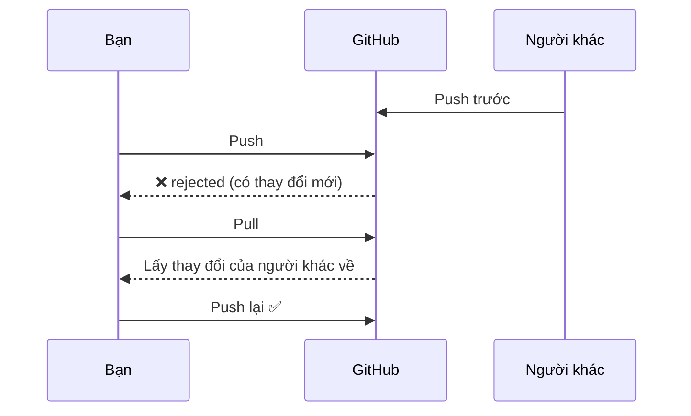

---

## 9. Pull

Lấy các thay đổi mà người khác đã push về máy của bạn.

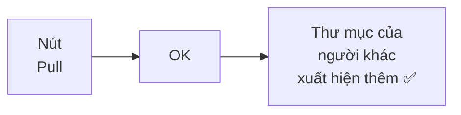

Mở thư mục `<リポジトリ名>` trên Desktop bằng File Explorer, nếu thấy có thêm thư mục của người khác là thành công.
Như vậy, việc **chia sẻ thay đổi của mọi người** thông qua GitHub chính là điểm tiện lợi của GitHub.

---

## 10. Quy trình làm việc

Khi phát triển với Git, chúng ta lặp lại quy trình sau.

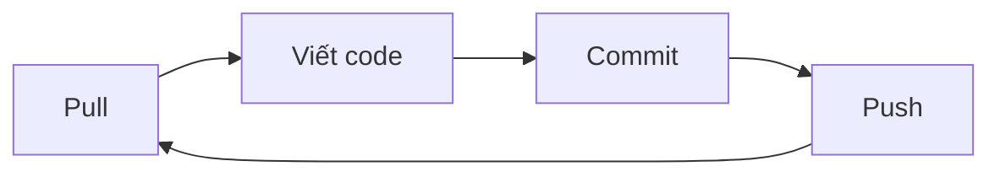

- **Pull trước khi bắt đầu làm**: lấy thay đổi của người khác về trước
- **Commit thường xuyên**: khi thấy "đến đây đã chạy được" thì lưu lại
- **Push khi kết thúc công việc**: lưu lên GitHub để chia sẻ

> Repository và token hôm nay **chỉ dùng để luyện tập** (sẽ không dùng được sau buổi học).
> Tạo repository của riêng bạn → [Cách tạo tài khoản GitHub và repository](../20261008/20261008_資料_1.md)

<!-- nav:start -->

---

| ⬅️ Trước | 🗺️ Sơ đồ tổng quan | Tiếp ➡️ |
|:--|:--:|--:|
| [10/01 Ôn tập học kỳ trước](20261001_復習.md) | [Sơ đồ tổng quan tài liệu](../../README.md) | [10/08 Tài khoản GitHub và repository](../20261008/20261008_資料_1.md) |

<!-- nav:end -->
