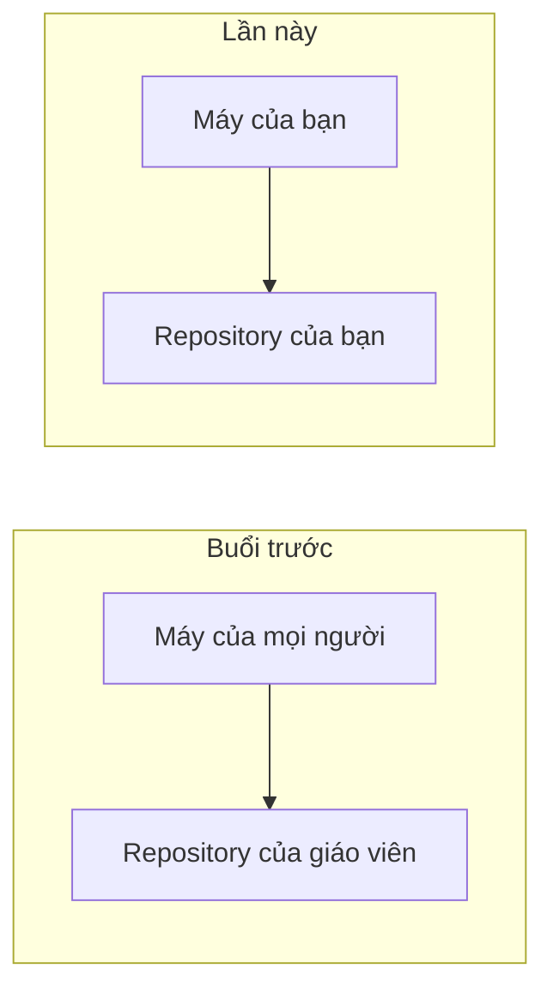
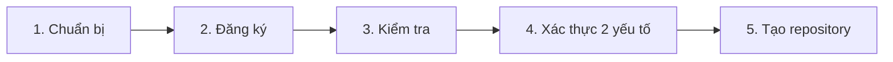
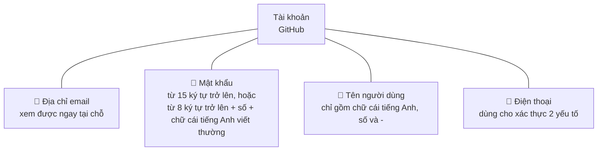
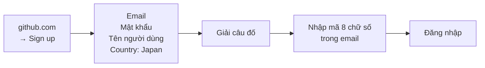
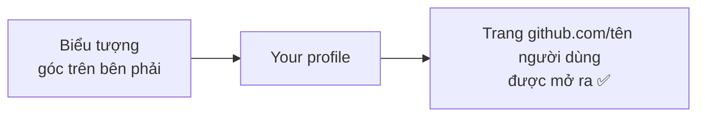
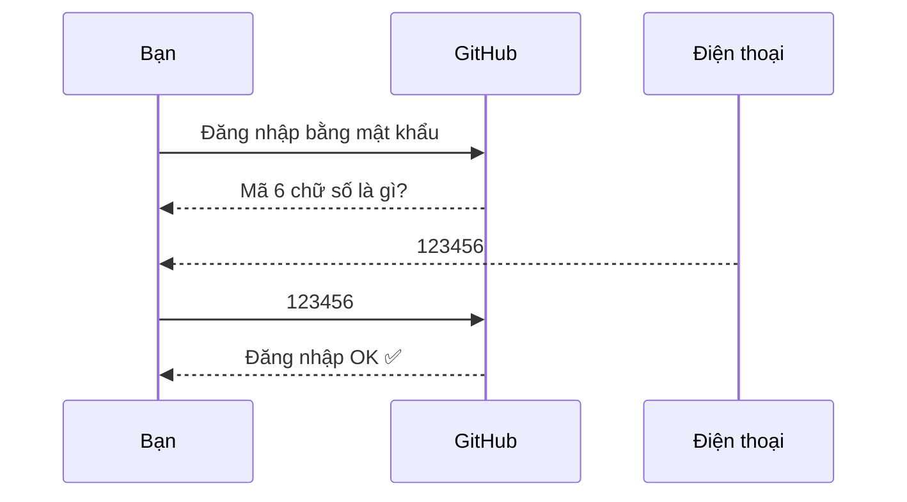
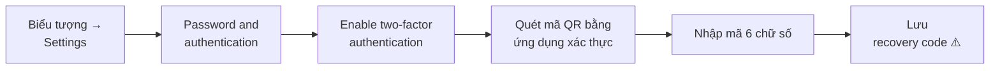
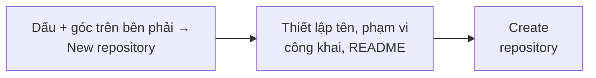
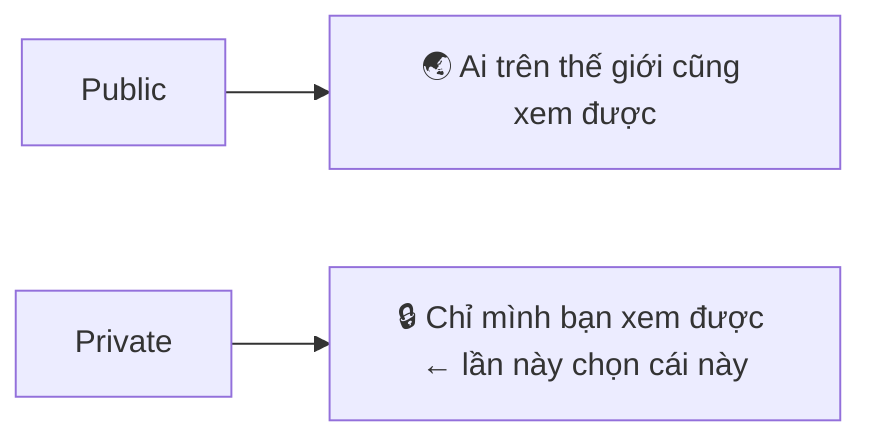

> 🇯🇵 Bản gốc (tiếng Nhật): [20261008_資料_1.md](<../../../1年生_データ設計とアプリ開発/後期/20261008/20261008_資料_1.md>) <!-- original-ja-link -->

# Cách tạo tài khoản GitHub và repository

## Mục tiêu hôm nay
- Có thể tạo tài khoản GitHub
- Có thể tạo repository của riêng mình

[Quay lại Nhập môn quản lý mã nguồn](../20261001/20261001_資料_1.md)

---

## Ôn lại buổi trước

Ở buổi học trước, cả lớp đã cùng push lên **repository nằm trong tài khoản GitHub của giáo viên**.

Lần này, chúng ta sẽ **tạo tài khoản GitHub của mình và chuẩn bị repository của riêng mình**.
Nhờ đó, bạn có thể quản lý code của mình trong không gian riêng.

---

## Quy trình tổng thể

Hôm nay, chúng ta sẽ chuẩn bị nơi lưu code riêng của mình trên GitHub qua 5 bước sau.

---

## 1. Những thứ cần chuẩn bị

Trước khi bắt đầu đăng ký, hãy chuẩn bị 4 thứ sau.

- **Địa chỉ email**: vì mã xác nhận sẽ được gửi đến, hãy dùng địa chỉ mà bạn có thể xem ngay trong giờ học
- **Điện thoại**: dùng để thiết lập xác thực 2 yếu tố ở bước sau

### Cách chọn tên người dùng

Tên người dùng sẽ **trở thành một phần của URL và là tên mà người khác nhìn thấy**, ví dụ `https://github.com/<ユーザー名>`.
Sau này bạn có thể giới thiệu tài khoản GitHub như một portfolio, vì vậy hãy tránh đặt những tên đùa cợt.
Nếu không muốn công khai tên thật thì không cần dùng tên thật.

| ❌ Nên tránh | ⭕ Tốt |
|-------------|----------|
| `unko-man`、`aaaa1234` | `taro-yamada`、`tyamada-dev` |

---

## 2. Đăng ký

Mở https://github.com và đăng ký từ nút `Sign up` ở góc trên bên phải.

- Nếu tên người dùng đã được người khác sử dụng, thông báo màu đỏ sẽ xuất hiện; hãy chọn tên khác
- **Câu đố** là bước "xác nhận bạn là con người". Hãy trả lời theo hướng dẫn trên màn hình
- Nhập **mã 8 chữ số** được gửi đến email đã đăng ký là hoàn tất việc đăng ký

Nếu giữa chừng xuất hiện câu hỏi hoặc phần chọn gói, hãy làm như sau.

| Màn hình | Lựa chọn |
|------|---------|
| Câu hỏi về mục đích sử dụng | `Skip personalization` (bỏ qua) |
| Gói | **Free (miễn phí)** |

> **Khi không nhận được email**
> Kiểm tra thư mục thư rác → đợi vài phút rồi nhấn `Resend the code` để gửi lại → nếu vẫn không được thì kiểm tra xem có gõ nhầm địa chỉ không

---

## 3. Kiểm tra

Mở trang hồ sơ của bạn để kiểm tra xem tài khoản đã được tạo chưa.

**Hãy ghi lại tên người dùng của bạn.** Bạn sẽ cần dùng sau.

---

## 4. Xác thực 2 yếu tố

**Xác thực 2 yếu tố (2FA)** là cơ chế xác nhận đăng nhập bằng cả mật khẩu và **mã 6 chữ số hiển thị trên điện thoại**.
Dù người khác biết mật khẩu, nếu không có điện thoại của bạn thì họ cũng không đăng nhập được.

GitHub yêu cầu thiết lập xác thực 2 yếu tố, nên sau khi đăng nhập một thời gian sẽ có hướng dẫn thiết lập hiện ra.

### Các bước thiết lập

Hãy cài ứng dụng xác thực (như Google Authenticator) vào điện thoại trước khi bắt đầu.

> ⚠️ **Nhất định phải lưu recovery code!**
> Đây là cách cuối cùng để đăng nhập khi bạn làm mất điện thoại.
> Nếu làm mất, có thể bạn sẽ không vào được tài khoản nữa.

---

## 5. Tạo repository

Sau khi có tài khoản, hãy tạo **repository** (chiếc hộp quản lý lịch sử) để lưu code của bạn.

Thiết lập như sau.

| Mục | Thiết lập |
|------|------------|
| Repository name | `php-study` |
| Phạm vi công khai | **`Private`** |
| Add README | **Bật** |

**Phạm vi công khai** là thiết lập xác định ai có thể xem repository này.
Code luyện tập thì hãy để ở chế độ `Private`.

**README** là file dùng để viết mô tả về repository.
Nếu có sẵn một file ngay từ đầu, sau này khi clone bạn có thể kiểm tra xem bên trong đã có nội dung chưa.

### Kiểm tra ✅

Nếu đáp ứng đủ 3 điều sau thì bạn đã hoàn thành.

- URL có dạng `github.com/<ユーザー名>/php-study`
- `README.md` được hiển thị
- Bên cạnh tên repository có hiển thị `Private`

---

Tiếp theo, chúng ta sẽ push môi trường luyện tập lên `php-study` vừa tạo → [Push môi trường luyện tập lên repository của bạn](./20261008_資料_2.md)

<!-- nav:start -->

---

| ⬅️ Trước | 🗺️ Sơ đồ tổng quan | Tiếp ➡️ |
|:--|:--:|--:|
| [10/01 Nhập môn quản lý mã nguồn](../20261001/20261001_資料_1.md) | [Sơ đồ tổng quan tài liệu](../../README.md) | [10/08 Push môi trường luyện tập](20261008_資料_2.md) |

<!-- nav:end -->
