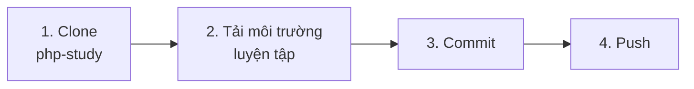
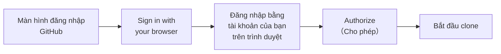
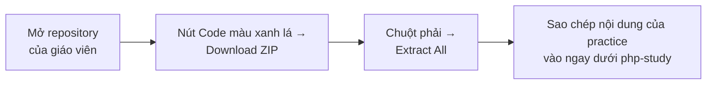
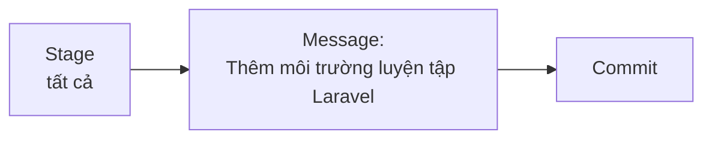

# Push môi trường luyện tập lên repository của bạn

> 🇯🇵 Bản gốc (tiếng Nhật): [20261008_資料_2.md](<../../../1年生_データ設計とアプリ開発/後期/20261008/20261008_資料_2.md>) <!-- original-ja-link -->

## Mục tiêu hôm nay
- Có thể đăng nhập bằng tài khoản GitHub của mình để clone và push
- Có thể push môi trường luyện tập lên repository của mình

[Quay lại Cách tạo tài khoản GitHub và repository](./20261008_資料_1.md)

---

## Quy trình tổng thể

Chúng ta sẽ đưa **môi trường luyện tập** mà giáo viên đã chuẩn bị vào `php-study` đã tạo ở [Tài liệu 1](./20261008_資料_1.md), rồi push lên.



---

## 1. Clone php-study

Giống như buổi trước, hãy sao chép về máy của bạn bằng `Clone` của SourceTree.
Buổi trước chúng ta đã clone bằng URL có chứa token, nhưng lần này sẽ kết nối bằng cách **đăng nhập bằng tài khoản GitHub của bạn**.

| Mục | Nội dung cần nhập |
|------|------------|
| Đường dẫn / URL nguồn | `https://github.com/<自分のユーザー名>/php-study.git` |
| Đường dẫn nơi lưu | `C:\Users\<ユーザー名>\Desktop\php-study` |

Khi nhấn Clone (`クローン`), màn hình đăng nhập GitHub sẽ hiện ra.
Chọn `Sign in with your browser` (đăng nhập bằng trình duyệt) rồi đăng nhập bằng **tài khoản của bạn**.



- Khi trình duyệt yêu cầu đăng nhập, hãy đăng nhập bằng tài khoản đã tạo ở Tài liệu 1 (nhập cả mã 6 chữ số của xác thực 2 yếu tố)
- Khi nhấn `Authorize` (cho phép), bạn sẽ quay lại SourceTree và quá trình clone bắt đầu
- Thông tin đăng nhập được lưu trong Windows, nên từ lần sau sẽ không bị hỏi nữa

✅ Nếu trên Desktop xuất hiện thư mục `php-study` và bên trong có `README.md` là thành công.

---

## 2. Tải môi trường luyện tập về

Tải repository của giáo viên về dưới dạng ZIP, rồi lấy **toàn bộ nội dung bên trong** thư mục `practice` ra.



**Repository của giáo viên:** https://github.com/hakobunet/iica-koyama

Trong thư mục đã giải nén, `practice` nằm ở vị trí sau.

```
iica-koyama-main/
  docs/
    1年生_データ設計とアプリ開発/
      practice/   ← Sao chép nội dung bên trong thư mục này
```

Mở thư mục `practice` rồi sao chép **toàn bộ nội dung** vào **ngay dưới** `php-study` (không tạo thư mục `practice`).

```
php-study/
  README.md          ← Có thể thay bằng README.md của practice
  .gitattributes
  mysql/
    compose.yaml
  laravel/
    .gitignore
    compose.yaml
    Dockerfile
    entrypoint.sh
```

> **Khi `README.md` bị trùng tên**
> Bạn cứ chọn "Replace the file" (ファイルを置き換える). Đây sẽ là README hướng dẫn cách chạy môi trường luyện tập.

> **Đừng chọn từng file một**
> Những file có tên bắt đầu bằng `.`, như `.gitattributes` hay `.gitignore`, là các file cấu hình quan trọng.
> Chúng có thể khó nhìn thấy, nên sau khi mở thư mục `practice`, hãy nhấn `Ctrl + A` (chọn tất cả) để sao chép một lần.

---

## 3. Commit

Khi mở mục Trạng thái file (`ファイルステータス`) trong SourceTree, các file bên trong `mysql` và `laravel` sẽ hiển thị ở "Unstaged files" (ステージしていないファイル).



---

## 4. Push

Nhấn nút Push (`プッシュ`) → tích chọn `main` → nhấn `OK` để tải lên GitHub.

### Kiểm tra ✅

Mở `github.com/<ユーザー名>/php-study` trên trình duyệt, nếu như sau là hoàn thành.

- Thư mục `mysql` và `laravel` hiển thị ở cấp trên cùng (ngay dưới thư mục gốc)

> **Khi clone hoặc push bị báo `403` hay `Repository not found`**
> Hãy kiểm tra `<自分のユーザー名>` trong URL có đúng không, và bạn đã đăng nhập bằng **tài khoản của mình** trên trình duyệt chưa.

Cách chạy môi trường luyện tập được viết trong `README.md` của thư mục `php-study`.
Vì thư mục nằm ở `C:\Users\<ユーザー名>\Desktop\php-study`, hãy hiểu `Desktop\practice` trong README là `Desktop\php-study`.

<!-- nav:start -->

---

| ⬅️ Trước | 🗺️ Sơ đồ tổng quan | Tiếp ➡️ |
|:--|:--:|--:|
| [10/08 Tài khoản GitHub và repository](20261008_資料_1.md) | [Sơ đồ tổng quan tài liệu](../../README.md) | [10/08 Nhập môn Docker](20261008_資料_3.md) |

<!-- nav:end -->
