# Nhập môn Docker — Cài đặt Docker Desktop

> 🇯🇵 Bản gốc (tiếng Nhật): [20261008_資料_3.md](<../../../1年生_データ設計とアプリ開発/後期/20261008/20261008_資料_3.md>) <!-- original-ja-link -->

## Mục tiêu hôm nay
- Hiểu Docker giúp chúng ta làm được gì
- Cài đặt Docker Desktop và chạy được `hello-world`
- Khởi động môi trường luyện tập và hiển thị được trang chủ Laravel trên trình duyệt

---

## Mở đầu: Container là gì?

**Container** giống như một **căn phòng nhỏ chuyên dụng** được tạo ra bên trong máy tính.
Trong phòng chỉ có những thứ cần thiết để chạy ứng dụng (như PHP, MySQL).

Ở học kỳ trước, XAMPP được cài trực tiếp vào máy tính.
Khi dùng container, bạn có thể chạy mọi thứ chỉ bên trong căn phòng mà không cần cài vào máy.

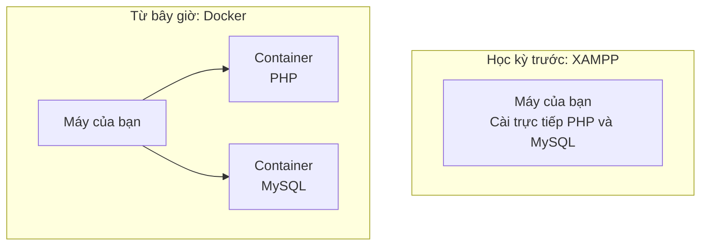

Container có những đặc điểm sau.

| Đặc điểm | Nghĩa là sao? |
|------|--------------|
| **Mỗi phòng tách biệt nhau** | Các container không ảnh hưởng lẫn nhau. Có thể chạy cùng lúc PHP phiên bản cũ và phiên bản mới |
| **Không làm "bẩn" máy tính** | Không có gì được cài vào máy tính cả |
| **Tạo nhanh, xóa nhanh** | Khởi động chỉ trong vài giây. Khi không cần nữa thì xóa đi, rồi tạo lại là được |
| **Máy của ai cũng có nội dung giống nhau** | Nếu tạo từ cùng một bản thiết kế, máy của mọi người sẽ có môi trường giống nhau |

Phần mềm dùng để tạo và chạy các container này chính là **Docker**.

---

## 1. Vì sao dùng Docker?

Ở học kỳ trước, để chạy ứng dụng, chúng ta đã cài XAMPP để có PHP và MySQL.
Nhưng những chuyện như thế này rất hay xảy ra.

```
Bạn A: "Trên máy mình thì chạy được mà…"
Bạn B: "Hình như phiên bản PHP khác nhau"
Bạn C: "Mình chỉnh cài đặt XAMPP xong thì không chạy nữa"
```

Khi dùng **Docker**, môi trường để chạy ứng dụng (PHP, MySQL...) được đặt vào **container** (căn phòng chuyên dụng), nên có thể chạy giống nhau trên bất kỳ máy nào.


- Dù làm hỏng môi trường, chỉ cần tạo lại container là trở lại như cũ ngay
- Chỉ cần chia sẻ file cấu hình, cả nhóm đều có thể chuẩn bị cùng một môi trường

---

## 2. Docker, image và container

Hãy ghi nhớ các thuật ngữ đầu tiên bằng cách liên hệ chúng với việc nấu ăn.

| Tên | Là gì? | Ví dụ dễ hiểu |
|------|-----------|-----------|
| **Image** | Bản thiết kế của môi trường | Công thức nấu ăn |
| **Container** | Môi trường hoạt động thực tế, được tạo từ image | Món ăn nấu theo công thức |
| **Docker Desktop** | Ứng dụng để dùng Docker trên Windows | Căn bếp |
| **Docker Hub** | Trang web công khai các image | Sách công thức nấu ăn |

Từ một image (công thức), bạn có thể tạo bao nhiêu container (món ăn) cũng được.

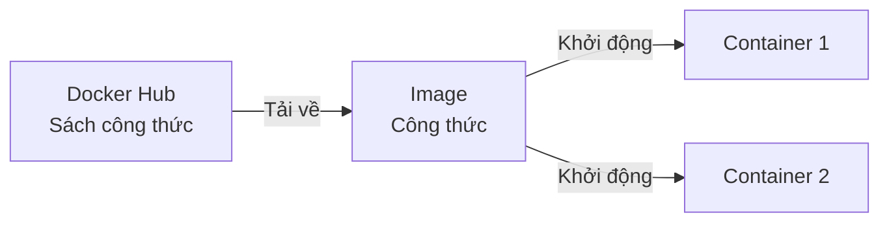

> **Xóa container có sao không?**
> Container luôn có thể tạo lại từ image (công thức), nên nếu bị hỏng thì cứ xóa đi và tạo lại là được.
> Tuy nhiên, **dữ liệu được tạo bên trong container cũng sẽ bị xóa khi bạn xóa container.** Cách giữ lại dữ liệu sẽ được học ở các buổi sau.

---

## 3. Quy trình cài đặt

Hôm nay chúng ta sẽ làm theo thứ tự sau.

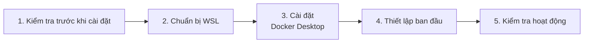

---

## 4. Kiểm tra trước khi cài đặt

Trước khi cài Docker Desktop, hãy kiểm tra xem máy tính có đáp ứng các điều kiện sau không.

| Cần kiểm tra | Điều kiện |
|------------|------|
| Phiên bản Windows | Windows 10 (22H2) hoặc Windows 11 |
| Ảo hóa | Đã được **bật** |
| Tài khoản | Người dùng có **quyền quản trị (administrator)** |

### Kiểm tra ảo hóa đã được bật chưa

Docker dùng chức năng **ảo hóa (virtualization)**, tức là chạy thêm một máy tính nhỏ khác bên trong máy tính.

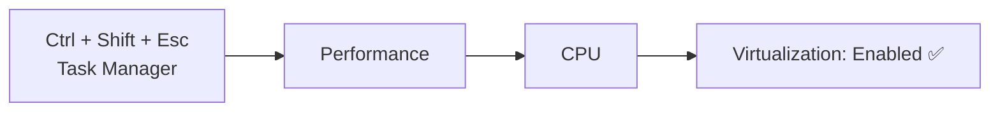

Nếu danh sách ở góc dưới bên phải hiển thị **"Virtualization: Enabled"** (仮想化：有効) là OK.

> **Nếu đang là "Disabled" (無効)**
> Cần bật nó trong BIOS (màn hình cài đặt khi khởi động máy). Cách thao tác khác nhau tùy hãng máy tính, nên hãy gọi giáo viên.

---

## 5. Chuẩn bị WSL

**WSL** (Windows Subsystem for Linux) là cơ chế chạy Linux bên trong Windows.
Docker Desktop chạy trên nền WSL này.

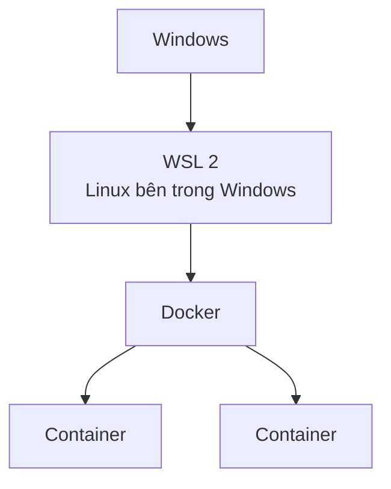

Tìm "PowerShell" trong menu Start, rồi mở bằng **chuột phải → "Run as administrator"**.

```powershell
wsl --install
```

Nếu đã cài sẵn rồi thì hãy cập nhật lên bản mới nhất.

```powershell
wsl --update
```

Xong rồi thì **khởi động lại máy tính**.

✅ Sau khi khởi động lại, chạy lệnh sau trong PowerShell, nếu hiển thị `既定のバージョン: 2` là OK.

```powershell
wsl --status
```

> **Nếu `wsl --install` hỏi tên người dùng Ubuntu**
> Đây là bước thiết lập ban đầu của Ubuntu (một loại Linux). Hãy tự đặt tên người dùng bằng chữ thường tiếng Anh và mật khẩu rồi nhập vào.
> Khi nhập mật khẩu, màn hình sẽ không hiển thị gì cả, nhưng thực ra vẫn đang được nhập.

---

## 6. Cài đặt Docker Desktop

Tải trình cài đặt từ trang web chính thức rồi chạy nó.

**Trang tải về:** https://www.docker.com/products/docker-desktop/

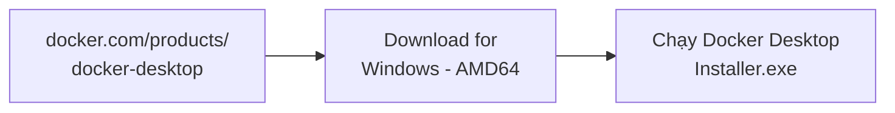

> **Sự khác nhau giữa ARM64 và AMD64**
> Đây là loại CPU của máy tính. Hầu hết máy tính Windows đều là **AMD64** (x86_64).
> Chỉ những máy dùng CPU kiểu điện thoại như Snapdragon mới chọn ARM64.

Trong lúc cài đặt, bạn sẽ được hỏi về thiết lập.

| Câu hỏi | Lựa chọn |
|------------|---------|
| Use WSL 2 instead of Hyper-V | **Bật** (chạy trên nền WSL) |
| Add shortcut to desktop | Bật (tạo biểu tượng trên Desktop) |

Nhấn `OK` là quá trình cài đặt bắt đầu.
Khi `Close and restart` (hoặc `Close`) hiện ra, hãy **khởi động lại máy tính**.

---

## 7. Thiết lập ban đầu

Sau khi khởi động lại, nhấp đúp vào biểu tượng **Docker Desktop** trên Desktop để mở.

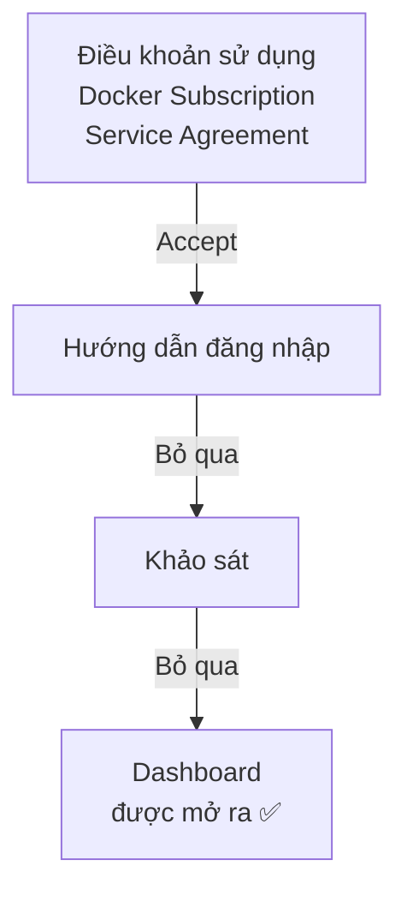

| Màn hình | Lựa chọn |
|------|---------|
| Điều khoản sử dụng (Subscription Service Agreement) | `Accept` |
| Đăng nhập (Sign in / Sign up) | `Skip` (hôm nay dùng mà không cần tài khoản) |
| Khảo sát (Welcome Survey) | `Skip` |

> Sử dụng cho mục đích học tập hoặc cá nhân thì miễn phí.

> Chữ trên màn hình có thể hơi khác tùy phiên bản. Nếu phân vân, hãy hỏi giáo viên.

### Kiểm tra Docker đã khởi động chưa

Nếu góc dưới bên trái màn hình hiển thị **Engine running** (màu xanh lá) là Docker đang chạy.
Bạn cũng có thể kiểm tra bằng **biểu tượng cá voi** 🐳 trên thanh tác vụ ở góc dưới bên phải màn hình (bên trong `^`).

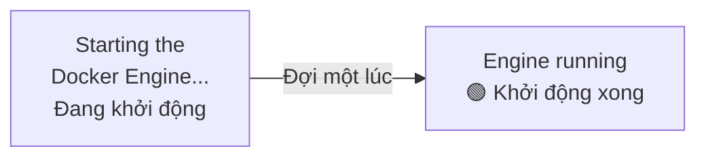

**Nếu Docker Desktop chưa được khởi động thì không dùng được Docker.**
Mỗi khi khởi động lại máy tính, hãy mở Docker Desktop trước tiên.

---

## 8. Kiểm tra hoạt động

Mở PowerShell (không cần quyền quản trị) và kiểm tra phiên bản Docker.

```powershell
docker --version
```

```
Docker version 28.x.x, build xxxxxxx
```

Nếu hiển thị như trên là OK (con số có thể khác nhau tùy người).

Tiếp theo, hãy thử chạy image luyện tập **hello-world**.

```powershell
docker run hello-world
```

Chỉ với một lệnh này, Docker đã làm những việc sau.

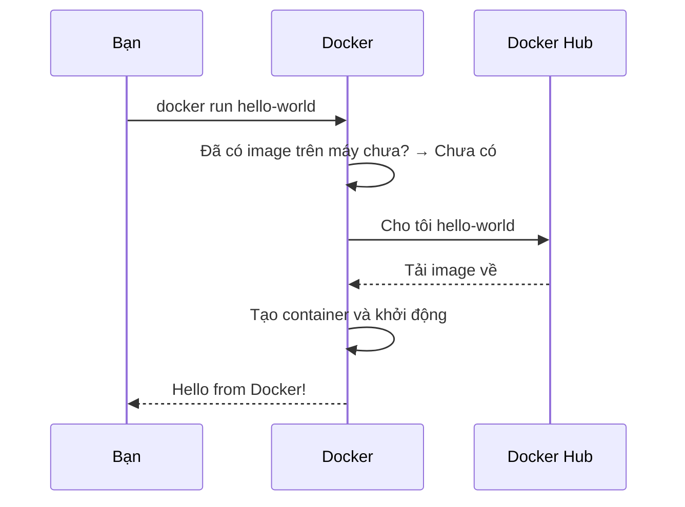

✅ Nếu hiển thị thông báo sau là cài đặt thành công.

```
Hello from Docker!
This message shows that your installation appears to be working correctly.
```

Khi chạy lại `docker run hello-world` lần nữa, lần này nó sẽ chạy ngay mà không cần tải về.
Đó là vì image (công thức) đã có sẵn trên máy.

Khi mở `Containers` ở bên trái Docker Desktop, bạn sẽ thấy container vừa chạy.

---

## 9. Khởi động môi trường luyện tập

Hãy thử chạy môi trường luyện tập đã push ở [Tài liệu 2](./20261008_資料_2.md) bằng Docker.
**Nhất định phải khởi động theo thứ tự mysql → laravel**.

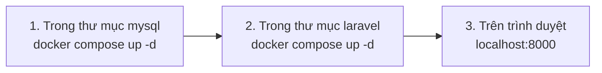

Sau khi khởi động, 2 container sẽ kết nối và hoạt động như sau.
Vì container laravel dùng container mysql, nên cần khởi động mysql trước.

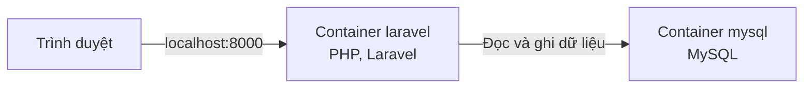

```powershell
cd C:\Users\<ユーザー名>\Desktop\php-study\mysql
docker compose up -d
```

```powershell
cd C:\Users\<ユーザー名>\Desktop\php-study\laravel
docker compose up -d
```

**Chỉ lần đầu tiên**, việc cài đặt Laravel sẽ mất vài phút.
Bạn có thể xem tiến độ bằng `docker compose logs -f` (nhấn `Ctrl + C` để dừng xem).
Khi hiển thị `Server running on [http://0.0.0.0:8000]` là đã sẵn sàng.

✅ Mở http://localhost:8000 trên trình duyệt, nếu màn hình sau hiện ra là OK.


---

## 10. Khi gặp sự cố

| Triệu chứng | Cách xử lý |
|------|------|
| Bị báo không tìm thấy `docker` | Kiểm tra Docker Desktop đã khởi động chưa → mở lại PowerShell |
| Cứ ở trạng thái `Engine stopped` mà không chạy | Thoát Docker Desktop rồi mở lại → nếu không được thì khởi động lại máy tính |
| Bị báo WSL đã cũ (WSL update failed...) | Chạy `wsl --update` trong PowerShell quyền quản trị → khởi động lại máy tính |
| Bị báo ảo hóa chưa bật (Virtualization support not detected) | Xem [4. Kiểm tra trước khi cài đặt](#4-kiểm-tra-trước-khi-cài-đặt) → gọi giáo viên |
| Hiển thị `error during connect` | Docker Engine vẫn đang khởi động. Hãy đợi đến khi góc dưới bên trái chuyển thành `Engine running` |

---

## 11. Tổng kết

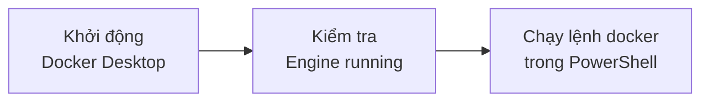

- **Image** là bản thiết kế, **container** là môi trường hoạt động thực tế được tạo ra từ image
- Trước khi dùng Docker, hãy **khởi động Docker Desktop**
- Với `docker run <イメージ名>`, Docker sẽ làm tất cả, từ tải image về đến khởi động container

Buổi sau, chúng ta sẽ dùng Docker để tạo môi trường PHP và MySQL.

<!-- nav:start -->

---

| ⬅️ Trước | 🗺️ Sơ đồ tổng quan | Tiếp ➡️ |
|:--|:--:|--:|
| [10/08 Push môi trường luyện tập](20261008_資料_2.md) | [Sơ đồ tổng quan tài liệu](../../README.md) | [10/15 Cơ chế MVC](../20261015/20261015_資料_1.md) |

<!-- nav:end -->
