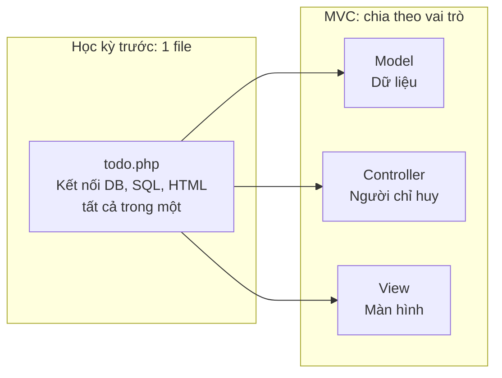
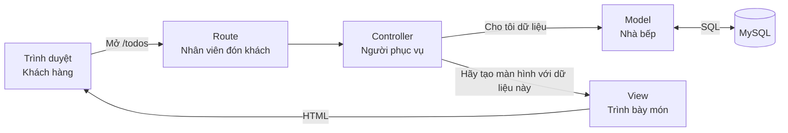
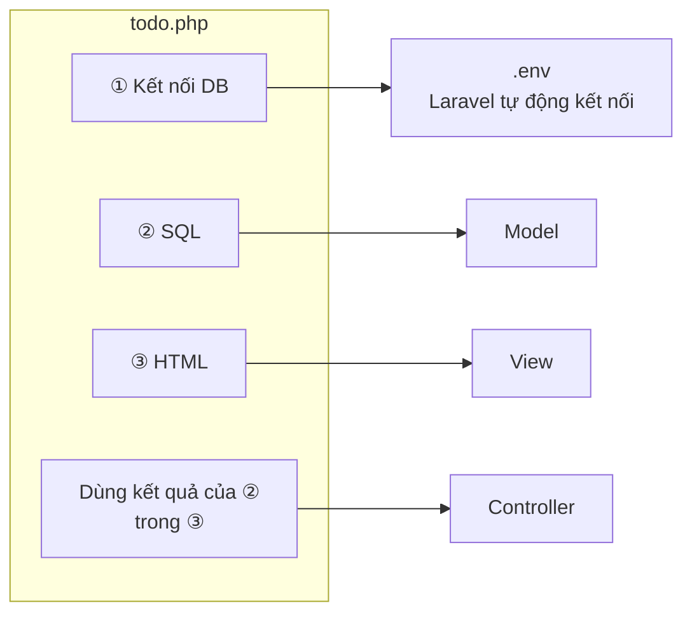
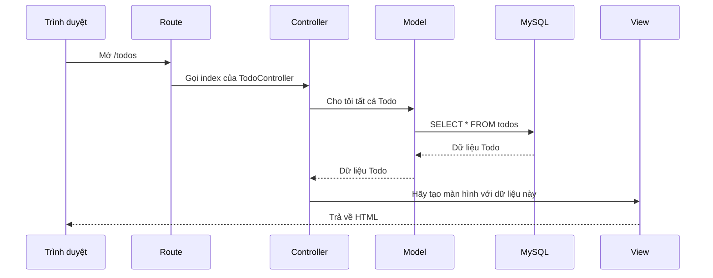
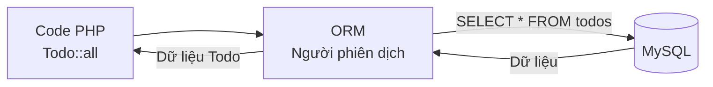
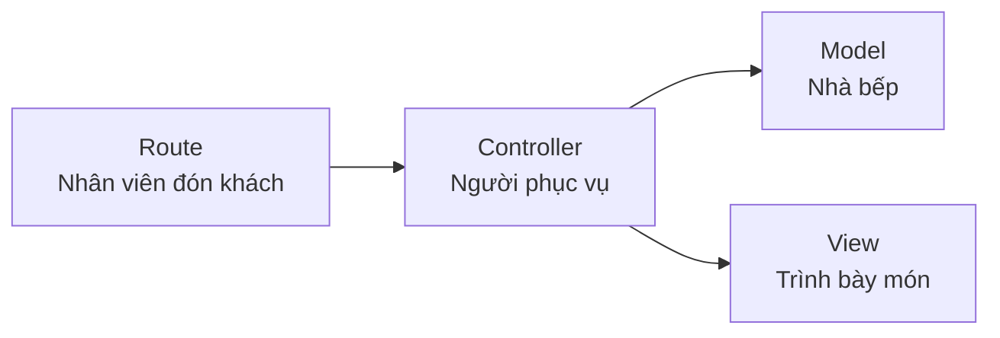

# Nhập môn Laravel — Cơ chế MVC

> 🇯🇵 Bản gốc (tiếng Nhật): [20261015_資料_1.md](<../../../1年生_データ設計とアプリ開発/後期/20261015/20261015_資料_1.md>) <!-- original-ja-link -->

## Mục tiêu hôm nay
- Hiểu vai trò của MVC (Model, View, Controller)
- Hiểu rằng trong Laravel, request đi theo luồng "Route → Controller → Model → View"
- Hiểu rằng khi dùng ORM, có thể đọc và ghi dữ liệu mà không cần viết SQL

---

## 1. Nhìn lại todo.php của học kỳ trước

Trong học kỳ trước, chúng ta đã viết **toàn bộ mã trong một file** `todo.php`.
Nếu chỉ lấy riêng phần hiển thị danh sách, nó trông như thế này.

```php
<?php
// ① Kết nối đến cơ sở dữ liệu
$pdo = new PDO('mysql:host=127.0.0.1;dbname=school_db;charset=utf8mb4', 'root', '');

// ② Lấy Todo bằng SQL
$stmt = $pdo->query("SELECT * FROM todos ORDER BY created_at DESC");
$todos = $stmt->fetchAll(PDO::FETCH_ASSOC);
?>
<!-- ③ Tạo màn hình bằng HTML -->
<ul>
<?php foreach ($todos as $todo): ?>
    <li><?= htmlspecialchars($todo['title']) ?></li>
<?php endforeach; ?>
</ul>
```

Với ứng dụng nhỏ thì như vậy vẫn chạy được.
Nhưng khi ứng dụng lớn dần, những chuyện như thế này sẽ xảy ra.

```
Bạn A: "Mình chỉ muốn sửa giao diện thôi, mà SQL lẫn vào nên khó đọc quá…"
Bạn B: "Mình lỡ copy cùng một câu SELECT vào nhiều file khác nhau"
Bạn C: "Mình không biết phải sửa chỗ nào"
```

Vì vậy, **MVC** là cách tổ chức mã bằng cách **chia file theo từng vai trò**.



---

## 2. MVC là gì

MVC là cách tổ chức ứng dụng thành 3 phần theo vai trò. Hãy liên hệ với một nhà hàng để dễ ghi nhớ.

| Tên | Vai trò | Nếu so với nhà hàng |
|------|------|------------------|
| **M**odel | Đọc và ghi dữ liệu trong cơ sở dữ liệu | Nhà bếp (lấy nguyên liệu ra) |
| **V**iew | Tạo màn hình (HTML) | Trình bày món ăn (bày lên đĩa cho khách xem) |
| **C**ontroller | Nhận yêu cầu, rồi ra chỉ thị cho Model và View | Người phục vụ (kết nối nhà bếp và người trình bày món) |

Trong Laravel, ngoài 3 vai trò này còn có thêm **Route** (URL nào sẽ do controller nào phụ trách).
Route chính là **nhân viên đón khách ở cửa** của nhà hàng.



Điểm quan trọng là **Controller đứng ở giữa và ra chỉ thị cho mọi người**.
View không tự lấy dữ liệu từ Model mà nhận dữ liệu từ Controller.

### todo.php của học kỳ trước sẽ đi đâu?

Các phần ①〜③ trong `todo.php` ở trên sẽ được chia ra trong MVC như sau.



| Phần trong todo.php | Chuyển đến | Vị trí đặt file |
|---------------|-------|---------|
| ① Kết nối đến cơ sở dữ liệu | Laravel tự động làm giúp | `.env` (file cấu hình) |
| ② Lấy Todo bằng SQL | **Model** | `app/Models/Todo.php` |
| ③ Tạo màn hình bằng HTML | **View** | `resources/views/todos/index.blade.php` |
| Đưa kết quả của ② cho ③ | **Controller** | `app/Http/Controllers/TodoController.php` |
| Chạy xử lý này ở URL nào | **Route** | `routes/web.php` |

---

## 3. Luồng xử lý request

Khi mở `http://localhost:8000/todos` trên trình duyệt, bên trong Laravel sẽ xử lý theo thứ tự sau.



Nếu so với nhà hàng, luồng sẽ như sau.

1. Khách đến nhà hàng (mở `/todos` trên trình duyệt)
2. Nhân viên đón khách dẫn khách đến người phục vụ phụ trách (Route → Controller)
3. Người phục vụ nhờ nhà bếp chuẩn bị nguyên liệu (Controller → Model)
4. Nhà bếp lấy nguyên liệu từ kho ra (Model → MySQL)
5. Người phục vụ đưa nguyên liệu cho người trình bày món (Controller → View)
6. Món ăn được mang ra cho khách (HTML được trả về trình duyệt)

---

## 4. Cơ chế ORM

### ORM là gì

Ở học kỳ trước, chúng ta **tự viết câu lệnh SQL** như `SELECT * FROM todos`.
Trong Laravel, chỉ cần dùng Model và viết `Todo::all()` là lấy được dữ liệu.

Đó là nhờ cơ chế gọi là **ORM** (Object-Relational Mapping).
ORM sẽ **tự động dịch code PHP sang SQL** rồi gửi đến MySQL.
ORM của Laravel có tên là **Eloquent**.



Nếu so với nhà hàng, hãy hình dung trong nhà bếp (Model) có một **người phiên dịch (ORM)**, chuyển yêu cầu "Cho tôi tất cả Todo" của người phục vụ thành ngôn ngữ mà kho (MySQL) đọc được (SQL).

### So sánh với SQL của học kỳ trước

| Việc muốn làm | Học kỳ trước (viết SQL) | Laravel (Eloquent) |
|------------|-----------------|-------------------|
| Lấy tất cả | `SELECT * FROM todos` | `Todo::all()` |
| Lấy bản ghi có id là 1 | `SELECT * FROM todos WHERE id = 1` | `Todo::find(1)` |
| Chỉ lấy những việc chưa xong | `SELECT * FROM todos WHERE is_done = 0` | `Todo::where('is_done', 0)->get()` |

Hôm nay, bạn chỉ cần hiểu rằng có thể viết như thế này mà không cần viết SQL.

### Vậy học SQL có bị phí công không?

**Không hề.** ORM vẫn tạo SQL ở phía sau rồi gửi đến MySQL.
Khi chương trình không chạy như ý, hoặc khi muốn lấy dữ liệu phức tạp, kiến thức SQL đã học ở học kỳ trước sẽ rất hữu ích.

---

## 5. Tổng kết



| Vai trò | Nói ngắn gọn |
|------|-----------|
| **Route** | Quyết định URL nào do controller nào phụ trách |
| **Controller** | Nhận dữ liệu từ Model rồi đưa cho View |
| **Model** | Đọc và ghi dữ liệu trong cơ sở dữ liệu (ORM sẽ dịch sang SQL giúp bạn) |
| **View** | Tạo màn hình (HTML) |

Vì file được chia theo từng vai trò, bạn sẽ **biết ngay cần sửa ở đâu**: "muốn sửa màn hình thì sửa View", "muốn sửa cách lấy dữ liệu thì sửa Model".

Tiếp theo, chúng ta sẽ thực hành chia ứng dụng theo MVC để tạo trang danh sách Todo → [Cùng tạo danh sách Todo](./20261015_資料_2.md)

<!-- nav:start -->

---

| ⬅️ Trước | 🗺️ Sơ đồ tổng quan | Tiếp ➡️ |
|:--|:--:|--:|
| [10/08 Nhập môn Docker](../20261008/20261008_資料_3.md) | [Sơ đồ tổng quan tài liệu](../../README.md) | [10/15 Danh sách Todo](20261015_資料_2.md) |

<!-- nav:end -->
