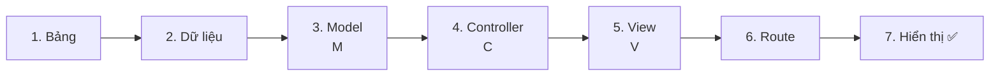
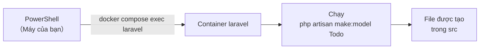
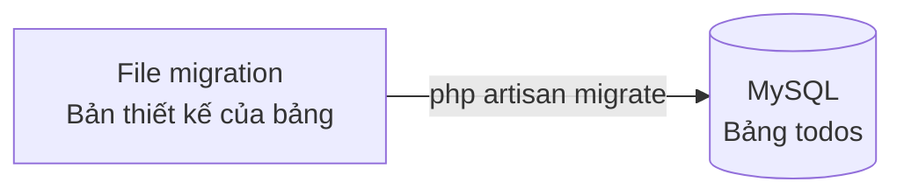
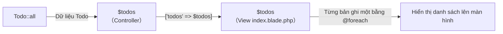
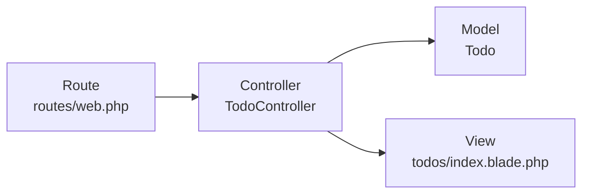

# Nhập môn Laravel — Cùng tạo danh sách Todo

> 🇯🇵 Bản gốc (tiếng Nhật): [20261015_資料_2.md](<../../../1年生_データ設計とアプリ開発/後期/20261015/20261015_資料_2.md>) <!-- original-ja-link -->

Chúng ta sẽ vận dụng những gì đã học ở [Cơ chế MVC](./20261015_資料_1.md) để tạo trang danh sách Todo.

## Mục tiêu hôm nay
- Có thể tạo trang danh sách Todo bằng cách chia theo MVC
- Biết cần viết migration, Model, Controller, View và Route ở đâu

> Hãy khởi động mysql và laravel của môi trường luyện tập (`php-study`) trước khi bắt đầu.
> Cách khởi động được viết trong `README.md` của thư mục `php-study`.

Chúng ta sẽ dùng bảng `todos` giống học kỳ trước để tạo trang danh sách Todo.
Các file sẽ được tạo trong `php-study\laravel\src`.

---

## 1. Thứ tự thực hiện

Ngược với **thứ tự chạy** (Route → Controller → Model → View), chúng ta sẽ làm **từ phía dữ liệu** trước.
Vì nếu không có nguyên liệu (bảng và dữ liệu) thì không thể nấu món ăn (màn hình).



---

## 2. Cách đọc lệnh

Hôm nay chúng ta sẽ dùng các lệnh như sau nhiều lần.
Các lệnh này được chạy trong PowerShell sau khi di chuyển đến **thư mục laravel**.

```powershell
cd C:\Users\<ユーザー名>\Desktop\php-study\laravel
```

```powershell
docker compose exec laravel php artisan make:model Todo
```

Trông có vẻ dài, nhưng thật ra được chia làm 2 phần.

| Phần | Ý nghĩa |
|------|------|
| `docker compose exec laravel` | "Hãy chạy lệnh tiếp theo bên trong container laravel" |
| `php artisan make:model Todo` | "Hãy tạo Model có tên là Todo" |

Hãy hình dung là bạn gửi lệnh từ PowerShell trên máy của mình vào bên trong container để chạy.
Các file được tạo bên trong container sẽ xuất hiện trong thư mục `src` trên máy của bạn.



**artisan** là **lệnh trợ giúp** đi kèm với Laravel.
Với `make:〇〇`, nó sẽ tự động tạo khung mẫu (template) cho file.

---

## 3. Cùng làm thử

Hôm nay có 5 file cần tạo hoặc sửa (bên trong `src`).

```
src/
├─ routes/
│   └─ web.php ······························ 6. Route (viết thêm)
├─ app/
│   ├─ Http/Controllers/
│   │   └─ TodoController.php ··············· 4. Controller
│   └─ Models/
│       └─ Todo.php ························· 3. Model
├─ resources/views/
│   └─ todos/
│       └─ index.blade.php ·················· 5. View
└─ database/migrations/
    └─ 2026_10_15_xxxxxx_create_todos_table.php ··· 1. Bảng
```

### 1. Tạo bảng (migration)

> Đang ở đây: **🟢 1. Bảng** → 2. Dữ liệu → 3. Model → 4. Controller → 5. View → 6. Route → 7. Hiển thị

**Migration** là file viết bản thiết kế của bảng bằng PHP.
Ở học kỳ trước, chúng ta tạo bảng bằng `CREATE TABLE` của SQL, còn trong Laravel thì tạo bảng từ file này.

Tạo file migration bằng lệnh sau.

```powershell
docker compose exec laravel php artisan make:migration create_todos_table
```

Nếu đặt tên là `create_〇〇_table`, Laravel sẽ đọc ra tên bảng `todos` và tạo khung mẫu giúp bạn.

Trong `database/migrations/` sẽ xuất hiện một **file có kèm ngày tháng**, ví dụ `2026_10_15_123456_create_todos_table.php`.
Mở file đó ra và sửa phần bên trong `up()` như sau.

```php
public function up(): void
{
    Schema::create('todos', function (Blueprint $table) {
        $table->id();
        $table->string('title');
        $table->boolean('is_done')->default(false);
        $table->timestamps();
    });
}
```

Hãy so sánh với `CREATE TABLE` của học kỳ trước. Cùng một nội dung, nhưng được viết bằng PHP.

| SQL của học kỳ trước | Migration |
|----------|----------------|
| `id INT AUTO_INCREMENT PRIMARY KEY` | `$table->id();` (chính xác hơn thì sẽ là `BIGINT UNSIGNED`, chứa được số lớn hơn INT) |
| `title VARCHAR(255) NOT NULL` | `$table->string('title');` |
| `is_done TINYINT(1) NOT NULL DEFAULT 0` | `$table->boolean('is_done')->default(false);` |
| `created_at TIMESTAMP ...` | `$table->timestamps();` (tạo ra 2 cột `created_at` và `updated_at`. Giá trị do Laravel tự động điền) |

Sau khi lưu, hãy chạy migration để tạo bảng.

Trước đó, hãy kiểm tra rằng **bảng `todos` vẫn chưa tồn tại**.
Chỉ viết file thôi thì bảng vẫn chưa được tạo.

👀 **Xem trước khi chạy**: Trong phpMyAdmin (http://localhost:8080), mở cơ sở dữ liệu `laravel` từ danh sách bên trái.
Hãy kiểm tra rằng trong danh sách bảng **vẫn chưa có** `todos`.



```powershell
docker compose exec laravel php artisan migrate
```

✅ **Kiểm tra**: Nếu bảng `todos` đã xuất hiện trong cơ sở dữ liệu `laravel` của phpMyAdmin (http://localhost:8080) là OK.

---

### 2. Nhập dữ liệu

> Đang ở đây: 1. Bảng → **🟢 2. Dữ liệu** → 3. Model → 4. Controller → 5. View → 6. Route → 7. Hiển thị

Mở bảng `todos` trong phpMyAdmin, rồi nhập 2〜3 Todo từ `挿入` (Insert).
Các cột `id`, `created_at`, `updated_at` cứ để trống là được.

| title | is_done |
|-------|---------|
| 牛乳を買う | 0 |
| レポートを出す | 1 |

✅ **Kiểm tra**: Nếu thấy dữ liệu vừa nhập ở tab `表示` (Browse) là OK.

---

### 3. Tạo Model (M)

> Đang ở đây: 1. Bảng → 2. Dữ liệu → **🟢 3. Model** → 4. Controller → 5. View → 6. Route → 7. Hiển thị

Bảng đã có, giờ hãy tạo **Model** (nhà bếp) để đọc và ghi dữ liệu của bảng đó.

```powershell
docker compose exec laravel php artisan make:model Todo
```

File `app/Models/Todo.php` sẽ được tạo. Mở ra xem thì gần như chẳng có gì được viết cả.

```php
class Todo extends Model
{
    //
}
```

**Như vậy là xong rồi. Không cần viết thêm gì cả.**
Laravel tự động xác định **tên bảng `todos`** từ tên Model `Todo`, nên chỉ cần như vậy là đã đọc và ghi được dữ liệu.

| Tên Model (số ít, bắt đầu bằng chữ hoa) | Tên bảng (số nhiều, chữ thường) |
|------------------|------------------|
| `Todo` | `todos` |
| `User` | `users` |

Khi dùng Model, bạn có thể đọc và ghi dữ liệu **mà không cần tự viết câu lệnh SQL**.
Đó là nhờ cơ chế gọi là **ORM** → [Cơ chế ORM](./20261015_資料_1.md#4-cơ-chế-orm)

> **Thêm `-m` để tạo cùng lúc**
> Nếu viết `php artisan make:model Todo -m`, bạn có thể tạo Model và migration chỉ trong 1 lần.
> Hôm nay, để hiểu rõ từng vai trò, chúng ta đã tạo riêng từng cái.

---

### 4. Tạo Controller (C)

> Đang ở đây: 1. Bảng → 2. Dữ liệu → 3. Model → **🟢 4. Controller** → 5. View → 6. Route → 7. Hiển thị

Tạo **Controller** (người phục vụ) để kết nối Model (nhà bếp) và View (trình bày món).

```powershell
docker compose exec laravel php artisan make:controller TodoController
```

File `app/Http/Controllers/TodoController.php` sẽ được tạo, hãy sửa nội dung bên trong như sau.

```php
<?php

namespace App\Http\Controllers;

use App\Models\Todo;  // ← Dòng này để dùng Model Todo

class TodoController extends Controller
{
    public function index()
    {
        // ① Nhờ Model: "Cho tôi tất cả Todo"
        $todos = Todo::all();

        // ② Nhờ View: "Hãy tạo màn hình với dữ liệu này"
        return view('todos.index', ['todos' => $todos]);
    }
}
```

| Code | Ý nghĩa |
|--------|------|
| `Todo::all()` | Giống với `SELECT * FROM todos`. Không cần viết SQL |
| `view('todos.index', ...)` | Dùng `resources/views/todos/index.blade.php` để tạo màn hình (`.` là dấu phân cách thư mục) |
| `['todos' => $todos]` | Cho phép dùng dữ liệu với tên `$todos` bên trong View |

Dữ liệu được truyền từ Controller sang View như sau.



So với `todo.php` của học kỳ trước, 2 dòng ở phần ② đã trở thành 1 dòng `Todo::all()`.

```php
// Học kỳ trước
$stmt = $pdo->query("SELECT * FROM todos");
$todos = $stmt->fetchAll(PDO::FETCH_ASSOC);

// Laravel
$todos = Todo::all();
```

---

### 5. Tạo View (V)

> Đang ở đây: 1. Bảng → 2. Dữ liệu → 3. Model → 4. Controller → **🟢 5. View** → 6. Route → 7. Hiển thị

Tạo **View** (trình bày món) để tạo màn hình. View không tạo bằng lệnh mà bạn tự tạo file.

1. Tạo thư mục `todos` bên trong `resources/views`
2. Tạo file tên `index.blade.php` bên trong thư mục `todos`

```
resources/views/
  └─ todos/
       └─ index.blade.php   ← Viết vào đây
```

```html
<!DOCTYPE html>
<html lang="ja">
<head>
    <meta charset="UTF-8">
    <title>TODOアプリ</title>
</head>
<body>
    <h1>TODOアプリ</h1>

    <ul>
        @foreach ($todos as $todo)
            <li>
                <input type="checkbox" @checked($todo->is_done)>
                {{ $todo->title }}
            </li>
        @endforeach
    </ul>
</body>
</html>
```

**Blade** là cách viết HTML của Laravel. Có thể viết ngắn hơn PHP của học kỳ trước.

| Blade | Nếu viết bằng PHP của học kỳ trước |
|-------|-----------------|
| `{{ $todo->title }}` | `<?= htmlspecialchars($todo['title']) ?>` |
| `@foreach (...)` 〜 `@endforeach` | `<?php foreach (...): ?>` 〜 `<?php endforeach; ?>` |
| `@checked($todo->is_done)` | `<?= $todo['is_done'] ? 'checked' : '' ?>` |

- `{{ }}` tự động thực hiện `htmlspecialchars` nên rất an toàn
- Ở học kỳ trước là `$todo['title']`, còn dữ liệu của Model thì lấy ra bằng **`$todo->title`** (dấu mũi tên)
- `@checked(...)` chỉ thêm `checked` vào checkbox khi giá trị trong `( )` là đã hoàn thành (`1`)
- Có thể nhấn vào checkbox, nhưng hôm nay **trạng thái của nó vẫn chưa được lưu vào cơ sở dữ liệu** (khi tải lại trang, trạng thái sẽ trở về như cũ). Chúng ta sẽ làm chức năng lưu trạng thái khi nhấn vào ngày 10/29

---

### 6. Viết Route

> Đang ở đây: 1. Bảng → 2. Dữ liệu → 3. Model → 4. Controller → 5. View → **🟢 6. Route** → 7. Hiển thị

Cuối cùng, hãy chỉ cho **Route** (nhân viên đón khách) biết "khi mở `/todos` thì chạy controller nào".

Mở `routes/web.php` và viết thêm 2 dòng có dấu ★.

```php
<?php

use Illuminate\Support\Facades\Route;
use App\Http\Controllers\TodoController;  // ★ Thêm vào (viết ở phía trên)

Route::get('/', function () {
    return view('welcome');
});

Route::get('/todos', [TodoController::class, 'index']);  // ★ Thêm vào (viết ở dưới cùng)
```

`Route::get('/todos', [TodoController::class, 'index']);` có nghĩa như sau.

```
Route::get( '/todos' ,  [TodoController::class, 'index'] );
             ~~~~~~~     ~~~~~~~~~~~~~~~~~~~~~  ~~~~~~~
             Khi mở      thì TodoController     dùng index để xử lý
             URL này
```

---

### 7. Hiển thị ✅

> Đang ở đây: 1. Bảng → 2. Dữ liệu → 3. Model → 4. Controller → 5. View → 6. Route → **🟢 7. Hiển thị**

Mở http://localhost:8000/todos trên trình duyệt.
Nếu các Todo đã nhập bằng phpMyAdmin được hiển thị thành danh sách là thành công.

```
TODOアプリ

☐ 牛乳を買う
☑ レポートを出す
```

Các Todo đã hoàn thành (`is_done` là `1`) sẽ được đánh dấu tích.

✅ **Kiểm tra**: Hãy thử thêm 1 Todo trong phpMyAdmin rồi tải lại trình duyệt. Nếu Todo vừa thêm xuất hiện, nghĩa là dữ liệu đã được lấy đúng từ cơ sở dữ liệu.

---

## 4. Khi gặp sự cố

Đọc dòng tiếng Anh ở trên cùng của màn hình lỗi, bạn sẽ biết chỗ nào bị sai.

| Triệu chứng | Nơi gây lỗi | Cách xử lý |
|------|----------|------|
| `404 Not Found` | Route | Kiểm tra đã viết route trong `routes/web.php` chưa, và URL có phải là `/todos` không |
| `Target class [TodoController] does not exist` | Route | Kiểm tra ở đầu file `web.php` đã có `use App\Http\Controllers\TodoController;` chưa |
| `Class "App\Http\Controllers\Todo" not found` | Controller | Kiểm tra ở đầu file `TodoController.php` đã có `use App\Models\Todo;` chưa |
| `View [todos.index] not found` | View | Kiểm tra vị trí file có đúng là `resources/views/todos/index.blade.php` không (phải có cả `.blade.php`) |
| `Table 'laravel.todos' doesn't exist` | Bảng | Kiểm tra đã chạy `php artisan migrate` chưa |
| Danh sách không hiện gì | Dữ liệu | Kiểm tra trong phpMyAdmin xem bảng `todos` đã có dữ liệu chưa |

---

## 5. Tổng kết



| Vai trò | Những gì đã viết hôm nay | Nói ngắn gọn |
|------|--------------|-----------|
| **Route** | `Route::get('/todos', ...)` | Quyết định URL nào do controller nào phụ trách |
| **Controller** | `index()` của `TodoController` | Nhận dữ liệu từ Model rồi đưa cho View |
| **Model** | `Todo` (`Todo::all()`) | Đọc và ghi dữ liệu trong cơ sở dữ liệu |
| **View** | `todos/index.blade.php` | Tạo màn hình (viết bằng Blade) |

Vì file được chia theo từng vai trò, bạn sẽ **biết ngay cần sửa ở đâu**.

<!-- nav:start -->

---

| ⬅️ Trước | 🗺️ Sơ đồ tổng quan | Tiếp ➡️ |
|:--|:--:|--:|
| [10/15 Cơ chế MVC](20261015_資料_1.md) | [Sơ đồ tổng quan tài liệu](../../README.md) | [10/22 Thêm Todo (CREATE)](../20261022/20261022_資料_1.md) |

<!-- nav:end -->
